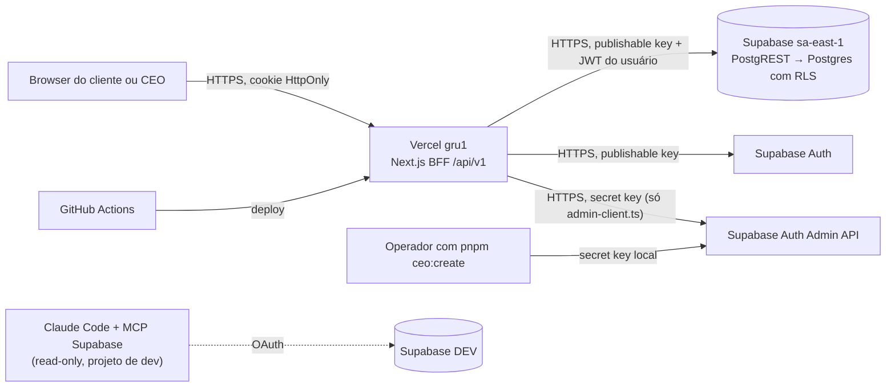

# Threat model — Rastreador de entregas (backend + banco)

> **Data:** 2026-11-15 · **Escopo:** API `/api/v1`, Supabase (Auth + Postgres), CI/CD e ferramentas
> de desenvolvimento · **Spec:** [`docs/specs/client-delivery-tracker.md`](../specs/client-delivery-tracker.md)
>
> Os controles citados (SEC-xx) estão definidos em §2.3 da spec. Atualize este documento sempre
> que a superfície de ataque mudar (rota nova, integração nova, papel novo).

## 1. Ativos

| Ativo | Por que importa |
|-------|-----------------|
| Dados de processo de cada cliente | Confidencialidade entre clientes concorrentes (vazamento cross-tenant é o pior cenário) |
| Contas de CEO | Uma conta de CEO lê tudo e avança processos de qualquer cliente |
| Integridade do fluxo de fases | Um "Ok" indevido muda o que o cliente vê e o que foi contratado |
| Trilha de auditoria | Prova de quem aprovou o quê (não repúdio) |
| `SUPABASE_SECRET_KEY` | Ignora RLS: comprometimento total do banco e do Auth |
| Dados pessoais (nome e e-mail) | LGPD |

## 2. Fronteiras de confiança e fluxo de dados

| Fronteira | Ameaça principal |
|-----------|------------------|
| Browser → BFF | Usuário malicioso autenticado (cliente curioso), CSRF, força bruta |
| BFF → PostgREST | Bug de autorização no app (mitigado por RLS e funções) |
| JWT do usuário → PostgREST direto | Usuário extrai o próprio JWT e chama o PostgREST sem passar pelo BFF |
| Secret key | Vazamento por log, commit, bundle do browser ou dependência maliciosa |
| CI/CD | Action ou dependência comprometida |
| Ferramentas de IA (MCP) | Prompt injection pelo conteúdo do banco; ação destrutiva |

## 3. STRIDE

| # | Elemento | STRIDE | Ameaça | Mitigação | Controles |
|---|----------|--------|--------|-----------|-----------|
| T-01 | Login | S | Força bruta e credential stuffing | Rate limit por IP e por conta, senha forte, HIBP, MFA de CEO | SEC-09, SEC-10, SEC-11 |
| T-02 | Login | I | Enumeração de e-mails | Resposta 401 idêntica, sem cadastro público. Com o provider de e-mail ligado, `/otp` e `/recover` do GoTrue seguem acessíveis a quem tiver a publishable key, que só existe no servidor (o browser nunca fala com o Supabase, ADR 0002); `/otp` e `/magiclink` não criam usuário (teste de integração); **risco residual aceito**: `/otp` diferencia e-mail conhecido de desconhecido | SEC-12, SEC-20 |
| T-03 | Login | D | Esgotar o limite por IP do Supabase Auth (todos chegam pelo IP da Vercel) e bloquear todo mundo | Nosso limitador na frente e mais restritivo que o do Supabase | SEC-09 |
| T-04 | Login | D | Bloqueio direcionado: errar a senha de um CEO de propósito | Janela curta (15 min), sem bloqueio permanente, alerta; **risco residual aceito** | SEC-09 |
| T-05 | Sessão | S | Roubo de cookie via XSS | `HttpOnly`, CSP, API só JSON; frontend futuro com CSP de nonce | SEC-07, SEC-14 |
| T-06 | Sessão | S | Reuso de refresh token roubado | Rotação com detecção de reuso (Supabase revoga a família) | SEC-07 |
| T-07 | Sessão | E | JWT continua válido após logout ou desativação | `current_principal()` exige sessão viva em `auth.sessions` e perfil ativo a cada requisição | SEC-07 |
| T-08 | Mutações | T | CSRF numa aprovação | SameSite=Lax, checagem de `Origin`, JSON obrigatório | SEC-08 |
| T-09 | `/me/*` | I | Cliente troca o `processId` (BOLA/IDOR) | Tenant derivado da sessão; filtro por tenant no repositório e RLS; 404 | SEC-03, SEC-05 |
| T-10 | `/me/*` | I | Cliente lê campos internos (quem aprovou) | Tabelas do cliente só com colunas seguras; dados internos em tabelas exclusivas de CEO; DTO explícito; contrato com `additionalProperties: false` | SEC-04 |
| T-11 | PostgREST direto | E | Cliente usa o próprio JWT para escrever ou ler fora do tenant | `authenticated` sem `INSERT/UPDATE/DELETE`; RLS somente `SELECT` por tenant; funções checam papel internamente | SEC-04 |
| T-12 | `/admin/*` | E | Cliente chama endpoint de CEO (BFLA) | Papel checado no pipeline **e** `private.is_ceo()` nas funções e policies | SEC-01, SEC-11 |
| T-13 | Contas | E | Criar ou promover um CEO pela API | Nenhum endpoint cria CEO; papel vem de `app_metadata` (só a secret key escreve); trigger recusa papel ausente; funções de conta recusam alvo CEO | RF-14, SEC-04 |
| T-14 | Contas | E | Usuário edita `user_metadata` para virar CEO | `raw_user_meta_data` nunca é lido para autorização | SEC-04 |
| T-15 | Banco | T | SQL injection (app, filtros PostgREST, funções) | Sem SQL no app; sem interpolação em `.or/.filter`; funções sem SQL dinâmico e com `search_path=''`; Zod `.strict()` | SEC-06 |
| T-16 | Banco | E | Hijack de `search_path` em função `SECURITY DEFINER` | `SET search_path = ''` com nomes qualificados, verificado por pgTAP | SEC-04, AC-25 |
| T-17 | Banco | E | Função nova executável por `PUBLIC` (padrão do Postgres) | `REVOKE EXECUTE … FROM PUBLIC, anon` em toda função, verificado por hook e pgTAP | SEC-04, AC-25 |
| T-18 | Aprovação | T | Dois CEOs aprovam ao mesmo tempo e o processo pula duas fases | `FOR UPDATE` + `expectedStageId` + índice único de fase atual | AC-17 |
| T-19 | Aprovação | R | CEO nega ter aprovado | `stage_approvals` + `audit_events` append-only na mesma transação, com `request_id` | SEC-16 |
| T-20 | Auditoria | T | Alterar ou apagar a trilha | `REVOKE UPDATE/DELETE/TRUNCATE` + trigger que bloqueia | AC-24 |
| T-21 | API | D | Payload gigante ou paginação sem limite | Corpo ≤ 16 KiB, tamanhos máximos, `limit` ≤ 100, rate limit por usuário | SEC-17, SEC-09 |
| T-22 | MFA | S | Força bruta de TOTP | 5 tentativas / 5 min por usuário | SEC-09 |
| T-23 | Erros | I | Stack trace ou erro SQL vazando estrutura | problem+json com `code` estável; mapeamento explícito; 500 genérico | SEC-13 |
| T-24 | Exceções | E | Falha numa checagem libera acesso (fail open) | Toda exceção em auth, authz ou rate limit nega a requisição | SEC-13, E-22 |
| T-25 | Segredos | I | Secret key no bundle do browser ou em log | Sem `NEXT_PUBLIC_`; `server-only`; uso restrito a um arquivo; redação de logs; gitleaks; hook | SEC-15, SEC-16 |
| T-26 | Supply chain | T | Dependência ou Action maliciosa | Lockfile, SHA pinado, Dependabot, `pnpm audit`, SAST, review de MCP e plugins | SEC-18 |
| T-27 | Ferramentas de IA | T/I | Conteúdo do banco (nome de cliente, fase) com prompt injection lido pelo agente via MCP | MCP read-only, só no projeto de dev, saída tratada como dado | SEC-18 |
| T-28 | Previews | I | Preview da Vercel apontando para dados de produção | Previews usam staging + Deployment Protection | §3.11 |

## 4. OWASP Top 10:2025

| Categoria | Como é tratada |
|-----------|----------------|
| A01 Broken Access Control | Deny by default (SEC-01); tenant da sessão (SEC-03); autorização em três camadas com RLS (SEC-04); 404 cross-tenant (SEC-05); MFA de CEO (SEC-11); SSRF fora da superfície (SEC-19) |
| A02 Security Misconfiguration | Headers (SEC-14); cadastro público desligado, `pg_graphql` removido, chaves JWT assimétricas (SEC-20); `config.toml` versionado; previews isolados |
| A03 Software Supply Chain Failures | Lockfile, Actions por SHA, Dependabot, `pnpm audit`, SAST, gitleaks, MCP e plugins revisados (SEC-18) |
| A04 Cryptographic Failures | TLS em tudo + HSTS; bcrypt do Supabase Auth; HMAC nas chaves de rate limit; segredos fora do código (SEC-15) |
| A05 Injection | §3.8 da spec: sem SQL no app, sem interpolação em filtros, funções sem SQL dinâmico, Zod `.strict()` (SEC-06); API só JSON com CSP (XSS) |
| A06 Insecure Design | Threat model, máquina de estados com invariantes no app e no banco, concorrência otimista, escrita só por funções (SEC-04) |
| A07 Authentication Failures | Rate limit (SEC-09), política de senha e HIBP (SEC-10), MFA (SEC-11), sem enumeração (SEC-12), sessão revogável (SEC-07) |
| A08 Software or Data Integrity Failures | Auditoria append-only (SEC-16); migrations imutáveis depois de mergeadas; deploy só por pipeline verde |
| A09 Security Logging & Alerting Failures | Logs JSON com request id, eventos de auth, auditoria no banco, alertas (spec §3.10) |
| A10 Mishandling of Exceptional Conditions | Fail closed (SEC-13); timeouts (SEC-19); transações atômicas com compensação (E-23); mapeamento de erros explícito |

## 5. OWASP API Security Top 10:2023

| Risco | Tratamento |
|-------|------------|
| API1 BOLA | Tenant da sessão + RLS + 404 (T-09) |
| API2 Broken Authentication | T-01 a T-07, T-22 |
| API3 Broken Object Property Level Authorization | DTOs explícitos, `.strict()` na entrada, `additionalProperties: false` na saída, tabelas do cliente sem colunas internas (T-10) |
| API4 Unrestricted Resource Consumption | Limites de corpo, strings, fases e paginação; rate limit (T-21) |
| API5 Broken Function Level Authorization | Papel no pipeline e no banco (T-12) |
| API6 Unrestricted Access to Sensitive Business Flows | Aprovação só por CEO `aal2`, com concorrência controlada e auditada (T-18, T-19) |
| API7 Server Side Request Forgery | Nenhum fetch de URL do usuário (SEC-19) |
| API8 Security Misconfiguration | A02 acima |
| API9 Improper Inventory Management | Contrato versionado e único; hook de Stop bloqueia rota sem contrato; agent `contract-guardian` |
| API10 Unsafe Consumption of APIs | Respostas do Supabase validadas com Zod; timeouts |

## 6. Abuse cases que viram testes

| Abuse case | Teste |
|------------|-------|
| Cliente A pede `/me/processes/{id-de-B}` | API: 404 (AC-09) |
| Cliente A chama o PostgREST direto com o próprio JWT em `processes` de B e tenta `INSERT` | pgTAP (AC-09, AC-10) |
| Cliente chama `approve_current_stage` via RPC | pgTAP: 42501 |
| CEO com sessão `aal1` chama uma função de CEO | pgTAP: 42501 (AC-08) |
| Duas aprovações simultâneas | API: 1 × 200 e 1 × 409 (AC-17) |
| POST de aprovação vindo de outra origem | API: 403 `ORIGIN_NOT_ALLOWED` (AC-23) |
| 11 logins errados para a mesma conta | API: 429 (AC-03) |
| Cookie reaproveitado após logout | API: 401 (AC-04) |
| Corpo com campo extra `clientId` em `/me/*` ou `role` em provisionamento | API: 400 (AC-23) |

## 7. Riscos residuais aceitos

- **T-04:** um atacante consegue atrasar o login de um CEO específico por até 15 min. Aceito
  diante do benefício contra força bruta; há alerta.
- **Janela do access token:** sem o BFF, o JWT vale até 15 min. Pelo BFF, a revogação é imediata
  (checagem de sessão no banco).
- **Insider CEO:** um CEO pode aprovar indevidamente. Mitigado por auditoria, não por prevenção.
  Desfazer aprovação fica para a v1.1 (Q-05).
