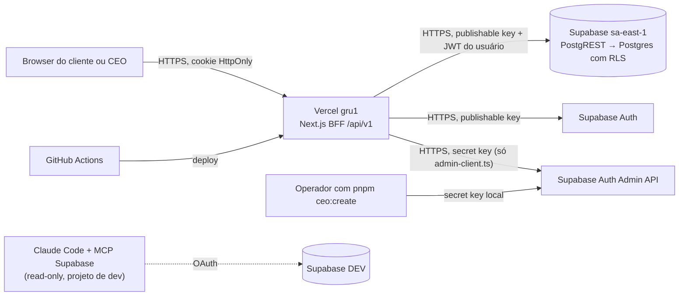

# Threat model — Rastreador de entregas (backend + banco)

> **Data:** 2026-11-15 (atualizado em 2026-11-16, Onda 3) · **Escopo:** API `/api/v1`, Supabase (Auth + Postgres), CI/CD e ferramentas
> de desenvolvimento · **Spec:** [`docs/specs/client-delivery-tracker.md`](../specs/client-delivery-tracker.md)
>
> Os controles citados (SEC-xx) estão definidos em §2.3 da spec. Atualize este documento sempre
> que a superfície de ataque mudar (rota nova, integração nova, papel novo).

## 1. Ativos

| Ativo | Por que importa |
|-------|-----------------|
| Dados de processo de cada cliente | Confidencialidade entre clientes concorrentes (vazamento cross-tenant é o pior cenário) |
| Contas de CEO | Uma conta de CEO lê tudo e avança processos de qualquer cliente |
| Integridade do fluxo de fases | Um "Ok" indevido muda o que o cliente vê e o que foi contratado |
| Trilha de auditoria | Prova de quem aprovou o quê (não repúdio) |
| `SUPABASE_SECRET_KEY` | Ignora RLS: comprometimento total do banco e do Auth |
| Dados pessoais (nome e e-mail) | LGPD |

## 2. Fronteiras de confiança e fluxo de dados

| Fronteira | Ameaça principal |
|-----------|------------------|
| Browser → BFF | Usuário malicioso autenticado (cliente curioso), CSRF, força bruta |
| BFF → PostgREST | Bug de autorização no app (mitigado por RLS e funções) |
| JWT do usuário → PostgREST direto | Usuário extrai o próprio JWT e chama o PostgREST sem passar pelo BFF |
| Secret key | Vazamento por log, commit, bundle do browser ou dependência maliciosa |
| CI/CD | Action ou dependência comprometida |
| Ferramentas de IA (MCP) | Prompt injection pelo conteúdo do banco; ação destrutiva |

## 3. STRIDE

| # | Elemento | STRIDE | Ameaça | Mitigação | Controles |
|---|----------|--------|--------|-----------|-----------|
| T-01 | Login | S | Força bruta e credential stuffing | Rate limit por IP (IPv6 agregado ao /64) e por conta, senha forte, HIBP, MFA de CEO. **Lacunas conhecidas:** o limite por IP só enxerga o /64, então um atacante com muitos prefixos escapa dele (o limite por conta e o teto global de T-03 cobrem o resto); o papel `client` não tem MFA (só CEO, SEC-11); o achado F-04 do threat-modeler fica para a Onda 11 | SEC-09, SEC-10, SEC-11 |
| T-02 | Login | I | Enumeração de e-mails | Resposta 401 idêntica (status, corpo e headers), sem cadastro público. **Tempo (F-05):** toda recusa de login responde só depois de um piso de 400 ms mais até 100 ms de jitter, medido do início do handler; o piso fica acima do caminho mais lento ("senha certa, conta desativada", cerca de 3 idas ao Auth), então senha errada, e-mail inexistente e conta desativada levam o mesmo tempo (se o Auth demorar mais que o piso, nada é somado). Com o provider de e-mail ligado, `/otp` e `/recover` do GoTrue seguem acessíveis a quem tiver a publishable key, que só existe no servidor (o browser nunca fala com o Supabase, ADR 0002); `/otp` e `/magiclink` não criam usuário (teste de integração). **Risco residual aceito:** `/otp` diferencia e-mail conhecido de desconhecido | SEC-12, SEC-20 |
| T-03 | Login | D | Esgotar a cota de logins do Supabase Auth (a cota `sign_in_sign_ups` conta por IP de origem e, atrás do BFF, o Auth só vê o IP do servidor) e derrubar o login de todos | Os limites por IP (20 / 15 min) e por conta **não** protegem essa cota contra um atacante distribuído: são por prefixo e por e-mail, e há muitos prefixos. **Teto global (F-02):** todo login gasta um orçamento `global` de 300 por 300 s antes de chamar o Auth, sempre abaixo da cota do Auth (1000 por 5 min no `config.toml` local; o projeto hospedado precisa ser configurado acima, Onda 11); acima dele, 429 `RATE_LIMITED` com `Retry-After`. **Residual aceito:** o teto troca um 503 por um 429 para todos durante o ataque, não impede a negação de serviço; o alerta de rajada de 429 (Onda 11) é a resposta | SEC-09 |
| T-04 | Login | D | Bloqueio direcionado: errar a senha de um CEO de propósito | Janela curta (15 min), sem bloqueio permanente, alerta. **Não mitigado, e sustentável:** 11 tentativas a cada 15 min, de qualquer IP, mantêm a conta bloqueada indefinidamente, não só a atrasam. **Decidido em 2026-11-16 (F-03): opção (c), cookie de dispositivo** (recomendação da OWASP): o navegador que já entrou com sucesso tem limite próprio e não é bloqueado pelo ataque à conta, e a força bruta continua limitada. Muda o §3.9 da spec; implementação na Onda 11. Até lá o risco segue aberto, com alerta | SEC-09 |
| T-05 | Sessão | S | Roubo de cookie via XSS | `HttpOnly`, CSP, API só JSON; frontend futuro com CSP de nonce | SEC-07, SEC-14 |
| T-06 | Sessão | S | Reuso de refresh token roubado; credencial roubada que vive para sempre | Rotação com detecção de reuso (Supabase revoga a família). A sessão vale no máximo 12 h e acaba após 4 h sem uso (ADR 0009): o Auth aplica `timebox` e `inactivity_timeout`, o banco repete os dois limites em `private.session_is_alive()` (F-08, migration `session_time_limits_in_db`), e o cookie vive 12 h | SEC-07 |
| T-07 | Sessão | E | JWT continua válido após logout ou desativação | `current_principal()` exige sessão viva em `auth.sessions` (dentro de 12 h e 4 h) e perfil ativo a cada requisição. O logout confirma no banco, antes do 204, que o token antigo já não tem principal (o client do Auth diz "deslogado" mesmo quando o Auth respondeu 401, 403 ou 404 sem revogar nada); se não confirmar, 503 e o cookie volta | SEC-07 |
| T-08 | Mutações | T | CSRF numa aprovação | SameSite=Lax, checagem de `Origin`, JSON obrigatório | SEC-08 |
| T-09 | `/me/*` | I | Cliente troca o `processId` (BOLA/IDOR) | Tenant derivado da sessão; filtro por tenant no repositório e RLS; 404 | SEC-03, SEC-05 |
| T-10 | `/me/*` | I | Cliente lê campos internos (quem aprovou) | Tabelas do cliente só com colunas seguras; dados internos em tabelas exclusivas de CEO; DTO explícito; contrato com `additionalProperties: false` | SEC-04 |
| T-11 | PostgREST direto | E | Cliente usa o próprio JWT para escrever ou ler fora do tenant | `authenticated` sem `INSERT/UPDATE/DELETE`; RLS somente `SELECT` por tenant; funções checam papel internamente | SEC-04 |
| T-12 | `/admin/*` | E | Cliente chama endpoint de CEO (BFLA) | Papel checado no pipeline **e** `private.is_ceo()` nas funções e policies | SEC-01, SEC-11 |
| T-13 | Contas | E | Criar ou promover um CEO pela API | Nenhum endpoint cria CEO; papel vem de `app_metadata` (só a secret key escreve); trigger recusa papel ausente; funções de conta recusam alvo CEO | RF-14, SEC-04 |
| T-14 | Contas | E | Usuário edita `user_metadata` para virar CEO | `raw_user_meta_data` nunca é lido para autorização | SEC-04 |
| T-15 | Banco | T | SQL injection (app, filtros PostgREST, funções) | Sem SQL no app; sem interpolação em `.or/.filter`; funções sem SQL dinâmico e com `search_path=''`; Zod `.strict()` | SEC-06 |
| T-16 | Banco | E | Hijack de `search_path` em função `SECURITY DEFINER` | `SET search_path = ''` com nomes qualificados, verificado por pgTAP | SEC-04, AC-25 |
| T-17 | Banco | E | Função nova executável por `PUBLIC` (padrão do Postgres) | `REVOKE EXECUTE … FROM PUBLIC, anon` em toda função, verificado por hook e pgTAP | SEC-04, AC-25 |
| T-18 | Aprovação | T | Dois CEOs aprovam ao mesmo tempo e o processo pula duas fases | `FOR UPDATE` + `expectedStageId` + índice único de fase atual | AC-17 |
| T-19 | Aprovação | R | CEO nega ter aprovado | `stage_approvals` + `audit_events` append-only na mesma transação, com `request_id` | SEC-16 |
| T-20 | Auditoria | T | Alterar ou apagar a trilha | `REVOKE UPDATE/DELETE/TRUNCATE` + trigger que bloqueia | AC-24 |
| T-21 | API | D | Payload gigante ou paginação sem limite | Corpo ≤ 16 KiB, tamanhos máximos, `limit` ≤ 100, rate limit por usuário | SEC-17, SEC-09 |
| T-22 | MFA | S/E | Força bruta e replay de TOTP, sondagem de ids de fator, fator extra para subir a `aal2`, fator removido com JWT `aal2` vivo, sequestro do primeiro cadastro (F-20 a F-24) | **Força bruta:** 5 / 5 min por usuário (da rota, cobra toda requisição, a que acerta também, antes de olhar o código; por usuário, não por IP) e **teto diário de 20 por usuário** (`totp-verify-daily`, orçamento do handler: sem ele 5 / 5 min dão 1.440 tentativas por dia, cerca de 8 meses até acertar; com ele, décadas) (F-22). **Replay (F-21, RFC 6238 seção 5.2):** o Auth aceita o mesmo código mais de uma vez na janela (~90 s); `consume_totp_code` queima o código (SHA-256 de `<fator>:<código>`) por 120 s, antes de o Auth ver o código, e só o dono do fator consome. **Sondagem:** código errado, vencido, já usado e fator de outro usuário ou inexistente respondem o mesmo 422 `INVALID_MFA_CODE`; o log distingue (`invalid_code`, `code_reused`, `factor_not_found`, `factor_ambiguous`). **Fator da sessão:** o `factorId` do corpo é opcional e obsoleto; sem ele o servidor lista os fatores TOTP **do próprio usuário** com a sessão dele (nenhum client admin) e usa o único verificado ou, não havendo, o único candidato; sem fator ou com mais de um no mesmo estado recusa com o mesmo 422, e nunca tenta o código em vários fatores. A identidade continua vindo da credencial, e `consume_totp_code` e os dois limites valem sobre o fator resolvido. **Fator extra:** quem já tem fator verificado leva 409, e o próprio Auth exige `aal2` para criar um fator (`insufficient_aal`), então uma sessão `aal1` roubada não se promove; um fator só (sem `friendly_name`). **Fator removido (F-24):** `private.is_ceo()` exige o atestado da sessão e que o fator atestado ainda esteja verificado, então remover o fator apaga o atestado e tira o acesso de CEO (RLS e funções) na hora, mesmo com um JWT `aal2` ainda válido. **`aal2` obtida direto no Auth (F-50 b, F-63, Onda 6.1, ADR 0013):** quem tem a senha e a publishable key verifica o TOTP direto no Auth e fica com um claim `aal2` que não vale nada: `is_ceo()` exige um atestado por `session_id`, gravado só por `attest_mfa_session` (`service_role`) depois de um verify que passou pelo backend; `current_principal()` devolve `aal1` para a `aal2` sem atestado (pendência `VERIFY_MFA`). O atestado é recusado, com 422 igual ao de código errado, alerta `auth.mfa.attestation_refused`, auditoria e todas as sessões do usuário apagadas, quando o fator tem, nos últimos 120 s, um challenge verificado que o backend não criou (o oráculo: chutar o código no Auth e reapresentá-lo ao backend), quando o fator ou o challenge nunca passaram pelo backend (F-61) ou quando os ids não descrevem uma sessão `aal2` consistente. **Fator só do backend (F-60):** o verify sem `factorId` resolve o candidato entre os fatores que o backend cadastrou (`list_backend_totp_factors()`); um candidato plantado no Auth nunca causa `factor_ambiguous` e gera `auth.mfa.foreign_factor`. **Primeiro cadastro (F-20):** quem tem a senha (ou um cookie `aal1`) antes de o CEO cadastrar o TOTP pode substituir o fator candidato do CEO e verificar o próprio; quando um verify **ativa** o primeiro fator, as outras sessões do CEO são derrubadas (`signOut` com escopo `others`), e o CEO que tentar o fator antigo com `factorId` deixa `auth.mfa.failed` com `factor_not_found` no log (sem `factorId`, o servidor usa o fator do atacante e o log mostra `invalid_code`; o traço do sequestro continua em `auth.mfa.enrolled`, com `replacedFactors`, e em `auth.mfa.verified`, com `activated`). Resíduos: ver §7 e §8 | SEC-09, SEC-11 |
| T-23 | Erros | I | Stack trace ou erro SQL vazando estrutura | problem+json com `code` estável; mapeamento explícito; 500 genérico | SEC-13 |
| T-24 | Exceções | E | Falha numa checagem libera acesso (fail open) | Toda exceção em auth, authz ou rate limit nega a requisição | SEC-13, E-22 |
| T-25 | Segredos | I | Secret key no bundle do browser ou em log | Sem `NEXT_PUBLIC_`; `server-only`; uso restrito a um arquivo; redação de logs; gitleaks; hook. **F-12:** o singleton do admin client não é exportado: só uma fachada estreita (a Auth Admin API e o RPC `rate_limit_hit`), sem `.from`, `.rpc` genérico nem `.auth.signIn*`; o ESLint só deixa o rate limiter e a infraestrutura de identity importá-la | SEC-15, SEC-16 |
| T-26 | Supply chain | T | Dependência ou Action maliciosa | Lockfile, SHA pinado, Dependabot, `pnpm audit`, SAST, review de MCP e plugins | SEC-18 |
| T-27 | Ferramentas de IA | T/I | Conteúdo do banco (nome de cliente, fase) com prompt injection lido pelo agente via MCP | MCP read-only, só no projeto de dev, saída tratada como dado | SEC-18 |
| T-28 | Previews | I | Preview da Vercel apontando para dados de produção | Previews usam staging + Deployment Protection | §3.11 |
| T-29 | Sessão | D | Amplificação antes da autenticação: um cookie forjado (`{"access_token":"x","refresh_token":"y","expires_at":1}` basta) faz o servidor chamar o Auth (refresh, `getUser` ou busca de JWKS) a partir do IP da Vercel, sem limite algum antes da autenticação; um 429 do Auth derruba o refresh de todos os usuários legítimos (F-01). Variantes: `expires_at` como `"1"`, `null`, `0`, `-1` ou `Infinity`, cookie vazio mais chunk, chunk com buraco, token simétrico, sem `kid`, `kid` desconhecido | **Invariante:** toda chamada ao Auth feita ao resolver um principal é cobrada do orçamento por IP `session-upstream` (60 por 900 s, IPv6 no /64), e um IP sem orçamento não chega ao Auth. Três camadas. **(1) Predição que falha fechada** (`classifySession`): o cookie é lido como `@supabase/ssr` e o auth-js o leem (`combineChunks`, prefixo `base64-`, `JSON.parse`, `_isValidSession`, `hasExpired` com a mesma verdade e coerção numérica, `decodeJWT`, `validateExp`) e a resposta é "sem chamada" **só** quando se prova que não há chamada: nenhum cookie de sessão, ou token não vencido de algoritmo assimétrico (ES256/RS256) cujo `kid` foi visto verificando neste processo há menos de 5 min (metade do TTL de 10 min do cache de JWKS). Qualquer outra coisa, inclusive cookie presente e ilegível, gasta uma unidade antes de `getClaims()`. Acima do orçamento: 401 **sem apagar os cookies**, log `auth.rate_limited` e nenhuma chamada ao Auth. **(2) Recusa local (MÉDIO 2):** o que faria o auth-js lançar uma exceção que não é erro de autenticação (e viraria 500 para qualquer anônimo: algoritmo fora de HS*/ES256/RS256, `alg` que não é string, cabeçalho ou payload que não é JSON, token que não é string, `kid` conhecido com outro algoritmo) e o que ele rejeitaria sem chamar o Auth (`exp` ausente ou vencido) recebe 401 antes do cliente rodar, sem gastar orçamento. **(3) Medição:** o `fetch` do cliente da requisição conta as chamadas a `/auth/v1/`; o resolvedor compara a contagem antes e depois de `getClaims()` e cobra a diferença depois do fato (parando na primeira recusa), com o log `auth.session_budget_mispredicted` (nível warn, contagem e `ipHash`, nunca o cookie). Predição errada vira alerta, não brecha. **Segunda linha:** mesmo para um token que se verifica localmente, o resolvedor consulta a memória do limitador (`peekDenial`, sem contar, sem banco): IP já sabidamente sem orçamento recebe 401. Limitador que falha: 503 (fail closed). Se o Auth responde 429 ao refresh, 503 e o cookie é mantido. Um `kid` é esquecido se a verificação falha depois de uma chamada ao Auth ou com qualquer erro que não seja `AuthInvalidJwtError`, nunca por uma simples falha de assinatura local (senão um forjador com um `kid` real o expulsaria da lista). **Trade-off aceito:** um navegador legítimo, com token local, atrás de um IP que um forjador esgotou também leva 401 até o fim da janela (o cookie é mantido e a sessão volta quando o orçamento volta). **Residual:** um `kid` novo e legítimo gasta uma unidade uma vez por processo (e de novo após 5 min sem uso) | SEC-09, SEC-13 |
| T-30 | Rate limit | D | O limitador como amplificador: um flood contra um sujeito já bloqueado custa uma escrita no banco por requisição; `private.rate_limit_counters` cresce sem limite com sujeitos variados (F-06, F-07) | Cache de negações em memória, por instância, consultado antes do RPC (só deixa o limite mais estrito, nunca libera, então não enfraquece o fail closed) e limitado: cheio, sai a entrada mais antiga em O(1), sem varrer o mapa a cada negação (BAIXO 5), para que um flood de sujeitos distintos não vire carga de CPU; `rate_limit_hit` apaga, em cerca de 1% das chamadas, até 500 janelas vencidas há mais de 48 h (migration `rate_limit_opportunistic_cleanup`). A limpeza diária por `pg_cron` entra na Onda 11 | SEC-09, E-22 |
| T-31 | Sessão | S/T | Fixação de sessão, CSRF e cookie tossing | Todo login cria uma sessão e tokens novos no Auth e sobrescreve o cookie (não há como impor um id de sessão); `__Host-` obriga `Secure`, `Path=/` e nenhum `Domain`, o que impede um subdomínio de plantar o cookie; `SameSite=Lax` mais checagem de `Origin` e JSON obrigatório (T-08). **Residual (F-10):** um login feito sobre uma sessão existente não revoga a anterior; ela expira pelo `timebox` de 12 h (ADR 0009) | SEC-07, SEC-08 |
| T-32 | Logs | R/T | Correlação falsificada ou insuficiente: um `X-Request-Id` escolhido pelo cliente entra na trilha de auditoria e nos logs; eventos de auth sem sessão nem origem (F-09, F-11) | O id da requisição é sempre gerado no servidor (UUID v4) e é o que vai ao header, ao `problem+json`, aos logs e ao `x-request-id` do banco, então a auditoria só carrega ids do servidor; um valor válido do cliente é registrado à parte como `clientRequestId`. Os eventos `auth.login.*` e `auth.logout` levam `sessionId` e `ipHash` (HMAC com chave derivada, nunca o IP), e `auth.rate_limited` leva `subjectHash` | SEC-16, RNF-04 |
| T-33 | Clientes | T/S | Nomes duplicados ou parecidos para confundir os CEOs ou falsificar um cliente no painel: espaços Unicode, caracteres invisíveis, homóglifos de outros alfabetos, dois clientes com o mesmo nome (F-51, F-52, F-59); e uma regra que vale no Zod e não vale no banco, para quem chama o RPC direto | O banco tem um validador só, `private.visible_text`, igual ao `visibleText` do Zod: NFC, pontas aparadas com o conjunto do `trim` do JavaScript (NBSP, U+3000, BOM...), de 1 a 160 caracteres, sem caractere de controle ou de formatação, sem os "fillers" invisíveis (U+3164, U+2800...) e com ao menos uma letra ou um número. `create_client` e `update_client` o usam (e as Ondas 8 e 9 vão usá-lo), e o pgTAP cobre cada caso na criação e na atualização, mais um teste de API que chama o RPC direto. O `[[:alnum:]]` só é Unicode se o locale do banco for: um teste do pgTAP confere com japonês e grego. **Nome único (F-51, decidido em 2026-11-16: opção (a), implementada no contrato `1.0.0-draft.3`):** índice único parcial `clients_active_name_key` sobre `lower(normalize(name, NFKC))`, sem as marcas de variação invisíveis (U+034F, seletores de variação) e com espaços repetidos reduzidos a um, só entre os clientes não arquivados. `create_client` e `update_client` trocam a violação do índice por `CLIENT_NAME_TAKEN`, que o app mapeia para 409 `CONFLICT`; a resposta não diz qual é o outro cliente, e a recusa não grava auditoria (o pgTAP 014 e os testes de API E-40 a E-46 cobrem a criação, a renomeação, o desarquivamento, a concorrência e o retry). Dois renames que se cruzam ao mesmo tempo podem dar deadlock entre os índices: o Postgres derruba uma das transações (`40P01`), que o app responde com 503 `SERVICE_UNAVAILABLE` (nada gravado, repetir é seguro). **Residual:** um homóglifo de outro alfabeto (o "А" cirílico) e o que o `lower()` não dobra ("ß" e "ss"; o Postgres 17 não tem `casefold()`) passam pela chave; o frontend deve mostrar o id do cliente na hora de provisionar um login (Onda 7), para o CEO não confiar só no nome. **A chave depende do banco:** o `lower()` só dobra letras fora do ASCII se o locale for Unicode (o pgTAP 014 confere), então a **Onda 11 confere o locale do banco hospedado** antes de aplicar a migration; e depois de uma troca de versão do ICU ou de um upgrade maior do Postgres, rode `REINDEX INDEX public.clients_active_name_key`, porque as tabelas do `normalize` e do `lower` mudam e um índice com a chave antiga deixaria passar (ou recusaria) nomes que a chave nova trata de outro jeito | SEC-06, SEC-17, E-30, E-40 a E-46 |
| T-34 | API | D | Entrada válida que vira 500 (F-53, F-54): um cursor bem formado que o Postgres não lê (ano 0000, offset acima de 15:59: erros 22008 e 22009) e um surrogate UTF-16 solto no JSON (`"A\ud800"`: erro 22P02 no banco) | O schema do cursor limita o ano (2000 a 9999) e o offset (até 15:59), e o repositório converte um erro da classe 22 numa posição recebida em 400 em `query.cursor` (rede de segurança). `visibleText` recusa surrogate solto com 400 em `body.name`. Testes unitários e de API para cada caso. Fora de `visibleText`, outros textos livres (e-mail, senha) ainda não checam surrogate solto | SEC-13, SEC-17, E-29 |
| T-35 | Banco | E/D | Trabalho antes da autorização: normalizar e validar a entrada antes de `is_ceo()` deixa quem não tem papel gastar CPU do banco e distinguir "entrada inválida" de "negado" (F-55) | As duas funções checam `private.is_ceo() IS NOT TRUE` antes de qualquer trabalho com a entrada; o validador só roda depois, e recusa de saída uma entrada acima de 16 KiB (o limite do corpo) antes de normalizar. O pgTAP prova que um cliente com nome enorme ou inválido recebe `FORBIDDEN` | SEC-04, SEC-11 |
| T-36 | Auditoria | R | O `request_id` da auditoria só é confiável pelo BFF: quem chama o PostgREST direto com o próprio JWT escolhe o `x-request-id`; renomear um cliente não guarda o nome antigo nem o novo (F-56) | Pelo BFF o id é sempre o do servidor (T-32). Direto, um CEO `aal2` escolhe o id (saneado para `[A-Za-z0-9-]{1,64}`), mas o ator vem do JWT e a ação vem do banco, então ele não forja quem fez nem o quê; a correlação com os logs do app só vale para o que passou pelo BFF. Os metadados não levam o nome (sem PII): `client.updated` registra que o nome mudou, não de quê para quê. Guardar o histórico de nomes exige base legal e retenção definidas (Q-07). **Aceito** | SEC-16, RNF-04 |
| T-37 | Clientes | T | Atualização perdida: dois CEOs editam o mesmo cliente ao mesmo tempo e o último a gravar vence (F-57) | `update_client` trava a linha (`FOR NO KEY UPDATE`), então as escritas se serializam e cada uma audita o que mudou; não há controle otimista (`version` ou `If-Match`) em clientes, ao contrário das fases (I6). A ordem fica na auditoria. **Aceito:** 4 CEOs e um campo de baixo risco | SEC-16 |

## 4. OWASP Top 10:2025

| Categoria | Como é tratada |
|-----------|----------------|
| A01 Broken Access Control | Deny by default (SEC-01); tenant da sessão (SEC-03); autorização em três camadas com RLS (SEC-04); 404 cross-tenant (SEC-05); MFA de CEO (SEC-11); SSRF fora da superfície (SEC-19) |
| A02 Security Misconfiguration | Headers (SEC-14); cadastro público desligado, `pg_graphql` removido, chaves JWT assimétricas (SEC-20); `config.toml` versionado; previews isolados |
| A03 Software Supply Chain Failures | Lockfile, Actions por SHA, Dependabot, `pnpm audit`, SAST, gitleaks, MCP e plugins revisados (SEC-18) |
| A04 Cryptographic Failures | TLS em tudo + HSTS; bcrypt do Supabase Auth; HMAC nas chaves de rate limit; segredos fora do código (SEC-15) |
| A05 Injection | §3.8 da spec: sem SQL no app, sem interpolação em filtros, funções sem SQL dinâmico, Zod `.strict()` (SEC-06); API só JSON com CSP (XSS) |
| A06 Insecure Design | Threat model, máquina de estados com invariantes no app e no banco, concorrência otimista, escrita só por funções (SEC-04) |
| A07 Authentication Failures | Rate limit (SEC-09), política de senha e HIBP (SEC-10), MFA (SEC-11), sem enumeração (SEC-12), sessão revogável (SEC-07) |
| A08 Software or Data Integrity Failures | Auditoria append-only (SEC-16); migrations imutáveis depois de mergeadas; deploy só por pipeline verde |
| A09 Security Logging & Alerting Failures | Logs JSON com request id, eventos de auth, auditoria no banco, alertas (spec §3.10) |
| A10 Mishandling of Exceptional Conditions | Fail closed (SEC-13); timeouts (SEC-19); transações atômicas com compensação (E-23); mapeamento de erros explícito |

## 5. OWASP API Security Top 10:2023

| Risco | Tratamento |
|-------|------------|
| API1 BOLA | Tenant da sessão + RLS + 404 (T-09) |
| API2 Broken Authentication | T-01 a T-07, T-22 |
| API3 Broken Object Property Level Authorization | DTOs explícitos, `.strict()` na entrada, `additionalProperties: false` na saída, tabelas do cliente sem colunas internas (T-10) |
| API4 Unrestricted Resource Consumption | Limites de corpo, strings, fases e paginação; rate limit (T-21) |
| API5 Broken Function Level Authorization | Papel no pipeline e no banco (T-12) |
| API6 Unrestricted Access to Sensitive Business Flows | Aprovação só por CEO `aal2`, com concorrência controlada e auditada (T-18, T-19) |
| API7 Server Side Request Forgery | Nenhum fetch de URL do usuário (SEC-19) |
| API8 Security Misconfiguration | A02 acima |
| API9 Improper Inventory Management | Contrato versionado e único; hook de Stop bloqueia rota sem contrato; agent `contract-guardian` |
| API10 Unsafe Consumption of APIs | Respostas do Supabase validadas com Zod; timeouts |

## 6. Abuse cases que viram testes

| Abuse case | Teste |
|------------|-------|
| Cliente A pede `/me/processes/{id-de-B}` | API: 404 (AC-09) |
| Cliente A chama o PostgREST direto com o próprio JWT em `processes` de B e tenta `INSERT` | pgTAP (AC-09, AC-10) |
| Cliente chama `approve_current_stage` via RPC | pgTAP: 42501 |
| CEO com sessão `aal1` chama uma função de CEO | pgTAP: 42501 (AC-08) |
| CEO com JWT `aal2` ainda válido, mas sem fator TOTP verificado (removido, só candidato ou só de telefone), lê ou chama função de CEO | pgTAP: nega (F-24) |
| O mesmo código TOTP é enviado duas vezes, na mesma sessão ou em outra sessão do mesmo CEO | API: 422 na segunda vez, com o mesmo corpo de um código errado e `auth.mfa.failed` com `code_reused`; pgTAP: `consume_totp_code` recusa dentro de 120 s e aceita depois (F-21) |
| Usuário queima os códigos do fator de outro, ou verifica com o fator de outro | pgTAP: `NOT_FOUND`; API: 422 igual a um código errado (F-21, E-28) |
| 20 tentativas de código no dia e a 21ª | API: 429 com `Retry-After`, sem chamar o Auth (F-22) |
| Candidato a fator substituído e sessão paralela aberta só com a senha | API: a ativação do primeiro fator derruba a outra sessão (401); o fator antigo dá `factor_not_found` no log (F-20) |
| Cookie `aal1` copiado, o CEO verifica na sessão dele e o refresh token antigo é usado | API: ainda devolve a sessão `aal2` dentro do intervalo de reuso do Auth (resíduo conhecido, F-23) |
| Sessão `aal2` obtida direto no Auth (supabase-js, senha e publishable key) tenta `rpc/create_client` e `/admin/*` | pgTAP e API: 42501 e conjunto vazio no PostgREST; o backend a mostra como `aal1` com `VERIFY_MFA` (E-32, F-50 b) |
| Código verificado direto no Auth e reapresentado ao backend dentro da janela | API: 422, sem atestado, `auth.mfa.attestation_refused`, auditoria e todas as sessões apagadas (E-33, F-63) |
| Fator TOTP plantado (candidato ou verificado) direto no Auth para a conta do CEO | API: o candidato não torna o verify ambíguo (F-60); o fator ativado fora do backend é recusado no atestado, com alerta (F-61) |
| Login com senha temporária de mais de 72 h; reset por um CEO | API e pgTAP: 401 genérico sem principal; o reset renova o prazo (E-34, E-35, F-41) |
| Duas aprovações simultâneas | API: 1 × 200 e 1 × 409 (AC-17) |
| POST de aprovação vindo de outra origem | API: 403 `ORIGIN_NOT_ALLOWED` (AC-23) |
| 11 logins errados para a mesma conta | API: 429 (AC-03) |
| Cookie reaproveitado após logout | API: 401 (AC-04) |
| Logout quando o Auth responde 403 sem revogar | API: 503 e cookie mantido; a sessão continua viva (AC-04) |
| Troca de senha com a senha atual errada (6 tentativas em 15 min) | API: 422 `INVALID_CURRENT_PASSWORD` nas 5 primeiras, 429 na 6ª, mesmo com a senha certa; nada muda (AC-06) |
| Chamar `mark_password_changed()` direto no PostgREST, sem trocar a senha | API: `PASSWORD_UNCHANGED`, a pendência continua (AC-05, ADR 0007) |
| Cliente manda `role` (ou `app_metadata`) em qualquer corpo, ou escreve `role: ceo` em `user_metadata` | API: 400 pelo `.strict()`; a sessão segue `client` e `/admin/*` segue 403 (AC-31) |
| 75 requisições com um cookie forjado do mesmo IP | API: no máximo 60 chamadas ao Auth, o resto 401 sem `Set-Cookie` (F-01) |
| 63 requisições do mesmo IP para cada variante de cookie forjado (`expires_at` estranho, chunks, token simétrico, sem `kid`, `kid` desconhecido ou real com assinatura falsa, ES384) | API: no máximo 60 chamadas ao Auth por variante, nenhuma depois de esgotado o orçamento, sempre 401 e nunca 5xx (F-01) |
| Token ES384 forjado com o `kid` real | API: 401, não 500, e nenhuma chamada ao Auth (MÉDIO 2) |
| Refresh que deu certo e verificação que então falha com 503 | unit: os cookies novos ficam, o refresh token consumido não volta (MÉDIO 3) |
| Login recusado de três jeitos (senha errada, e-mail inexistente, conta desativada) | API: mesmo 401 e mesmo piso de tempo (AC-02, F-05) |
| Sessão com 12 h 1 min, ou sem uso há 4 h 1 min, ainda com JWT válido | pgTAP: sem principal (SEC-07, F-08) |
| Corpo com campo extra `clientId` em `/me/*` ou `role` em provisionamento | API: 400 (AC-23) |

## 7. Riscos residuais aceitos

- **T-04 (não aceito, decidido, ainda não implementado):** um atacante consegue manter bloqueado o
  login de um CEO específico de forma sustentada (11 tentativas a cada 15 min bastam), não só
  atrasá-lo. Em 2026-11-16 o usuário escolheu o cookie de dispositivo (F-03, opção (c)), que entra
  na Onda 11; até lá o risco está aberto, com alerta.
- **Janela do access token:** sem o BFF, o JWT vale até 15 min. Pelo BFF, a revogação é imediata
  (checagem de sessão no banco).
- **Login sobre uma sessão existente (F-10):** a sessão anterior não é revogada; expira pelo
  `timebox` de 12 h (ADR 0009).
- **Enumeração por `/otp` (T-02):** ver T-02.
- **Refresh token anterior ao verify (F-23, confirmado por teste e à mão):** o Auth deixa o refresh token
  que o navegador tinha **antes** de um verify bom ser usado de novo por `refresh_token_reuse_interval`
  (10 s no local) e responde com a sessão atual, já `aal2`. Quem copiou o cookie `aal1` antes de o CEO
  verificar, e age nesses 10 s, recebe um token `aal2` (o mesmo que o CEO tem: a sessão é a mesma). Passado
  o intervalo, o mesmo token dá `refresh_token_already_used`. Rotacionar a sessão de novo depois do verify
  **não** ajuda (testado: com uma rotação a mais, o resultado foi o mesmo), e o app não
  encurta o intervalo, que é configuração do Auth (`[auth.sessions] refresh_token_reuse_interval`). **Onda 11:**
  baixar o intervalo no projeto hospedado, pesando o custo (dois refreshes concorrentes do mesmo cookie
  passam a falhar). O teste de API fixa o resíduo e exige que o intervalo configurado não passe de 10 s.
- **Esgotar o limite de verificação (F-22, lado B):** quem tem a senha pode gastar os 5 / 5 min e os
  20 / dia do CEO com códigos errados e impedir o CEO de verificar até a janela passar. É a mesma classe do
  T-04 (bloqueio direcionado) e fica no mesmo item. A janela do teto diário é fixa: na virada do dia cabem
  até 40 tentativas seguidas.
- **Chamada extra ao Auth no enroll (F-26, aceito):** o enroll lista os fatores (`listFactors`, um
  `getUser` no Auth) antes de criar o novo, e o verify faz `challenge` e `verify`. Essas chamadas não
  entram no orçamento `session-upstream` (que só cobre a resolução do principal) e são limitadas pelas
  regras da rota (10 / 15 min no enroll, 5 / 5 min mais 20 / dia no verify).
- **Revogação das outras sessões sem confirmação (F-20):** o cliente do Auth trata 401, 403 e 404 da
  revogação como "já desconectado", então uma revogação que o Auth recusou por esses status não é
  vista pelo app (o `auth.mfa.followup_failed` só cobre os demais erros). O teste de API prova o efeito
  real no Auth local.
- **Logout que falha (BAIXO 6):** quando o logout falha (503), os cookies são devolvidos ao navegador com
  `maxAge` de 12 h de novo, então o cookie pode viver além do `timebox`. Aceito: o banco aplica 12 h de
  vida e 4 h sem uso à sessão (`private.session_is_alive()`, F-08), então o cookie estendido não
  autentica nada depois do limite.
- **Refresh que termina depois do prazo de 5 s (MÉDIO 3):** se o Auth conclui o refresh depois que o
  resolvedor desistiu (503), o navegador ainda tem o refresh token antigo, que o Auth aceita dentro do
  intervalo de reuso (10 s) e depois trata como reuso e revoga a família. O resolvedor fecha o jar
  (`fenceRequestClient`) para que o trabalho abandonado não escreva cookies, mas não consegue desfazer
  o refresh do lado do Auth.
- **Chamadas ao Auth depois do prazo (T-29):** o `getClaims()` abandonado por prazo continua
  tentando de novo (o auth-js repete um refresh que falha por rede, por até cerca de 30 s). O fence
  também bloqueia o `fetch` do cliente: cada nova tentativa falha na hora, sem requisição, então
  nada chega ao Auth sem cobrança. Resta só a requisição que já estava em voo no momento do fence,
  que termina pelo próprio timeout de 5 s.
- **Arquivar um cliente não revoga os logins dele (F-58, Q-08):** arquivar só impede novos processos e
  novos logins; os logins que já existem continuam entrando e lendo os próprios processos. É a decisão
  da spec. Na Onda 7, quem decide recusar o login novo de um cliente arquivado é o gatilho de perfil do
  banco (`CLIENT_ARCHIVED`); o `getClientStatus` do módulo `tracking` só serve para o app dar a
  mensagem antes, e a checagem decisiva continua sendo o gatilho.
- **Texto hostil para o frontend futuro (F-59):** nome de cliente e título de processo são texto de
  terceiros. A API só devolve JSON e o `visibleText` recusa controle e formatação Unicode, mas não limita
  corridas de marcas combinantes (texto "Zalgo") nem barra homóglifos. O frontend precisa escapar tudo
  como texto, isolar o sentido da escrita (`<bdi>` ou `dir="auto"` em cada nome) e cortar a altura de
  um nome com marcas empilhadas.
- **Atestado de CEO (Onda 6.1, ADR 0013), o que sobra:**
  - **F-23** (refresh token anterior ao verify, dentro do intervalo de reuso): o atestado é por
    `session_id`, e o `session_id` não muda no verify, então o token antigo também recebe a sessão `aal2`
    atestada. É o mesmo resíduo, não um buraco novo;
  - quem já tem a senha ainda descobre senhas válidas pelo `/auth/v1/token` direto, sem os limites do
    BFF: é o F-50 (c) (publishable key tratada como segredo, HIBP, alerta sobre os logs do Auth), gate da
    Onda 11;
  - os modos de falha do caminho admin (banco fora do ar, secret key inválida, resposta que o app não
    entende) falham fechados: 503 ou 500 e a sessão fica `VERIFY_MFA`. O CEO tenta de novo;
  - o oráculo conta challenges verificados que o Auth guarda (observado no Auth local: as linhas ficam
    depois do verify); uma versão do Auth que os apague em menos de 120 s enfraqueceria a checagem sem
    avisar. A recusa de oráculo derruba as sessões do CEO e o impede de verificar por 120 s, e só quem
    acertou um código direto no Auth consegue provocá-la;
  - um CEO que deixa a senha temporária vencer (F-41) fica sem acesso até um reset; o reset de CEO é o
    script da Onda 11 (E-25). Até lá, a conta é recriada ou a linha de base é regravada no banco.
- **Insider CEO:** um CEO pode aprovar indevidamente. Mitigado por auditoria, não por prevenção.
  Desfazer aprovação fica para a v1.1 (Q-05).

## 8. Pendências e decisões em aberto

| Item | Situação |
|------|----------|
| F-03 (bloqueio direcionado, T-04) | **Decidido em 2026-11-16: (c) cookie de dispositivo.** Muda o §3.9 da spec; implementação na Onda 11. Não mitigado até lá |
| F-04 (T-01) | Adiado para a Onda 11 |
| F-20 (c) (T-22) | **Gate de go-live da Onda 11 (decidido em 2026-11-16):** (1) amarrar o cadastro do TOTP à sessão que limpou o `CHANGE_PASSWORD` (hoje qualquer sessão `aal1` do CEO cadastra); (2) script operacional de reset de MFA (E-25), que também é como o CEO recupera um fator substituído por outra pessoa. Não implementados nesta onda |
| F-23 (T-22) | **Onda 11:** baixar `refresh_token_reuse_interval` no projeto hospedado (ver o §7). Mudança de `supabase/config.toml`, fora da Onda 5 |
| `factorId` depois do cadastro (T-22, E-25) | **Decidido em 2026-11-16: opção (a); implementado no contrato `1.0.0-draft.2` (ADR 0011)** (`factorId` opcional e obsoleto; o servidor resolve o fator do usuário pela sessão). Histórico: `TotpVerifyRequest` exige `factorId`, e nenhuma resposta o devolve depois do enroll (`GET /auth/session` não o traz; o enroll recusa quem já tem fator verificado). Um CEO que entra em outro dispositivo (`VERIFY_MFA`) não consegue chamar o verify. Opções: (a) tornar `factorId` opcional e o servidor resolver o fator TOTP verificado do usuário; (b) incluir o `factorId` no DTO de `Session`. |
| F-13 | **Decidido na Onda 4 (ADR 0010): ligado** (`secure_password_change = true` em `config.toml`). Com sessões de no máximo 12 h (ADR 0009) o Auth nunca pede o nonce no fluxo do app (só o pede para sessão com mais de 24 h), então a chave não muda nada para o usuário; ela fecha o `PUT /auth/v1/user` direto com a sessão velha enquanto o `timebox` não estiver no projeto hospedado (Onda 11). A chave **não prova a senha atual**: isso é do app, que a confere por um sign-in descartável (ADR 0010). No Supabase local só vale depois de recriar o container do Auth |
| F-40 (ALTO) | **GATE DE GO-LIVE (Onda 11): nenhum ambiente hospedado com contas reais antes de `security_update_password_require_current_password` estar ligado** (Management API; não existe em `config.toml`, e o local não a liga). Até lá, quem tem o token de acesso de uma sessão com menos de 24 h e a publishable key (que não é segredo) troca a senha direto no Auth, sem a senha atual que `POST /auth/password` exige. O token só existe no cookie `HttpOnly` e no servidor (ADR 0002) e vale 15 min, mas o gate é a única mitigação completa. O app já envia `current_password` ao `updateUser`, então ligar a chave não quebra o fluxo. Registrado também no §3.11 da spec. **Candidatos da Onda 11, ainda não decididos:** (a) um job do `pg_cron` que apague de `auth.sessions` as sessões que `session_is_alive()` já nega (hoje elas só deixam de autenticar nas rotas do app e continuam existindo no Auth, e o `PUT /auth/v1/user` direto não passa pelo banco); (b) um trigger de detecção em `auth.users` que registre toda troca de `encrypted_password` que não veio de `mark_password_changed()`, para alertar |
| F-41 (decisão do usuário) | **Senha temporária sem validade:** a senha temporária de um CEO ou de um cliente vale até ser trocada, por tempo indefinido (ela foi vista por quem a entregou). Proposta: validade de, por exemplo, 72 h, aplicada em `current_active_user_id()` (conta com `must_change_password` e senha mais velha que o prazo deixa de ter principal) e um caminho de reset por um CEO para reabrir a conta. Exige mudança de spec (RF-04, SEC-10, §3.5). **Decidido em 2026-11-16: 72 h, na Onda 6.1. Implementado (ADR 0013):** `private.current_active_user_id()` devolve NULL para o perfil com `must_change_password` cuja linha de base (`private.password_baselines`, gravada na criação e no reset) é mais velha que `private.temporary_password_validity()` (72 h; 72 h exatas já vencem; sem linha, fail closed); o login cai no caminho da conta desativada (E-34); o reset por um CEO grava uma linha nova (E-35), o reset de cliente é da Onda 7 e o de CEO vira script na Onda 11 |
| F-42 | **Tratado na Onda 4:** a criação de CEO grava `account.provisioned` (sem ator, canal `auth_admin`) pelo trigger de perfil, na mesma transação; falha da auditoria derruba a criação (migration `ceo_creation_audit`, pgTAP `011`, teste de integração) |
| F-43 e M5 do code review | **Tratado na Onda 4 (`ceo:create`):** só `SUPABASE_URL` e `SUPABASE_SECRET_KEY`; `--target` igual ao host da URL; `http:` só em loopback; URL e chave do mesmo lugar (shell ou arquivo, `--env-file`); recusa com `CI` definido e com stdout que não é terminal sem `--allow-non-tty`; stdout só com a senha |
| F-44 | **Tratado na Onda 4:** se a primeira chamada de `mark_password_changed()` gravou e só a resposta se perdeu, o `PASSWORD_UNCHANGED` da segunda é sucesso (só no retry; a linha de base só iguala o hash depois de um `updateUser` bem-sucedido se uma chamada anterior gravou). O `updateUser` sem resposta, que pode ter gravado a senha, responde 503 com a orientação dos dois estados (M4) |
| F-45 | **Aceito:** duas trocas concorrentes da mesma conta. Os dois `updateUser` e as duas `mark_password_changed()` se ordenam no Auth e no `FOR UPDATE` do perfil; no pior caso a segunda recebe 422 `PASSWORD_UNCHANGED` mesmo com a senha trocada (a primeira renovou a linha de base). A conta fica consistente e o usuário repete. Não vale um lock de aplicação para quem troca a própria senha, limitado a 5 por 15 min |
| F-46 | **Aceito:** a sessão do cookie clonado sobrevive à troca. A troca derruba as OUTRAS sessões e mantém a da requisição por desenho (AC-06); um atacante que clonou o cookie da sessão que está trocando a senha mantém essa sessão, mas não conhece a senha nova. Quem suspeita de um cookie roubado faz logout (que a revoga) ou pede reset a um CEO |
| F-47 | **Aceito:** o sign-in de prova da senha atual aparece no log do Auth como um login (`last_sign_in_at` e eventos de login do usuário) e gasta uma unidade do orçamento global de logins. É a única forma de provar a senha sem alterar o estado (ADR 0010); o ruído é de um usuário já autenticado, limitado a 5 por 15 min |
| Proposta de mudança no contrato (**aprovada em 2026-11-16; implementada no contrato `1.0.0-draft.2`, ADR 0011**) | O contrato **não foi editado** na Onda 4; as cinco inconsistências abaixo foram corrigidas no `draft.2`, uma mudança aditiva: (1) `ChangePasswordRequest.newPassword` declara `minLength: 12` e `maxLength: 72`, mas E-12 e a resposta `Unprocessable` mandam 422 `WEAK_PASSWORD`, não 400: tirar os limites do schema e deixá-los na descrição (a implementação aceita qualquer string e a política responde 422); (2) `currentPassword.maxLength: 72` conta caracteres em JSON Schema, e a implementação conta bytes UTF-8: dizer "bytes" na descrição; (3) o orçamento global de logins (`global`, 300 por 300 s, F-02) não está em `x-rate-limit` de `/auth/login`, e passou a ser gasto também por `/auth/password`; (4) o `204` de `/auth/password` pode trazer `Set-Cookie` da sessão (o Auth regrava a mesma sessão) e a resposta não o documenta; (5) `/auth/password` (e `/auth/logout`, `/auth/session`) podem responder 503 `SERVICE_UNAVAILABLE` com `Retry-After` (E-21) e não o documentam |
| F-60 (BAIXO, T-22) | **Candidato plantado:** quem tem a senha e a publishable key cadastra direto no Auth, com `friendly_name`, um segundo fator não verificado para o CEO (o Auth permite: o CEO ainda não tem fator verificado, então não pede `aal2`). O verify sem `factorId` passa a ver dois candidatos e responde 422 (`factor_ambiguous`): o CEO não consegue ativar o primeiro fator até o candidato sair ou ele mandar o `factorId` do `enroll` (o contrato ainda o aceita). Negação de serviço, sem ganho de acesso. **Agora:** `factor_ambiguous` gera o evento `auth.mfa.factor_ambiguous`, em nível `error` e com nome estável para alerta (o app nunca cria esse estado, então toda ocorrência merece olhar). **Correção de raiz, implementada na Onda 6.1 (ADR 0013):** o candidato é resolvido pelo registro do próprio `enroll` do backend (`private.mfa_backend_factors`, lido por `list_backend_totp_factors()`), não pela lista do Auth: um candidato plantado nunca causa `factor_ambiguous`. O evento `auth.mfa.foreign_factor` (nível `error`) avisa de todo fator TOTP que o backend não cadastrou |
| F-61 (MÉDIO, T-22) | **Fator verificado plantado:** se o CEO ainda não ativou o TOTP, o atacante planta o fator B e o **verifica** direto no Auth (sem fator verificado, não é preciso `aal2`). "Verificado primeiro" resolve B; o código do CEO (fator A) falha com `invalid_code` e o log parece digitação errada, o que esconde a tomada. **Agora:** `auth.mfa.failed` e `auth.mfa.verified` de um verify sem `factorId` levam o `factorId` resolvido e `candidateCount` (quantos fatores TOTP a conta tem; o app mantém um só). **Observado no teste:** ao verificar o fator plantado, o Auth apaga os candidatos não verificados do CEO, então a conta fica com um fator só e `candidateCount` vale 1: a contagem **não** mostra essa tomada (ela mostra a coexistência de fatores, como no F-60). O sinal que existe é o `factorId` da linha de falha não ser o do último `auth.mfa.enrolled` do mesmo usuário (alerta por correlação). **Correção de raiz, implementada na Onda 6.1 (F-63, ADR 0013):** um fator verificado que o backend nunca ativou não recebe atestado (`factor_not_backend` e `factor_not_activated_by_backend`), com `auth.mfa.attestation_refused` em nível `error` e todas as sessões do CEO apagadas; no verify sem `factorId` o fator plantado nem é resolvido (`factor_not_found` e `auth.mfa.foreign_factor`). O CEO que perdeu o fator para um plantado só o recupera pelo reset de MFA (E-25, Onda 11) |
| F-62 (BAIXO) | **Tipo de fator novo no Auth:** a listagem validava todos os fatores antes de filtrar os TOTP, então um tipo novo (por exemplo `recovery_code`, no auth-js 2.119) viraria 500 em todo verify sem `factorId`, no caminho do login. **Tratado:** o filtro `factor_type === 'totp'` vem antes do parse estrito (teste unitário) |
| F-63 (MÉDIO, **implementado na Onda 6.1**, ADR 0013) | O atestado de CEO (F-50 b) precisa: (1) um registro dos fatores que o backend ativou, e recusar, com alerta, atestar um fator ativado fora dele (fecha F-60 e F-61); (2) amarrar o atestado a `(session_id, factor_id resolvido, challenge_id do backend)`, e `is_ceo()` exigir que **esse** fator ainda esteja verificado; (3) fazer a checagem do oráculo excluindo o `challenge_id` do próprio backend, **nunca** por IP (o IP de saída da Vercel é compartilhado); (4) a função do `service_role` revalidar tudo em SQL: dono do fator, `status = 'verified'`, `auth.sessions.aal = 'aal2'`, e que o challenge pertence a esse fator e tem `verified_at`. **Implementado** em `attest_mfa_session`, `record_backend_mfa_challenge` e `register_backend_totp_factor`; testes: pgTAP `014_ceo_attestation_and_temp_password` e API `ceo-attestation` |
| F-50 (ALTO, security-scan de 2026-11-16) | **O problema:** os limites de força bruta e de replay (login 10 / 15 min por conta, teto global e piso de 400 ms; TOTP 5 / 5 min, 20 por dia e queima de código) só existem no BFF. Quem tem a senha e a publishable key chama direto `/auth/v1/token` e `/auth/v1/factors/{id}/verify`, onde só valem os limites por IP do Auth hospedado (login 30 / 5 min, configurável; verify de MFA 15 / min, fixo); com muitos IPs, a busca do TOTP cai de décadas para dias, e o Auth não tem proteção contra replay (supabase/auth#2882). Os hooks `mfa_verification_attempt` e `password_verification_attempt` só existem nos planos Teams e Enterprise. **Decidido em 2026-11-16:** (c) é o controle principal e gate da Onda 11: o navegador nunca recebe a publishable key (nenhuma variável do Supabase usa o prefixo público do Next.js), então ela é tratada como segredo, rotacionada a qualquer exposição, com HIBP ligado e alerta sobre os logs do Auth. (b) é a defesa em profundidade, **implementada na Onda 6.1 (ADR 0013)**: `is_ceo()` passa a exigir um atestado por `session_id`, gravado pelo backend depois do verify, então uma `aal2` obtida direto no Auth não dá poder de CEO; o atestado é recusado quando o fator tem, na janela do TOTP, um challenge verificado que não veio do backend (fecha o oráculo de chutar o código no Auth e reapresentá-lo pelo backend). (a) o plano Teams fica fora: com (c) bem feito, não é necessário |
| BAIXOs do security-scan de 2026-11-16 | **Decididos em 2026-11-16:** (1) o limite por usuário só vale depois de `current_principal()`: aceito, porque antes da autenticação não há usuário e o limite por IP cobre essa fase; (2) minimatch GHSA-g3hv-75wg-m249 (só desenvolvimento, via `typescript-eslint` → `typescript-estree`, que exige `^10` até a versão mais nova, 8.72.2, enquanto a correção está na 11): aceito por ora, porque o linter só recebe os globs da nossa própria configuração; rever quando o `typescript-eslint` subir para o minimatch 11 (o job `audit` do CI usa `--prod` e não o pega); (3) OTP de e-mail com `max_frequency = 1s` e `otp_expiry = 3600`: apertar no `config.toml` na Onda 11 (o fluxo não é usado); (4) headers `Cross-Origin-Opener-Policy` e `Cross-Origin-Resource-Policy`: Onda 11 |
| F-51 (MÉDIO, T-33) | **Decidido em 2026-11-16: opção (a); implementado no contrato `1.0.0-draft.3` (migration `client_name_unique`, pgTAP 014, testes de API E-40 a E-46).** O índice único parcial cobre a criação, a renomeação e o desarquivamento (409 `CONFLICT`), e o retry de uma criação que já tinha sido gravada responde 409 em vez de duplicar o cliente (E-21, E-45). A descrição da resposta compartilhada `ServiceUnavailable` foi corrigida: o retry de `createProcess` ainda pode duplicar, e o CEO confere a lista. A opção (b), `Idempotency-Key`, não foi implementada (nem (c)). **Residual (T-33):** homóglifo de outro alfabeto e o que `lower()` não dobra; o frontend mostra o id do cliente ao provisionar login (Onda 7). **Operação (Onda 11):** conferir o locale do banco hospedado antes da migration, e rodar `REINDEX INDEX public.clients_active_name_key` depois de uma troca de versão do ICU ou de um upgrade maior do Postgres (a chave usa `normalize` e `lower`). **Deadlock:** dois renames cruzados (A para o nome de B, B para o de A) podem dar `40P01`; o PostgREST o devolve como HTTP 500 (conferido no stack local, o `23505` dá 409), e o app o mapeia pelo SQLSTATE, qualquer que seja o status, para 503 `SERVICE_UNAVAILABLE`, o mesmo para `40001`. **Histórico:** dois `POST /admin/clients` com o mesmo nome criavam dois clientes, e um timeout depois do COMMIT (resposta 503) fazia o retry duplicar o cliente. Opções: (a) índice único parcial sobre o nome normalizado (por exemplo `lower(name)`) entre os clientes não arquivados, com 409 `CONFLICT` na criação e na atualização (o catálogo já tem `CONFLICT`, e o contrato passa a documentar o 409 nas duas operações); (b) cabeçalho `Idempotency-Key` no `POST`, com uma tabela de chaves que guarda a resposta; (c) as duas. (a) também reduz a falsificação de cliente por nome repetido, mas não por homóglifo de outro alfabeto. A mesma mudança de contrato corrigiu a descrição da resposta compartilhada `ServiceUnavailable` ("Escritas são atômicas, então repetir é seguro"), que não valia para a criação |
| F-14 | Registrado pelo threat-modeler como observação, sem ação nesta onda |
| MÉDIO 4 (T-02) | O piso de 400 ms do login recusado pode não cobrir o caminho "conta desativada" em produção: são cerca de 3 idas ao Auth, de gru1 a sa-east-1, e o piso foi medido com o Supabase local. **Onda 11:** medir o p95 dos três caminhos recusados em produção e subir `REFUSED_LOGIN_FLOOR_MS` acima dele; até lá a diferença de tempo é um canal lateral possível, não confirmado |
| BAIXO 6 | Aceito, ver o §7 (logout que falha devolve o cookie com `maxAge` de 12 h; o banco aplica 12 h e 4 h) |
