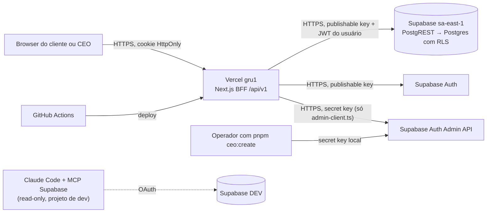

# Threat model — Rastreador de entregas (backend + banco)

> **Data:** 2026-11-15 (atualizado em 2026-11-16, Onda 3) · **Escopo:** API `/api/v1`, Supabase (Auth + Postgres), CI/CD e ferramentas
> de desenvolvimento · **Spec:** [`docs/specs/client-delivery-tracker.md`](../specs/client-delivery-tracker.md)
>
> Os controles citados (SEC-xx) estão definidos em §2.3 da spec. Atualize este documento sempre
> que a superfície de ataque mudar (rota nova, integração nova, papel novo).

## 1. Ativos

| Ativo | Por que importa |
|-------|-----------------|
| Dados de processo de cada cliente | Confidencialidade entre clientes concorrentes (vazamento cross-tenant é o pior cenário) |
| Contas de CEO | Uma conta de CEO lê tudo e avança processos de qualquer cliente |
| Integridade do fluxo de fases | Um "Ok" indevido muda o que o cliente vê e o que foi contratado |
| Trilha de auditoria | Prova de quem aprovou o quê (não repúdio) |
| `SUPABASE_SECRET_KEY` | Ignora RLS: comprometimento total do banco e do Auth |
| Dados pessoais (nome e e-mail) | LGPD |

## 2. Fronteiras de confiança e fluxo de dados

| Fronteira | Ameaça principal |
|-----------|------------------|
| Browser → BFF | Usuário malicioso autenticado (cliente curioso), CSRF, força bruta |
| BFF → PostgREST | Bug de autorização no app (mitigado por RLS e funções) |
| JWT do usuário → PostgREST direto | Usuário extrai o próprio JWT e chama o PostgREST sem passar pelo BFF |
| Secret key | Vazamento por log, commit, bundle do browser ou dependência maliciosa |
| CI/CD | Action ou dependência comprometida |
| Ferramentas de IA (MCP) | Prompt injection pelo conteúdo do banco; ação destrutiva |

## 3. STRIDE

| # | Elemento | STRIDE | Ameaça | Mitigação | Controles |
|---|----------|--------|--------|-----------|-----------|
| T-01 | Login | S | Força bruta e credential stuffing | Rate limit por IP (IPv6 agregado ao /64) e por conta, senha forte, HIBP, MFA de CEO. **Lacunas conhecidas:** o limite por IP só enxerga o /64, então um atacante com muitos prefixos escapa dele (o limite por conta e o teto global de T-03 cobrem o resto); o papel `client` não tem MFA (só CEO, SEC-11); o achado F-04 do threat-modeler fica para a Onda 11 | SEC-09, SEC-10, SEC-11 |
| T-02 | Login | I | Enumeração de e-mails | Resposta 401 idêntica (status, corpo e headers), sem cadastro público. **Tempo (F-05):** toda recusa de login responde só depois de um piso de 400 ms mais até 100 ms de jitter, medido do início do handler; o piso fica acima do caminho mais lento ("senha certa, conta desativada", cerca de 3 idas ao Auth), então senha errada, e-mail inexistente e conta desativada levam o mesmo tempo (se o Auth demorar mais que o piso, nada é somado). Com o provider de e-mail ligado, `/otp` e `/recover` do GoTrue seguem acessíveis a quem tiver a publishable key, que só existe no servidor (o browser nunca fala com o Supabase, ADR 0002); `/otp` e `/magiclink` não criam usuário (teste de integração). **Risco residual aceito:** `/otp` diferencia e-mail conhecido de desconhecido | SEC-12, SEC-20 |
| T-03 | Login | D | Esgotar a cota de logins do Supabase Auth (a cota `sign_in_sign_ups` conta por IP de origem e, atrás do BFF, o Auth só vê o IP do servidor) e derrubar o login de todos | Os limites por IP (20 / 15 min) e por conta **não** protegem essa cota contra um atacante distribuído: são por prefixo e por e-mail, e há muitos prefixos. **Teto global (F-02):** todo login gasta um orçamento `global` de 300 por 300 s antes de chamar o Auth, sempre abaixo da cota do Auth (1000 por 5 min no `config.toml` local; o projeto hospedado precisa ser configurado acima, Onda 11); acima dele, 429 `RATE_LIMITED` com `Retry-After`. **Residual aceito:** o teto troca um 503 por um 429 para todos durante o ataque, não impede a negação de serviço; o alerta de rajada de 429 (Onda 11) é a resposta | SEC-09 |
| T-04 | Login | D | Bloqueio direcionado: errar a senha de um CEO de propósito | Janela curta (15 min), sem bloqueio permanente, alerta. **Não mitigado, e sustentável:** 11 tentativas a cada 15 min, de qualquer IP, mantêm a conta bloqueada indefinidamente, não só a atrasam. **Decidido em 2026-11-16 (F-03): opção (c), cookie de dispositivo** (recomendação da OWASP): o navegador que já entrou com sucesso tem limite próprio e não é bloqueado pelo ataque à conta, e a força bruta continua limitada. Muda o §3.9 da spec; implementação na Onda 11. Até lá o risco segue aberto, com alerta | SEC-09 |
| T-05 | Sessão | S | Roubo de cookie via XSS | `HttpOnly`, CSP, API só JSON; frontend futuro com CSP de nonce | SEC-07, SEC-14 |
| T-06 | Sessão | S | Reuso de refresh token roubado; credencial roubada que vive para sempre | Rotação com detecção de reuso (Supabase revoga a família). A sessão vale no máximo 12 h e acaba após 4 h sem uso (ADR 0009): o Auth aplica `timebox` e `inactivity_timeout`, o banco repete os dois limites em `private.session_is_alive()` (F-08, migration `session_time_limits_in_db`), e o cookie vive 12 h | SEC-07 |
| T-07 | Sessão | E | JWT continua válido após logout ou desativação | `current_principal()` exige sessão viva em `auth.sessions` (dentro de 12 h e 4 h) e perfil ativo a cada requisição. O logout confirma no banco, antes do 204, que o token antigo já não tem principal (o client do Auth diz "deslogado" mesmo quando o Auth respondeu 401, 403 ou 404 sem revogar nada); se não confirmar, 503 e o cookie volta | SEC-07 |
| T-08 | Mutações | T | CSRF numa aprovação | SameSite=Lax, checagem de `Origin`, JSON obrigatório | SEC-08 |
| T-09 | `/me/*` | I | Cliente troca o `processId` (BOLA/IDOR) | Tenant derivado da sessão; o query service `ClientProcessQueries` filtra por esse tenant, o RLS filtra pelo perfil da sessão e uma linha de outro tenant derruba a leitura (500, `tracking.client_panel_tenant_mismatch`: o *tripwire*, T-44); 404 igual para o processo de outro cliente e para um UUID inexistente | SEC-03, SEC-05 |
| T-10 | `/me/*` | I | Cliente lê campos internos (quem aprovou) | Tabelas do cliente só com colunas seguras; dados internos em tabelas exclusivas de CEO; o painel nunca seleciona `stage_approvals`; o modelo de leitura e o DTO `MyProcess*` têm só os campos do contrato (sem `version`, `clientId`, `cancelledAt`, id de fase nem CEO); contrato com `additionalProperties: false`, que o teste de API prova recusando o campo extra | SEC-04 |
| T-11 | PostgREST direto | E | Cliente usa o próprio JWT para escrever ou ler fora do tenant | `authenticated` sem `INSERT/UPDATE/DELETE`; RLS somente `SELECT` por tenant; funções checam papel internamente | SEC-04 |
| T-12 | `/admin/*` | E | Cliente chama endpoint de CEO (BFLA) | Papel checado no pipeline **e** `private.is_ceo()` nas funções e policies | SEC-01, SEC-11 |
| T-13 | Contas | E | Criar ou promover um CEO pela API | Nenhum endpoint cria CEO; papel vem de `app_metadata` (só a secret key escreve); trigger recusa papel ausente; funções de conta recusam alvo CEO | RF-14, SEC-04 |
| T-14 | Contas | E | Usuário edita `user_metadata` para virar CEO | `raw_user_meta_data` nunca é lido para autorização | SEC-04 |
| T-15 | Banco | T | SQL injection (app, filtros PostgREST, funções) | Sem SQL no app; sem interpolação em `.or/.filter`; funções sem SQL dinâmico e com `search_path=''`; Zod `.strict()` | SEC-06 |
| T-16 | Banco | E | Hijack de `search_path` em função `SECURITY DEFINER` | `SET search_path = ''` com nomes qualificados, verificado por pgTAP | SEC-04, AC-25 |
| T-17 | Banco | E | Função nova executável por `PUBLIC` (padrão do Postgres) | `REVOKE EXECUTE … FROM PUBLIC, anon` em toda função, verificado por hook e pgTAP | SEC-04, AC-25 |
| T-18 | Aprovação | T | Dois CEOs aprovam ao mesmo tempo e o processo pula duas fases | `FOR UPDATE` + `expectedStageId` + índice único de fase atual | AC-17 |
| T-19 | Aprovação | R | CEO nega ter aprovado | `stage_approvals` + `audit_events` append-only na mesma transação, com `request_id` | SEC-16 |
| T-20 | Auditoria | T | Alterar ou apagar a trilha | `REVOKE UPDATE/DELETE/TRUNCATE` + trigger que bloqueia | AC-24 |
| T-21 | API | D | Payload gigante ou paginação sem limite | Corpo ≤ 16 KiB, tamanhos máximos, `limit` ≤ 100, rate limit por usuário | SEC-17, SEC-09 |
| T-22 | MFA | S/E | Força bruta e replay de TOTP, sondagem de ids de fator, fator extra para subir a `aal2`, fator removido com JWT `aal2` vivo, sequestro do primeiro cadastro (F-20 a F-24) | **Força bruta:** 5 / 5 min por usuário (da rota, cobra toda requisição, a que acerta também, antes de olhar o código; por usuário, não por IP) e **teto diário de 20 por usuário** (`totp-verify-daily`, orçamento do handler: sem ele 5 / 5 min dão 1.440 tentativas por dia, cerca de 8 meses até acertar; com ele, décadas) (F-22). **Replay (F-21, RFC 6238 seção 5.2):** o Auth aceita o mesmo código mais de uma vez na janela (~90 s); `consume_totp_code` queima o código (SHA-256 de `<fator>:<código>`) por 120 s, antes de o Auth ver o código, e só o dono do fator consome. **Sondagem:** código errado, vencido, já usado e fator de outro usuário ou inexistente respondem o mesmo 422 `INVALID_MFA_CODE`; o log distingue (`invalid_code`, `code_reused`, `factor_not_found`, `factor_ambiguous`). **Fator da sessão:** o `factorId` do corpo é opcional e obsoleto; sem ele o servidor lista os fatores TOTP **do próprio usuário** com a sessão dele (nenhum client admin) e usa o único verificado ou, não havendo, o único candidato; sem fator ou com mais de um no mesmo estado recusa com o mesmo 422, e nunca tenta o código em vários fatores. A identidade continua vindo da credencial, e `consume_totp_code` e os dois limites valem sobre o fator resolvido. **Fator extra:** quem já tem fator verificado leva 409, e o próprio Auth exige `aal2` para criar um fator (`insufficient_aal`), então uma sessão `aal1` roubada não se promove; um fator só (sem `friendly_name`). **Fator removido (F-24):** `private.is_ceo()` exige o atestado da sessão e que o fator atestado ainda esteja verificado, então remover o fator apaga o atestado e tira o acesso de CEO (RLS e funções) na hora, mesmo com um JWT `aal2` ainda válido. **`aal2` obtida direto no Auth (F-50 b, F-63, Onda 6.1, ADR 0013):** quem tem a senha e a publishable key verifica o TOTP direto no Auth e fica com um claim `aal2` que não vale nada: `is_ceo()` exige um atestado por `session_id`, gravado só por `attest_mfa_session` (`service_role`) depois de um verify que passou pelo backend; `current_principal()` devolve `aal1` para a `aal2` sem atestado (pendência `VERIFY_MFA`). O atestado é recusado, com 422 igual ao de código errado e auditoria (`auth.mfa_attestation_refused`), quando o fator tem, nos últimos 120 s, um challenge verificado que o backend não criou (o oráculo: chutar o código no Auth e reapresentá-lo ao backend), quando o fator ou o challenge nunca passaram pelo backend (F-61), quando o fator é novo depois de o primeiro ter sido ativado (F-64) ou quando os ids não descrevem uma sessão `aal2` consistente; os **sinais de ataque** (todos menos as corridas) apagam todas as sessões do usuário e geram o alerta `auth.mfa.attestation_refused` em nível `error` (F-66). **Queima de código (F-65):** `consume_totp_code` é do `service_role`; era um oráculo de código pelo PostgREST. **Um fator, uma vez (F-64):** `private.mfa_first_activations`, sem FK para o fator, impede cadastrar e ativar um fator novo depois de o primeiro ser apagado no Auth. **Fator só do backend (F-60):** o verify sem `factorId` resolve o candidato entre os fatores que o backend cadastrou (`list_backend_totp_factors()`); um candidato plantado no Auth nunca causa `factor_ambiguous` e gera `auth.mfa.foreign_factor`. **Primeiro cadastro (F-20):** quem tem a senha (ou um cookie `aal1`) antes de o CEO cadastrar o TOTP pode substituir o fator candidato do CEO e verificar o próprio; quando um verify **ativa** o primeiro fator, as outras sessões do CEO são derrubadas (`signOut` com escopo `others`), e o CEO que tentar o fator antigo com `factorId` deixa `auth.mfa.failed` com `factor_not_found` no log (sem `factorId`, o servidor usa o fator do atacante e o log mostra `invalid_code`; o traço do sequestro continua em `auth.mfa.enrolled`, com `replacedFactors`, e em `auth.mfa.verified`, com `activated`). Resíduos: ver §7 e §8 | SEC-09, SEC-11 |
| T-23 | Erros | I | Stack trace ou erro SQL vazando estrutura | problem+json com `code` estável; mapeamento explícito; 500 genérico | SEC-13 |
| T-24 | Exceções | E | Falha numa checagem libera acesso (fail open) | Toda exceção em auth, authz ou rate limit nega a requisição | SEC-13, E-22 |
| T-25 | Segredos | I | Secret key no bundle do browser ou em log | Sem `NEXT_PUBLIC_`; `server-only`; uso restrito a um arquivo; redação de logs; gitleaks; hook. **F-12:** o singleton do admin client não é exportado: só uma fachada estreita (quatro operações tipadas de login de cliente, com o papel fixo em `client`, os RPCs do atestado e `rate_limit_hit`; **a Auth Admin API não sai dela**, F-91), sem `.from`, `.rpc` genérico nem `.auth.signIn*`; o ESLint só deixa o rate limiter e a infraestrutura de identity importá-la, e o Semgrep (`no-auth-admin-outside-facade`, `no-app-metadata-role-but-client`) proíbe `auth.admin` e papel diferente de `client` em `src/` fora da fachada | SEC-15, SEC-16 |
| T-26 | Supply chain | T | Dependência ou Action maliciosa | Lockfile, SHA pinado, Dependabot, `pnpm audit`, SAST, review de MCP e plugins | SEC-18 |
| T-27 | Ferramentas de IA | T/I | Conteúdo do banco (nome de cliente, fase) com prompt injection lido pelo agente via MCP | MCP read-only, só no projeto de dev, saída tratada como dado | SEC-18 |
| T-28 | Previews | I | Preview da Vercel apontando para dados de produção | Previews usam staging + Deployment Protection | §3.11 |
| T-29 | Sessão | D | Amplificação antes da autenticação: um cookie forjado (`{"access_token":"x","refresh_token":"y","expires_at":1}` basta) faz o servidor chamar o Auth (refresh, `getUser` ou busca de JWKS) a partir do IP da Vercel, sem limite algum antes da autenticação; um 429 do Auth derruba o refresh de todos os usuários legítimos (F-01). Variantes: `expires_at` como `"1"`, `null`, `0`, `-1` ou `Infinity`, cookie vazio mais chunk, chunk com buraco, token simétrico, sem `kid`, `kid` desconhecido | **Invariante:** toda chamada ao Auth feita ao resolver um principal é cobrada do orçamento por IP `session-upstream` (60 por 900 s, IPv6 no /64), e um IP sem orçamento não chega ao Auth. Três camadas. **(1) Predição que falha fechada** (`classifySession`): o cookie é lido como `@supabase/ssr` e o auth-js o leem (`combineChunks`, prefixo `base64-`, `JSON.parse`, `_isValidSession`, `hasExpired` com a mesma verdade e coerção numérica, `decodeJWT`, `validateExp`) e a resposta é "sem chamada" **só** quando se prova que não há chamada: nenhum cookie de sessão, ou token não vencido de algoritmo assimétrico (ES256/RS256) cujo `kid` foi visto verificando neste processo há menos de 5 min (metade do TTL de 10 min do cache de JWKS). Qualquer outra coisa, inclusive cookie presente e ilegível, gasta uma unidade antes de `getClaims()`. Acima do orçamento: 401 **sem apagar os cookies**, log `auth.rate_limited` e nenhuma chamada ao Auth. **(2) Recusa local (MÉDIO 2):** o que faria o auth-js lançar uma exceção que não é erro de autenticação (e viraria 500 para qualquer anônimo: algoritmo fora de HS*/ES256/RS256, `alg` que não é string, cabeçalho ou payload que não é JSON, token que não é string, `kid` conhecido com outro algoritmo) e o que ele rejeitaria sem chamar o Auth (`exp` ausente ou vencido) recebe 401 antes do cliente rodar, sem gastar orçamento. **(3) Medição:** o `fetch` do cliente da requisição conta as chamadas a `/auth/v1/`; o resolvedor compara a contagem antes e depois de `getClaims()` e cobra a diferença depois do fato (parando na primeira recusa), com o log `auth.session_budget_mispredicted` (nível warn, contagem e `ipHash`, nunca o cookie). Predição errada vira alerta, não brecha. **Segunda linha:** mesmo para um token que se verifica localmente, o resolvedor consulta a memória do limitador (`peekDenial`, sem contar, sem banco): IP já sabidamente sem orçamento recebe 401. Limitador que falha: 503 (fail closed). Se o Auth responde 429 ao refresh, 503 e o cookie é mantido. Um `kid` é esquecido se a verificação falha depois de uma chamada ao Auth ou com qualquer erro que não seja `AuthInvalidJwtError`, nunca por uma simples falha de assinatura local (senão um forjador com um `kid` real o expulsaria da lista). **Trade-off aceito:** um navegador legítimo, com token local, atrás de um IP que um forjador esgotou também leva 401 até o fim da janela (o cookie é mantido e a sessão volta quando o orçamento volta). **Residual:** um `kid` novo e legítimo gasta uma unidade uma vez por processo (e de novo após 5 min sem uso) | SEC-09, SEC-13 |
| T-30 | Rate limit | D | O limitador como amplificador: um flood contra um sujeito já bloqueado custa uma escrita no banco por requisição; `private.rate_limit_counters` cresce sem limite com sujeitos variados (F-06, F-07) | Cache de negações em memória, por instância, consultado antes do RPC (só deixa o limite mais estrito, nunca libera, então não enfraquece o fail closed) e limitado: cheio, sai a entrada mais antiga em O(1), sem varrer o mapa a cada negação (BAIXO 5), para que um flood de sujeitos distintos não vire carga de CPU; `rate_limit_hit` apaga, em cerca de 1% das chamadas, até 500 janelas vencidas há mais de 48 h (migration `rate_limit_opportunistic_cleanup`). A limpeza diária por `pg_cron` entra na Onda 11 | SEC-09, E-22 |
| T-31 | Sessão | S/T | Fixação de sessão, CSRF e cookie tossing | Todo login cria uma sessão e tokens novos no Auth e sobrescreve o cookie (não há como impor um id de sessão); `__Host-` obriga `Secure`, `Path=/` e nenhum `Domain`, o que impede um subdomínio de plantar o cookie; `SameSite=Lax` mais checagem de `Origin` e JSON obrigatório (T-08). **Residual (F-10):** um login feito sobre uma sessão existente não revoga a anterior; ela expira pelo `timebox` de 12 h (ADR 0009) | SEC-07, SEC-08 |
| T-32 | Logs | R/T | Correlação falsificada ou insuficiente: um `X-Request-Id` escolhido pelo cliente entra na trilha de auditoria e nos logs; eventos de auth sem sessão nem origem (F-09, F-11) | O id da requisição é sempre gerado no servidor (UUID v4) e é o que vai ao header, ao `problem+json`, aos logs e ao `x-request-id` do banco, então a auditoria só carrega ids do servidor; um valor válido do cliente é registrado à parte como `clientRequestId`. Os eventos `auth.login.*` e `auth.logout` levam `sessionId` e `ipHash` (HMAC com chave derivada, nunca o IP), e `auth.rate_limited` leva `subjectHash` | SEC-16, RNF-04 |
| T-33 | Clientes | T/S | Nomes duplicados ou parecidos para confundir os CEOs ou falsificar um cliente no painel: espaços Unicode, caracteres invisíveis, homóglifos de outros alfabetos, dois clientes com o mesmo nome (F-51, F-52, F-59); e uma regra que vale no Zod e não vale no banco, para quem chama o RPC direto | O banco tem um validador só, `private.visible_text`, igual ao `visibleText` do Zod: NFC, pontas aparadas com o conjunto do `trim` do JavaScript (NBSP, U+3000, BOM...), de 1 a 160 caracteres, sem caractere de controle ou de formatação, sem os "fillers" invisíveis (U+3164, U+2800...) e com ao menos uma letra ou um número. `create_client` e `update_client` o usam (e as Ondas 8 e 9 vão usá-lo), e o pgTAP cobre cada caso na criação e na atualização, mais um teste de API que chama o RPC direto. O `[[:alnum:]]` só é Unicode se o locale do banco for: um teste do pgTAP confere com japonês e grego. **Nome único (F-51, decidido em 2026-11-16: opção (a), implementada no contrato `1.0.0-draft.3`):** índice único parcial `clients_active_name_key` sobre `lower(normalize(name, NFKC))`, sem as marcas de variação invisíveis (U+034F, seletores de variação) e com espaços repetidos reduzidos a um, só entre os clientes não arquivados. `create_client` e `update_client` trocam a violação do índice por `CLIENT_NAME_TAKEN`, que o app mapeia para 409 `CONFLICT`; a resposta não diz qual é o outro cliente, e a recusa não grava auditoria (o pgTAP 014 e os testes de API E-40 a E-46 cobrem a criação, a renomeação, o desarquivamento, a concorrência e o retry). Dois renames que se cruzam ao mesmo tempo podem dar deadlock entre os índices: o Postgres derruba uma das transações (`40P01`), que o app responde com 503 `SERVICE_UNAVAILABLE` (nada gravado, repetir é seguro). **Residual:** um homóglifo de outro alfabeto (o "А" cirílico) e o que o `lower()` não dobra ("ß" e "ss"; o Postgres 17 não tem `casefold()`) passam pela chave; o frontend deve mostrar o id do cliente na hora de provisionar um login (Onda 7), para o CEO não confiar só no nome. **A chave depende do banco:** o `lower()` só dobra letras fora do ASCII se o locale for Unicode (o pgTAP 014 confere), então a **Onda 11 confere o locale do banco hospedado** antes de aplicar a migration; e depois de uma troca de versão do ICU ou de um upgrade maior do Postgres, rode `REINDEX INDEX public.clients_active_name_key`, porque as tabelas do `normalize` e do `lower` mudam e um índice com a chave antiga deixaria passar (ou recusaria) nomes que a chave nova trata de outro jeito | SEC-06, SEC-17, E-30, E-40 a E-46 |
| T-34 | API | D | Entrada válida que vira 500 (F-53, F-54): um cursor bem formado que o Postgres não lê (ano 0000, offset acima de 15:59: erros 22008 e 22009) e um surrogate UTF-16 solto no JSON (`"A\ud800"`: erro 22P02 no banco) | O schema do cursor limita o ano (2000 a 9999) e o offset (até 15:59), e o repositório converte um erro da classe 22 numa posição recebida em 400 em `query.cursor` (rede de segurança). `visibleText` recusa surrogate solto com 400 em `body.name`. Testes unitários e de API para cada caso. Fora de `visibleText`, outros textos livres (e-mail, senha) ainda não checam surrogate solto | SEC-13, SEC-17, E-29 |
| T-35 | Banco | E/D | Trabalho antes da autorização: normalizar e validar a entrada antes de `is_ceo()` deixa quem não tem papel gastar CPU do banco e distinguir "entrada inválida" de "negado" (F-55) | As duas funções checam `private.is_ceo() IS NOT TRUE` antes de qualquer trabalho com a entrada; o validador só roda depois, e recusa de saída uma entrada acima de 16 KiB (o limite do corpo) antes de normalizar. O pgTAP prova que um cliente com nome enorme ou inválido recebe `FORBIDDEN` | SEC-04, SEC-11 |
| T-36 | Auditoria | R | O `request_id` da auditoria só é confiável pelo BFF: quem chama o PostgREST direto com o próprio JWT escolhe o `x-request-id`; renomear um cliente não guarda o nome antigo nem o novo (F-56) | Pelo BFF o id é sempre o do servidor (T-32). Direto, um CEO `aal2` escolhe o id (saneado para `[A-Za-z0-9-]{1,64}`), mas o ator vem do JWT e a ação vem do banco, então ele não forja quem fez nem o quê; a correlação com os logs do app só vale para o que passou pelo BFF. Os metadados não levam o nome (sem PII): `client.updated` registra que o nome mudou, não de quê para quê. Guardar o histórico de nomes exige base legal e retenção definidas (Q-07). **Aceito** | SEC-16, RNF-04 |
| T-37 | Clientes | T | Atualização perdida: dois CEOs editam o mesmo cliente ao mesmo tempo e o último a gravar vence (F-57) | `update_client` trava a linha (`FOR NO KEY UPDATE`), então as escritas se serializam e cada uma audita o que mudou; não há controle otimista (`version` ou `If-Match`) em clientes, ao contrário das fases (I6). A ordem fica na auditoria. **Aceito:** 4 CEOs e um campo de baixo risco | SEC-16 |
| T-38 | Processos | T/D | Retry que duplica: um 503 de `POST /admin/clients/{clientId}/processes` não diz se o COMMIT aconteceu (nem quando só a releitura que devolve o corpo falha), e o CEO que repete criava um segundo processo igual, com dois `process.created` (F-80, F-88) | **Implementado na Onda 10.2 (decisão do usuário, Q-14, contrato `1.0.0-draft.4`).** O título é único entre os processos **ativos** do cliente: o índice `processes_client_active_title_key` (a chave de `clients_active_name_key`, com o `client_id`) decide, e `create_process` e `update_process` trocam a violação dele por `PROCESS_TITLE_TAKEN`, que o app responde 409 `CONFLICT`, sem dizer qual é o outro processo nem repetir o título. O retry de um `POST` gravado dá 409 e um processo só **enquanto o primeiro estiver ativo** (se ele foi concluído ou cancelado entre as duas chamadas, o título voltou a ficar livre e o retry cria outro); seis criações simultâneas dão um 201 e cinco 409; uma criação parada atrás de outra ainda não gravada também termina em 409 (API e pgTAP 022). O `PATCH` de renome, repetido, segue idempotente, e o cancelamento repetido depois de gravado responde 422 `PROCESS_NOT_ACTIVE`, sem desfazer nada (E-60). `Idempotency-Key` foi rejeitado | SEC-16, E-21, E-96 a E-98 |
| T-39 | Processos | T/R | Invariantes só nas funções: I1, I2, I3 e I5 não têm constraint no banco além dos índices e CHECKs da Onda 2; o `service_role` mantinha DML em `processes`, `process_stages` e `stage_approvals` sem auditoria (fixtures, operação manual), então uma linha feita à mão as quebra; e a leitura só conferia o formato (F-81). Um `23514` ou `22001` dentro das funções seria culpar o CEO por um defeito (F-86) | As duas funções são o único caminho de escrita do app. A leitura confere as invariantes: `invariantViolations` no detalhe e na releitura depois de uma escrita, `summaryViolations` em cada linha da lista; uma violação é 500 e o log `tracking.process_invariant_violated` leva só o id e as invariantes, sem título. `23514` e `22001` nas funções de processo são 500 (`visible_text` é mais estrito que os CHECKs), e os CHECKs de `default_stage_template` exigem o texto que a API aceita. **Corrigido na Onda 10.1:** o `service_role` não tem **nenhum** privilégio em `clients`, `processes`, `process_stages` e `stage_approvals` (nem leitura, e o privilégio padrão do dono das migrations também não concede nada a ele); só as funções `SECURITY DEFINER` escrevem, e as fixtures dos testes escrevem pelo `psql` do contêiner (`tests/helpers/db.ts`). Uma linha feita à mão só nasce de quem já é superusuário do banco. **Residual:** um processo quebrado por um defeito (ou por um operador com acesso de superusuário) derruba a lista inteira do cliente, por desenho (falha fechada) | SEC-04, SEC-16, I1 a I5 |
| T-40 | Processos | R/T | Renomear não guarda o título antigo nem o novo, e dois CEOs que editam o mesmo processo ao mesmo tempo se sobrepõem: o último vence (F-84, F-85) | Como T-36 e T-37: `process.updated` guarda só `{"fields":["title"]}` (o contrato lista `previousTitle` e `newTitle`, opcionais, que a trilha não traz); `update_process` trava a linha com `FOR NO KEY UPDATE`, então as escritas se serializam e cada uma audita o que mudou, e a `version` soma 1 por mudança, mas o `PATCH` não tem `If-Match`. **Aceito** | SEC-16 |
| T-41 | Aprovação | T | "Ok" e cancelamento ao mesmo tempo no mesmo processo: uma aprovação que trava a fase antes do processo, ou com um modo de trava que cruza com o `FOR NO KEY UPDATE` de `update_process`, abre deadlock ou aprova um processo que acabou de ser cancelado (F-82) | **Implementado na Onda 9.** `approve_current_stage` trava **primeiro a linha do processo** (`FOR NO KEY UPDATE`, a mesma consulta e o mesmo modo de `update_process`), relê o `status` depois da trava (`PROCESS_NOT_ACTIVE`, I4) e só então trava a fase; o cliente é consultado antes, com `FOR SHARE` (Onda 10.2, F-87, T-55): a ordem de trava do módulo é cliente, processo, fase. O pgTAP confere a ordem no catálogo, e os testes de API a provam com a trava na mão numa segunda sessão (aprovação atrás de cancelamento: 422; cancelamento atrás de aprovação: a aprovação vem antes na trilha), sem `sleep` (spec §3.7.3) | AC-17, AC-19, I4, I6 |
| T-42 | Painel do cliente | I | Um login de cliente que ainda tem a senha temporária (`CHANGE_PASSWORD` pendente) lia os processos do próprio cliente direto pelo PostgREST, com o próprio JWT, sem passar pelo BFF que recusa `/me/*` com a pendência (F-83) | **Corrigido na Onda 10.1:** `private.current_client_id()` exige `NOT must_change_password`, e é por ele que as policies de `processes` e `process_stages` leem; o login pendente não lê tabela de negócio alguma pelo PostgREST (nem `clients`: o nome do cliente que a sessão mostra vem de `current_client_summary()`, com a projeção mínima e sem argumento) e lê assim que troca a senha. O principal dele continua existindo (a troca de senha e o `GET /auth/session` dependem disso). pgTAP 018 e 020, e um teste de API pelo PostgREST | AC-09, AC-20 |
| T-43 | `/me/processes` (cursor) | T/I | O cursor `my-processes` é adulterado, vem de outro endpoint, leva um instante que o banco não lê, ou foi emitido para outro cliente | Envelope e payload estritos (`.strict()`, `v`, `kind`), limites do instante (de 2000 em diante, offset até 15:59), classe 22 do banco → 400 com o aviso `tracking.client_panel_cursor_refused`, e o tenant sempre da sessão: o cursor de A na sessão de B só anda nas linhas de B. **Resíduo (F-101):** o cursor expõe em claro o `id` e o `created_at` da última linha | SEC-03, E-29, E-80 |
| T-44 | `/me/*` | I | Uma linha de outro cliente chega ao painel | Três camadas: filtro por tenant na consulta, RLS pelo perfil da sessão e a comparação linha a linha com o tenant antes de mapear (500, log só com o id do processo). O *tripwire* só dispara com as duas primeiras falhando JUNTAS; uma regressão só do RLS é pega pelo pgTAP 003 e 018 e pelo inventário das policies (`policies_are`, F-97, **implementado na Onda 10**) | SEC-03, SEC-04 |
| T-45 | `/me/processes/{id}` | I | Enumeração de processos pelo 404, por corpo ou por tempo | Mesma resposta, campo a campo, para o processo de outro cliente e para um UUID inexistente (a consulta por id já filtra pelo tenant, então são a mesma ida ao banco); UUID v4 não é enumerável. **Aceito (F-102):** o tempo não tem piso, como o do login | SEC-12, E-05 |
| T-46 | `/me/*` | D | Leitura em massa: 300 leituras por minuto por login, até 10 logins por cliente, e o PostgREST direto fora do limitador do BFF | Limite `reads` por usuário (300 / min) e teto de 10 logins por cliente (E-18). **Aceito (F-100):** quem chama o PostgREST direto só encontra os limites do Supabase; alerta de 429 na Onda 11 | SEC-09 |
| T-47 | `/me/*` | R | Leitura sem trilha por processo e sinais de defeito silenciosos (guarda de papel, cursor recusado pelo banco, linha de outro tenant) | O caso de uso grava `tracking.client_panel_read` e `tracking.client_panel_list`; a guarda de papel, o cursor recusado pelo banco e a linha de outro tenant geram `tracking.client_panel_role_guard`, `tracking.client_panel_cursor_refused` e `tracking.client_panel_tenant_mismatch`, sem título, nome nem PII (F-98 e F-99, **implementados na Onda 10**) | SEC-16 |
| T-48 | Fixtures de teste | E/T | As fixtures de `tests/helpers/db.ts` rodam SQL como superusuário do banco local: um valor mal validado viraria SQL, e uma fixture que imita a aprovação poderia ser tomada pela função real | Só UUID, instante ISO estrito, inteiro pequeno e rótulo simples entram no texto; nenhum valor que o banco devolve volta ao SQL; cada fixture é um comando só (atômico), a de aprovação recusa processo que não está `active` e trava a linha como a função real. Ela não grava auditoria nem checa papel, `aal2` ou `expectedStageId`, e o cabeçalho diz que não serve para testar a linha do tempo (F-103, **implementado na Onda 10**; a Onda 9 a troca pela RPC) | SEC-20 |
| T-49 | Aprovação | T/E | A função confia no estado que lê: um `started_at` de fase muito à frente do relógio, posições de fase com buraco ou uma fase anterior ainda aberta viram uma aprovação "bem-sucedida" que deixa o processo quebrado (uma fase concluída num instante no futuro, um processo sem fase em andamento, um processo concluído com uma fase aberta). O estado ruim vem de uma linha feita à mão com a secret key (F-81), nunca das funções (F-104, F-105) | **Corrigido na Onda 9.** `approve_current_stage` limita o relógio (`INVARIANT_VIOLATION` se o `started_at` está mais de 1 minuto à frente do `now()`), confere `ROW_COUNT = 1` em cada escrita, exige a fase seguinte `pending` e, na última, que nenhuma outra esteja aberta. A recusa desfaz a transação inteira e é 500 sem texto do banco (`cause` só `{ code, status }`). pgTAP: PG (1 h à frente), PH (posições 1 e 3), PI (fase anterior aberta) e PN (sem fase atual), cada um sem escrever nada. A causa (o DML do `service_role`) segue em F-81 | SEC-04, I2, I3, I5, F-81 |
| T-50 | Linha do tempo | D | O keyset da linha do tempo filtra `process_id` e ordena por `id`, e o índice existente era `(process_id, occurred_at)`: a ordenação ia para depois da leitura. O número de eventos de um processo não tem teto (cada renome grava um `process.updated`, limitado só pelas 60 escritas por minuto do CEO), então a leitura de uma página custa o processo inteiro (F-106) | **Índice corrigido na Onda 9:** `audit_events (process_id, id) WHERE process_id IS NOT NULL`, conferido no pgTAP. **Onda 11:** retenção da trilha (Q-07) e alerta de volume de eventos por processo | RNF-02, SEC-16 |
| T-51 | Aprovação | T | Um cliente da API (o frontend) que reenvia o "Ok" sozinho, com o `currentStageId` que recebeu num 409 `STALE_STAGE` ou depois de um 503, aprova a fase **seguinte**, que o CEO nunca viu: o `expectedStageId` protege contra aprovar a mesma fase duas vezes, não contra um cliente que o atualiza sozinho (F-107) | **Requisito para a Onda de frontend**, registrado na spec §3.7.3 e no próximo bump de contrato: o cliente da API nunca reenvia uma aprovação automaticamente (nem retry de biblioteca de fetch); um 409 ou 503 mostra a fase atual e quem aprovou a anterior, e um novo "Ok" é sempre um clique novo | I6, E-02, E-70 |
| T-52 | Logins de cliente | R/T | Uma escrita no Auth Admin API (banir, desbanir, trocar a senha, apagar a conta criada) não passa por função do banco: se o passo do banco falhava depois, a trilha não mostrava o que o app tentou, e uma conta apagada na compensação deixava um `account.provisioned` sem fim (F-92 b, F-93) | A intenção de cada escrita no Auth é gravada antes (`begin_client_login_admin`: CEO atestado, o login é do cliente do path, lista fechada de três ações); sem ela o Auth não é tocado. A compensação do provisionamento grava `account.provision_reverted` antes de apagar, e sem ela não apaga. O reset de uma conta órfã registra o `account.provisioned` que faltava. Catálogo dos eventos de conta fixado por pgTAP (spec §3.7.4). **Residual:** a intenção é o que o app **ia** fazer, não prova que o Auth o fez (o log e o `ban_failed` dizem o resto), e uma exclusão que falha depois da reversão deixa um `provision_reverted` numa conta que existe (o log `provision_orphaned` e o reset de recuperação contam o fim) | SEC-16, F-92, F-93 |
| T-53 | Logins de cliente | I/R | **(Onda 11)** A secret key deixou de ler e escrever as tabelas de rastreamento, mas o Auth Admin API segue com ela: pode trocar a senha de um login **ativo** de cliente, entrar com ela e ler o tenant dele pelo RLS, sem nenhuma linha em `audit_events` (o reset legítimo grava a intenção e o evento; esta troca não passa por função) | Hoje: a chave só no servidor (SEC-15), a fachada do admin client sem `auth.admin` aberto (F-91), `begin_client_login_admin` como trilha do que o app faz. **Onda 11:** um gatilho `AFTER UPDATE OF encrypted_password, banned_until` e `AFTER DELETE` em `auth.users`, numa função `SECURITY DEFINER`, que grava o **efeito observado** (`account.auth_*`); um alerta quando um efeito não tem a intenção correspondente; e o runbook de rotação da secret key | SEC-04, SEC-15, SEC-16, F-92, F-91 |
| T-54 | Logins de cliente | R | **(Onda 11)** "Intenção sem efeito" não se distingue na trilha quando os logs expiram: um `account.password_set_intent` sem `account.password_reset` pode ser uma troca que não chegou ao Auth ou uma que chegou e cujo passo do banco falhou | O gatilho de T-53 fecha (o efeito vira evento). Até lá, um passo de runbook: comparar o digest da senha com a linha de base (`private.password_baselines`) e conferir o `banned_until` do Auth contra a flag `disabled_at` | F-92 b, T-52 |
| T-55 | Processos | T | Escrita em processo de cliente arquivado, e a corrida entre o arquivamento e a escrita: uma aprovação, um renome ou um cancelamento que já tinham lido o cliente como ativo gravam depois de o arquivamento gravar (F-87, F-120); e duas convenções de trava no módulo (F-121) | **Implementado na Onda 10.2 (decisão do usuário, Q-13).** As três funções recusam o processo de cliente arquivado com `CLIENT_ARCHIVED` (422), em qualquer status do processo, antes de `PROCESS_NOT_ACTIVE` e do título, e depois do 404. A trava é **de pai para filho**: `update_process` e `approve_current_stage` leem o `client_id` sem trava, travam o cliente com `FOR SHARE` (lendo o `archived_at` já com a trava), o processo e só então a fase (`FOR NO KEY UPDATE`); `FOR SHARE` conflita com o `FOR NO KEY UPDATE` de `update_client`, então um arquivamento em andamento é esperado e visto, e um arquivamento que chega depois espera a escrita. O pgTAP confere a ordem no catálogo e os testes de API a provam nas duas direções com uma sessão do banco que segura a trava, sem `sleep`; duas aprovações de processos do mesmo cliente não esperam uma pela outra | SEC-16, I4, E-99 a E-101 |
| T-56 | Processos | T | Uma função de escrita nova que grava em `processes`, `process_stages` ou `stage_approvals` e não conhece o F-87: escreve em processo de cliente arquivado, ou trava na ordem errada (F-124) | **Mitigado na Onda 10.2 por um inventário.** O pgTAP 022 compara o conjunto das funções (de qualquer esquema que não seja o dos helpers de teste) cujo corpo escreve nessas três tabelas com a lista fixa `create_process`, `update_process` e `approve_current_stage`; uma função nova falha o teste, com a mensagem de que todo escritor novo precisa travar o cliente com `FOR SHARE` antes de tudo e recusar o cliente arquivado. A regra está na spec §3.7 e no ADR 0017 | SEC-16, I4 |

## 4. OWASP Top 10:2025

| Categoria | Como é tratada |
|-----------|----------------|
| A01 Broken Access Control | Deny by default (SEC-01); tenant da sessão (SEC-03); autorização em três camadas com RLS (SEC-04); 404 cross-tenant (SEC-05); MFA de CEO (SEC-11); SSRF fora da superfície (SEC-19) |
| A02 Security Misconfiguration | Headers (SEC-14); cadastro público desligado, `pg_graphql` removido, chaves JWT assimétricas (SEC-20); `config.toml` versionado; previews isolados |
| A03 Software Supply Chain Failures | Lockfile, Actions por SHA, Dependabot, `pnpm audit`, SAST, gitleaks, MCP e plugins revisados (SEC-18) |
| A04 Cryptographic Failures | TLS em tudo + HSTS; bcrypt do Supabase Auth; HMAC nas chaves de rate limit; segredos fora do código (SEC-15) |
| A05 Injection | §3.8 da spec: sem SQL no app, sem interpolação em filtros, funções sem SQL dinâmico, Zod `.strict()` (SEC-06); API só JSON com CSP (XSS) |
| A06 Insecure Design | Threat model, máquina de estados com invariantes no app e no banco, concorrência otimista, escrita só por funções (SEC-04) |
| A07 Authentication Failures | Rate limit (SEC-09), política de senha e HIBP (SEC-10), MFA (SEC-11), sem enumeração (SEC-12), sessão revogável (SEC-07) |
| A08 Software or Data Integrity Failures | Auditoria append-only (SEC-16); migrations imutáveis depois de mergeadas; deploy só por pipeline verde |
| A09 Security Logging & Alerting Failures | Logs JSON com request id, eventos de auth, auditoria no banco, alertas (spec §3.10) |
| A10 Mishandling of Exceptional Conditions | Fail closed (SEC-13); timeouts (SEC-19); transações atômicas com compensação (E-23); mapeamento de erros explícito |

## 5. OWASP API Security Top 10:2023

| Risco | Tratamento |
|-------|------------|
| API1 BOLA | Tenant da sessão + RLS + 404 (T-09) |
| API2 Broken Authentication | T-01 a T-07, T-22 |
| API3 Broken Object Property Level Authorization | DTOs explícitos, `.strict()` na entrada, `additionalProperties: false` na saída, tabelas do cliente sem colunas internas (T-10) |
| API4 Unrestricted Resource Consumption | Limites de corpo, strings, fases e paginação; rate limit (T-21) |
| API5 Broken Function Level Authorization | Papel no pipeline e no banco (T-12) |
| API6 Unrestricted Access to Sensitive Business Flows | Aprovação só por CEO `aal2`, com concorrência controlada e auditada (T-18, T-19) |
| API7 Server Side Request Forgery | Nenhum fetch de URL do usuário (SEC-19) |
| API8 Security Misconfiguration | A02 acima |
| API9 Improper Inventory Management | Contrato versionado e único; hook de Stop bloqueia rota sem contrato; agent `contract-guardian` |
| API10 Unsafe Consumption of APIs | Respostas do Supabase validadas com Zod; timeouts |

## 6. Abuse cases que viram testes

| Abuse case | Teste |
|------------|-------|
| Cliente A pede `/me/processes/{id-de-B}` | API: 404 (AC-09) |
| Cliente B usa, na sessão dele, o cursor que o cliente A recebeu em `/me/processes`, ou o cursor da lista de CEO | API: o de A anda só nas linhas de B e não mostra nada de A; o de CEO é 400 (E-80, T-43) |
| CEO, ou login com `CHANGE_PASSWORD` pendente, chama `/me/*` | API: 403 `FORBIDDEN` e 403 `PASSWORD_CHANGE_REQUIRED`, sem tocar o banco (E-07, E-81) |
| Processo sem fases (linha feita à mão) na lista ou no detalhe do cliente | API: 500 `INTERNAL_ERROR`, sem título nem id na resposta; a lista volta quando a linha sai (E-82, F-81) |
| Cliente A chama o PostgREST direto com o próprio JWT em `processes` de B e tenta `INSERT` | pgTAP (AC-09, AC-10) |
| Cliente chama `approve_current_stage` via RPC | pgTAP: 42501 |
| CEO com sessão `aal1` chama uma função de CEO | pgTAP: 42501 (AC-08) |
| CEO com JWT `aal2` ainda válido, mas sem fator TOTP verificado (removido, só candidato ou só de telefone), lê ou chama função de CEO | pgTAP: nega (F-24) |
| O mesmo código TOTP é enviado duas vezes, na mesma sessão ou em outra sessão do mesmo CEO | API: 422 na segunda vez, com o mesmo corpo de um código errado e `auth.mfa.failed` com `code_reused`; pgTAP: `consume_totp_code` recusa dentro de 120 s e aceita depois (F-21) |
| Usuário queima os códigos do fator de outro, ou verifica com o fator de outro | pgTAP: `NOT_FOUND`; API: 422 igual a um código errado (F-21, E-28) |
| 20 tentativas de código no dia e a 21ª | API: 429 com `Retry-After`, sem chamar o Auth (F-22) |
| Candidato a fator substituído e sessão paralela aberta só com a senha | API: a ativação do primeiro fator derruba a outra sessão (401); o fator antigo dá `factor_not_found` no log (F-20) |
| Cookie `aal1` copiado, o CEO verifica na sessão dele e o refresh token antigo é usado | API: ainda devolve a sessão `aal2` dentro do intervalo de reuso do Auth (resíduo conhecido, F-23) |
| Sessão `aal2` obtida direto no Auth (supabase-js, senha e publishable key) tenta `rpc/create_client` e `/admin/*` | pgTAP e API: 42501 e conjunto vazio no PostgREST; o backend a mostra como `aal1` com `VERIFY_MFA` (E-32, F-50 b) |
| Código verificado direto no Auth e reapresentado ao backend dentro da janela | API: 422, sem atestado, `auth.mfa.attestation_refused`, auditoria e todas as sessões apagadas (E-33, F-63) |
| Fator TOTP plantado (candidato ou verificado) direto no Auth para a conta do CEO | API: o candidato não torna o verify ambíguo (F-60); o fator ativado fora do backend é recusado no atestado, com alerta (F-61) |
| Login com senha temporária de mais de 72 h; reset por um CEO | API e pgTAP: 401 genérico sem principal; o reset renova o prazo (E-34, E-35, F-41) |
| `aal2` achada no Auth apaga o fator verificado do CEO (`DELETE /factors/{id}`) e o atacante cadastra o dele pelo backend | API e pgTAP: 409, sessões apagadas, alerta; a marca de primeira ativação sobrevive ao fator (E-38, F-64) |
| Sessão só de senha chama `consume_totp_code` pelo PostgREST para descobrir ou queimar códigos | API e pgTAP: 42501; a função é do `service_role` (E-39, F-65) |
| Duas ou mais aprovações simultâneas da mesma fase: quatro paradas juntas na trava (sessão do banco segurando a linha do processo) e seis disparadas sem trava | API: exatamente 1 × 200 e o resto 409 `STALE_STAGE` com a fase seguinte, uma aprovação, um `stage.approved` (AC-17, E-01) |
| Aprovação e cancelamento do mesmo processo ao mesmo tempo: a aprovação atrás do cancelamento, o cancelamento atrás da aprovação, e uma aprovação parada na fase com o processo já travado | API, determinístico (sessão do banco que segura a trava, sem `sleep`): atrás do cancelamento a aprovação é 422 e nada é aprovado; atrás da aprovação o cancelamento é 200 e a aprovação vem antes na trilha; com a fase travada, o cancelamento também espera (ordem de trava correta). pgTAP confere a ordem no catálogo (E-71, F-82, T-41) |
| Retry de um "Ok" depois de um 503 (resposta perdida, ou só a releitura falhou) | API: 409 com a fase seguinte, ou 422 se era a última, e nada avança duas vezes (E-70, E-02, E-21) |
| `expectedStageId` de outro processo, de uma fase futura, já concluída ou inexistente | API e pgTAP: 409 `STALE_STAGE` com a fase atual, nunca 404 e nunca pula fase; num processo não ativo, 422 (E-72, E-03) |
| CEO com `aal2` sem atestado (obtida direto no Auth) chama `rpc/approve_current_stage` ou escreve `stage_approvals` | API e pgTAP: 42501, nada é aprovado, nenhuma leitura de aprovação (F-50 b, SEC-04) |
| Criar ou renomear para o título de um processo ativo do mesmo cliente, em qualquer grafia (caixa, espaços, largura total, marca invisível, acento); duas criações simultâneas; uma criação parada atrás de outra ainda não gravada; o retry de um `POST` gravado | API e pgTAP 022: 409 `CONFLICT` sem id nem título, nada criado nem auditado; um 201 e o resto 409; o título de um processo concluído ou cancelado, e o de outro cliente, ficam livres (F-80, E-96 a E-98) |
| Aprovar, renomear e cancelar o processo de um cliente arquivado, em qualquer status; o arquivamento e uma escrita do mesmo cliente ao mesmo tempo, nas duas ordens | API e pgTAP 022: 422 `CLIENT_ARCHIVED` antes de `PROCESS_NOT_ACTIVE`, do título e do `STALE_STAGE`, nada gravado; a leitura segue 200; desarquivar descongela; a escrita atrás de um arquivamento em andamento é 422, e o arquivamento atrás de uma aprovação em andamento espera por ela (F-87, E-99 a E-101) |
| CEO sem atestado, `aal1`, cliente ou `anon` chamam `create_process`, `update_process` ou `approve_current_stage` com um título em uso ou sobre um cliente arquivado | pgTAP 022: 42501 em todos, nunca 409 nem `CLIENT_ARCHIVED` (a autorização vem antes; o erro não revela um título nem o estado de um cliente), com o controle positivo do mesmo CEO atestado (F-50 b) |
| Cursor da linha do tempo adulterado, de outro endpoint, não canônico ou acima do maior `bigint` | API e unit: 400 em `query.cursor`; o maior `bigint` é uma página vazia, nunca 500 (E-74, E-29) |
| A linha do tempo de um processo renomeado, e a de um processo ao lado | API: nenhum título nem `previousTitle` na resposta; nenhum evento de outro processo (E-73, AC-28, SEC-16) |
| Fase que começou 1 h à frente do relógio; posições 1 e 3; fase anterior aberta; processo ativo sem fase atual | pgTAP: `INVARIANT_VIOLATION` (ou `STALE_STAGE` sem fase atual) sem escrever nada; unit: 500 com `cause` só `{ code, status }` (F-104, F-105, T-49) |
| POST de aprovação vindo de outra origem | API: 403 `ORIGIN_NOT_ALLOWED` (AC-23) |
| 11 logins errados para a mesma conta | API: 429 (AC-03) |
| Cookie reaproveitado após logout | API: 401 (AC-04) |
| Logout quando o Auth responde 403 sem revogar | API: 503 e cookie mantido; a sessão continua viva (AC-04) |
| Troca de senha com a senha atual errada (6 tentativas em 15 min) | API: 422 `INVALID_CURRENT_PASSWORD` nas 5 primeiras, 429 na 6ª, mesmo com a senha certa; nada muda (AC-06) |
| Chamar `mark_password_changed()` direto no PostgREST, sem trocar a senha | API: `PASSWORD_UNCHANGED`, a pendência continua (AC-05, ADR 0007) |
| Cliente manda `role` (ou `app_metadata`) em qualquer corpo, ou escreve `role: ceo` em `user_metadata` | API: 400 pelo `.strict()`; a sessão segue `client` e `/admin/*` segue 403 (AC-31) |
| 75 requisições com um cookie forjado do mesmo IP | API: no máximo 60 chamadas ao Auth, o resto 401 sem `Set-Cookie` (F-01) |
| 63 requisições do mesmo IP para cada variante de cookie forjado (`expires_at` estranho, chunks, token simétrico, sem `kid`, `kid` desconhecido ou real com assinatura falsa, ES384) | API: no máximo 60 chamadas ao Auth por variante, nenhuma depois de esgotado o orçamento, sempre 401 e nunca 5xx (F-01) |
| Token ES384 forjado com o `kid` real | API: 401, não 500, e nenhuma chamada ao Auth (MÉDIO 2) |
| Refresh que deu certo e verificação que então falha com 503 | unit: os cookies novos ficam, o refresh token consumido não volta (MÉDIO 3) |
| Login recusado de três jeitos (senha errada, e-mail inexistente, conta desativada) | API: mesmo 401 e mesmo piso de tempo (AC-02, F-05) |
| Sessão com 12 h 1 min, ou sem uso há 4 h 1 min, ainda com JWT válido | pgTAP: sem principal (SEC-07, F-08) |
| Corpo com campo extra `clientId` em `/me/*` ou `role` em provisionamento | API: 400 (AC-23) |

## 7. Riscos residuais aceitos

- **T-04 (não aceito, decidido, ainda não implementado):** um atacante consegue manter bloqueado o
  login de um CEO específico de forma sustentada (11 tentativas a cada 15 min bastam), não só
  atrasá-lo. Em 2026-11-16 o usuário escolheu o cookie de dispositivo (F-03, opção (c)), que entra
  na Onda 11; até lá o risco está aberto, com alerta.
- **Janela do access token:** sem o BFF, o JWT vale até 15 min. Pelo BFF, a revogação é imediata
  (checagem de sessão no banco).
- **Login sobre uma sessão existente (F-10):** a sessão anterior não é revogada; expira pelo
  `timebox` de 12 h (ADR 0009).
- **Enumeração por `/otp` (T-02):** ver T-02.
- **Refresh token anterior ao verify (F-23, confirmado por teste e à mão):** o Auth deixa o refresh token
  que o navegador tinha **antes** de um verify bom ser usado de novo por `refresh_token_reuse_interval`
  (10 s no local) e responde com a sessão atual, já `aal2`. Quem copiou o cookie `aal1` antes de o CEO
  verificar, e age nesses 10 s, recebe um token `aal2` (o mesmo que o CEO tem: a sessão é a mesma). Passado
  o intervalo, o mesmo token dá `refresh_token_already_used`. Rotacionar a sessão de novo depois do verify
  **não** ajuda (testado: com uma rotação a mais, o resultado foi o mesmo), e o app não
  encurta o intervalo, que é configuração do Auth (`[auth.sessions] refresh_token_reuse_interval`). **Onda 11:**
  baixar o intervalo no projeto hospedado, pesando o custo (dois refreshes concorrentes do mesmo cookie
  passam a falhar). O teste de API fixa o resíduo e exige que o intervalo configurado não passe de 10 s.
- **Esgotar o limite de verificação (F-22, lado B):** quem tem a senha pode gastar os 5 / 5 min e os
  20 / dia do CEO com códigos errados e impedir o CEO de verificar até a janela passar. É a mesma classe do
  T-04 (bloqueio direcionado) e fica no mesmo item. A janela do teto diário é fixa: na virada do dia cabem
  até 40 tentativas seguidas.
- **Chamada extra ao Auth no enroll (F-26, aceito):** o enroll lista os fatores (`listFactors`, um
  `getUser` no Auth) antes de criar o novo, e o verify faz `challenge` e `verify`. Essas chamadas não
  entram no orçamento `session-upstream` (que só cobre a resolução do principal) e são limitadas pelas
  regras da rota (10 / 15 min no enroll, 5 / 5 min mais 20 / dia no verify).
- **Revogação das outras sessões (F-20, F-74):** desde a Onda 6.1 é o próprio atestado que apaga as
  outras sessões do usuário quando ativa o primeiro fator, em SQL, na mesma transação; a revogação do
  app (`signOut({ scope: 'others' })`, melhor esforço, que o cliente do Auth dava por feita para 401,
  403 e 404) saiu. Resta o que já era: o que o Auth faz por conta própria (ele apaga as outras sessões
  `aal1` do usuário a cada verify de MFA).
- **Logout que falha (BAIXO 6):** quando o logout falha (503), os cookies são devolvidos ao navegador com
  `maxAge` de 12 h de novo, então o cookie pode viver além do `timebox`. Aceito: o banco aplica 12 h de
  vida e 4 h sem uso à sessão (`private.session_is_alive()`, F-08), então o cookie estendido não
  autentica nada depois do limite.
- **Refresh que termina depois do prazo de 5 s (MÉDIO 3):** se o Auth conclui o refresh depois que o
  resolvedor desistiu (503), o navegador ainda tem o refresh token antigo, que o Auth aceita dentro do
  intervalo de reuso (10 s) e depois trata como reuso e revoga a família. O resolvedor fecha o jar
  (`fenceRequestClient`) para que o trabalho abandonado não escreva cookies, mas não consegue desfazer
  o refresh do lado do Auth.
- **Chamadas ao Auth depois do prazo (T-29):** o `getClaims()` abandonado por prazo continua
  tentando de novo (o auth-js repete um refresh que falha por rede, por até cerca de 30 s). O fence
  também bloqueia o `fetch` do cliente: cada nova tentativa falha na hora, sem requisição, então
  nada chega ao Auth sem cobrança. Resta só a requisição que já estava em voo no momento do fence,
  que termina pelo próprio timeout de 5 s.
- **Arquivar um cliente não revoga os logins dele (F-58, Q-08):** arquivar só impede novos processos e
  novos logins; os logins que já existem continuam entrando e lendo os próprios processos. É a decisão
  da spec. Na Onda 7, quem decide recusar o login novo de um cliente arquivado é o gatilho de perfil do
  banco (`CLIENT_ARCHIVED`); o `getClientStatus` do módulo `tracking` só serve para o app dar a
  mensagem antes, e a checagem decisiva continua sendo o gatilho.
- **Logins de cliente (Onda 7), o que sobra depois de uma falha no meio:** a criação e o reset passam por
  dois sistemas (Auth e banco) sem transação comum, então há estados intermediários, todos recuperáveis e
  nenhum silencioso (spec §3.4, E-50 a E-56). (1) A conta criada cuja auditoria falhou é apagada; se a
  exclusão também falha, sobra uma conta com senha que ninguém recebeu e sem `account.provisioned`
  (log `provision_orphaned`; o reset a entrega). (2) Uma criação cuja resposta se perdeu, ou que o Auth
  aceita sem dizer o id, **não é mais um estado a achar na lista**: o caso de uso a procura pelo e-mail
  antes de responder e a apaga (F-90); só quando a exclusão também falha sobra a conta, com o log
  `provision_answer_lost` e o id. Se a conta não se acha e a resposta veio sem id, o log
  `provision_unconfirmed` (sem e-mail e sem id) pede que uma pessoa olhe a lista. (3) Um reset que falha no
  banco depois do Auth, **por qualquer motivo** (queda, recusa por atestado vencido, login que sumiu),
  deixa o usuário sem senha conhecida e sem sessão até o reset ser repetido (log `reset_incomplete`): é
  negação de serviço contra aquele login, nunca acesso, e a resposta é 503 e nunca o 403 ou 404 que diria
  que o reset não aconteceu. (4) O ban no Auth é a segunda trava de uma desativação, não a primeira
  (E-24): a primeira é o banco. Quem tem a secret key continua podendo tudo isso pela Auth Admin API
  (ADR 0006); o que a Onda 7 acrescenta é só o que o app faz com ela, e o app guarda das falhas do Auth o
  tipo, o status e o código, nunca a mensagem (que pode ecoar o e-mail).
- **Texto hostil para o frontend futuro (F-59):** nome de cliente e título de processo são texto de
  terceiros. A API só devolve JSON e o `visibleText` recusa controle e formatação Unicode, mas não limita
  corridas de marcas combinantes (texto "Zalgo") nem barra homóglifos. O frontend precisa escapar tudo
  como texto, isolar o sentido da escrita (`<bdi>` ou `dir="auto"` em cada nome) e cortar a altura de
  um nome com marcas empilhadas.
- **Atestado de CEO (Onda 6.1, ADR 0013), o que sobra:**
  - **F-23** (refresh token anterior ao verify, dentro do intervalo de reuso): o atestado é por
    `session_id`, e o `session_id` não muda no verify, então o token antigo também recebe a sessão `aal2`
    atestada. É o mesmo resíduo, não um buraco novo;
  - quem já tem a senha ainda descobre senhas válidas pelo `/auth/v1/token` direto, sem os limites do
    BFF: é o F-50 (c) (publishable key tratada como segredo, HIBP, alerta sobre os logs do Auth), gate da
    Onda 11;
  - os modos de falha do caminho admin (banco fora do ar, secret key inválida, resposta que o app não
    entende) falham fechados: 503 ou 500 e a sessão fica `VERIFY_MFA`. O CEO tenta de novo;
  - o oráculo conta challenges verificados que o Auth guarda (observado no Auth local: as linhas ficam
    depois do verify); uma versão do Auth que os apague em menos de 120 s enfraqueceria a checagem sem
    avisar. A recusa de oráculo derruba as sessões do CEO e o impede de verificar por 120 s, e só quem
    acertou um código direto no Auth consegue provocá-la;
  - um CEO que deixa a senha temporária vencer (F-41) fica sem acesso até um reset; o reset de CEO é o
    script da Onda 11 (E-25). Até lá, a conta é recriada ou, no mesmo ato, recebe uma senha temporária NOVA pela Auth Admin API e a linha de base dela (regravar só a linha de base reabriria por 72 h a senha antiga, já vista por quem a entregou, F-70).
  - **F-64, a janela do 503, fechada (F-73):** a marca é gravada por um gatilho na transação em que o Auth ativa o fator, então um atestado que falha depois não deixa a janela aberta. Resta que, depois do primeiro fator, um CEO que perde o dispositivo só volta com o reset do operador (E-25): é o preço de a marca não ter saída pela API. **O suporte a gatilhos em `auth.mfa_factors` e a `REFERENCES` para `auth.sessions` e `auth.mfa_factors` no Supabase hospedado precisam ser conferidos na Onda 11** (o local aceita: o precedente é `on_auth_user_created`, em `auth.users`).
  - **F-68, alerta sobre a auditoria:** um timeout depois do COMMIT devolve 503 e a linha do log do app se perde; a auditoria `auth.mfa_attestation_refused` fica. A Onda 11 monta o alerta sobre o `audit_events` (e sobre `auth.mfa.reenrollment_refused` e `auth.mfa.foreign_factor`), não só sobre o log.
- **Insider CEO:** um CEO pode aprovar indevidamente. Mitigado por auditoria, não por prevenção.
  Desfazer aprovação fica para a v1.1 (Q-05).

## 8. Pendências e decisões em aberto

| Item | Situação |
|------|----------|
| F-03 (bloqueio direcionado, T-04) | **Decidido em 2026-11-16: (c) cookie de dispositivo.** Muda o §3.9 da spec; implementação na Onda 11. Não mitigado até lá |
| F-04 (T-01) | Adiado para a Onda 11 |
| F-20 (c) (T-22) | **Gate de go-live da Onda 11 (decidido em 2026-11-16):** (1) amarrar o cadastro do TOTP à sessão que limpou o `CHANGE_PASSWORD` (hoje qualquer sessão `aal1` do CEO cadastra); (2) script operacional de reset de MFA (E-25), que também é como o CEO recupera um fator substituído por outra pessoa. Não implementados nesta onda |
| F-23 (T-22) | **Onda 11:** baixar `refresh_token_reuse_interval` no projeto hospedado (ver o §7). Mudança de `supabase/config.toml`, fora da Onda 5 |
| `factorId` depois do cadastro (T-22, E-25) | **Decidido em 2026-11-16: opção (a); implementado no contrato `1.0.0-draft.2` (ADR 0011)** (`factorId` opcional e obsoleto; o servidor resolve o fator do usuário pela sessão). Histórico: `TotpVerifyRequest` exige `factorId`, e nenhuma resposta o devolve depois do enroll (`GET /auth/session` não o traz; o enroll recusa quem já tem fator verificado). Um CEO que entra em outro dispositivo (`VERIFY_MFA`) não consegue chamar o verify. Opções: (a) tornar `factorId` opcional e o servidor resolver o fator TOTP verificado do usuário; (b) incluir o `factorId` no DTO de `Session`. |
| F-13 | **Decidido na Onda 4 (ADR 0010): ligado** (`secure_password_change = true` em `config.toml`). Com sessões de no máximo 12 h (ADR 0009) o Auth nunca pede o nonce no fluxo do app (só o pede para sessão com mais de 24 h), então a chave não muda nada para o usuário; ela fecha o `PUT /auth/v1/user` direto com a sessão velha enquanto o `timebox` não estiver no projeto hospedado (Onda 11). A chave **não prova a senha atual**: isso é do app, que a confere por um sign-in descartável (ADR 0010). No Supabase local só vale depois de recriar o container do Auth |
| F-40 (ALTO) | **GATE DE GO-LIVE (Onda 11): nenhum ambiente hospedado com contas reais antes de `security_update_password_require_current_password` estar ligado** (Management API; não existe em `config.toml`, e o local não a liga). Até lá, quem tem o token de acesso de uma sessão com menos de 24 h e a publishable key (que não é segredo) troca a senha direto no Auth, sem a senha atual que `POST /auth/password` exige. O token só existe no cookie `HttpOnly` e no servidor (ADR 0002) e vale 15 min, mas o gate é a única mitigação completa. O app já envia `current_password` ao `updateUser`, então ligar a chave não quebra o fluxo. Registrado também no §3.11 da spec. **Candidatos da Onda 11, ainda não decididos:** (a) um job do `pg_cron` que apague de `auth.sessions` as sessões que `session_is_alive()` já nega (hoje elas só deixam de autenticar nas rotas do app e continuam existindo no Auth, e o `PUT /auth/v1/user` direto não passa pelo banco); (b) um trigger de detecção em `auth.users` que registre toda troca de `encrypted_password` que não veio de `mark_password_changed()`, para alertar |
| F-41 (decisão do usuário) | **Senha temporária sem validade:** a senha temporária de um CEO ou de um cliente vale até ser trocada, por tempo indefinido (ela foi vista por quem a entregou). Proposta: validade de, por exemplo, 72 h, aplicada em `current_active_user_id()` (conta com `must_change_password` e senha mais velha que o prazo deixa de ter principal) e um caminho de reset por um CEO para reabrir a conta. Exige mudança de spec (RF-04, SEC-10, §3.5). **Decidido em 2026-11-16: 72 h, na Onda 6.1. Implementado (ADR 0013):** `private.current_active_user_id()` devolve NULL para o perfil com `must_change_password` cuja linha de base (`private.password_baselines`, gravada na criação e no reset) é mais velha que `private.temporary_password_validity()` (72 h; 72 h exatas já vencem; sem linha, fail closed); o login cai no caminho da conta desativada (E-34); o reset por um CEO grava uma linha nova (E-35), o reset de cliente é o `POST …/users/{userId}/password-reset` da Onda 7 (implementado e testado pela API: a senha com mais de 72 h recusa o login e o reset reabre) e o de CEO vira script na Onda 11 |
| F-42 | **Tratado na Onda 4:** a criação de CEO grava `account.provisioned` (sem ator, canal `auth_admin`) pelo trigger de perfil, na mesma transação; falha da auditoria derruba a criação (migration `ceo_creation_audit`, pgTAP `011`, teste de integração) |
| F-43 e M5 do code review | **Tratado na Onda 4 (`ceo:create`):** só `SUPABASE_URL` e `SUPABASE_SECRET_KEY`; `--target` igual ao host da URL; `http:` só em loopback; URL e chave do mesmo lugar (shell ou arquivo, `--env-file`); recusa com `CI` definido e com stdout que não é terminal sem `--allow-non-tty`; stdout só com a senha |
| F-44 | **Tratado na Onda 4:** se a primeira chamada de `mark_password_changed()` gravou e só a resposta se perdeu, o `PASSWORD_UNCHANGED` da segunda é sucesso (só no retry; a linha de base só iguala o hash depois de um `updateUser` bem-sucedido se uma chamada anterior gravou). O `updateUser` sem resposta, que pode ter gravado a senha, responde 503 com a orientação dos dois estados (M4) |
| F-45 | **Aceito:** duas trocas concorrentes da mesma conta. Os dois `updateUser` e as duas `mark_password_changed()` se ordenam no Auth e no `FOR UPDATE` do perfil; no pior caso a segunda recebe 422 `PASSWORD_UNCHANGED` mesmo com a senha trocada (a primeira renovou a linha de base). A conta fica consistente e o usuário repete. Não vale um lock de aplicação para quem troca a própria senha, limitado a 5 por 15 min |
| F-46 | **Aceito:** a sessão do cookie clonado sobrevive à troca. A troca derruba as OUTRAS sessões e mantém a da requisição por desenho (AC-06); um atacante que clonou o cookie da sessão que está trocando a senha mantém essa sessão, mas não conhece a senha nova. Quem suspeita de um cookie roubado faz logout (que a revoga) ou pede reset a um CEO |
| F-47 | **Aceito:** o sign-in de prova da senha atual aparece no log do Auth como um login (`last_sign_in_at` e eventos de login do usuário) e gasta uma unidade do orçamento global de logins. É a única forma de provar a senha sem alterar o estado (ADR 0010); o ruído é de um usuário já autenticado, limitado a 5 por 15 min |
| Proposta de mudança no contrato (**aprovada em 2026-11-16; implementada no contrato `1.0.0-draft.2`, ADR 0011**) | O contrato **não foi editado** na Onda 4; as cinco inconsistências abaixo foram corrigidas no `draft.2`, uma mudança aditiva: (1) `ChangePasswordRequest.newPassword` declara `minLength: 12` e `maxLength: 72`, mas E-12 e a resposta `Unprocessable` mandam 422 `WEAK_PASSWORD`, não 400: tirar os limites do schema e deixá-los na descrição (a implementação aceita qualquer string e a política responde 422); (2) `currentPassword.maxLength: 72` conta caracteres em JSON Schema, e a implementação conta bytes UTF-8: dizer "bytes" na descrição; (3) o orçamento global de logins (`global`, 300 por 300 s, F-02) não está em `x-rate-limit` de `/auth/login`, e passou a ser gasto também por `/auth/password`; (4) o `204` de `/auth/password` pode trazer `Set-Cookie` da sessão (o Auth regrava a mesma sessão) e a resposta não o documenta; (5) `/auth/password` (e `/auth/logout`, `/auth/session`) podem responder 503 `SERVICE_UNAVAILABLE` com `Retry-After` (E-21) e não o documentam |
| F-60 (BAIXO, T-22) | **Candidato plantado:** quem tem a senha e a publishable key cadastra direto no Auth, com `friendly_name`, um segundo fator não verificado para o CEO (o Auth permite: o CEO ainda não tem fator verificado, então não pede `aal2`). O verify sem `factorId` passa a ver dois candidatos e responde 422 (`factor_ambiguous`): o CEO não consegue ativar o primeiro fator até o candidato sair ou ele mandar o `factorId` do `enroll` (o contrato ainda o aceita). Negação de serviço, sem ganho de acesso. **Agora:** `factor_ambiguous` gera o evento `auth.mfa.factor_ambiguous`, em nível `error` e com nome estável para alerta (o app nunca cria esse estado, então toda ocorrência merece olhar). **Correção de raiz, implementada na Onda 6.1 (ADR 0013):** o candidato é resolvido pelo registro do próprio `enroll` do backend (`private.mfa_backend_factors`, lido por `list_backend_totp_factors()`), não pela lista do Auth: um candidato plantado nunca causa `factor_ambiguous`. O evento `auth.mfa.foreign_factor` (nível `error`) avisa de todo fator TOTP que o backend não cadastrou |
| F-61 (MÉDIO, T-22) | **Fator verificado plantado:** se o CEO ainda não ativou o TOTP, o atacante planta o fator B e o **verifica** direto no Auth (sem fator verificado, não é preciso `aal2`). "Verificado primeiro" resolve B; o código do CEO (fator A) falha com `invalid_code` e o log parece digitação errada, o que esconde a tomada. **Agora:** `auth.mfa.failed` e `auth.mfa.verified` de um verify sem `factorId` levam o `factorId` resolvido e `candidateCount` (quantos fatores TOTP a conta tem; o app mantém um só). **Observado no teste:** ao verificar o fator plantado, o Auth apaga os candidatos não verificados do CEO, então a conta fica com um fator só e `candidateCount` vale 1: a contagem **não** mostra essa tomada (ela mostra a coexistência de fatores, como no F-60). O sinal que existe é o `factorId` da linha de falha não ser o do último `auth.mfa.enrolled` do mesmo usuário (alerta por correlação). **Correção de raiz, implementada na Onda 6.1 (F-63, ADR 0013):** um fator verificado que o backend nunca ativou não recebe atestado (`factor_not_backend` e `factor_not_activated_by_backend`), com `auth.mfa.attestation_refused` em nível `error` e todas as sessões do CEO apagadas; no verify sem `factorId` o fator plantado nem é resolvido (`factor_not_found` e `auth.mfa.foreign_factor`). O CEO que perdeu o fator para um plantado só o recupera pelo reset de MFA (E-25, Onda 11) |
| F-62 (BAIXO) | **Tipo de fator novo no Auth:** a listagem validava todos os fatores antes de filtrar os TOTP, então um tipo novo (por exemplo `recovery_code`, no auth-js 2.119) viraria 500 em todo verify sem `factorId`, no caminho do login. **Tratado:** o filtro `factor_type === 'totp'` vem antes do parse estrito (teste unitário) |
| F-63 (MÉDIO, **implementado na Onda 6.1**, ADR 0013) | O atestado de CEO (F-50 b) precisa: (1) um registro dos fatores que o backend ativou, e recusar, com alerta, atestar um fator ativado fora dele (fecha F-60 e F-61); (2) amarrar o atestado a `(session_id, factor_id resolvido, challenge_id do backend)`, e `is_ceo()` exigir que **esse** fator ainda esteja verificado; (3) fazer a checagem do oráculo excluindo o `challenge_id` do próprio backend, **nunca** por IP (o IP de saída da Vercel é compartilhado); (4) a função do `service_role` revalidar tudo em SQL: dono do fator, `status = 'verified'`, `auth.sessions.aal = 'aal2'`, e que o challenge pertence a esse fator e tem `verified_at`. **Implementado** em `attest_mfa_session`, `record_backend_mfa_challenge` e `register_backend_totp_factor`; testes: pgTAP `014_ceo_attestation_and_temp_password` e API `ceo-attestation` |
| F-64 (ALTO, rls-auditor e threat-modeler, **implementado na Onda 6.1**, ADR 0013 §C) | **Apagar o fator e cadastrar outro:** com uma `aal2` achada no Auth, o atacante faz `DELETE /factors/{id}` no fator verificado do CEO; o `CASCADE` apagava o registro do backend e os atestados, o CEO voltava a `ENROLL_MFA`, e o atacante cadastrava e ativava o fator dele pelo backend (o oráculo olha um fator só), era atestado e o F-20 derrubava o CEO de verdade, sem alerta. **Corrigido:** `private.mfa_first_activations` (sem FK para o fator) é gravada na primeira ativação; `register_backend_totp_factor` e `attest_mfa_session` recusam um fator novo (`factor_reenrolled`: auditoria, sessões apagadas, `auth.mfa.reenrollment_refused`); o enroll responde 409. Só o runbook de reset de MFA (E-25, Onda 11) apaga a linha, e ele apaga também os registros do usuário (F-75). **A janela do 503 entre o Auth ativar e o atestado gravar foi fechada (F-73):** a marca é gravada por um gatilho em `auth.mfa_factors`, na transação em que o Auth ativa o fator, não pelo atestado |
| F-65 (MÉDIO, threat-modeler, **implementado na Onda 6.1**) | **`consume_totp_code` como oráculo (Onda 5):** executável por `authenticated`; com uma sessão só de senha, os 10^6 digests pelo PostgREST sem limite: um `false` revela o código que o CEO acabou de usar (o Auth o aceita ~90 s) e cada `true` queima um código dele. **Corrigido** na migration da Onda 6.1: a função de dois argumentos foi apagada e a de três (`p_user_id`) é do `service_role`, chamada pelo facade admin depois dos limites da rota |
| F-66 (BAIXO, **implementado**) | **Revogar só nos sinais de ataque:** a recusa de corrida (`session_not_found`, `session_not_aal2`, `not_ceo`, `challenge_stale`, `factor_not_found`...) derrubava todas as sessões do CEO: negação de serviço barata. Agora só `oracle`, `factor_not_backend`, `factor_not_activated_by_backend`, `challenge_not_backend`, `challenge_not_found`, `challenge_reused`, `session_factor_mismatch` e `factor_reenrolled` revogam; a auditoria leva `severity` (`alert` ou `warning`) e `revoked` |
| F-67 (BAIXO, rls-auditor, **implementado**) | **Guardas do registro e do atestado:** `record_backend_mfa_challenge` só aceita um challenge novo (menos de 60 s) e não verificado; `attest_mfa_session` exige `auth.sessions.factor_id` igual ao fator atestado e um challenge por sessão (`challenge_id` `UNIQUE`) |
| F-68 (BAIXO, **requisito da Onda 11**) | O alerta de uma recusa deve vir do `audit_events` (`auth.mfa_attestation_refused`, com `severity`), não só do log do app: um timeout depois do COMMIT devolve 503 e a linha do log se perde |
| F-69 (BAIXO, **implementado**) | **Fatores anteriores ao registro:** sem backfill (não há ambiente hospedado); a migration tem um bloco `DO` que **para** se algum CEO tiver fator TOTP verificado fora do registro, forçando uma decisão explícita do operador (zerar o fator ou registrar a ativação à mão) |
| F-70 (BAIXO, **documentado**) | A recuperação de uma senha temporária vencida não é "regravar a linha de base" (reabriria por 72 h a mesma senha, já vista): é uma senha temporária nova pela Auth Admin API, com a linha de base dela, ou o script da Onda 11 |
| F-71 (BAIXO, hipótese **não confirmada**, **implementado** de qualquer modo) | **Limpeza de challenges pelo Auth:** a hipótese de uma limpeza de 24 h não se confirmou (a fonte do Auth que se pôde ler só apaga o challenge expirado que está sendo verificado, os de WebAuthn consumidos e fatores não verificados sem challenge e vencidos; no Auth local uma linha verificada continuava lá 281 s depois; não se descarta uma limpeza do lado hospedado). A prova da ativação não depende dele: `mfa_backend_challenges` não tem FK nem `CASCADE` para `auth.mfa_challenges` e guarda uma cópia de `verified_at`. **F-73 fecha o resto:** o gatilho de ativação grava a prova (challenge, instante, origem) no registro do fator na transação do Auth, e o atestado só lê as tabelas do backend para "ativado pelo backend" (não há mais cópia nem releitura do Auth). A checagem do oráculo (120 s) ainda lê as linhas do Auth: é a parte que fica PARCIAL |
| F-72 (MÉDIO, code-reviewer, **implementado**) | **A revogação do F-20 se perdia no retry:** `activated` vinha da pendência `ENROLL_MFA`; depois de um atestado que falhou com o Auth já tendo ativado o fator, a derivação ativava o fator sem derrubar as outras sessões. `attest_mfa_session` devolve `attested_activated` e a revogação segue isso (E-37) |
| F-73 (BAIXO, **implementado na Onda 6.1**, fecha o F-64 e o F-71) | **A marca e a prova só saíam de um atestado que desse certo:** se o atestado da ativação falhasse depois de o Auth ativar o fator (503, `session_not_found` forçado por um logout global de quem tem a senha, `challenge_stale`), a janela do F-64 ficava aberta até o próximo verify, e a derivação lia `auth.mfa_challenges`, que o Auth hospedado pode não guardar. **Corrigido:** um gatilho `AFTER UPDATE OF status` em `auth.mfa_factors` (status passando a `verified`, só para fatores do registro) grava, na mesma transação, a marca da primeira ativação (com o `factor_id`) e a prova no registro do fator (challenge, `verified_at`, se foi do backend); o atestado lê só as tabelas do backend. Uma marca gravada cedo só bloqueia: falha segura. Verificado no Auth local que o gatilho dispara (o `challenge.Verify` vem antes do `UpdateStatus`, na mesma transação). **Onda 11: conferir o suporte a gatilhos em `auth.mfa_factors` e a `REFERENCES` para `auth.sessions`/`auth.mfa_factors` no hospedado** |
| F-74 (BAIXO, **implementado**) | **A revogação do F-20 era melhor esforço:** o `signOut({ scope: 'others' })` do app, fora da transação, e se falhasse nada o repetia. Agora o atestado que ativa (`attested_activated`) apaga as outras sessões do usuário na própria transação, como o `mark_password_changed()`; o app não chama mais o Auth para isso |
| F-75 (BAIXO, **requisito da Onda 11**) | O runbook de reset de MFA do operador (E-25) tem de apagar a linha do usuário em `private.mfa_first_activations` **e** os registros dele (`mfa_backend_factors`, `mfa_backend_challenges`, `mfa_session_attestations`), por SQL; é a única porta de saída da marca. E o alerta sobre o `audit_events` (`auth.mfa_attestation_refused`, F-68) é um **gate de go-live** |
| F-80 (MÉDIO, T-38, **implementado na Onda 10.2**, decisão do usuário, Q-14) | **Retry de `createProcess` duplicava o processo.** Decidido em 2026-11-17 (o retry deixa de duplicar **enquanto o primeiro processo estiver ativo**; concluído ou cancelado, o título volta a ficar livre): título único e normalizado entre os processos **ativos** de um cliente, com 409 `CONFLICT` (opção (a); `Idempotency-Key`, a (b), foi rejeitado). Índice `processes_client_active_title_key`, `PROCESS_TITLE_TAKEN` nas duas funções, contrato `1.0.0-draft.4`, spec §3.7.2 e E-96 a E-98, pgTAP 022 e testes de API (`F-80`). A migration falha se um banco já tem dois ativos iguais num cliente (não há ambiente hospedado). Residual: F-122 |
| F-81 (MÉDIO, T-39, **implementado na Onda 8 (leitura) e na Onda 10.1 (privilégios)**) | **Invariantes só nas funções, e a leitura conferia só o formato.** Feito na Onda 8: `invariantViolations` e `summaryViolations` rodam em tudo o que o repositório lê, e uma violação é 500 com log de id e invariante (sem título); um processo malformado derruba a lista do cliente, aceito porque as funções são as únicas que escrevem (§3.7.2). **Feito na Onda 10.1** (migration `tracking_service_role_revoke`): `REVOKE ALL` do `service_role` em `clients`, `processes`, `process_stages` e `stage_approvals`, e não só o DML. O `SELECT` caiu porque nada na aplicação lê essas tabelas com a secret key (a fachada do admin client não expõe `.from()`, e `scripts/create-ceo.ts` escreve só o Auth) e, com `BYPASSRLS`, um `SELECT` lê todos os clientes. `TRIGGER`, `REFERENCES` e `MAINTAIN` também: um gatilho numa tabela que as funções `SECURITY DEFINER` escrevem seria código rodando com o privilégio do dono. O privilégio padrão do dono das migrations em `public` (tabelas e sequências) deixou de conceder algo a ele, então uma tabela nova não herda. As fixtures dos testes (inclusive `seedProcesses`, que agora cria uma fase por processo e respeita I1 a I5) saem do `psql` do contêiner, com entradas validadas. pgTAP 019: a ACL sem uma linha para `service_role`, cada acesso 42501 sob `SET LOCAL ROLE service_role`, uma tabela criada agora sem herança e toda relação de `public` do `postgres` (F-119). **Limite (T-53):** a chave deixou de ler e escrever as tabelas diretamente (PostgREST ou SQL); pelo Auth Admin API ela ainda troca a senha de um login ativo e então lê o tenant dele pelo RLS, sem linha em `audit_events`. **Residual (observação):** `profiles`, `audit_events` e `default_stage_template` ainda dão ao `service_role` `SELECT`, `REFERENCES`, `TRIGGER` e `MAINTAIN` (o `REVOKE` de lá foi só do DML): fora do escopo desta onda, e a revisão da Onda 11 decide se o mesmo `REVOKE ALL` cabe nelas |
| F-82 (MÉDIO, T-41, **implementado na Onda 9**) | **Aprovar e cancelar ao mesmo tempo.** `approve_current_stage` trava primeiro a linha do processo com `FOR NO KEY UPDATE` (a mesma de `update_process`), depois a fase, e relê o `status` depois da trava; nunca `FOR UPDATE` no processo, que cruzaria com o outro modo. Teste de concorrência com cancelamento: feito, determinístico (segunda sessão do banco segurando a trava; §3.7.3) |
| F-83 (BAIXO, T-42, **implementado na Onda 10.1**) | **Senha temporária e leitura direta.** Um login de cliente com `CHANGE_PASSWORD` pendente lia os próprios processos pelo PostgREST sem passar pela recusa do BFF. **Decidido: o banco exige a senha definitiva** (`current_client_id()` com `NOT must_change_password`), em vez de aceitar o residual. Os chamadores do helper foram conferidos antes: só as policies de `processes` e `process_stages` o usam. A leitura da própria linha de `clients`, que o `GET /auth/session` e o login mostram ao cliente pendente (`SessionClient`), saiu da tabela e foi para `current_client_summary()` (só `id` e `name` do cliente do próprio perfil, sem argumento), para a regra valer também para `clients` sem quebrar o primeiro acesso. **`is_ceo()`:** o atestado de um CEO com a senha pendente já era inalcançável pelo produto (o enroll e o verify do BFF não aceitam `CHANGE_PASSWORD`), mas o banco não dizia isso (`attest_mfa_session` e `register_backend_totp_factor` não olham a pendência); `is_ceo()` agora exige o mesmo predicado, então uma sessão atestada de um CEO que voltou a ter a senha temporária (um reset de operador) não é CEO até a troca. A troca e o atestado não dependem de `is_ceo()` (`mark_password_changed` e `current_principal` usam `session_is_attested()`), e nada que `is_ceo()` guarda é usado no cadastro do fator. pgTAP 018 (as duas asserções do resíduo foram viradas) e 020 |
| F-84 (BAIXO, T-40, **aceito**) | **Renomear sem histórico:** a trilha de `process.updated` não guarda o título antigo nem o novo (sem PII, como T-36 para o nome do cliente). O contrato lista `previousTitle` e `newTitle` em `ProcessEventDetails`, mas os dois são opcionais: a linha do tempo da Onda 9 não os preenche. Guardar o histórico exige base legal e retenção definidas (Q-07) |
| F-85 (BAIXO, T-40, **aceito**) | **Atualização perdida em processo:** duas edições simultâneas do mesmo processo se serializam pela trava, e a última vence; não há `If-Match` no `PATCH` (4 CEOs, dois campos de baixo risco), como T-37 para clientes |
| F-86 (BAIXO, T-39, **implementado**) | **`23514` e `22001` viravam 400 nas funções de processo,** culpando o CEO por um defeito: `private.visible_text` é mais estrito que todo CHECK das tabelas que elas escrevem, então só um defeito os produz. Agora são 500, e os CHECKs de `default_stage_template` (a única entrada de texto que não passa pela função) exigem nome e descrição iguais ao que `visible_text` devolve. Teste pgTAP 016 e teste unitário do repositório |
| F-87 (BAIXO, **implementado na Onda 10.2**, decisão do usuário, Q-13) | **Mudar processo de cliente arquivado.** Decidido em 2026-11-17: arquivar congela os processos. Aprovar, renomear e cancelar respondem 422 `CLIENT_ARCHIVED` (antes de `PROCESS_NOT_ACTIVE`), a leitura continua (E-83) e desarquivar descongela. Trava do cliente com `FOR SHARE` antes do processo, o que fecha a janela contra o arquivamento (T-55, F-120, F-121); contrato `1.0.0-draft.4`; spec §3.7.3 e E-99 a E-101; pgTAP 017 e 022 e testes de API (`F-87`) |
| F-88 (MÉDIO, T-38, **documentado**) | **O retry de um cancelamento gravado responde 422.** O comentário do handler e a spec diziam que repetir um `PATCH` é seguro, o que só vale para o renome. O cancelamento não é idempotente: a segunda chamada é 422 `PROCESS_NOT_ACTIVE` e o processo continua como a primeira o deixou (E-60); o CEO lê o detalhe. O comportamento não mudou, a spec (E-21, E-60, §3.7.2) e o teste de API agora o dizem |
| F-89 (BAIXO, **aceito**, F-50 c) | **O limite de escrita (60 / min por CEO) vive só no BFF.** Quem chama o PostgREST direto com o JWT de CEO não passa pelo limitador do app, só pelos limites do Auth e do PostgREST. Aceito: com F-50 (c) a publishable key é tratada como segredo, e uma `aal2` sem atestado do backend não executa função de CEO (F-50 b), então só um CEO com sessão atestada chega lá |
| F-50 (ALTO, security-scan de 2026-11-16) | **O problema:** os limites de força bruta e de replay (login 10 / 15 min por conta, teto global e piso de 400 ms; TOTP 5 / 5 min, 20 por dia e queima de código) só existem no BFF. Quem tem a senha e a publishable key chama direto `/auth/v1/token` e `/auth/v1/factors/{id}/verify`, onde só valem os limites por IP do Auth hospedado (login 30 / 5 min, configurável; verify de MFA 15 / min, fixo); com muitos IPs, a busca do TOTP cai de décadas para dias, e o Auth não tem proteção contra replay (supabase/auth#2882). Os hooks `mfa_verification_attempt` e `password_verification_attempt` só existem nos planos Teams e Enterprise. **Decidido em 2026-11-16:** (c) é o controle principal e gate da Onda 11: o navegador nunca recebe a publishable key (nenhuma variável do Supabase usa o prefixo público do Next.js), então ela é tratada como segredo, rotacionada a qualquer exposição, com HIBP ligado e alerta sobre os logs do Auth. (b) é a defesa em profundidade, **implementada na Onda 6.1 (ADR 0013)**: `is_ceo()` passa a exigir um atestado por `session_id`, gravado pelo backend depois do verify, então uma `aal2` obtida direto no Auth não dá poder de CEO; o atestado é recusado quando o fator tem, na janela do TOTP, um challenge verificado que não veio do backend (fecha o oráculo de chutar o código no Auth e reapresentá-lo pelo backend). (a) o plano Teams fica fora: com (c) bem feito, não é necessário |
| BAIXOs do security-scan de 2026-11-16 | **Decididos em 2026-11-16:** (1) o limite por usuário só vale depois de `current_principal()`: aceito, porque antes da autenticação não há usuário e o limite por IP cobre essa fase; (2) minimatch GHSA-g3hv-75wg-m249 (só desenvolvimento, via `typescript-eslint` → `typescript-estree`, que exige `^10` até a versão mais nova, 8.72.2, enquanto a correção está na 11): aceito por ora, porque o linter só recebe os globs da nossa própria configuração; rever quando o `typescript-eslint` subir para o minimatch 11 (o job `audit` do CI usa `--prod` e não o pega); (3) OTP de e-mail com `max_frequency = 1s` e `otp_expiry = 3600`: apertar no `config.toml` na Onda 11 (o fluxo não é usado); (4) headers `Cross-Origin-Opener-Policy` e `Cross-Origin-Resource-Policy`: Onda 11 |
| F-51 (MÉDIO, T-33) | **Decidido em 2026-11-16: opção (a); implementado no contrato `1.0.0-draft.3` (migration `client_name_unique`, pgTAP 014, testes de API E-40 a E-46).** O índice único parcial cobre a criação, a renomeação e o desarquivamento (409 `CONFLICT`), e o retry de uma criação que já tinha sido gravada responde 409 em vez de duplicar o cliente (E-21, E-45). A descrição da resposta compartilhada `ServiceUnavailable` foi corrigida: o retry de `createProcess` ainda pode duplicar, e o CEO confere a lista. A opção (b), `Idempotency-Key`, não foi implementada (nem (c)). **Residual (T-33):** homóglifo de outro alfabeto e o que `lower()` não dobra; o frontend mostra o id do cliente ao provisionar login (Onda 7). **Operação (Onda 11):** conferir o locale do banco hospedado antes da migration, e rodar `REINDEX INDEX public.clients_active_name_key` depois de uma troca de versão do ICU ou de um upgrade maior do Postgres (a chave usa `normalize` e `lower`). **Deadlock:** dois renames cruzados (A para o nome de B, B para o de A) podem dar `40P01`; o PostgREST o devolve como HTTP 500 (conferido no stack local, o `23505` dá 409), e o app o mapeia pelo SQLSTATE, qualquer que seja o status, para 503 `SERVICE_UNAVAILABLE`, o mesmo para `40001`. **Histórico:** dois `POST /admin/clients` com o mesmo nome criavam dois clientes, e um timeout depois do COMMIT (resposta 503) fazia o retry duplicar o cliente. Opções: (a) índice único parcial sobre o nome normalizado (por exemplo `lower(name)`) entre os clientes não arquivados, com 409 `CONFLICT` na criação e na atualização (o catálogo já tem `CONFLICT`, e o contrato passa a documentar o 409 nas duas operações); (b) cabeçalho `Idempotency-Key` no `POST`, com uma tabela de chaves que guarda a resposta; (c) as duas. (a) também reduz a falsificação de cliente por nome repetido, mas não por homóglifo de outro alfabeto. A mesma mudança de contrato corrigiu a descrição da resposta compartilhada `ServiceUnavailable` ("Escritas são atômicas, então repetir é seguro"), que não valia para a criação |
| F-90 (ALTO, code-reviewer e threat-modeler, **implementado na Onda 7**) | **Desfechos do provisionamento que o app não via.** (a) O Auth aceita a criação e responde sem um id de usuário que o schema entenda: era um erro simples (500), sem compensação e sem id. (b) Uma falha de classe 503 do `createUser` podia esconder uma conta que **existe** (resposta perdida), e o re-exame do E-52 a transformava em 422 `CLIENT_ARCHIVED` ou `USER_LIMIT_REACHED`, dizendo "recusado" sobre um login cuja senha ninguém recebeu. **Agora:** a fachada extrai o id de forma tolerante (`id: null` quando não há); sem id, `ClientUserProvisionUnconfirmedError` (503) e `provision_unconfirmed` no log; depois de **qualquer** falha de classe 503, o caso de uso relê a lista do cliente **antes** de responder e procura pelo e-mail um login **novo** (que não estava na lista de antes), com a senha temporária em uso e sem acesso, o que o impede de apagar um login que já existia ou que alguém usa. Achando-o, só o apaga se for o **único** candidato **e** tiver sido criado no começo da tentativa ou depois (menos 2 s de tolerância do relógio do banco): outro CEO que provisionou o mesmo endereço um instante antes tem um login igualzinho, e apagá-lo seria destruir o login de outro pedido (M1). Com mais de um candidato, ou um criado antes da tentativa, não apaga nada (falha fechada) e `provision_answer_lost` leva os ids e `deleted: false`; se a exclusão da conta própria falha, o mesmo evento leva o id e o motivo. A resposta é sempre 503, nunca 422. Só sem o login o 422 do arquivado ou cheio vale. Um login do cliente com o mesmo e-mail que já estava na lista antes é o 409 antes de criar. Resíduo: a lista que falha na hora de olhar deixa a conta sem nome e só o log `provision_unconfirmed` avisa (E-50, E-55) |
| F-91 (MÉDIO, threat-modeler, **implementado na Onda 7**) | **A fachada do admin client entregava a Auth Admin API inteira** (`authAdmin`): qualquer código de `identity/infrastructure` podia criar um usuário com `app_metadata.role = 'ceo'`, ler ou alterar qualquer conta. **Agora:** a fachada tem quatro operações tipadas (criar login de cliente com o papel **fixo** em `client` dentro dela, trocar senha, banir, apagar), com o id do usuário validado como UUID antes de ir à URL, e devolve só o tipo, o status e o código da falha (a mensagem pode ecoar o e-mail). Nenhum export irrestrito sobrou em `src/`: o `ceo:create` monta o próprio client em `scripts/`. O Semgrep ganhou `no-auth-admin-outside-facade` (nenhum `auth.admin` em `src/` fora da fachada) e `no-app-metadata-role-but-client` (todo `app_metadata` escrito em `src/` é um literal com `role: 'client'`, sem spread), com fixtures e `pnpm sast:test`. Resíduo: quem tem a secret key continua podendo tudo (ADR 0006) |
| F-92 (MÉDIO/BAIXO, code-reviewer e threat-modeler, **(a) implementado na Onda 7, (b) implementado na Onda 10.1**) | **(a) Ordem de desativar e reativar, implementado na Onda 7.** Reativar tira o ban antes do banco: se o banco falha depois do desbanir, o login ficava desbanido e desativado (bloqueado só pelo banco). **Agora** o ban é recolocado (melhor esforço) e `reban_after_failed_enable` sai em `error` (E-56). O ban que falha na desativação deixou de ser engolido em silêncio: o motivo (`unavailable`, `not_found`, `unexpected`) vai em `ban_failed`, em `error`, e só esses três são engolidos (o banco já bloqueia, então segue 200); um erro não classificado sobe. Desativar um login já desativado ainda tenta o ban (é o que conserta o E-24), e o renomear para o mesmo nome é pulado (a função audita toda chamada; desativar e reativar já auditam só a mudança). **Dois CEOs que desativam e reativam o mesmo login ao mesmo tempo** podem intercalar o banco e o Auth; o pior resultado é "ativo no banco, banido no Auth", que **recusa** o login (falha fechada). Reativar de novo **não** conserta (o login já está ativo e o passo é pulado: só um login que estava desativado passa pelo desbanir e pelo re-ban, porque um re-ban depois de uma falha trancaria para fora um login ativo, M2); **desativar e reativar** conserta. **(b) Implementado na Onda 10.1:** `begin_client_login_admin(client_id, user_id, action)`, função `SECURITY DEFINER` que confere `is_ceo()` primeiro, o dono e o papel e grava uma auditoria de **intenção** (`account.ban_intent`, `account.unban_intent`, `account.password_set_intent`, spec §3.7.4) em transação própria, antes de cada escrita no Auth, para que uma escrita no Auth cujo passo do banco falha deixe rastro. A lista de ações é a das três escritas do `AccountAdminGateway` sobre um login que já existe. **Falha fechada:** sem a intenção gravada o app não toca no Auth (reset e reativação respondem com o erro da gravação; o ban de uma desativação vira `ban_failed` com o motivo `not_audited`, e o banco segue bloqueando o login). O ban recolocado depois de uma reativação que falhou segue a mesma regra: se a intenção não grava, o ban não é recolocado e `reban_after_failed_enable` sai com `rebanned: false` e `reason: not_audited` (o login continua bloqueado pelo banco). Um desativar que a reativação desfaz grava uma intenção por escrita no Auth, então a trilha mostra o que o app tentou, e não só o que concluiu. **Limite do ban recolocado (F-113):** ele depende do mesmo banco e do mesmo `is_ceo()` cuja falha o motivou, então quase nunca roda no caso para o qual existe; a flag do banco (`disabled_at`) e o RLS seguem negando o acesso. Correção proposta para a Onda 11: pré-autorizar o ban compensatório na própria intenção de desbanir |
| F-93 (MÉDIO, rls-auditor e code-reviewer, **implementado na Onda 10.1**) | **A auditoria do provisionamento tinha lacunas** que só o banco fecha. Feito: (1) `record_account_provisioned` **devolve a linha do login** (as colunas de `list_client_users`), e o app deixou de reler a lista (a releitura era um passo a mais que podia falhar depois do registro e forçar a compensação); (2) `record_account_provision_reverted` grava `account.provision_reverted` (com o motivo `record_failed` ou `answer_lost`) **antes** de o app apagar a conta, e só para um login que ninguém usou, criado há menos de 15 minutos e ainda sem `account.provisioned` (F-117), uma vez por login; a conta apagada deixava um `account.provisioned` sem fim, com o log como único rastro. **Se o registro da reversão falha, a conta não é apagada** (falha fechada, `provision_orphaned`): uma exclusão sem rastro é pior do que um órfão que o CEO recupera; (3) o reset de recuperação de uma conta órfã (E-53, `provision_answer_lost`) registra o `account.provisioned` que faltava, tardio, com `{"late": true}`, antes do `account.password_reset`. A mudança do tipo de retorno exigiu apagar a função e criá-la de novo (mesmo nome, mesma entrada, mesmos privilégios). pgTAP 021 e testes de API |
| F-94 (BAIXO, code-reviewer, **implementado na Onda 7; alerta na Onda 11**) | **O ban que falha era engolido em silêncio** (`catch` sem motivo). Implementado: ver F-92 (a). **Onda 11:** alerta sobre `identity.client_user.ban_failed` e `reban_after_failed_enable` (nível `error`, motivo em `reason`) |
| F-95 (BAIXO, threat-modeler, **Onda 11**) | **Divergência entre o banco e o Auth** (`profiles.disabled_at` contra `auth.users.banned_until`, e senha trocada no Auth sem `require_password_change`): depois de uma falha no meio, o estado pode ficar torto até um `PATCH` ou um reset repetir. **Onda 11:** um job de reconciliação que compara `disabled_at` com `banned_until` e alerta (ou repara) a diferença; o alerta de `reset_incomplete`, `provision_orphaned`, `provision_answer_lost` e `provision_unconfirmed` já nasce dos logs de nível `error` |
| F-96 (BAIXO, threat-modeler, **aceito**) | **Resets concorrentes do mesmo login:** dois CEOs que resetam a mesma conta ao mesmo tempo gravam duas senhas no Auth, e o último vence (a senha do outro deixa de valer sem que ele saiba). A senha temporária só vale 72 h e é entregue por um humano que confere com quem pediu; o limite de 20 por hora por CEO e a auditoria de cada reset mostram quem fez. Sem mudança |
| F-97 (BAIXO, rls-auditor, **implementado na Onda 10**, T-44) | **O *tripwire* do painel não prova o RLS, e as policies não tinham inventário.** O comentário do código e a spec diziam que a comparação com o tenant cobria a falha do RLS; ela só pega o filtro do app e o RLS falhando juntos, porque o filtro sozinho ainda segura. **Agora:** comentário e §3.5.1 corrigidos, e o pgTAP 018 fixa o inventário das policies de `processes`, `process_stages` e `stage_approvals` com `policies_are`: uma policy permissiva nova, ou uma frouxa, quebra o CI até alguém revisar |
| F-98 (BAIXO, code-reviewer e threat-modeler, **implementado na Onda 10**, T-47) | **Sinais de defeito silenciosos no painel.** (a) Um cursor que a validação deixou passar e o banco recusou (classe 22) virava 400 sem rastro: agora é `warn` `tracking.client_panel_cursor_refused` com o SQLSTATE. (b) O alarme de tenant vinha depois do Zod completo, então uma linha de outro cliente que também fosse malformada dava só "não entendida": agora a checagem roda antes, sobre `id` e `client_id`. (c) A guarda de papel do caso de uso devolvia 403 sem log: agora é `error` `tracking.client_panel_role_guard` (papel e se havia tenant, sem PII) |
| F-99 (BAIXO, threat-modeler, **implementado na Onda 10**, T-47) | **Leitura do cliente sem trilha por processo.** O detalhe grava `tracking.client_panel_read` com o id do processo e a lista grava `tracking.client_panel_list` com quantos processos e se era uma página posterior; com o `requestId` e o usuário da linha de acesso dizem quem leu o quê. Nada de título, nome de fase nem id de cliente |
| F-100 (BAIXO, threat-modeler, **aceito**, T-46) | **Leitura em massa.** Um login lê 300 vezes por minuto, um cliente tem até 10 logins, e quem chama o PostgREST direto só encontra os limites do Supabase, fora do limitador do BFF. Aceito (os dados são do próprio cliente); alerta sobre os 429 na Onda 11 |
| F-101 (BAIXO, threat-modeler, **aceito; requisito do frontend**, T-43) | **O cursor expõe em claro o `id` e o `created_at` da última linha.** Não é credencial nem dá acesso (o tenant é da sessão). **Requisito do frontend:** o cursor nunca entra numa URL compartilhável. Assinar ou cifrar (HMAC ou AEAD) é opcional |
| F-102 (BAIXO, threat-modeler, **aceito**, T-45) | **Enumeração por tempo do 404.** O corpo e os headers são idênticos; o tempo não tem piso (o do login existe porque a conta é o que se enumera; aqui o id é um UUID v4). Aceito |
| F-103 (BAIXO, rls-auditor, **implementado na Onda 10**, T-48) | **As fixtures de `tests/helpers/db.ts` rodam como superusuário e a de aprovação era feita em várias idas.** Agora cada uma é um comando só (um bloco `DO` ou um CTE), nenhum valor devolvido pelo banco volta ao SQL, a aprovação recusa processo que não está `active` e trava a linha como a função real, e o cabeçalho avisa que ela não grava auditoria nem checa nada do papel: não serve para a linha do tempo nem para a I5. `deleteProcessFixture` tira da base a linha corrompida do E-82. A Onda 9 troca a fixture pela RPC |
| F-104 (MÉDIO, T-49, code-reviewer e threat-modeler, **corrigido na Onda 9**) | **O `greatest(now(), started_at)` não tinha teto.** O clamp existe para a espera de trava (milissegundos), mas uma fase que começa 1 h à frente (linha feita à mão, F-81) faria a aprovação gravar um instante no futuro em quatro tabelas. Agora um `started_at` mais de 1 minuto à frente do `now()` é `INVARIANT_VIOLATION` (500, sem escrever nada); dentro de 1 minuto o clamp vale. pgTAP com +1 segundo (passa) e +1 hora (recusa). A auditoria segue com o `now()` da transação (a fonte forense, T-19), e a spec §3.7.3 diz que ela pode ser alguns milissegundos anterior ao `approved_at` |
| F-105 (MÉDIO, T-49, code-reviewer e rls-auditor, **corrigido na Onda 9**) | **A função não conferia o que escrevia.** O `UPDATE` da fase seguinte podia afetar zero linhas (posições 1 e 3) e a aprovação "dava certo" sem fase em andamento; a última fase concluía o processo com uma fase anterior aberta. Agora cada escrita confere `ROW_COUNT = 1`, a fase seguinte é a de posição seguinte e `pending`, e na última fase nenhuma outra pode estar fora de `completed`; senão `INVARIANT_VIOLATION`, que desfaz tudo e é 500. O estado ruim só vem de uma linha feita à mão (F-81), e a revogação do DML do `service_role` (Onda 10.1) fecha a causa |
| F-106 (BAIXO, T-50, code-reviewer e rls-auditor, **índice corrigido na Onda 9; retenção e alerta na Onda 11**) | **A linha do tempo não tinha índice para o keyset por `id`**, e o número de eventos por processo não tem teto (renomear não é limitado além das 60 escritas por minuto). Criado `audit_events (process_id, id) WHERE process_id IS NOT NULL`. Pendente (Onda 11): retenção da trilha (Q-07) e alerta quando um processo passa de um volume de eventos |
| F-107 (MÉDIO, T-51, threat-modeler, **requisito do frontend; entra no próximo bump de contrato**) | **Um cliente que reenvia a aprovação sozinho aprova a fase seguinte.** O `expectedStageId` impede aprovar a mesma fase duas vezes, mas um cliente que reenvia o "Ok" com o `currentStageId` de um 409, ou repete depois de um 503, aprova a fase que o CEO nunca viu. Requisito da Onda de frontend (spec §3.7.3): nunca reenviar uma aprovação automaticamente; um 409 ou 503 mostra a fase atual e quem aprovou a anterior, e um novo "Ok" é um clique novo |
| F-108 (BAIXO, code-reviewer e rls-auditor, **corrigido na Onda 9**) | **A sessão do banco que os testes seguram podia vazar a trava, e o contador de espera era frouxo.** (a) O helper `held-transaction` agora limita a sessão no banco (`lock_timeout`, `statement_timeout` e `idle_in_transaction_session_timeout`, abaixo do timeout do teste) e a encerra dos dois lados na falha de abertura, em qualquer passo que falha e no `abort()` (fim da entrada, espera curta, kill e `pg_terminate_backend` pelo pid, restrito a `postgres`/`psql`); (b) `countLockWaiters` conta só os backends bloqueados pela sessão segurada, direta ou por outra requisição (CTE recursiva sobre `pg_blocking_pids`), em vez de todo backend à espera de qualquer coisa; (c) a sessão segurada manda um `x-request-id`, e as leituras de `stage_approvals` e `audit_events` dos testes saem do container (psql), não da secret key |
| F-109 (MÉDIO, **decisão da Onda 10.1**, T-42) | **`is_ceo()` e a senha temporária pendente.** Um CEO atestado com `must_change_password = true` era CEO no banco. O produto não o produz (o enroll e o verify do BFF recusam `CHANGE_PASSWORD`), mas o banco aceitava a combinação (por exemplo, depois de um reset de operador de um CEO já atestado). Decidido: `is_ceo()` exige `NOT must_change_password`, como `current_client_id()`. Efeito nos testes: as fixtures de pgTAP e de API passam a entregar o CEO com a senha definitiva (`tests.create_user`; `ceoAal2Client` faz o primeiro acesso antes de cadastrar o fator, como na produção). Ver F-110 |
| F-110 (MÉDIO, **requisito da Onda 11**, F-41) | **O reset de senha de um CEO que já cadastrou o fator trava no BFF.** Com `must_change_password = true` e o fator verificado, a sessão nova é `aal1` e tem as pendências `CHANGE_PASSWORD` e `VERIFY_MFA`: `POST /auth/mfa/totp/verify` aceita `ENROLL_MFA` e `VERIFY_MFA`, não `CHANGE_PASSWORD`, e `POST /auth/password` aceita `CHANGE_PASSWORD` e `ENROLL_MFA`, não `VERIFY_MFA`; `mark_password_changed` ainda exige sessão atestada de um CEO com fator. Nenhum caminho sai desse estado. O script de reset da Onda 11 precisa decidir (liberar o `verify` com `CHANGE_PASSWORD` pendente, e então a troca vale com a sessão atestada, que `is_ceo()` agora não reconhece até a troca; ou zerar o fator junto, E-25) e ter teste de API. Não é uma regressão desta onda: o BFF já era assim, e o banco só deixou de fingir o contrário. **Alcançável sem operador (F-115):** com `[auth.mfa.totp] enroll_enabled = true`, um CEO, ou quem tenha a senha temporária, cadastra e verifica um fator TOTP nativo do GoTrue direto no Auth; dali em diante `mark_password_changed` e `current_principal` o tratam como um CEO com fator e recusam a troca |
| F-111 (BAIXO, **decidido na Onda 10.1**) | **O nome do cliente na sessão vem de uma função, não da tabela.** `GET /auth/session`, o login e a troca de senha mostram `client: { id, name }` ao cliente pendente. Para a policy de `clients` valer a senha definitiva sem quebrar o primeiro acesso, a leitura passou para `current_client_summary()` (sem argumento, só `id` e `name`, só o cliente do próprio perfil, por `current_active_user_id()`). É mais uma função `SECURITY DEFINER` executável por `authenticated`, com a mesma superfície de dados que o login já devolvia, e menos colunas do que a tabela (sem `archived_at` nem datas). pgTAP 020 |
| F-112 (BAIXO, **residual da Onda 10.1**, F-81) | **`profiles`, `audit_events` e `default_stage_template` ainda dão `SELECT`, `REFERENCES`, `TRIGGER` e `MAINTAIN` ao `service_role`.** O `REVOKE` da Onda 2 foi só de `INSERT`, `UPDATE`, `DELETE` e `TRUNCATE`. Os testes leem `profiles` e `audit_events` com a secret key (verificações de fixture, nunca comportamento) e o teste de prontidão do PostgREST lê o template. Fora do escopo da Onda 10.1; a revisão da Onda 11 decide se um `REVOKE ALL` cabe e quais leituras de teste passam para o `psql` |
| F-113 (BAIXO, **Onda 11**, F-92 b) | **O ban recolocado depende da mesma causa que o motivou.** Depois de uma reativação cujo passo do banco falha, o app tenta recolocar o ban; mas a gravação da intenção do ban e o `is_ceo()` dependem do mesmo banco, então quase nunca rodam no caso para o qual o ban existe. O bloqueio segue valendo (a flag do banco e o RLS negam o acesso), e o aviso `reban_after_failed_enable` sai com `rebanned: false`. Correção proposta: pré-autorizar o ban compensatório na intenção de desbanir, gravada antes do desbanir |
| F-114 (BAIXO, **Onda 11**, F-93) | **O ramo 403 do provisionamento deixa sempre uma órfã.** Quando o banco já não vê um CEO, o registro volta 403 e a reversão também: o app não apaga (falha fechada) e responde 503, deterministicamente, em vez de apagar sem rastro ou de devolver o 403. A conta fica na lista e o reset a entrega (E-53, E-93). Alternativa para a Onda 11: um `provision_intent` gravado **antes** do `createUser`, que dá ao app o que auditar mesmo quando o registro depois falha |
| F-115 (BAIXO, **Onda 11**, junto com F-110) | **O beco sem saída de F-110 é alcançável sem operador.** Com `enroll_enabled = true` no Auth, um CEO, ou quem tenha a senha temporária, cadastra e verifica um fator TOTP nativo do GoTrue direto; depois disso o BFF e `mark_password_changed` o tratam como um CEO com fator e recusam a troca. Correção proposta: contar só os fatores que o backend provou (`private.mfa_backend_factors` com `proof_by_backend`) em `current_principal` e em `mark_password_changed`, e não qualquer fator TOTP verificado de `auth.mfa_factors` |
| F-116 (BAIXO, **implementado na Onda 10.1**, documentação) | **A troca de senha do CEO pendente tem uma condição.** A spec E-91 dizia que "a troca funciona"; ela só funciona a partir de uma sessão atestada que sobreviveu ao reset. Um reset de operador que troca a senha no Auth derruba as sessões, e a sessão nova cai em F-110 ou F-115. Reescrito em E-91 |
| F-117 (BAIXO, **implementado na Onda 10.1**, rls-auditor) | **`record_account_provision_reverted` aceitava qualquer login sem uso.** Um CEO atestado podia gravar uma reversão para um login velho ou já registrado (o evento seria falso, e o app, ao apagar, estaria apagando uma conta em uso). Agora: só um login criado há menos de 15 minutos (a compensação roda na mesma requisição) e **sem** `account.provisioned` (INVALID_INPUT se já tem). **Escolha:** o caminho do app em que o registro valeu mas a resposta se perdeu (ou não foi entendida) é recusado, e a conta fica como órfã, com o registro mantido, em vez de ser apagada: falha fechada, e o reset a entrega sem registro tardio. pgTAP 021 e um teste de API |
| F-118 (BAIXO, **documentação**, code-reviewer) | **O `account.provisioned` tardio nomeia o CEO do reset como ator.** `{"late": true}` quer dizer "adotado na recuperação por este ator", não "criado por ele". Um login com `account.provision_reverted` seguido de um `account.provisioned` tardio é uma órfã recuperada. Registrado na spec §3.7.4. **Onda 11:** consulta de detecção para logins sem evento de origem |
| F-119 (BAIXO, **Onda 11**; a guarda é da 10.1, rls-auditor) | **Os privilégios padrão revogados cobrem só o `postgres`** (`FOR ROLE postgres`): uma relação de `public` de outro dono herdaria o padrão da plataforma, que dá tudo a `service_role`, `anon` e `authenticated`. Guarda da 10.1: pgTAP 019 exige que toda relação de `public` seja do `postgres`. **Consequência:** leituras operacionais das tabelas de rastreamento agora precisam do `postgres`. **Onda 11:** funções `SECURITY DEFINER` de operação, auditadas, ou um papel de leitura `NOLOGIN` sob demanda; e conferir `pg_default_acl` no projeto hospedado |
| F-120 (BAIXO, T-55, **implementado na Onda 10.2**) | **A janela entre o arquivamento e a escrita no processo.** O desenho que a spec previa para o F-87, ler o `archived_at` num `JOIN` da consulta que trava o processo, sem travar o cliente, deixa uma janela que **vai do instante da consulta até o COMMIT**: no `READ COMMITTED`, depois de esperar a trava do processo, a reavaliação refaz só a linha travada, e o `archived_at` seria o do começo da consulta. Uma aprovação parada atrás de outra passaria sobre um arquivamento que gravou durante a espera, e o `approved_at` (o `now()` da transação) podia ser posterior ao `archived_at`. Impacto: um "Ok" a mais num processo congelado, sem violar I1 a I6, mas contra a regra de produto. Corrigido com a trava `FOR SHARE` do cliente, antes do processo (T-55); provado com uma sessão do banco que segura o arquivamento, nas duas ordens, e verificado por mutação (sem a trava, os testes de API da corrida falham). Efeito de ordenação que sobra: F-125 |
| F-121 (BAIXO, T-55, **implementado na Onda 10.2**) | **Ordem de trava cliente, processo, fase.** A convenção do módulo é de pai para filho em toda função de escrita, e não há ciclo de espera: quem segura o cliente em modo **exclusivo** (`update_client`, `create_process`, o gatilho do perfil) nunca espera por processo nem por fase, e quem segura o processo já passou pelo cliente; nenhuma função pede `FOR SHARE` e depois `FOR NO KEY UPDATE` na mesma linha de cliente. O único ciclo possível é o dos renomes cruzados (F-123). A justificativa **não** é um deadlock com o índice de título: travar o processo antes do cliente não o abriria (uma linha só travada, ainda não atualizada, não faz a checagem de unicidade esperar, e o renome só escreve a entrada do índice depois de segurar as duas travas). A razão é a janela do `JOIN` (F-120) e ter uma regra só. O pgTAP 016, 017 e 022 conferem a ordem das funções que existem; quem protege as funções futuras é o inventário de F-124 |
| F-122 (BAIXO, T-38, **aceito**) | **O título único tem os residuais do nome de cliente (T-33).** Um homóglifo de outro alfabeto (o "А" cirílico) e o que o `lower()` não dobra ("ß" e "ss") passam pela chave, e depois de um upgrade do ICU ou maior do Postgres é preciso `REINDEX INDEX public.processes_client_active_title_key` (como `clients_active_name_key`; a Onda 11 confere o locale do banco hospedado). O 409 não é um oráculo: só um CEO atestado chega à conferência (o pgTAP prova 42501 antes, para `anon`, cliente, `aal1` e CEO sem atestado), e o CEO já lê todos os títulos. Um título ativo "ocupa" o nome (um CEO pode impedir outro de usá-lo): CEOs são confiáveis, e cancelar ou concluir libera |
| F-123 (BAIXO, T-38, **documentado**) | **Dois renomes que se cruzam** (o processo P1 para o título do P2 e o P2 para o do P1, ao mesmo tempo) esperam um pelo índice do outro: o Postgres derruba uma das transações (`40P01`), que o app responde 503 com `Retry-After`, sem nada gravado nem auditado; a outra termina em 409 (E-102, o mesmo caso de E-47 nos clientes). Repetir a que caiu é seguro. **Sem teste determinístico:** a corrida está dentro de um único `UPDATE`, entre a atualização da linha e a checagem do índice único, onde uma transação segurada de teste não consegue parar. Quem precisa trocar dois títulos usa um título provisório (spec §3.7.2) |
| F-124 (BAIXO, T-56, **mitigado na Onda 10.2**) | **Uma função de escrita nova contorna o F-87 e a ordem de trava.** Nada no banco impede uma migration futura de gravar em `processes`, `process_stages` ou `stage_approvals` sem travar o cliente nem recusar o arquivado. Mitigado pelo inventário do pgTAP 022 (lista fixa dos escritores, com a mensagem que diz o que fazer); a revisão da migration segue necessária, e o inventário só olha o corpo das funções (um gatilho ou SQL de operador não passa por ele) |
| F-125 (BAIXO, T-55, **documentado**) | **`approved_at` e `archived_at` podem aparecer invertidos por milissegundos.** Cada um é o `now()` do começo da sua transação: um arquivamento que começou antes e pegou a trava depois da aprovação tem o `archived_at` anterior ao `approved_at`, embora a aprovação tenha vindo antes na ordem real. Sem consequência de segurança nem de integridade; a ordem autoritativa dos fatos é a do `id` da auditoria (spec §3.7.3) |
| F-126 (BAIXO, T-55, **aceito**) | **Inanição teórica do arquivamento e do `create_process`.** Um `FOR SHARE` que só encontra outras travas compartilhadas passa na frente de um `FOR NO KEY UPDATE` na fila: aprovações e renomes sobrepostos, sem parar, de um mesmo cliente poderiam atrasar um arquivamento ou uma criação até o `statement_timeout`, que vira 503. Probabilidade baixa com 4 CEOs humanos e 60 escritas por minuto cada; repetir resolve |
| F-127 (BAIXO, T-55, **implementado na Onda 10.2**) | **A trava do cliente que não acha a linha falha fechada.** Em `update_process` e `approve_current_stage`, um `SELECT … FOR SHARE` que não acha o cliente deixaria `archived_at` nulo e leria o cliente como "não arquivado". Hoje não acontece (a chave estrangeira é `ON DELETE RESTRICT`), mas as duas funções respondem `NOT_FOUND` (404) logo depois da trava; o pgTAP 022 confere no catálogo e roda o caso, tirando a chave estrangeira dentro da transação de teste |
| F-14 | Registrado pelo threat-modeler como observação, sem ação nesta onda |
| MÉDIO 4 (T-02) | O piso de 400 ms do login recusado pode não cobrir o caminho "conta desativada" em produção: são cerca de 3 idas ao Auth, de gru1 a sa-east-1, e o piso foi medido com o Supabase local. **Onda 11:** medir o p95 dos três caminhos recusados em produção e subir `REFUSED_LOGIN_FLOOR_MS` acima dele; até lá a diferença de tempo é um canal lateral possível, não confirmado |
| BAIXO 6 | Aceito, ver o §7 (logout que falha devolve o cookie com `maxAge` de 12 h; o banco aplica 12 h e 4 h) |
