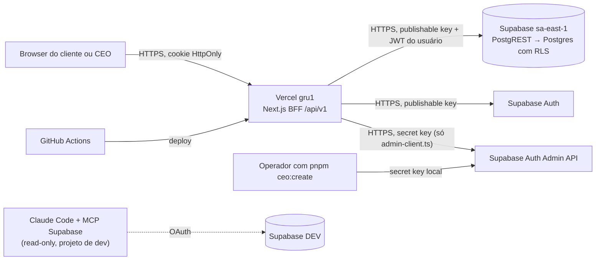

# Threat model — Rastreador de entregas (backend + banco)

> **Data:** 2026-11-15 (atualizado em 2026-11-16, Onda 3) · **Escopo:** API `/api/v1`, Supabase (Auth + Postgres), CI/CD e ferramentas
> de desenvolvimento · **Spec:** [`docs/specs/client-delivery-tracker.md`](../specs/client-delivery-tracker.md)
>
> Os controles citados (SEC-xx) estão definidos em §2.3 da spec. Atualize este documento sempre
> que a superfície de ataque mudar (rota nova, integração nova, papel novo).

## 1. Ativos

| Ativo | Por que importa |
|-------|-----------------|
| Dados de processo de cada cliente | Confidencialidade entre clientes concorrentes (vazamento cross-tenant é o pior cenário) |
| Contas de CEO | Uma conta de CEO lê tudo e avança processos de qualquer cliente |
| Integridade do fluxo de fases | Um "Ok" indevido muda o que o cliente vê e o que foi contratado |
| Trilha de auditoria | Prova de quem aprovou o quê (não repúdio) |
| `SUPABASE_SECRET_KEY` | Ignora RLS: comprometimento total do banco e do Auth |
| Dados pessoais (nome e e-mail) | LGPD |

## 2. Fronteiras de confiança e fluxo de dados

| Fronteira | Ameaça principal |
|-----------|------------------|
| Browser → BFF | Usuário malicioso autenticado (cliente curioso), CSRF, força bruta |
| BFF → PostgREST | Bug de autorização no app (mitigado por RLS e funções) |
| JWT do usuário → PostgREST direto | Usuário extrai o próprio JWT e chama o PostgREST sem passar pelo BFF |
| Secret key | Vazamento por log, commit, bundle do browser ou dependência maliciosa |
| CI/CD | Action ou dependência comprometida |
| Ferramentas de IA (MCP) | Prompt injection pelo conteúdo do banco; ação destrutiva |

## 3. STRIDE

| # | Elemento | STRIDE | Ameaça | Mitigação | Controles |
|---|----------|--------|--------|-----------|-----------|
| T-01 | Login | S | Força bruta e credential stuffing | Rate limit por IP (IPv6 agregado ao /64) e por conta, senha forte, HIBP, MFA de CEO. **Lacunas conhecidas:** o limite por IP só enxerga o /64, então um atacante com muitos prefixos escapa dele (o limite por conta e o teto global de T-03 cobrem o resto); o papel `client` não tem MFA (só CEO, SEC-11); o achado F-04 do threat-modeler fica para a Onda 11 | SEC-09, SEC-10, SEC-11 |
| T-02 | Login | I | Enumeração de e-mails | Resposta 401 idêntica (status, corpo e headers), sem cadastro público. **Tempo (F-05):** toda recusa de login responde só depois de um piso de 400 ms mais até 100 ms de jitter, medido do início do handler; o piso fica acima do caminho mais lento ("senha certa, conta desativada", cerca de 3 idas ao Auth), então senha errada, e-mail inexistente e conta desativada levam o mesmo tempo (se o Auth demorar mais que o piso, nada é somado). Com o provider de e-mail ligado, `/otp` e `/recover` do GoTrue seguem acessíveis a quem tiver a publishable key, que só existe no servidor (o browser nunca fala com o Supabase, ADR 0002); `/otp` e `/magiclink` não criam usuário (teste de integração). **Risco residual aceito:** `/otp` diferencia e-mail conhecido de desconhecido | SEC-12, SEC-20 |
| T-03 | Login | D | Esgotar a cota de logins do Supabase Auth (a cota `sign_in_sign_ups` conta por IP de origem e, atrás do BFF, o Auth só vê o IP do servidor) e derrubar o login de todos | Os limites por IP (20 / 15 min) e por conta **não** protegem essa cota contra um atacante distribuído: são por prefixo e por e-mail, e há muitos prefixos. **Teto global (F-02):** todo login gasta um orçamento `global` de 300 por 300 s antes de chamar o Auth, sempre abaixo da cota do Auth (1000 por 5 min no `config.toml` local; o projeto hospedado precisa ser configurado acima, Onda 11); acima dele, 429 `RATE_LIMITED` com `Retry-After`. **Residual aceito:** o teto troca um 503 por um 429 para todos durante o ataque, não impede a negação de serviço; o alerta de rajada de 429 (Onda 11) é a resposta | SEC-09 |
| T-04 | Login | D | Bloqueio direcionado: errar a senha de um CEO de propósito | Janela curta (15 min), sem bloqueio permanente, alerta. **Não mitigado, e sustentável:** 11 tentativas a cada 15 min, de qualquer IP, mantêm a conta bloqueada indefinidamente, não só a atrasam. **Decisão em aberto (F-03), para o usuário:** mudar o §3.9 da spec para (a) um limite por e-mail mais prefixo de IP, (b) um contador global por conta só de falhas, ou (c) um cookie de dispositivo que isente o navegador já conhecido. Fica registrado como pendente até a decisão | SEC-09 |
| T-05 | Sessão | S | Roubo de cookie via XSS | `HttpOnly`, CSP, API só JSON; frontend futuro com CSP de nonce | SEC-07, SEC-14 |
| T-06 | Sessão | S | Reuso de refresh token roubado; credencial roubada que vive para sempre | Rotação com detecção de reuso (Supabase revoga a família). A sessão vale no máximo 12 h e acaba após 4 h sem uso (ADR 0009): o Auth aplica `timebox` e `inactivity_timeout`, o banco repete os dois limites em `private.session_is_alive()` (F-08, migration `session_time_limits_in_db`), e o cookie vive 12 h | SEC-07 |
| T-07 | Sessão | E | JWT continua válido após logout ou desativação | `current_principal()` exige sessão viva em `auth.sessions` (dentro de 12 h e 4 h) e perfil ativo a cada requisição. O logout confirma no banco, antes do 204, que o token antigo já não tem principal (o client do Auth diz "deslogado" mesmo quando o Auth respondeu 401, 403 ou 404 sem revogar nada); se não confirmar, 503 e o cookie volta | SEC-07 |
| T-08 | Mutações | T | CSRF numa aprovação | SameSite=Lax, checagem de `Origin`, JSON obrigatório | SEC-08 |
| T-09 | `/me/*` | I | Cliente troca o `processId` (BOLA/IDOR) | Tenant derivado da sessão; filtro por tenant no repositório e RLS; 404 | SEC-03, SEC-05 |
| T-10 | `/me/*` | I | Cliente lê campos internos (quem aprovou) | Tabelas do cliente só com colunas seguras; dados internos em tabelas exclusivas de CEO; DTO explícito; contrato com `additionalProperties: false` | SEC-04 |
| T-11 | PostgREST direto | E | Cliente usa o próprio JWT para escrever ou ler fora do tenant | `authenticated` sem `INSERT/UPDATE/DELETE`; RLS somente `SELECT` por tenant; funções checam papel internamente | SEC-04 |
| T-12 | `/admin/*` | E | Cliente chama endpoint de CEO (BFLA) | Papel checado no pipeline **e** `private.is_ceo()` nas funções e policies | SEC-01, SEC-11 |
| T-13 | Contas | E | Criar ou promover um CEO pela API | Nenhum endpoint cria CEO; papel vem de `app_metadata` (só a secret key escreve); trigger recusa papel ausente; funções de conta recusam alvo CEO | RF-14, SEC-04 |
| T-14 | Contas | E | Usuário edita `user_metadata` para virar CEO | `raw_user_meta_data` nunca é lido para autorização | SEC-04 |
| T-15 | Banco | T | SQL injection (app, filtros PostgREST, funções) | Sem SQL no app; sem interpolação em `.or/.filter`; funções sem SQL dinâmico e com `search_path=''`; Zod `.strict()` | SEC-06 |
| T-16 | Banco | E | Hijack de `search_path` em função `SECURITY DEFINER` | `SET search_path = ''` com nomes qualificados, verificado por pgTAP | SEC-04, AC-25 |
| T-17 | Banco | E | Função nova executável por `PUBLIC` (padrão do Postgres) | `REVOKE EXECUTE … FROM PUBLIC, anon` em toda função, verificado por hook e pgTAP | SEC-04, AC-25 |
| T-18 | Aprovação | T | Dois CEOs aprovam ao mesmo tempo e o processo pula duas fases | `FOR UPDATE` + `expectedStageId` + índice único de fase atual | AC-17 |
| T-19 | Aprovação | R | CEO nega ter aprovado | `stage_approvals` + `audit_events` append-only na mesma transação, com `request_id` | SEC-16 |
| T-20 | Auditoria | T | Alterar ou apagar a trilha | `REVOKE UPDATE/DELETE/TRUNCATE` + trigger que bloqueia | AC-24 |
| T-21 | API | D | Payload gigante ou paginação sem limite | Corpo ≤ 16 KiB, tamanhos máximos, `limit` ≤ 100, rate limit por usuário | SEC-17, SEC-09 |
| T-22 | MFA | S | Força bruta de TOTP | 5 tentativas / 5 min por usuário | SEC-09 |
| T-23 | Erros | I | Stack trace ou erro SQL vazando estrutura | problem+json com `code` estável; mapeamento explícito; 500 genérico | SEC-13 |
| T-24 | Exceções | E | Falha numa checagem libera acesso (fail open) | Toda exceção em auth, authz ou rate limit nega a requisição | SEC-13, E-22 |
| T-25 | Segredos | I | Secret key no bundle do browser ou em log | Sem `NEXT_PUBLIC_`; `server-only`; uso restrito a um arquivo; redação de logs; gitleaks; hook. **F-12:** o singleton do admin client não é exportado: só uma fachada estreita (a Auth Admin API e o RPC `rate_limit_hit`), sem `.from`, `.rpc` genérico nem `.auth.signIn*`; o ESLint só deixa o rate limiter e a infraestrutura de identity importá-la | SEC-15, SEC-16 |
| T-26 | Supply chain | T | Dependência ou Action maliciosa | Lockfile, SHA pinado, Dependabot, `pnpm audit`, SAST, review de MCP e plugins | SEC-18 |
| T-27 | Ferramentas de IA | T/I | Conteúdo do banco (nome de cliente, fase) com prompt injection lido pelo agente via MCP | MCP read-only, só no projeto de dev, saída tratada como dado | SEC-18 |
| T-28 | Previews | I | Preview da Vercel apontando para dados de produção | Previews usam staging + Deployment Protection | §3.11 |
| T-29 | Sessão | D | Amplificação antes da autenticação: um cookie forjado (`{"access_token":"x","refresh_token":"y","expires_at":1}` basta) faz o servidor chamar o Auth (refresh, `getUser` ou busca de JWKS) a partir do IP da Vercel, sem limite algum antes da autenticação; um 429 do Auth derruba o refresh de todos os usuários legítimos (F-01). Variantes: `expires_at` como `"1"`, `null`, `0`, `-1` ou `Infinity`, cookie vazio mais chunk, chunk com buraco, token simétrico, sem `kid`, `kid` desconhecido | **Invariante:** toda chamada ao Auth feita ao resolver um principal é cobrada do orçamento por IP `session-upstream` (60 por 900 s, IPv6 no /64), e um IP sem orçamento não chega ao Auth. Três camadas. **(1) Predição que falha fechada** (`classifySession`): o cookie é lido como `@supabase/ssr` e o auth-js o leem (`combineChunks`, prefixo `base64-`, `JSON.parse`, `_isValidSession`, `hasExpired` com a mesma verdade e coerção numérica, `decodeJWT`, `validateExp`) e a resposta é "sem chamada" **só** quando se prova que não há chamada: nenhum cookie de sessão, ou token não vencido de algoritmo assimétrico (ES256/RS256) cujo `kid` foi visto verificando neste processo há menos de 5 min (metade do TTL de 10 min do cache de JWKS). Qualquer outra coisa, inclusive cookie presente e ilegível, gasta uma unidade antes de `getClaims()`. Acima do orçamento: 401 **sem apagar os cookies**, log `auth.rate_limited` e nenhuma chamada ao Auth. **(2) Recusa local (MÉDIO 2):** o que faria o auth-js lançar uma exceção que não é erro de autenticação (e viraria 500 para qualquer anônimo: algoritmo fora de HS*/ES256/RS256, `alg` que não é string, cabeçalho ou payload que não é JSON, token que não é string, `kid` conhecido com outro algoritmo) e o que ele rejeitaria sem chamar o Auth (`exp` ausente ou vencido) recebe 401 antes do cliente rodar, sem gastar orçamento. **(3) Medição:** o `fetch` do cliente da requisição conta as chamadas a `/auth/v1/`; o resolvedor compara a contagem antes e depois de `getClaims()` e cobra a diferença depois do fato (parando na primeira recusa), com o log `auth.session_budget_mispredicted` (nível warn, contagem e `ipHash`, nunca o cookie). Predição errada vira alerta, não brecha. **Segunda linha:** mesmo para um token que se verifica localmente, o resolvedor consulta a memória do limitador (`peekDenial`, sem contar, sem banco): IP já sabidamente sem orçamento recebe 401. Limitador que falha: 503 (fail closed). Se o Auth responde 429 ao refresh, 503 e o cookie é mantido. Um `kid` é esquecido se a verificação falha depois de uma chamada ao Auth ou com qualquer erro que não seja `AuthInvalidJwtError`, nunca por uma simples falha de assinatura local (senão um forjador com um `kid` real o expulsaria da lista). **Trade-off aceito:** um navegador legítimo, com token local, atrás de um IP que um forjador esgotou também leva 401 até o fim da janela (o cookie é mantido e a sessão volta quando o orçamento volta). **Residual:** um `kid` novo e legítimo gasta uma unidade uma vez por processo (e de novo após 5 min sem uso) | SEC-09, SEC-13 |
| T-30 | Rate limit | D | O limitador como amplificador: um flood contra um sujeito já bloqueado custa uma escrita no banco por requisição; `private.rate_limit_counters` cresce sem limite com sujeitos variados (F-06, F-07) | Cache de negações em memória, por instância, consultado antes do RPC (só deixa o limite mais estrito, nunca libera, então não enfraquece o fail closed) e limitado: cheio, sai a entrada mais antiga em O(1), sem varrer o mapa a cada negação (BAIXO 5), para que um flood de sujeitos distintos não vire carga de CPU; `rate_limit_hit` apaga, em cerca de 1% das chamadas, até 500 janelas vencidas há mais de 48 h (migration `rate_limit_opportunistic_cleanup`). A limpeza diária por `pg_cron` entra na Onda 11 | SEC-09, E-22 |
| T-31 | Sessão | S/T | Fixação de sessão, CSRF e cookie tossing | Todo login cria uma sessão e tokens novos no Auth e sobrescreve o cookie (não há como impor um id de sessão); `__Host-` obriga `Secure`, `Path=/` e nenhum `Domain`, o que impede um subdomínio de plantar o cookie; `SameSite=Lax` mais checagem de `Origin` e JSON obrigatório (T-08). **Residual (F-10):** um login feito sobre uma sessão existente não revoga a anterior; ela expira pelo `timebox` de 12 h (ADR 0009) | SEC-07, SEC-08 |
| T-32 | Logs | R/T | Correlação falsificada ou insuficiente: um `X-Request-Id` escolhido pelo cliente entra na trilha de auditoria e nos logs; eventos de auth sem sessão nem origem (F-09, F-11) | O id da requisição é sempre gerado no servidor (UUID v4) e é o que vai ao header, ao `problem+json`, aos logs e ao `x-request-id` do banco, então a auditoria só carrega ids do servidor; um valor válido do cliente é registrado à parte como `clientRequestId`. Os eventos `auth.login.*` e `auth.logout` levam `sessionId` e `ipHash` (HMAC com chave derivada, nunca o IP), e `auth.rate_limited` leva `subjectHash` | SEC-16, RNF-04 |

## 4. OWASP Top 10:2025

| Categoria | Como é tratada |
|-----------|----------------|
| A01 Broken Access Control | Deny by default (SEC-01); tenant da sessão (SEC-03); autorização em três camadas com RLS (SEC-04); 404 cross-tenant (SEC-05); MFA de CEO (SEC-11); SSRF fora da superfície (SEC-19) |
| A02 Security Misconfiguration | Headers (SEC-14); cadastro público desligado, `pg_graphql` removido, chaves JWT assimétricas (SEC-20); `config.toml` versionado; previews isolados |
| A03 Software Supply Chain Failures | Lockfile, Actions por SHA, Dependabot, `pnpm audit`, SAST, gitleaks, MCP e plugins revisados (SEC-18) |
| A04 Cryptographic Failures | TLS em tudo + HSTS; bcrypt do Supabase Auth; HMAC nas chaves de rate limit; segredos fora do código (SEC-15) |
| A05 Injection | §3.8 da spec: sem SQL no app, sem interpolação em filtros, funções sem SQL dinâmico, Zod `.strict()` (SEC-06); API só JSON com CSP (XSS) |
| A06 Insecure Design | Threat model, máquina de estados com invariantes no app e no banco, concorrência otimista, escrita só por funções (SEC-04) |
| A07 Authentication Failures | Rate limit (SEC-09), política de senha e HIBP (SEC-10), MFA (SEC-11), sem enumeração (SEC-12), sessão revogável (SEC-07) |
| A08 Software or Data Integrity Failures | Auditoria append-only (SEC-16); migrations imutáveis depois de mergeadas; deploy só por pipeline verde |
| A09 Security Logging & Alerting Failures | Logs JSON com request id, eventos de auth, auditoria no banco, alertas (spec §3.10) |
| A10 Mishandling of Exceptional Conditions | Fail closed (SEC-13); timeouts (SEC-19); transações atômicas com compensação (E-23); mapeamento de erros explícito |

## 5. OWASP API Security Top 10:2023

| Risco | Tratamento |
|-------|------------|
| API1 BOLA | Tenant da sessão + RLS + 404 (T-09) |
| API2 Broken Authentication | T-01 a T-07, T-22 |
| API3 Broken Object Property Level Authorization | DTOs explícitos, `.strict()` na entrada, `additionalProperties: false` na saída, tabelas do cliente sem colunas internas (T-10) |
| API4 Unrestricted Resource Consumption | Limites de corpo, strings, fases e paginação; rate limit (T-21) |
| API5 Broken Function Level Authorization | Papel no pipeline e no banco (T-12) |
| API6 Unrestricted Access to Sensitive Business Flows | Aprovação só por CEO `aal2`, com concorrência controlada e auditada (T-18, T-19) |
| API7 Server Side Request Forgery | Nenhum fetch de URL do usuário (SEC-19) |
| API8 Security Misconfiguration | A02 acima |
| API9 Improper Inventory Management | Contrato versionado e único; hook de Stop bloqueia rota sem contrato; agent `contract-guardian` |
| API10 Unsafe Consumption of APIs | Respostas do Supabase validadas com Zod; timeouts |

## 6. Abuse cases que viram testes

| Abuse case | Teste |
|------------|-------|
| Cliente A pede `/me/processes/{id-de-B}` | API: 404 (AC-09) |
| Cliente A chama o PostgREST direto com o próprio JWT em `processes` de B e tenta `INSERT` | pgTAP (AC-09, AC-10) |
| Cliente chama `approve_current_stage` via RPC | pgTAP: 42501 |
| CEO com sessão `aal1` chama uma função de CEO | pgTAP: 42501 (AC-08) |
| Duas aprovações simultâneas | API: 1 × 200 e 1 × 409 (AC-17) |
| POST de aprovação vindo de outra origem | API: 403 `ORIGIN_NOT_ALLOWED` (AC-23) |
| 11 logins errados para a mesma conta | API: 429 (AC-03) |
| Cookie reaproveitado após logout | API: 401 (AC-04) |
| Logout quando o Auth responde 403 sem revogar | API: 503 e cookie mantido; a sessão continua viva (AC-04) |
| Troca de senha com a senha atual errada (6 tentativas em 15 min) | API: 422 `INVALID_CURRENT_PASSWORD` nas 5 primeiras, 429 na 6ª, mesmo com a senha certa; nada muda (AC-06) |
| Chamar `mark_password_changed()` direto no PostgREST, sem trocar a senha | API: `PASSWORD_UNCHANGED`, a pendência continua (AC-05, ADR 0007) |
| Cliente manda `role` (ou `app_metadata`) em qualquer corpo, ou escreve `role: ceo` em `user_metadata` | API: 400 pelo `.strict()`; a sessão segue `client` e `/admin/*` segue 403 (AC-31) |
| 75 requisições com um cookie forjado do mesmo IP | API: no máximo 60 chamadas ao Auth, o resto 401 sem `Set-Cookie` (F-01) |
| 63 requisições do mesmo IP para cada variante de cookie forjado (`expires_at` estranho, chunks, token simétrico, sem `kid`, `kid` desconhecido ou real com assinatura falsa, ES384) | API: no máximo 60 chamadas ao Auth por variante, nenhuma depois de esgotado o orçamento, sempre 401 e nunca 5xx (F-01) |
| Token ES384 forjado com o `kid` real | API: 401, não 500, e nenhuma chamada ao Auth (MÉDIO 2) |
| Refresh que deu certo e verificação que então falha com 503 | unit: os cookies novos ficam, o refresh token consumido não volta (MÉDIO 3) |
| Login recusado de três jeitos (senha errada, e-mail inexistente, conta desativada) | API: mesmo 401 e mesmo piso de tempo (AC-02, F-05) |
| Sessão com 12 h 1 min, ou sem uso há 4 h 1 min, ainda com JWT válido | pgTAP: sem principal (SEC-07, F-08) |
| Corpo com campo extra `clientId` em `/me/*` ou `role` em provisionamento | API: 400 (AC-23) |

## 7. Riscos residuais aceitos

- **T-04 (não aceito, pendente de decisão):** um atacante consegue manter bloqueado o login de um
  CEO específico de forma sustentada (11 tentativas a cada 15 min bastam), não só atrasá-lo. A
  decisão F-03 sobre o §3.9 da spec é do usuário; até lá o risco está aberto, com alerta.
- **Janela do access token:** sem o BFF, o JWT vale até 15 min. Pelo BFF, a revogação é imediata
  (checagem de sessão no banco).
- **Login sobre uma sessão existente (F-10):** a sessão anterior não é revogada; expira pelo
  `timebox` de 12 h (ADR 0009).
- **Enumeração por `/otp` (T-02):** ver T-02.
- **Logout que falha (BAIXO 6):** quando o logout falha (503), os cookies são devolvidos ao navegador com
  `maxAge` de 12 h de novo, então o cookie pode viver além do `timebox`. Aceito: o banco aplica 12 h de
  vida e 4 h sem uso à sessão (`private.session_is_alive()`, F-08), então o cookie estendido não
  autentica nada depois do limite.
- **Refresh que termina depois do prazo de 5 s (MÉDIO 3):** se o Auth conclui o refresh depois que o
  resolvedor desistiu (503), o navegador ainda tem o refresh token antigo, que o Auth aceita dentro do
  intervalo de reuso (10 s) e depois trata como reuso e revoga a família. O resolvedor fecha o jar
  (`fenceRequestClient`) para que o trabalho abandonado não escreva cookies, mas não consegue desfazer
  o refresh do lado do Auth.
- **Chamadas ao Auth depois do prazo (T-29):** o `getClaims()` abandonado por prazo continua
  tentando de novo (o auth-js repete um refresh que falha por rede, por até cerca de 30 s). O fence
  também bloqueia o `fetch` do cliente: cada nova tentativa falha na hora, sem requisição, então
  nada chega ao Auth sem cobrança. Resta só a requisição que já estava em voo no momento do fence,
  que termina pelo próprio timeout de 5 s.
- **Insider CEO:** um CEO pode aprovar indevidamente. Mitigado por auditoria, não por prevenção.
  Desfazer aprovação fica para a v1.1 (Q-05).

## 8. Pendências e decisões em aberto

| Item | Situação |
|------|----------|
| F-03 (bloqueio direcionado, T-04) | **Decisão do usuário**, muda o §3.9 da spec: limite por e-mail mais prefixo de IP, contador global por conta só de falhas, ou cookie de dispositivo. Não mitigado |
| F-04 (T-01) | Adiado para a Onda 11 |
| F-13 | **Decidido na Onda 4 (ADR 0010): ligado** (`secure_password_change = true` em `config.toml`). Com sessões de no máximo 12 h (ADR 0009) o Auth nunca pede o nonce no fluxo do app (só o pede para sessão com mais de 24 h), então a chave não muda nada para o usuário; ela fecha o `PUT /auth/v1/user` direto com a sessão velha enquanto o `timebox` não estiver no projeto hospedado (Onda 11). A chave **não prova a senha atual**: isso é do app, que a confere por um sign-in descartável (ADR 0010). **Aberto, Onda 11:** ligar `security_update_password_require_current_password` no projeto hospedado (Management API; não existe em `config.toml`), porque quem tem o token de acesso de uma sessão com menos de 24 h e a chave publicável troca a senha direto no Auth, sem a senha atual. Também fica a troca que falha no meio (a senha nova vale e a pendência segue de pé até o usuário repetir com a senha nova como atual; log `auth.password_change.incomplete`) e o limite de adivinhação da senha atual: 5 / 15 min na troca, somados aos 10 / 15 min por conta do login (contadores separados) |
| F-14 | Registrado pelo threat-modeler como observação, sem ação nesta onda |
| MÉDIO 4 (T-02) | O piso de 400 ms do login recusado pode não cobrir o caminho "conta desativada" em produção: são cerca de 3 idas ao Auth, de gru1 a sa-east-1, e o piso foi medido com o Supabase local. **Onda 11:** medir o p95 dos três caminhos recusados em produção e subir `REFUSED_LOGIN_FLOOR_MS` acima dele; até lá a diferença de tempo é um canal lateral possível, não confirmado |
| BAIXO 6 | Aceito, ver o §7 (logout que falha devolve o cookie com `maxAge` de 12 h; o banco aplica 12 h e 4 h) |
