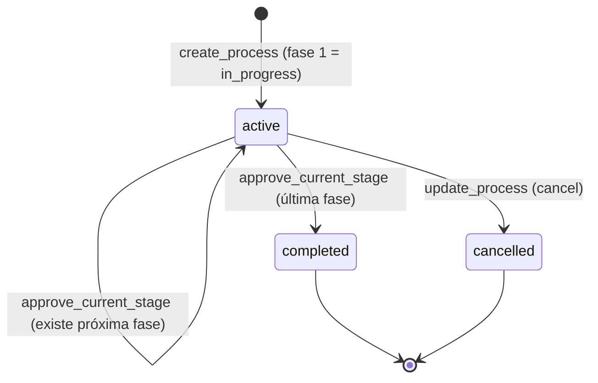
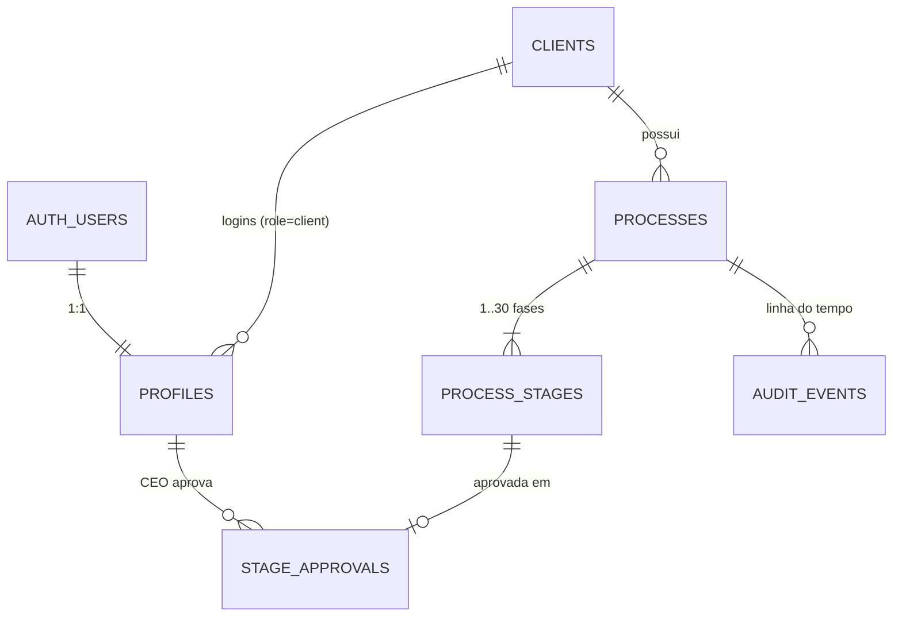

# Spec — Rastreador de entregas para clientes (backend + banco)

> **Status:** rascunho para revisão · **Versão:** 0.1 · **Data:** 2026-11-15
> **Escopo desta spec:** somente **backend e banco de dados**. Os painéis (frontend) terão spec própria.
>
> Artefatos ligados: contrato [`contracts/openapi.v1.yaml`](../../contracts/openapi.v1.yaml) ·
> threat model [`docs/security/threat-model.md`](../security/threat-model.md) ·
> plano [`docs/plan/implementation-waves.md`](../plan/implementation-waves.md) ·
> ADRs [`docs/adr/`](../adr/)

---

## 1. Visão geral

### 1.1 Objetivo

Quando um cliente fecha contrato, ele recebe um link (o domínio deste projeto) e um login criado
manualmente. Com ele, acompanha **somente** o andamento das próprias entregas, fase a fase. Os
**4 CEOs** têm um painel próprio: veem todos os clientes (uma aba por cliente) e todos os
processos, e **só eles** avançam um processo para a próxima fase, dando um "Ok".

Este backend entrega:

1. Autenticação com login e senha criados manualmente, sem cadastro público.
2. Isolamento rígido entre clientes (multi-tenant), validado em três camadas.
3. O fluxo de fases com aprovação por um único CEO, atômico e seguro sob concorrência.
4. Trilha de auditoria de toda mutação de negócio.

### 1.2 Atores

| Ator | `role` | Como a conta nasce | O que vê | O que faz |
|------|--------|--------------------|----------|-----------|
| Cliente | `client` | Um CEO provisiona pela API e recebe uma senha temporária | Só os processos do **próprio** cliente | Lê o andamento e troca a própria senha |
| CEO (4 pessoas) | `ceo` | Script operacional fora da API (`pnpm ceo:create`); **não existe endpoint que crie CEO** | Todos os clientes e processos | Cria clientes, logins de cliente e processos; aprova fases; cancela e arquiva |

### 1.3 Linguagem ubíqua

| Termo (pt-BR) | No código (en) | Definição |
|---------------|----------------|-----------|
| Cliente | `Client` | Empresa contratante. É o **tenant**. |
| Login de cliente | `ClientUser` | Credencial (e-mail e senha) vinculada a exatamente um cliente. |
| Processo | `Process` | Acompanhamento de uma entrega contratada. Pertence a um cliente e tem fases ordenadas. |
| Fase | `Stage` | Etapa de um processo: `pending` → `in_progress` → `completed`. |
| "Ok" / Aprovação | `Approval` | Ato de **um** CEO que conclui a fase atual e inicia a próxima. |
| Template de fases | `StageTemplate` | Lista padrão de fases, copiada para o processo no momento da criação. |
| Principal | `Principal` | Identidade autenticada da requisição: `userId`, `role`, `clientId`, `aal` e pendências. |
| Pendência | `PendingAction` | Ação que o usuário precisa concluir antes de usar o sistema: `CHANGE_PASSWORD`, `ENROLL_MFA` ou `VERIFY_MFA`. |
| Evento de auditoria | `AuditEvent` | Registro append-only de uma mutação de negócio. |

### 1.4 Escopo

**Dentro (v1):** login, logout e sessão; troca de senha obrigatória no primeiro acesso; MFA TOTP
obrigatório para CEOs; gestão de clientes e de logins de cliente (provisionar, listar, desativar
e resetar senha); processos com fases (template padrão ou fases informadas); aprovação de fase;
cancelamento; linha do tempo; leitura pelo cliente; auditoria; rate limiting; observabilidade;
migrations com RLS e testes.

**Fora (v1):** frontend; "esqueci minha senha" por e-mail (o reset é feito por um CEO);
notificações por e-mail ou WhatsApp; anexos e upload; desfazer aprovação ou reabrir fase; editar
fases depois de criadas; mensagens por fase visíveis ao cliente; criação de CEO pela API;
internacionalização. Os itens com chance de entrar depois estão em §8.

---

## 2. Requisitos

### 2.1 Funcionais

| ID | Requisito | Endpoint(s) | Aceite |
|----|-----------|-------------|--------|
| RF-01 | Usuário faz login com e-mail e senha. Não existe cadastro público. | `POST /auth/login` | AC-01, AC-02, AC-03 |
| RF-02 | Usuário encerra a sessão, que é revogada no servidor. | `POST /auth/logout` | AC-04 |
| RF-03 | Usuário consulta a própria sessão: papel, cliente e pendências. | `GET /auth/session` | AC-05, AC-07 |
| RF-04 | Usuário troca a própria senha. A troca é obrigatória após senha temporária, que vale **72 h** (criação ou reset): vencida, a conta fica sem principal até um reset (SEC-10, ADR 0013). | `POST /auth/password` | AC-05, AC-06, E-34, E-35 |
| RF-05 | CEO cadastra e verifica MFA TOTP. É obrigatório para usar o painel de CEO. | `POST /auth/mfa/totp/enroll`, `POST /auth/mfa/totp/verify` | AC-07, AC-08 |
| RF-06 | CEO lista, cria, consulta, renomeia, arquiva e desarquiva clientes. | `GET/POST /admin/clients`, `GET/PATCH /admin/clients/{clientId}` | AC-11 |
| RF-07 | CEO provisiona logins de um cliente com senha temporária exibida **uma única vez**; lista, desativa, reativa e reseta a senha. | `/admin/clients/{clientId}/users/**` | AC-12, AC-13, AC-14 |
| RF-08 | CEO cria um processo para um cliente com as fases informadas ou com o template padrão. A fase 1 inicia `in_progress`. | `POST /admin/clients/{clientId}/processes`, `GET /admin/stage-templates/default` | AC-15 |
| RF-09 | CEO lista os processos de qualquer cliente e vê o detalhe completo (base das abas por cliente). | `GET /admin/clients/{clientId}/processes`, `GET /admin/processes/{processId}` | AC-15, AC-16 |
| RF-10 | CEO dá "Ok" na fase atual: ela vira `completed` e a próxima `in_progress`. Basta **um** CEO. A última aprovação conclui o processo. | `POST /admin/processes/{processId}/approvals` | AC-16, AC-17, AC-18 |
| RF-11 | CEO renomeia ou cancela um processo ativo. | `PATCH /admin/processes/{processId}` | AC-19 |
| RF-12 | CEO vê a linha do tempo do processo, com quem fez o quê e quando. | `GET /admin/processes/{processId}/events` | AC-28 |
| RF-13 | Cliente lista e detalha **somente** os próprios processos, sem dados internos. | `GET /me/processes`, `GET /me/processes/{processId}` | AC-09, AC-20, AC-21 |
| RF-14 | Contas de CEO são criadas apenas por script operacional auditado, nunca pela API. A criação grava `account.provisioned` na trilha de auditoria, na mesma transação, sem ator. | `pnpm ceo:create` (fora do contrato) | AC-31 |
| RF-15 | Health check público e sem detalhes internos. | `GET /health` | AC-29 |

### 2.2 Não funcionais

| ID | Requisito |
|----|-----------|
| RNF-01 | **Segurança:** atender OWASP Top 10:2025 e OWASP API Security Top 10:2023. O mapeamento está em [`docs/security/threat-model.md`](../security/threat-model.md); os requisitos concretos são os SEC-* de §2.3. |
| RNF-02 | **Desempenho** (tempo de servidor, Vercel `gru1` ↔ Supabase `sa-east-1`): p95 < 300 ms em leituras e < 500 ms em escritas, com até 50 requisições/s. |
| RNF-03 | **Escala-alvo:** até 500 clientes, 2.000 processos, 30 fases por processo, 10 logins por cliente e 4 CEOs. Não se otimiza além disso. |
| RNF-04 | **Observabilidade:** logs JSON estruturados, `X-Request-Id` ponta a ponta (HTTP → banco), auditoria de mutações e logs de eventos de autenticação. |
| RNF-05 | **LGPD:** dados no Brasil (`sa-east-1` e `gru1`), minimização, base legal e retenção definidas (§3.12). |
| RNF-06 | **Qualidade:** TypeScript strict (`strict`, `noUncheckedIndexedAccess`, `exactOptionalPropertyTypes`), cobertura ≥ 80% em `domain/` e `application/`, toda policy e função do banco coberta por pgTAP. |
| RNF-07 | **Compatibilidade:** API versionada em `/api/v1`. Mudança incompatível vira `/api/v2` com nota de compatibilidade; mudança aditiva é bump minor do contrato. |
| RNF-08 | **Disponibilidade:** herda os SLAs de Vercel e Supabase. Produção no plano Pro do Supabase, porque projetos Free pausam por inatividade e não têm proteção contra senhas vazadas. |

### 2.3 Requisitos de segurança

| ID | Requisito |
|----|-----------|
| SEC-01 | **Deny by default.** Toda rota declara uma política de acesso explícita. As únicas rotas públicas são `GET /health` e `POST /auth/login`, marcadas no contrato com `security: []`. |
| SEC-02 | **Ordem fixa no pipeline:** request id → checagens de transporte (Origin, Content-Type, tamanho) → rate limit → autenticação → autorização (papel e pendências) → validação de input → caso de uso. |
| SEC-03 | **Tenant vem da sessão, nunca do cliente.** Endpoints de cliente (`/me/*`) não recebem `clientId` em path, query ou body. O tenant é derivado de `auth.uid()` no banco. |
| SEC-04 | **RLS em todas as tabelas de `public`.** Policies existem somente para `SELECT`. `anon` não tem nenhum privilégio. `authenticated` não tem `INSERT/UPDATE/DELETE` em nenhuma tabela: escritas só por funções `SECURITY DEFINER` com `SET search_path = ''`, nomes totalmente qualificados e checagem de papel e tenant dentro da função. |
| SEC-05 | **Acesso cross-tenant retorna 404** (nunca o dado e nunca 403, que revelaria a existência do recurso). Testes cross-tenant são obrigatórios em pgTAP e na API. |
| SEC-06 | **SQL injection:** nenhuma SQL montada por concatenação no app; acesso só pelo client Supabase (PostgREST parametrizado) e por RPC com parâmetros tipados; nenhuma SQL dinâmica em funções (se inevitável, `format()` com `%I`/`%L` e `EXECUTE ... USING`); input do usuário nunca interpolado em filtros PostgREST (`.or()`, `.filter()`, `.textSearch()`). Todos os objetos Zod usam `.strict()` (rejeitam campos desconhecidos, o que evita mass assignment). Ver §3.8. |
| SEC-07 | **Sessão:** cookie `__Host-rt-session` com `HttpOnly`, `Secure`, `SameSite=Lax` e `Path=/`. O access token expira em 15 min; refresh token com rotação e detecção de reuso. A sessão dura no máximo 12 h e é encerrada após 4 h de inatividade (`[auth.sessions] timebox` e `inactivity_timeout`); o cookie tem o mesmo teto de 12 h (ADR 0009). O servidor valida o JWT com `getClaims()`/`getUser()` e nunca confia em `getSession()`. A sessão é checada no banco a cada requisição (`auth.sessions`), o que torna logout e desativação efetivos imediatamente. |
| SEC-08 | **CSRF:** métodos não seguros exigem `Origin` igual a uma origem permitida (`APP_ORIGIN`; em preview, as URLs da própria deployment). O corpo precisa ser `application/json`. SameSite=Lax completa a defesa. |
| SEC-09 | **Rate limiting** por IP, por conta e por usuário (§3.9), com resposta 429 e `Retry-After`. O limitador fica **na frente** do Supabase Auth. |
| SEC-10 | **Senhas:** de 12 a 72 bytes UTF-8 (o bcrypt trunca acima de 72 bytes); a nova precisa ser diferente da atual; senha temporária com 20 caracteres gerados por CSPRNG, exibida uma única vez, com troca obrigatória e **validade de 72 h** contadas da criação ou do reset (vencida, a conta perde o principal e o login é recusado com o erro genérico; um reset por um CEO recomeça o prazo, ADR 0013); troca exige a senha atual e revoga as demais sessões; proteção contra senhas vazadas (HIBP) do Supabase ativada em produção. |
| SEC-11 | **MFA TOTP obrigatório para CEO.** Todo endpoint `/admin/*` e toda função de CEO no banco exigem `aal2` **atestado pelo backend**: a sessão só vale como CEO depois de um verify de TOTP que passou pelo backend (que aplica os limites de força bruta e queima o código), e uma `aal2` obtida direto no Auth, com a senha e a publishable key, não dá poder de CEO nem pelo backend nem pelo PostgREST (ADR 0013). |
| SEC-12 | **Sem enumeração de usuários:** o login responde `401 INVALID_CREDENTIALS` com corpo idêntico para e-mail inexistente, senha errada e conta desativada. |
| SEC-13 | **Erros sem internals:** `application/problem+json` (RFC 9457) com `code` estável e `requestId`, sem stack, SQL ou mensagem do Supabase. Qualquer exceção numa checagem de segurança resulta em negação (**fail closed**). |
| SEC-14 | **Headers em toda resposta:** HSTS (2 anos, `includeSubDomains; preload`), `Content-Security-Policy: default-src 'none'; frame-ancestors 'none'` na API, `X-Content-Type-Options: nosniff`, `X-Frame-Options: DENY`, `Referrer-Policy: no-referrer`, `Permissions-Policy` mínima, `Cache-Control: no-store` e `X-Request-Id`. Sem CORS (mesma origem), sem `X-Powered-By`. |
| SEC-15 | **Segredos:** chaves só no servidor. Nenhuma variável do Supabase usa prefixo `NEXT_PUBLIC_`. A secret key é lida apenas em `src/shared/db/admin-client.ts` (com `import 'server-only'`) e em `scripts/`. |
| SEC-16 | **Auditoria append-only:** toda mutação de negócio grava `audit_events` **na mesma transação**. A tabela não aceita `UPDATE` nem `DELETE`. Eventos de autenticação vão para logs estruturados. Logs sem PII (redação de e-mail, senha, cookie, `authorization` e tokens). |
| SEC-17 | **Limites de input:** corpo ≤ 16 KiB; todas as strings com tamanho máximo; até 30 fases por processo; paginação com `limit` ≤ 100; cursor opaco validado. |
| SEC-18 | **Supply chain:** lockfile commitado, GitHub Actions pinadas por SHA com `permissions: contents: read`, Dependabot, gitleaks, `pnpm audit`, SAST (CodeQL ou Semgrep). O MCP do Supabase fica restrito ao projeto de **dev**, em modo read-only. |
| SEC-19 | **Chamadas de saída** só para o Supabase (URL vinda de env), com timeout de 5 s. Nenhum fetch de URL controlada pelo usuário: SSRF fica fora da superfície por design. |
| SEC-20 | **Superfície mínima no Supabase:** cadastro público desativado, extensão `pg_graphql` removida, Storage e Realtime sem uso, chaves de assinatura JWT assimétricas. |

---

## 3. Design técnico

### 3.1 Stack e decisões

| Camada | Escolha | ADR |
|--------|---------|-----|
| Runtime e API | Next.js 16+ (App Router, Route Handlers, runtime Node.js), TypeScript strict | [0001](../adr/0001-stack-nextjs-supabase-vercel.md) |
| Hospedagem | Vercel, funções na região `gru1` (São Paulo) | 0001 |
| Banco e Auth | Supabase (Postgres + Auth), região `sa-east-1` (São Paulo) | 0001 |
| Sessão | Next.js como **BFF**: o browser fala só com `/api/v1`, nunca direto com o Supabase. Cookie HttpOnly via `@supabase/ssr` | [0002](../adr/0002-bff-sessao-cookie-httponly.md) |
| Autorização | Três camadas: pipeline HTTP, funções `SECURITY DEFINER` (único caminho de escrita) e RLS (leitura) | [0003](../adr/0003-autorizacao-em-camadas-rls-e-funcoes.md) |
| Rate limiting | Contadores em Postgres (`private`), atrás de uma interface `RateLimiter` | [0004](../adr/0004-rate-limiting-no-postgres.md) |
| Arquitetura | Monolito modular com vertical slices e camadas DDD por módulo | [0005](../adr/0005-monolito-modular-vertical-slices.md) |
| Validação | Zod (`.strict()`) em toda fronteira, inclusive nas respostas do Supabase | — |
| Logs | pino (JSON) com redação | — |
| Testes | Vitest (unit, integração e API), pgTAP (`supabase test db`), validação de contrato com Ajv sobre o OpenAPI | — |
| Contrato | OpenAPI 3.1, lint com Redocly | — |

### 3.2 Arquitetura

Monolito modular com dois bounded contexts e um kernel compartilhado:

```
src/
├── app/api/v1/**/route.ts        # adaptadores finos: só reexportam o handler do módulo
├── modules/
│   ├── identity/                 # autenticação, sessão, senha, MFA, contas (logins)
│   │   ├── domain/               # Role, Principal, PendingAction, política de senha
│   │   ├── application/          # um arquivo por caso de uso (login.ts, change-password.ts …)
│   │   ├── infrastructure/       # gateways Supabase Auth, repositórios, admin gateway
│   │   ├── presentation/         # schemas Zod, mappers de DTO, handlers HTTP
│   │   └── index.ts              # API pública do módulo
│   └── tracking/                 # clientes, processos, fases, aprovações, linha do tempo
│       └── (mesma estrutura)
└── shared/
    ├── http/                     # withRoute: pipeline seguro, problem+json, políticas
    ├── db/                       # fábricas de client Supabase (server-only) + tipos gerados
    ├── observability/            # logger, request id
    ├── config/                   # env validado por Zod (falha no boot)
    └── kernel/                   # Result, erros base, Clock, tipos de id
```

**Regras de fronteira** (aplicadas pelo ESLint a partir da Onda 0):

- `domain/` não importa nada de fora do próprio `domain/` e do `shared/kernel`.
- `application/` depende de interfaces (ports) declaradas em `domain/`; `infrastructure/` as implementa.
- Um módulo só importa outro pelo `index.ts`. `identity` conhece `clientId` apenas como id opaco
  e consulta a existência de um cliente via `tracking` (`index.ts` → `getClientStatus`).
  `tracking` **não** importa `identity`: a dependência é de mão única, sem ciclo.
- Não há container de DI compartilhado: cada handler monta as próprias dependências. Assim,
  slices paralelos não disputam o mesmo arquivo de composição.
- `src/app/**/route.ts` não importa `@supabase/*` nem `@/shared/db`.
- Leituras do cliente usam um **query service** separado do repositório do agregado (CQRS leve),
  para que os slices de leitura e de escrita evoluam sem conflito.

### 3.3 Pipeline de requisição (`withRoute`)

Toda rota é criada com `withRoute(policy, handler)`. O tipo `policy` **não tem default**:
`{ access: 'public' }` precisa ser escrito explicitamente.

```
 1. Gera X-Request-Id (UUID v4), SEMPRE no servidor. Um X-Request-Id enviado pelo cliente nunca vira
    o id da requisição: se casar com ^[A-Za-z0-9-]{8,64}$, é registrado à parte nos logs como
    `clientRequestId`; senão é ignorado. Resposta, `problem+json`, logs e auditoria só carregam o id do servidor.
 2. Métodos não seguros: Origin ∈ origens permitidas            → senão 403 ORIGIN_NOT_ALLOWED
 3. Corpo: Content-Type application/json e tamanho ≤ 16 KiB      → 415 / 413
 4. Rate limit do grupo da rota (IP, conta ou usuário)          → 429 + Retry-After
 5. Autenticação: getClaims() + RPC current_principal()         → 401 UNAUTHENTICATED
 6. Autorização: papel ∈ policy.roles                           → 403 FORBIDDEN
                 pendências ⊆ policy.allowPending               → 403 <pendência>_REQUIRED
 7. Validação Zod (.strict()) de params, query e body           → 400 VALIDATION_ERROR
 8. Caso de uso (Result<T, DomainError>)
 9. Mapeia o resultado para DTO e status; erro de domínio → problem+json
10. Headers de segurança e X-Request-Id em TODAS as respostas, inclusive erros
```

`withRoute` lê cookies de `NextRequest` e escreve em `NextResponse` (sem `next/headers`), de modo
que um handler pode ser testado por invocação direta. O client Supabase de cada requisição envia
o header `x-request-id`, que as funções do banco gravam na auditoria
(`current_setting('request.headers', true)::json->>'x-request-id'`).

### 3.4 Autenticação e sessão

- **Login** (`POST /auth/login`): normaliza o e-mail (trim + lowercase, NFC) → rate limit por IP
  e por conta (HMAC do e-mail) → `signInWithPassword` num client que grava cookies → carrega
  `current_principal()` → se não houver principal ativo, faz `signOut` e responde 401 genérico.
  Antes de chamar o Auth, o login gasta o orçamento global de logins (§3.9). Só as respostas do Auth
  que dizem "estas credenciais não abrem sessão" (`invalid_credentials`, `user_banned`,
  `email_not_confirmed`) viram o 401 genérico; falha de transporte, timeout, 5xx, 429 e qualquer
  outro código do Auth viram 503, nunca 401. Toda recusa (401) responde só depois de um piso de
  400 ms mais até 100 ms de jitter, medido do início do handler, para que senha errada, e-mail
  inexistente e conta desativada levem o mesmo tempo.
  A resposta traz `user`, `client` (para quem tem papel `client`), `aal` e `pendingActions`, e
  **nunca** tokens.
- **Cookies:** `@supabase/ssr` com `cookieOptions.name = '__Host-rt-session'`; ao gravar, força
  `httpOnly: true, secure: true, sameSite: 'lax', path: '/'`. Pode ser dividido em `.0`, `.1`.
  `localhost` é contexto seguro nos navegadores modernos, então funciona em dev.
- **Renovação:** o access token (15 min) é renovado com o refresh token dentro do pipeline; os
  cookies novos vão na resposta. O reuso de refresh token revoga a família (Supabase).
- **Revogação efetiva:** `current_principal()` só retorna o principal se a `session_id` do JWT
  existir em `auth.sessions` e o perfil não estiver desativado. Logout, desativação e reset de
  senha apagam sessões, e a próxima requisição recebe 401 mesmo com um JWT ainda válido.
- **MFA TOTP** (`POST /auth/mfa/totp/enroll` e `…/verify`, só CEO): usa o MFA do Supabase Auth no
  client da requisição, o mesmo do resolvedor de principal. **Enroll:** com fator TOTP verificado,
  409 `MFA_ALREADY_ENROLLED` e nada muda; fatores não verificados são removidos (E-26) e um novo é
  criado sem `friendly_name` (o Auth então aceita um único fator por usuário, o que fecha a
  corrida entre dois enrolls). URI, segredo e QR code vão na resposta, uma única vez; o log só leva
  ids; o fator novo é registrado como **do backend** (`register_backend_totp_factor`, com a sessão que
  cadastrou) antes de a resposta sair, e, se o registro falhar, o CEO repete o enroll. **Verify:** o fator
  vem da sessão, não de um parâmetro. Sem `factorId` no corpo (o normal; o campo está `deprecated`
  desde o contrato `1.0.0-draft.2`), o caso de uso lista os fatores TOTP do usuário com a **própria
  sessão dele** (nenhum client admin) e considera **só os que o backend cadastrou**
  (`list_backend_totp_factors()`, F-60): um fator criado direto no Auth por quem tem a senha não é o
  candidato e nunca deixa o verify ambíguo; ele é contado (`foreignFactorCount`) e gera o evento
  `auth.mfa.foreign_factor`, em nível `error`. Entre os do backend, usa o único fator verificado
  (login em outro dispositivo, `VERIFY_MFA`) ou, se nenhum estiver verificado, o único candidato do
  cadastro (primeiro uso, `ENROLL_MFA`): o espelho do enroll, que mantém um fator só. Sem fator
  TOTP do backend, ou com mais de um no mesmo estado, a resposta é 422 `INVALID_MFA_CODE` (o log diz
  `factor_not_found` ou `factor_ambiguous`) e o código nunca é tentado em vários fatores. Com
  `factorId`, ele precisa ser fator do próprio usuário (E-28, como antes), e o atestado ainda recusa
  um fator que o backend nunca ativou. Resolvido o fator, **queima o código** (`consume_totp_code`,
  abaixo, chaveado pelo id resolvido; é do `service_role`, pelo caminho admin, e não da sessão do
  usuário, F-65), faz o `challenge` do Auth, **registra o challenge como do
  backend** (`record_backend_mfa_challenge`, service_role) e só então faz o `verify` do Auth: sem o
  registro o código não é tentado (503). Um 503 depois da queima diz no `detail` que o código foi
  usado e que o CEO deve esperar o próximo (E-37). O primeiro sucesso ativa o fator, e todo sucesso troca a
  sessão por uma `aal2` (mesma `session_id`, tokens novos): os cookies novos saem na resposta, pelo
  jar do pipeline, e o principal é lido de novo com a sessão nova. Depois disso o backend **atesta a
  sessão** (`attest_mfa_session`, service_role; ver "Atestado de CEO" abaixo); um atestado recusado é
  o mesmo 422, e um que não pôde ser gravado é 503 e deixa a sessão em `VERIFY_MFA`. Código errado, código vencido, código
  já usado e fator que não é do usuário respondem **igual** (422 `INVALID_MFA_CODE`), para não
  sondar ids de fator nem códigos usados; o log distingue (§3.10). O limite de 5 / 5 min é da rota
  e cobra toda requisição, a que acerta também, antes de olhar o código; sobre ele há um teto
  diário de 20 por usuário (§3.9). O token `aal1` anterior continua valendo como `aal1`: toda rota
  de CEO o recusa (pendência `VERIFY_MFA`) e as funções do banco exigem `aal2` no próprio JWT e o atestado do backend.
- **Replay de código TOTP (F-21, RFC 6238 seção 5.2):** o Auth aceita o mesmo código mais de uma
  vez dentro da janela de validade (período anterior, atual e próximo, até cerca de 90 s).
  `public.consume_totp_code(p_user_id, p_factor_id, p_code_digest)` guarda o SHA-256 de
  `<factorId>:<código>` (o código nunca chega ao banco) em `private.totp_code_uses` e devolve `false`
  para o mesmo código do mesmo fator dentro de 120 s; só o dono do fator consome (fator alheio,
  inexistente ou que não é TOTP: `NOT_FOUND`; usuário que não existe ou está desativado: `FORBIDDEN`).
  Um código errado também é queimado, o que não custa nada. **Só o `service_role` a executa** (F-65): a
  versão da Onda 5, executável por `authenticated`, era um oráculo de código pelo PostgREST (com uma
  sessão só de senha, os 10^6 digests, sem limite: um `false` revelava o código que o CEO acabou de
  usar, e cada `true` queimava um código dele). O app a chama depois dos limites da rota.
- **Atestado de CEO (F-50 b, F-60, F-61, F-63, ADR 0013):** o Auth não limita nem tem replay por
  usuário; quem tem a senha e a publishable key verifica o TOTP direto nele e fica com uma sessão
  `aal2`. Por isso `private.is_ceo()` exige um registro em `private.mfa_session_attestations`
  (uma linha por `session_id`, com FK `ON DELETE CASCADE` para `auth.sessions`) para a sessão do
  JWT e o usuário, cujo fator TOTP ainda esteja verificado; e `current_principal()` devolve `aal1`
  para uma `aal2` sem atestado (pendência `VERIFY_MFA`). O atestado é gravado por
  `public.attest_mfa_session(p_user_id, p_session_id, p_factor_id, p_challenge_id)`, que só o
  `service_role` executa (o client admin da infraestrutura de identidade, nunca para leitura ou
  escrita de negócio) e que **revalida tudo em SQL**: usuário CEO ativo; sessão do usuário em `aal2`;
  fator do usuário, TOTP, verificado e cadastrado pelo backend; challenge desse fator, verificado há
  menos de 120 s e registrado pelo backend. **Oráculo:** recusa se, nos últimos 120 s, o fator tem um
  challenge verificado que o backend não criou (o Auth não tem proteção contra replay; o código aceito
  vale ~90 s), sem nunca comparar IP; os challenges do próprio backend, de um login legítimo
  concorrente inclusive, não contam. **Conferências a mais (F-67):** a sessão foi elevada por este fator
  (`auth.sessions.factor_id`), um challenge atesta uma sessão só (`challenge_id` é `UNIQUE`) e o challenge
  que o backend registra é novo (menos de 60 s) e ainda não verificado. **Ativação (F-61):** um fator
  cadastrado só é atestado se um challenge do backend, registrado quando o fator ainda não estava
  verificado, o verificou e nenhum challenge verificado de fora do backend jamais existiu para ele; a
  derivação se recupera de uma falha entre o verify e o atestado, e o atestado devolve
  `attested_activated` quando foi ele que ativou (é isso que faz o app derrubar as outras sessões,
  F-72). **A prova da ativação é gravada pelo banco quando o Auth ativa o fator (F-73):** um gatilho
  (`on_mfa_factor_verified`, `AFTER UPDATE OF status` em `auth.mfa_factors`, só para fatores do
  registro) roda na MESMA transação do verify do Auth e grava (a) a marca da primeira ativação do
  usuário e (b) no registro do fator o challenge verificado mais recente, o instante dele e se a
  ativação foi do backend (esse challenge foi registrado com o fator ainda não verificado, e nenhum
  challenge verificado de fora do backend existia). O atestado confia só nessas tabelas para "ativado
  pelo backend": não relê `auth.mfa_challenges` para isso, que o Auth hospedado pode não guardar
  (F-71), e um atestado que falha (503, `session_not_found` forçado por um logout global de quem tem
  a senha, `challenge_stale`) não deixa a janela do F-64 aberta. **Primeira ativação, uma vez só
  (F-64):** `private.mfa_first_activations` (uma linha por usuário, com o `factor_id` que a criou,
  **sem FK para o fator**) é gravada pelo gatilho; depois dela, o cadastro e a ativação de um fator
  NOVO (o antigo foi apagado direto no Auth por quem tinha uma `aal2`) são recusados
  (`factor_reenrolled`, 409 `MFA_ALREADY_ENROLLED` no enroll), e só o atestado do próprio fator da marca
  passa, até o reset de MFA do operador (E-25, Onda 11, que apaga a marca e os registros do usuário,
  F-75). A marca é decidida sob trava do perfil e o `INSERT` dela devolve a linha: se nada foi inserido
  e a marca é de outro fator, é recusa. **Recusa:**
  devolve o motivo e grava `auth.mfa_attestation_refused` na auditoria (sem ator; motivo, id do fator,
  `severity` e `revoked`); os **sinais de ataque** (`oracle`, `factor_not_backend`,
  `factor_not_activated_by_backend`, `challenge_not_backend`, `challenge_not_found`, `challenge_reused`,
  `session_factor_mismatch`, `factor_reenrolled`) apagam **todas as sessões do usuário**, e os motivos
  de corrida (`session_not_found`, `session_not_aal2`, `not_ceo`, `challenge_stale`…) só recusam
  (`severity: warning`, F-66). O app responde o mesmo 422 `INVALID_MFA_CODE` e loga
  `auth.mfa.attestation_refused` (`error` para os sinais de ataque, `warn` para os demais); o alerta
  também vem do `audit_events`, que sobrevive a um 503 depois do COMMIT (F-68). Não vira negação de
  serviço contra o CEO sem um código verificado direto no Auth: código errado não deixa challenge
  verificado.
- **Ativação do primeiro fator derruba as outras sessões (F-20, F-74):** quando um verify **ativa** o
  primeiro fator (o atestado devolve `attested_activated`, também no retry de um atestado que falhou,
  F-72, e não a pendência `ENROLL_MFA`), o PRÓPRIO atestado apaga as outras sessões do usuário
  (`DELETE FROM auth.sessions`), dentro da transação, como o `mark_password_changed()` faz: as outras
  sessões do CEO morrem e a sessão atestada fica. Assim uma sessão aberta só com a senha (ou um cookie
  `aal1` roubado) não sobrevive ao momento em que a conta ganha o segundo fator. O app não chama mais o
  `signOut({ scope: 'others' })` do Auth, que era melhor esforço, fora da transação e sem retry (a
  revogação por SQL não tem a ressalva de o cliente do Auth tratar 401, 403 e 404 como "já
  desconectado").
- **Janela do refresh token antigo (F-23, resíduo):** o refresh token que o navegador tinha
  **antes** do verify continua valendo pelo intervalo de reuso do Auth
  (`refresh_token_reuse_interval`, 10 s) e responde com a sessão atual, já `aal2`. Rotacionar de
  novo não encurta isso (testado: com uma rotação a mais, o resultado foi o mesmo). Depois
  do intervalo, o mesmo token dá `refresh_token_already_used`. Reduzir o intervalo é decisão da
  Onda 11, no projeto hospedado.
- **Contas de CEO:** `pnpm -s ceo:create --target <host> --email … --name …` (o `-s` é parte do
  comando: sem ele o pnpm escreve o próprio cabeçalho no stdout) roda localmente, por uma pessoa, num
  terminal, com a secret key do ambiente alvo. Gera uma senha temporária e cria o usuário com
  `app_metadata.role = 'ceo'`, já com a senha (ADR 0007), de modo que nasce com `CHANGE_PASSWORD` e
  `ENROLL_MFA` pendentes. O trigger de perfil grava `account.provisioned` na auditoria na mesma
  transação (RF-14), com `actor_id` e `request_id` nulos e `{"role":"ceo","channel":"auth_admin"}` nos
  metadados; uma falha da auditoria derruba a criação (fail closed). O script valida os argumentos
  como a API (e-mail normalizado, nome de 1 a 120 caracteres visíveis) e exige só `SUPABASE_URL` e
  `SUPABASE_SECRET_KEY`, lidas do shell e do arquivo de ambiente (`--env-file`, padrão `.env.local`;
  o que já está no shell vence o arquivo, e o stderr diz qual arquivo foi lido ou que nenhum foi).
  As proteções valem antes de qualquer chamada: `--target` precisa ser o host de `SUPABASE_URL`,
  `http:` só vale para loopback, URL e chave precisam vir do mesmo lugar (as duas do shell ou as duas
  do arquivo, para uma chave nunca encontrar a URL de outro projeto), o script recusa rodar com `CI`
  definido e recusa um stdout que não seja um terminal, a não ser com `--allow-non-tty` (a senha não
  pode ir parar num log por acidente). O stdout leva **só** a senha temporária, **uma única vez**, em
  uma linha; todo o resto (rótulos, o host alvo, o id do usuário) vai para o stderr. Um e-mail que já
  tem conta (de qualquer papel) é recusado sem alterar nada (código de saída 3); recusas antes da
  chamada saem com 2; as demais falhas saem com 1 e sem repetir o que o Auth respondeu.
- **Troca de senha** (`POST /auth/password`, ADR 0010): valida a política da nova senha (12
  caracteres a 72 bytes, E-12) e que difere da atual (E-13) antes de chamar o Auth; prova a senha
  atual por um sign-in descartável, que gasta o orçamento global de logins e cuja sessão é revogada
  na hora (nada dela vai para a resposta); grava a nova senha com a sessão do usuário (o Auth
  derruba as outras sessões) e chama `mark_password_changed()`, que prova a troca, limpa
  `CHANGE_PASSWORD` e revoga as outras sessões de novo, mantendo a da requisição (AC-06). Senha
  atual errada: 422 `INVALID_CURRENT_PASSWORD`. No schema, `newPassword` não tem limite de tamanho
  (só o do corpo, 16 KiB): toda violação da política é 422 `WEAK_PASSWORD`, nunca 400.
  `currentPassword` tem de 1 a 72 **bytes** UTF-8, e acima disso é 400 `VALIDATION_ERROR` (forma,
  como no login). O 204 só traz `Set-Cookie` quando o token da sessão foi renovado durante a
  chamada. Um CEO sem TOTP verificado ainda fica com
  `ENROLL_MFA` depois da troca; um CEO com TOTP verificado precisa de `aal2` (com `aal1` o pipeline
  responde 403 `MFA_VERIFICATION_REQUIRED`, e a função recusa com 42501 por baixo). Duas falhas sem
  resposta deixam o estado incerto e viram 503 com a orientação "repita; se a senha atual for
  recusada, use a nova senha como atual": o `updateUser` que não responde (o Auth pode ter gravado a
  senha) e o `mark_password_changed()` que falha duas vezes depois do `updateUser`. Se a primeira
  chamada do `mark_password_changed()` gravou e só a resposta se perdeu, o `PASSWORD_UNCHANGED` da
  segunda é sucesso: depois de um `updateUser` bem-sucedido, a linha de base só iguala o hash se uma
  chamada anterior gravou.
- **Contas de cliente:** `auth.admin.createUser` com `email_confirm: true` e
  `app_metadata = { role: 'client', client_id }`. O trigger `private.handle_new_auth_user` cria o
  `profile` **na mesma transação** a partir de `raw_app_meta_data`, que só a secret key consegue
  escrever. O GoTrue faz o `INSERT` em `auth.users` só com `provider`/`providers` e grava o
  `app_metadata` recebido num `UPDATE` logo depois, na mesma transação; por isso o trigger é um
  `CONSTRAINT TRIGGER` **adiado** (roda no `COMMIT` e relê a linha). Se faltar papel ou cliente, o
  trigger lança erro, o `COMMIT` falha e o usuário não é criado (fail closed).
  `raw_user_meta_data`, que o próprio usuário edita, **nunca** é lido. O nome de exibição vem de
  `app_metadata.display_name` (CEO e cliente), e o trigger também recusa cliente arquivado ou com
  10 logins (defesa em profundidade; o caso de uso checa antes para responder 422).
- **Senha temporária na criação:** o usuário é criado **já com a senha temporária** na mesma
  chamada `auth.admin.createUser` (provisionamento e `ceo:create`); no reset, a senha nova é
  gravada no Auth **antes** de chamar `require_password_change`. Só assim a linha de base de
  `mark_password_changed()` prova que o usuário trocou a senha (criar sem senha e definir depois
  deixaria a "troca" comprovada sem ação do usuário).
- **Logins de cliente (Onda 7, `/admin/clients/{clientId}/users/**`):** só CEO. O cliente vem do
  **path** (nunca do corpo, que é `.strict()`), e um `userId` que não é login desse cliente (outro
  cliente, um CEO, id inexistente) é 404 igual ao de um cliente inexistente (E-19); o caso de uso prova
  isso pela lista do cliente, porque as funções do banco só recebem o id do usuário. As escritas de conta
  vão pelas funções de §3.7 **como o CEO** (client da requisição). A secret key só chega à Auth Admin
  API por **quatro operações tipadas** da fachada de `src/shared/db/admin-client.ts` (criar login de
  cliente, apagar, trocar senha, banir e desbanir): a fachada **não** expõe a Auth Admin API, e o papel
  de um login novo é `client`, fixo dentro dela (o chamador não passa `app_metadata`), então um caminho
  de requisição não cria CEO nem lê conta alguma (F-91). Nada em `src/` usa `auth.admin` fora da fachada
  nem escreve `app_metadata` com papel que não seja `'client'` (regras do Semgrep
  `no-auth-admin-outside-facade` e `no-app-metadata-role-but-client`); o script do operador
  (`ceo:create`) monta o próprio client em `scripts/`. A infraestrutura guarda das falhas do Auth só o
  tipo, o status e o código (a mensagem pode ecoar o e-mail).
  - **Provisionar:** confere cliente existente, não arquivado (E-16), sem login do cliente com o mesmo
    e-mail (409, E-17) e com vaga (E-18) para responder 404, 422 ou 409 limpos; cria a conta com a senha
    temporária na mesma chamada; chama `record_account_provisioned`, que devolve a linha do login (o 201 o
    mostra como a lista o mostra, **sem reler a lista**: a releitura podia falhar depois do registro e forçar a
    compensação, F-93). **Depois de qualquer falha de classe 503 do `createUser`** (queda, recusa do
    gatilho, resposta sem id), o caso de uso descobre o que aconteceu antes de responder, lendo a lista do
    cliente de novo, **nesta ordem** (F-90): (1) há um login com o e-mail do pedido, **novo** (não estava
    na lista de antes), com a senha temporária ainda em uso e sem nenhum acesso? Então a criação
    **funcionou** e só a resposta se perdeu (E-50, E-55), **ou** outro CEO provisionou o mesmo endereço
    um instante antes. Só se houver **exatamente um** candidato e ele tiver sido criado **no começo da
    tentativa ou depois** (menos 2 s de tolerância para o relógio do banco) ele é da tentativa: a conta é
    apagada e a resposta é 503, nunca 422, porque um 422 diria "recusado" sobre um login que existe e cuja
    senha ninguém recebeu. Com mais de um candidato, ou com um criado antes da tentativa, **nada é
    apagado** (falha fechada, sem ação destrutiva por palpite): 503, e o log traz `provision_answer_lost`
    com o id ou os ids e `deleted: false` (M1); (2) só se não
    está: o cliente está arquivado ou cheio agora? Então o gatilho do perfil recusou (o Auth devolve só um
    500 sem nome) e a resposta é 422 `CLIENT_ARCHIVED` ou `USER_LIMIT_REACHED` (E-52). Uma criação que o
    Auth aceita e responde **sem id de usuário** é `ClientUserProvisionUnconfirmedError` (503, nunca 500):
    se a conta está na lista, é apagada como acima; se não se acha (a lista falha), o log traz
    `identity.client_user.provision_unconfirmed`, sem e-mail nem id. Falha **depois** de `createUser` (o
    registro): a conta é apagada (compensação, E-23) e a resposta é 503. **Antes de apagar, a compensação grava
    `account.provision_reverted` (F-93, §3.7.4) e, se esse registro falha, NÃO apaga** (falha fechada: a conta
    fica como órfã, abaixo, em vez de uma exclusão sem rastro). Quando a exclusão
    também falha (duas tentativas), o log traz `provision_orphaned` (falha do registro) ou
    `provision_answer_lost` (resposta perdida), com o id da conta que sobrou e o porquê da falha da
    exclusão (um tipo e um status), e a recuperação é achar o login na lista e resetar a senha (E-53).
  - **Antes de cada escrita no Auth sobre um login que já existe** (banir, desbanir, trocar a senha), o caso de
    uso chama `begin_client_login_admin` (F-92 b, §3.7.4), que grava a **intenção** numa transação própria; se
    a gravação falha, o Auth **não** é tocado (um reset ou um desbanir respondem com o erro dela; o ban de uma
    desativação vira o aviso `ban_failed` com o motivo `not_audited`, porque o banco já bloqueia o login).
  - **Desativar e reativar:** desativar grava o banco primeiro (apaga as sessões e `current_principal()`
    deixa de devolver o usuário: é o bloqueio que vale) e bane no Auth depois (`ban_duration` de um
    século), como segunda trava; reativar tira o ban **antes** de reativar no banco, nunca o contrário (o
    banco não pode dizer "ativo" enquanto o Auth ainda recusa o login), e, se o passo do banco falha depois
    do desbanir, **recoloca o ban** (E-56) para o login seguir bloqueado nos dois lugares. **Só um login
    que estava desativado no começo do pedido** passa por isso: reativar um login que já está ativo não
    toca em nada (nem o desbanir, nem o banco, nem o re-ban), porque um re-ban depois de uma falha
    trancaria para fora um login ativo (M2). O ban que falha
    depois de o banco desativar não desfaz nada e continua 200 (E-24), mas é registrado em `error` com o
    motivo (`unavailable`, `not_found` ou `unexpected`); só esses três são engolidos, e um erro que
    ninguém classificou sobe (e `not_audited`: a intenção do ban não pôde ser gravada e o Auth nem foi chamado).
    Repetir o mesmo `PATCH` repara, e `{ "disabled": true }` tenta o ban de novo
    mesmo com o login já desativado. A função do banco só audita mudança de estado, então repetir
    desativar ou reativar não grava um segundo evento; o **renomear** para o nome que o login já tem é
    pulado (a função audita toda chamada). O renomear vai antes de tudo, por não ser sobre acesso. Dois
    CEOs que desativam e reativam o mesmo login ao mesmo tempo podem intercalar os dois sistemas; o pior
    resultado é "ativo no banco, banido no Auth", que recusa o login (falha fechada). Reativar de novo
    não conserta (o login já está ativo, e o passo é pulado); **desativar e reativar** conserta (F-92a).
  - **Resetar a senha:** grava a senha nova no Auth **antes** de `require_password_change` (§3.4), que
    renova a linha de base das 72 h (F-41, E-35), exige a troca e apaga as sessões. O Auth também derruba
    as sessões do usuário quando a senha é trocada (observado no Auth local). **Qualquer** resultado ruim
    do passo do banco depois do Auth (queda, recusa do chamador por atestado vencido, login que sumiu,
    entrada recusada, até um bug) é o mesmo 503 com `identity.client_user.reset_incomplete` em `error`
    (com só o tipo, o SQLSTATE e o status como motivo), porque a senha já mudou e um 403 ou 404 diria que
    o reset não aconteceu: a senha antiga não vale mais, as sessões já caíram, e faltam `CHANGE_PASSWORD`,
    a linha de base nova e a auditoria; a senha temporária **nunca** foi mostrada, e repetir o reset
    conclui (E-51). Só uma queda é repetida na própria chamada, e a repetição de uma tentativa que tinha
    gravado, com a resposta perdida, grava um **segundo** `account.password_reset` na auditoria. O reset também
    é a **recuperação de uma conta órfã** (E-53): um login que nunca teve `account.provisioned` (o registro
    falhou, ou a resposta da criação se perdeu) ganha o evento no reset que o entrega, com `{"late": true}` nos
    metadados e antes do `account.password_reset` (F-93).
  - **Arquivar um cliente não toca nos logins** (F-58, Q-08): eles continuam entrando, e o CEO ainda os
    lista, renomeia, desativa, reativa e reseta (E-54); só um login NOVO é recusado.

### 3.5 Autorização

**Camada 1, aplicação (`withRoute` + caso de uso):** papel, pendências e posse do recurso. Quando
um CEO age sobre um login, o caso de uso confere que `userId` pertence ao `clientId` do path; se
não pertencer, responde 404.

**Camada 2, funções do banco (escrita):** toda função de escrita chama `private.is_ceo()`
(papel `ceo`, sessão **atestada pelo backend** em `aal2` com o fator TOTP do atestado ainda verificado,
sessão viva, perfil ativo) e valida o alvo. O atestado importa porque o claim `aal2` obtido direto no
Auth não vale nada (F-50 b); o fator importa porque o JWT `aal2` dura até 15 min: remover o fator
apaga o atestado e tira o acesso de CEO na hora (F-24). Exemplo: as funções de conta
recusam alvo que não seja `role = 'client'`.

**Camada 3, RLS (leitura):** clientes leem apenas linhas do próprio tenant; CEOs `aal2` leem tudo.
As tabelas visíveis ao cliente contêm **só colunas seguras para o cliente**; dados internos
(quem aprovou, auditoria, perfis de outros usuários) ficam em tabelas exclusivas de CEO. Isso
protege propriedades (OWASP API3) mesmo se alguém chamar o PostgREST direto com o próprio JWT.

**Pendências** (calculadas em `current_principal()`):

| Pendência | Condição | Código do 403 |
|-----------|----------|---------------|
| `CHANGE_PASSWORD` | `profiles.must_change_password = true` | `PASSWORD_CHANGE_REQUIRED` |
| `ENROLL_MFA` | papel `ceo` sem fator TOTP verificado | `MFA_ENROLLMENT_REQUIRED` |
| `VERIFY_MFA` | papel `ceo` com fator verificado e sessão `aal1`, ou `aal2` **sem atestado** (`current_principal()` a devolve como `aal1`) | `MFA_VERIFICATION_REQUIRED` |

Uma rota é liberada somente se **todas** as pendências do principal estiverem no `allowPending`
dela:

| Rota | `roles` | `allowPending` |
|------|---------|----------------|
| `POST /auth/logout`, `GET /auth/session` | client, ceo | CHANGE_PASSWORD, ENROLL_MFA, VERIFY_MFA |
| `POST /auth/password` | client, ceo | CHANGE_PASSWORD, ENROLL_MFA |
| `POST /auth/mfa/totp/enroll` | ceo | ENROLL_MFA |
| `POST /auth/mfa/totp/verify` | ceo | ENROLL_MFA, VERIFY_MFA |
| `/me/*` | client | — |
| `/admin/*` | ceo | — |

Fluxo do primeiro acesso de um CEO: login (`aal1`, CHANGE_PASSWORD e ENROLL_MFA) → troca de
senha → enroll → verify (`aal2`) → painel liberado. Com pendência em ordem, o `code` do 403
segue a prioridade CHANGE_PASSWORD > ENROLL_MFA > VERIFY_MFA.

#### 3.5.1 Leitura do cliente (Onda 10)

`GET /me/processes` e `GET /me/processes/{processId}` (RF-13) leem por um **query service** próprio
(`ClientProcessQueries`), separado do repositório do agregado (§3.2), com o client do usuário (RLS) e só as
tabelas que um cliente lê: `processes` e `process_stages`, nunca `stage_approvals`.

- **Tenant.** Vem do principal (o `clientId` da sessão); nenhuma rota recebe id de cliente (a lista aceita só
  `limit` e `cursor`, e `?clientId=` é 400). A consulta filtra por esse tenant, o RLS filtra pelo perfil da
  sessão (`private.current_client_id()`) e cada linha lida é comparada com o tenant **antes** de ser mapeada
  (e antes do Zod completo, para que uma linha de outro cliente que também é malformada ainda dispare o
  alarme): uma linha de outro tenant é defeito (500, log `tracking.client_panel_tenant_mismatch` só com o id do
  processo) e nada é devolvido. **O que essa terceira camada cobre:** o filtro do app e o RLS são
  independentes, então uma linha de outro cliente exige que os DOIS falhem juntos; é isso que o *tripwire*
  pega. Uma regressão só do RLS (uma policy apagada ou frouxa) não aparece nele, porque o filtro do app ainda
  segura; essa é pega pelo pgTAP 003 e 018 e pelo inventário das policies de `processes`, `process_stages` e
  `stage_approvals` (`policies_are`, F-97). Processo de outro cliente e UUID inexistente dão o mesmo 404
  (E-05), porque a leitura por id também filtra pelo tenant. Um CEO ou um cliente sem `clientId` é recusado
  também no caso de uso (403, log `tracking.client_panel_role_guard`).
- **DTO.** O modelo de leitura e o DTO têm só os campos de `MyProcessSummary`, `MyProcessDetail` e `MyStage`:
  nenhum `version`, `clientId`, `cancelledAt`, id de fase, aprovação, CEO ou evento. O contrato fecha os
  objetos com `additionalProperties: false`, e a leitura nem seleciona as aprovações.
- **Progresso.** `progressPercent = round(100 × completedStages ÷ totalStages)`, inteiro de 0 a 100 (1 de 3 é
  33, 2 de 3 é 67); com no máximo 30 fases, 100 só quando todas estão concluídas. Para um processo que quebra
  a I1 (sem fase, mais de 30, mais concluídas do que fases) o progresso é **indefinido e a conta falha
  fechada** (500): nunca 0, que mostraria um processo quebrado como se não tivesse começado, nem mais de 100.
  `currentStage` é a fase `in_progress`, como no painel de CEO: no cancelado é onde ele parou e no concluído é
  `null`.
- **Ordem e paginação.** Do mais recente ao mais antigo (`created_at DESC, id ASC`, índice
  `processes (client_id, created_at DESC, id)`), com o keyset de duas consultas de §3.7.1. O cursor é do
  `kind` `my-processes` (`{ c, i }`, os mesmos limites de `c` do F-53): o de outro endpoint dá 400, e o de outro
  cliente só anda dentro das linhas de quem o envia. Um instante que passou pela validação e que o banco ainda
  assim recusa (classe 22) é 400 e um aviso `tracking.client_panel_cursor_refused` (as faixas do esquema e do
  banco se afastaram). `40P01` e `40001` numa leitura são 503, como nas escritas.
- **Falha fechada.** A leitura confere as invariantes que um cliente consegue ver (todas menos a I5, que
  depende das aprovações): processo sem fase, progresso que não fecha, fases fora de ordem ou estado sem a
  data são 500 (log `tracking.process_invariant_violated` com `panel: 'client'`, só o id do processo e as
  invariantes), como no painel de CEO (F-81, E-82). A regra vale para **toda** linha lida, inclusive a que só
  avisa que há outra página: um processo corrompido derruba a página que o contém e a anterior, a que
  apontaria para ele.
- **Trilha.** O caso de uso grava `tracking.client_panel_read` (o id do processo) numa leitura de detalhe que
  deu certo e `tracking.client_panel_list` (quantos processos e se a página era uma posterior) na lista. Com o
  `requestId` da linha e o usuário da linha de acesso, dizem quem leu o quê (F-99); nenhuma leva título, nome
  de fase nem id de cliente.
- **Limite, pendências e arquivados.** `reads`, 300 por minuto por usuário (o contador é do próprio login).
  `allowPending: []`: login com a senha temporária por trocar recebe 403 `PASSWORD_CHANGE_REQUIRED` (E-81).
  **O banco diz o mesmo (F-83, Onda 10.1):** `private.current_client_id()` exige `NOT must_change_password`, então o
  mesmo login, chamando o PostgREST direto com o próprio JWT, não lê `processes` nem `process_stages` (nem
  `clients`, nem `stage_approvals`) enquanto a senha temporária estiver pendente, e lê assim que a troca vale. O
  principal dele continua existindo (`current_active_user_id()` não muda: o `GET /auth/session`, a troca de
  senha e o logout dependem disso), e o nome do próprio cliente, que o login e o `GET /auth/session` mostram
  (`SessionClient`), vem de `current_client_summary()`, uma função sem argumento que devolve só `id` e `name` do cliente
  do próprio perfil, e não da tabela. Um cliente arquivado continua lendo os processos que já tem (E-83, Q-13).

### 3.6 Máquina de estados do processo



**Invariantes** (no agregado `Process` em TypeScript **e** nas constraints e funções do banco):

- I1. Um processo tem de 1 a 30 fases com `position` contígua de 1 a n.
- I2. Processo `active`: exatamente uma fase `in_progress`; as anteriores estão `completed` e as
  posteriores `pending`.
- I3. Processo `completed`: todas as fases `completed` e `completed_at` preenchido.
- I4. Processo `cancelled`: as fases ficam congeladas e nenhuma transição é aceita.
- I5. Toda fase `completed` tem exatamente uma `stage_approvals` com o CEO e o instante.
- I6. Aprovar exige papel `ceo` com `aal2`, processo `active` e `expectedStageId` igual à fase
  atual (controle de concorrência otimista, com semântica de `If-Match`).

### 3.7 Escrita por funções do banco (RPC)

Toda função de escrita é `SECURITY DEFINER`, `SET search_path = ''`, tem `EXECUTE` revogado de
`PUBLIC`/`anon` e concedido só ao papel necessário, valida os inputs (espelhando o Zod), grava
`audit_events` na mesma transação e trava as linhas afetadas, sempre **de pai para filho** (cliente, processo,
fase): `SELECT … FOR NO KEY UPDATE` no pai que a função escreve, `FOR SHARE` no cliente que a função só consulta
(`update_process`, `approve_current_stage`: F-87, §3.7.3); nunca `FOR UPDATE`, que cruzaria com o modo das outras
funções.

| Função | Executada por | Efeito |
|--------|---------------|--------|
| `current_principal()` | authenticated | Retorna o principal (ou nenhuma linha): sessão viva, perfil ativo e, se a senha ainda é temporária, dentro das 72 h; papel, cliente, nome de exibição, `aal` (`aal2` só com o atestado), `has_verified_totp`, `must_change_password` |
| `create_client(p_name)` | authenticated + `is_ceo()` | Cria o cliente e devolve a linha. Evento `client.created`. Nome já usado por um cliente não arquivado: `CLIENT_NAME_TAKEN`, sem evento (§3.7.1) |
| `update_client(p_client_id, p_name, p_archived)` | idem | Renomeia, arquiva ou desarquiva; `NULL` = não mexe. Eventos `client.updated` / `client.archived` / `client.unarchived`, só quando algo muda. Renomear ou desarquivar para um nome já usado por um cliente não arquivado: `CLIENT_NAME_TAKEN`, sem evento e sem mudança (§3.7.1) |
| `list_client_users(p_client_id)` | authenticated + `is_ceo()` | Logins do cliente com e-mail e último acesso (junta `profiles` com `auth.users`, que não é exposto) |
| `record_account_provisioned(p_user_id)` | idem | Evento `account.provisioned` (após `auth.admin.createUser`). **Devolve a linha do login**, com as colunas de `list_client_users` (F-93) |
| `begin_client_login_admin(p_client_id, p_user_id, p_action)` | idem; o login precisa ser `client` **do cliente informado** | Grava a **intenção** de uma escrita no Auth: `ban`, `unban` ou `set_password` (lista fechada; outra ação: `INVALID_INPUT`). Eventos `account.ban_intent`, `account.unban_intent`, `account.password_set_intent` (§3.7.4, F-92 b) |
| `record_account_provision_reverted(p_user_id, p_reason)` | idem; alvo `client` que ninguém usou, criado há menos de 15 minutos e sem `account.provisioned` | A compensação do provisionamento: evento `account.provision_reverted`, antes de apagar a conta. `p_reason`: `record_failed` ou `answer_lost`. Uma vez por login (§3.7.4, F-93) |
| `current_client_summary()` | authenticated (o próprio login, também com a senha temporária pendente) | `id` e `name` do cliente do próprio perfil, sem argumento (o `SessionClient` do login e do `GET /auth/session`, F-83) |
| `set_account_disabled(p_user_id, p_disabled)` | idem; alvo precisa ser `client` | Marca o perfil, apaga as sessões. `account.disabled` / `account.enabled` (só quando o estado muda) |
| `set_account_display_name(p_user_id, p_display_name)` | idem; alvo precisa ser `client` | Renomeia o login (`PATCH …/users/{userId}` com `displayName`). `account.updated` |
| `require_password_change(p_user_id)` | idem; alvo precisa ser `client` | `must_change_password = true`, apaga as sessões. `account.password_reset`, precedido de um `account.provisioned` tardio (`{"late": true}`) quando o login nunca teve o seu (F-93) |
| `mark_password_changed()` | authenticated (o próprio usuário) | Exige prova da troca: o hash atual em `auth.users` difere da linha de base (`private.password_baselines`, gravada na criação e no reset), senão `PASSWORD_UNCHANGED`; CEO com TOTP verificado precisa de sessão `aal2` atestada. Então `must_change_password = false`, renova a linha de base e apaga as **demais** sessões do usuário (mantém a da requisição, AC-06). `account.password_changed` |
| `consume_totp_code(p_user_id, p_factor_id, p_code_digest)` | **somente `service_role`** (F-65) | Queima um código TOTP: `true` na primeira vez, `false` se o mesmo digest do mesmo fator já foi consumido nos últimos 120 s (F-21). Fator que não é TOTP do usuário: `NOT_FOUND`. Usuário que não existe ou está desativado: `FORBIDDEN`. Não audita (é estado do fluxo de login, e eventos de auth vão para o log) |
| `list_backend_totp_factors()` | authenticated (o próprio usuário) | Ids dos fatores TOTP que o backend cadastrou para o usuário; o verify sem `factorId` só resolve entre eles (F-60) |
| `register_backend_totp_factor(p_user_id, p_factor_id, p_session_id)` | **somente `service_role`** | Registra o fator que o enroll acabou de criar (CEO ativo, fator TOTP não verificado do usuário, sessão do usuário); idempotente. Devolve `registered` ou, se o usuário já teve um primeiro fator ativado, `factor_reenrolled` (audita e apaga as sessões, F-64) |
| `record_backend_mfa_challenge(p_user_id, p_factor_id, p_challenge_id)` | **somente `service_role`** | Registra o challenge que o backend criou, antes de o Auth verificá-lo, com o estado do fator naquele instante; só aceita um challenge novo (menos de 60 s) e não verificado (F-67); idempotente |
| `attest_mfa_session(p_user_id, p_session_id, p_factor_id, p_challenge_id)` | **somente `service_role`** | Atesta a sessão depois de um verify aceito pelo Auth (§3.4). Devolve `attested`, `attested_activated` (este atestado ativou o fator) ou o motivo da recusa; toda recusa audita `auth.mfa_attestation_refused` e os sinais de ataque apagam todas as sessões do usuário (F-66) |
| `create_process(p_client_id, p_title, p_stages jsonb)` | authenticated + `is_ceo()` | Cria o processo e as fases (do template se `p_stages` for nulo); fase 1 `in_progress`. Cliente inexistente: `NOT_FOUND`; arquivado: `CLIENT_ARCHIVED`, sem evento (§3.7.2). Título já ativo no mesmo cliente: `PROCESS_TITLE_TAKEN`, sem evento (F-80, §3.7.2). `process.created` |
| `update_process(p_process_id, p_title, p_cancel)` | idem | Renomeia e/ou cancela um processo **ativo**; concluído ou cancelado: `PROCESS_NOT_ACTIVE`. Processo de cliente arquivado: `CLIENT_ARCHIVED`, antes de tudo o mais (F-87). Renomear para um título já ativo no mesmo cliente: `PROCESS_TITLE_TAKEN` (F-80). `process.updated` / `process.cancelled`, só quando algo muda (§3.7.2) |
| `approve_current_stage(p_process_id, p_expected_stage_id)` | idem | Conclui a fase atual, grava a aprovação, inicia a próxima ou conclui o processo. Processo de cliente arquivado: `CLIENT_ARCHIVED` (F-87, §3.7.3). `stage.approved` (+ `process.completed`) |
| `rate_limit_hit(p_bucket, p_window_seconds, p_max)` | **somente `service_role`** | Contador de janela fixa; retorna `allowed` e `retry_after_seconds` |

**Mapeamento de erros do banco** (feito em `infrastructure/`; o que não for mapeado vira 500, o `23505` bruto inclusive: os dois únicos que o app espera, o do índice de nome de cliente e o do índice de título ativo de processo, as funções já trocam por `CLIENT_NAME_TAKEN` e `PROCESS_TITLE_TAKEN`):

| Banco | Erro de domínio | HTTP / `code` |
|-------|-----------------|---------------|
| SQLSTATE `42501` | `ForbiddenError` (também gera log `warn`: indica bypass da camada 1) | 403 `FORBIDDEN` |
| `P0001` + `NOT_FOUND` | `NotFoundError` | 404 `NOT_FOUND` |
| `P0001` + `STALE_STAGE` | `StaleStageError` (o `currentStageId` vem de uma releitura do processo, §3.7.3: o erro do banco não leva a linha) | 409 `STALE_STAGE` |
| `P0001` + `PROCESS_NOT_ACTIVE` | `ProcessNotActiveError` | 422 `PROCESS_NOT_ACTIVE` |
| `P0001` + `CLIENT_ARCHIVED` (`create_process`, `update_process`, `approve_current_stage`) | `ClientArchivedError` | 422 `CLIENT_ARCHIVED` |
| `P0001` + `PASSWORD_UNCHANGED` | `PasswordUnchangedError` | 422 `PASSWORD_UNCHANGED` |
| `P0001` + `USER_LIMIT_REACHED` | `UserLimitReachedError` | 422 `USER_LIMIT_REACHED` |
| `P0001` + `INVALID_INPUT`, `23514`, `22001` | `ValidationError` | 400 `VALIDATION_ERROR` (nas funções de processo só o `INVALID_INPUT`: `23514` e `22001` são 500, §3.7.2) |
| `P0001` + `INVARIANT_VIOLATION` (só `approve_current_stage`, §3.7.3) | nenhum: não está no catálogo, é erro inesperado, com `cause` só `{ code, status }` | 500 `INTERNAL_ERROR` |
| `P0001` + `CLIENT_NAME_TAKEN` | `ConflictError` (o `detail` não diz qual é o outro cliente) | 409 `CONFLICT` |
| `P0001` + `PROCESS_TITLE_TAKEN` | `ConflictError` (o `detail` não diz qual é o outro processo) | 409 `CONFLICT` |
| `40P01` (deadlock) e `40001` (falha de serialização), pelo SQLSTATE e qualquer que seja o status HTTP do PostgREST (que dá 500 aos dois) | `ServiceUnavailableError`: o Postgres desfez a transação inteira, sem linha nem auditoria, e repetir é seguro | 503 `SERVICE_UNAVAILABLE` com `Retry-After` |

#### 3.7.1 Clientes (Onda 6)

- **Escrita.** `create_client` e `update_client` checam `private.is_ceo() IS NOT TRUE` antes de qualquer
  trabalho com a entrada (papel `ceo`, sessão `aal2` atestada com o fator verificado, sessão viva, perfil ativo: senão
  42501; F-55). O nome passa por `private.visible_text(texto, 160)`, o mesmo que as Ondas 8 e 9 usam
  para títulos e nomes de fase, e que faz o que o `visibleText` do Zod faz (E-30): entrada acima de
  16 KiB é recusada antes de qualquer trabalho; NFC; pontas aparadas com o conjunto do `trim` do JavaScript (não só o espaço:
  NBSP, U+3000, o BOM e os demais); de 1 a 160 caracteres; nenhum caractere de controle ou de formatação
  Unicode; nenhum "filler" invisível (U+115F, U+1160, U+17B4, U+17B5, U+2800, U+3164, U+FFA0); e ao menos
  uma letra ou um número. Qualquer falha é `INVALID_INPUT` (F-52). Duas diferenças aceitas: o banco
  usa `[[:alnum:]]`, que depende do locale do banco ser Unicode (o pgTAP confere com japonês e grego) e
  é um pouco mais estrito que `\p{L}\p{N}` do Zod em números como "²"; e o CHECK de `clients.name`
  (Onda 2) segue mais fraco, como última barreira. As duas funções devolvem a linha de `clients`, sem
  os contadores: a criação responde com contadores zero e a atualização lê o cliente de novo (o
  PostgREST não restringe o `count` embutido ao status `active` no resultado de uma função); se essa
  releitura não acha o cliente, a resposta é 404. `update_client` com `p_name` e `p_archived` nulos é
  `INVALID_INPUT`, cliente inexistente é `NOT_FOUND`, e uma chamada que não muda nada (nome igual
  depois da normalização, estado de arquivamento igual) devolve a linha como está, sem auditar e sem
  mexer em `updated_at` (arquivar quem já está arquivado mantém o `archived_at` original). Renomear e
  arquivar na mesma chamada grava dois eventos, nessa ordem. A linha é travada com `FOR NO KEY UPDATE`:
  as escritas do mesmo cliente se serializam (a última vence, sem controle otimista: T-37) e quem só
  referencia o cliente por chave estrangeira não espera. A criação de processos trava o cliente do mesmo
  modo, de propósito, para olhar se ele está arquivado (§3.7.2).
- **Nome único (F-51; E-40 a E-47).** Entre os clientes **não arquivados** não há dois nomes com a
  mesma chave: `lower(normalize(name, NFKC))`, sem as marcas de variação invisíveis (U+034F, U+180B a
  U+180D, U+180F, U+FE00 a U+FE0F e U+E0100 a U+E01EF) e com cada sequência de espaços reduzida a um
  só (índice único parcial `clients_active_name_key … WHERE archived_at IS NULL`). Valem como o
  **mesmo nome**: um acento decomposto e o composto ("Cafe" + U+0301 e "Café", mas "Cafe" e "Café"
  seguem distintos); as formas de compatibilidade do Unicode, NFKC ("Acme™" e "AcmeTM", "①" e "1",
  letras de largura total, ligaduras); e as diferenças só de caixa, de sequências de espaços (o HTML
  as mostra iguais) e de marcas de variação invisíveis, que o NFKC mantém e `visible_text` aceita.
  Só a chave perde essas marcas: o nome guardado e mostrado as mantém (o seletor de emoji U+FE0F é
  legítimo num nome). O Postgres 17 não tem `casefold()` (chega no 18), então o dobramento é o de
  `lower()` do locale do banco: "ß" e "ss", ou "ς" e "σ", seguem distintos. O `lower()` só dobra
  letras fora do ASCII se o locale for Unicode (o pgTAP 014 confere, como o 013 faz com
  `[[:alnum:]]`), e as tabelas do `normalize` e do `lower` mudam com a versão do ICU e com um upgrade
  maior do Postgres: depois de qualquer um, `REINDEX INDEX public.clients_active_name_key`; a Onda
  11 confere o locale do banco hospedado. Letras de outro alfabeto que se parecem com as latinas (o
  "А" cirílico) passam: é o residual do T-33, e o frontend deve mostrar o id do cliente na hora de
  provisionar um login (Onda 7). `create_client` e `update_client` pegam a violação **desse** índice (pelo esquema, pela tabela e
  pelo nome do constraint; a de qualquer outro sobe como `23505`) e a trocam por `P0001` +
  `CLIENT_NAME_TAKEN`, sem DETAIL, HINT nem nome de constraint e sem o texto do erro original (que
  traz o nome normalizado); o app a mapeia para `ConflictError` (409 `CONFLICT`) e a resposta não diz qual é o outro cliente. Quem
  decide é o índice, não uma consulta prévia: duas escritas concorrentes com o mesmo nome não passam
  as duas (uma recebe 201 e a outra 409), e um retry de criação que já tinha sido gravada responde 409
  em vez de duplicar (E-21). A recusa vem do `INSERT` ou do `UPDATE`, antes da auditoria, e desfaz a
  transação: nenhum evento é gravado e nada muda. O conflito vale pelo **estado final** da linha:
  renomear e arquivar na mesma chamada não disputa o nome; renomear para outra grafia do próprio nome
  (maiúsculas, espaços) é permitido; desarquivar disputa o nome que o cliente tem naquele momento; e
  uma chamada que não muda nada nunca dá 409. Arquivar libera o nome, e pode haver vários clientes
  arquivados com o mesmo nome. Se um banco já tem dois clientes ativos com o mesmo nome, a migration
  falha: arquive ou renomeie um deles antes de aplicá-la.
- **Auditoria sem PII.** Os metadados não levam o nome do cliente: `client.updated` guarda só
  `{"fields":["name"]}`, e os demais eventos não têm metadados. Recurso e `client_id` são o próprio
  cliente.
- **Leitura.** O app lê `clients` com o client do usuário (RLS), nunca com a secret key. Os contadores
  da API (`activeProcessCount`, `processCount`) vêm de dois `count` embutidos do PostgREST sobre
  `processes`, o segundo restrito a `status = 'active'` por filtro embutido; o RLS vale para as
  linhas embutidas também.
- **Paginação.** A lista segue `created_at DESC, id ASC` (índice `clients (created_at DESC, id)`) e
  usa keyset. O PostgREST não compara tuplas e `.or()` não pode levar valor (§3.8), então a página
  seguinte são duas consultas simples: as linhas com o **mesmo** `created_at` e `id` maior, e, se a
  página não encheu, as mais antigas (`created_at <` posição). O cursor é opaco, do `kind`
  `admin-clients`, e leva `{ c, i }`: o `created_at` exatamente como o banco o devolveu (com
  microssegundos, que um `Date` perderia) e o `id`. Cursor adulterado, truncado, de outro endpoint ou
  com payload fora do formato é 400 `VALIDATION_ERROR` em `query.cursor` (E-29). O `c` precisa ser um
  instante de 2000 em diante e com offset de até 15:59 (o que o Postgres lê; ano 0000 ou offset de
  23:59 seriam um 500, F-53), e um erro da classe 22 do banco numa posição recebida também vira esse
  400. Um cursor bem formado só move a posição dentro do que o CEO já pode ler.
- **Para outros módulos.** `tracking/index.ts` exporta `getClientStatus(supabase, clientId)`: `{ id,
  name, archived }` ou `null` (o RLS esconde o que a sessão não vê). `getClientSummary` é a mesma
  leitura sem o `archived`. A Onda 7 usa o status para recusar login novo de cliente arquivado
  (E-16).

#### 3.7.2 Processos e fases (Onda 8)

- **Escrita.** `create_process` e `update_process` checam `private.is_ceo() IS NOT TRUE` antes de
  qualquer trabalho com a entrada (papel `ceo`, sessão `aal2` **atestada**, fator verificado, sessão viva,
  perfil ativo: senão 42501, F-55), e só o `authenticated` as executa (nem o `service_role`). O título passa
  por `private.visible_text(texto, 160)`, e o nome e a descrição de cada fase, por `visible_text(texto, 120)`
  e `visible_text(texto, 2000)`: as mesmas regras do `visibleText` do Zod (E-30, F-52), na criação e na
  atualização. As duas devolvem a linha de `processes`; o app lê o processo de novo (com as fases, as
  aprovações e o cliente, numa requisição só) e, se ele não aparece mais, responde 404.
- **Fases informadas.** `p_stages` é um array JSON de 1 a 30 objetos (I1, E-20), conferido por tamanho
  antes de tocar em qualquer elemento. Cada elemento é um objeto com `name` (texto) e, opcionalmente,
  `description` (texto ou `null`), e **nada além disso**: uma chave desconhecida (`position`, `status`, `id`)
  é recusada, como o `.strict()` do Zod. As posições são as do array, de 1 a n; a fase 1 nasce `in_progress`
  com `started_at` igual ao `created_at` do processo, e as outras `pending`, sem datas (I2). Qualquer falha é
  `INVALID_INPUT`, e o JSON `null` não vale como "sem fases": sem fases é o parâmetro ausente, que copia o
  template. A descrição vazia ou em branco é "sem descrição" na API (o Zod a aceita e o app a guarda como
  `NULL`, porque o contrato só limita o tamanho), mas o banco, que é mais estrito, a recusa: quem chama a
  função direto manda `null` ou omite a chave.
- **Template.** Sem `p_stages`, as fases vêm de `default_stage_template` em ordem de `position`, renumeradas de
  1 a n (um template com buracos nas posições não gera um processo com buracos). Um template vazio é defeito
  de migration, não entrada do CEO: a função levanta `P0001` com `TEMPLATE_EMPTY`, que não está no catálogo e
  o app responde 500; nunca nasce um processo sem fases.
- **Cliente.** A linha do cliente é travada com `FOR NO KEY UPDATE` (a mesma de `update_client`), então
  criar um processo e arquivar o cliente se serializam: um processo nunca nasce num cliente que acabou de ser
  arquivado (E-16). Duas criações para o mesmo cliente também se serializam, o que não custa nada na escala
  do §2.2, e é isso que faz de duas criações simultâneas com o mesmo título um 201 e um 409 (F-80). Cliente
  inexistente é `NOT_FOUND` (404); arquivado, `CLIENT_ARCHIVED` (422), sem processo e sem evento. A ordem é:
  papel, entrada, cliente, e só então o `INSERT` (e o índice de título). `update_process` e
  `approve_current_stage` também olham o cliente, com uma trava **mais fraca** (`FOR SHARE`, §3.7.3: a ordem de
  trava do módulo é cliente, processo, fase).
- **Atualização.** O processo de um cliente **arquivado** não muda (F-87, Q-13): renomear e cancelar respondem
  `CLIENT_ARCHIVED` (422), nada é gravado nem auditado, e isso vence o resto, `PROCESS_NOT_ACTIVE` inclusive (a
  precedência completa está em §3.7.3; E-99). Só um processo `active` muda (I3, I4): concluído ou cancelado
  responde `PROCESS_NOT_ACTIVE` (422) a qualquer coisa, até a um renome para o mesmo título (E-60). `p_title`
  nulo não renomeia; `p_cancel`
  nulo não cancela; `true` cancela; `false`, ou nenhum dos dois, é `INVALID_INPUT` (não há caminho de volta).
  Cancelar preenche `cancelled_at` e **congela as fases como estão**: a fase em andamento continua em
  andamento. Uma chamada que não muda nada (o mesmo título depois da normalização) devolve a linha como está,
  sem auditar e sem mexer em `version` nem em `updated_at`: repetir um **renome** é idempotente. Repetir um
  **cancelamento** que já foi gravado, não: é 422 `PROCESS_NOT_ACTIVE` (E-60). Uma que muda soma 1 à
  `version`, **uma vez**, mesmo que renomeie e cancele juntos (dois eventos, nessa ordem, E-61). A linha do
  processo é travada com `FOR NO KEY UPDATE`: as escritas do mesmo processo (e a aprovação, na Onda 9) se
  serializam. Cancelar um processo já cancelado **não** é idempotente: é 422. Renomear para um título que já é de
  outro processo **ativo** do mesmo cliente é `PROCESS_TITLE_TAKEN` (409, F-80, abaixo); a recusa vem do `UPDATE`,
  antes da auditoria, e desfaz tudo (nenhuma versão, nenhum evento).
- **Auditoria sem PII.** Os metadados não levam o título nem o nome de fase: `process.created` e
  `process.cancelled` não têm metadados, e `process.updated` guarda só `{"fields":["title"]}`. O recurso e o
  `process_id` são o próprio processo, e o `client_id` é o do cliente. Consequência para a linha do tempo da
  Onda 9: o contrato lista `previousTitle` e `newTitle` em `ProcessEventDetails`, mas os dois são opcionais e a
  trilha **não os guarda** (como T-36 para o nome do cliente), então um `process.updated` não os traz.
- **Leitura.** O app lê com o client do usuário (RLS), nunca com a secret key. O detalhe é uma requisição com
  o cliente, as fases em ordem e, em cada fase concluída, a aprovação e o CEO que a deu (`display_name`).
  Linha que não é entendida (processo sem fase, status desconhecido, duas aprovações numa fase) é erro
  inesperado (500), e **a leitura também confere as invariantes** (F-81): o repositório roda
  `invariantViolations` sobre o processo que lê (o detalhe, e a releitura depois de uma escrita) e
  `summaryViolations` sobre cada linha da lista (que não tem as fases, só os contadores: I1, I2, I3 e I4 e as
  datas). Uma violação falha fechado, com 500, e o log de erro `tracking.process_invariant_violated` leva só o
  id do processo e as invariantes quebradas (nenhum título nem nome de fase). Um processo malformado derruba a
  lista inteira do cliente, e não só a linha dele: é aceito, porque as duas funções são as únicas que escrevem
  e só uma linha feita à mão (uma fixture, um operador com a secret key: o `service_role` mantém DML nas
  tabelas, sem auditoria) ou um defeito chega lá, e porque mostrar um processo quebrado é pior do que não
  mostrar nenhum até alguém olhar o log. `currentStage` é a fase `in_progress`, seja
  qual for o status do processo: no ativo é a atual, no cancelado é onde ele parou, e o concluído não tem
  nenhuma (`null`). `completedStages` conta as fases `completed`.
- **Lista.** `GET /admin/clients/{clientId}/processes` traz, por processo, os contadores das fases e a fase
  atual com `count` embutido e lista embutida filtrados (`completed_stages.status`, `current_stage.status`),
  sem trazer as fases. Segue `created_at DESC, id ASC` (índice `processes (client_id, created_at DESC, id)`) e
  usa o mesmo keyset de duas consultas de §3.7.1; o cursor é do `kind` `admin-client-processes`, com `{ c, i }`
  e os mesmos limites de `c` (de 2000 em diante, offset de até 15:59) e a mesma regra de classe 22 (F-53,
  E-29). O cursor não leva o cliente: o path diz qual é, e uma posição só anda dentro do que o CEO já lê. Cliente
  sem processo é uma página vazia; cliente inexistente é 404 (a leitura do cliente só roda quando a lista vem
  vazia: uma linha já prova que ele existe). `status` filtra por `active`, `completed` ou `cancelled`.
- **Template.** `GET /admin/stage-templates/default` lê `default_stage_template` em ordem de `position`.
- **Título único entre os processos ativos de um cliente (F-80, Q-14; E-96 a E-98).** Dentro de um mesmo
  cliente não há dois processos `active` com a mesma chave de título: a de §3.7.1 (`lower(normalize(title, NFKC))`,
  sem as marcas de variação invisíveis e com cada sequência de espaços reduzida a um), então "Site novo", "SITE
  NOVO" e "Site  novo" são o **mesmo** título, e as regras de §3.7.1 sobre o que vale como o mesmo texto (NFKC,
  acento decomposto, o que o `lower()` do locale não dobra, o residual do "А" cirílico) valem aqui sem mudança
  (índice único parcial `processes_client_active_title_key (client_id, <chave>) WHERE status = 'active'`, §4.3).
  O título de **outro cliente** não conta (a chave leva o `client_id`), e o de um processo `completed` ou
  `cancelled` sai do índice, então um título concluído ou cancelado pode ser usado de novo. Quem decide é o
  índice, não uma consulta prévia. `create_process` e `update_process` pegam a violação **desse** índice (pelo
  esquema, pela tabela e pelo nome do constraint; a de qualquer outro sobe como `23505`, e o app responde 500) e a
  trocam por `P0001` + `PROCESS_TITLE_TAKEN`, sem DETAIL, HINT nem nome de constraint e sem o texto do erro
  original (que traz o título normalizado); o app a mapeia para `ConflictError` (409 `CONFLICT`, `cause` só
  `{ code }`) e a resposta não diz qual é o outro processo nem repete o título. A recusa vem do `INSERT` ou do
  `UPDATE`, antes da auditoria, e desfaz a transação: nenhum evento, nenhuma fase, nenhuma versão. O conflito vale
  pelo **estado final** da linha, como em §3.7.1: renomear e cancelar na mesma chamada não disputa o título (o
  processo cancelado sai do índice); renomear para outra grafia do próprio título (maiúsculas, espaços) é permitido
  (o `UPDATE` troca a própria linha do índice); e uma chamada que não muda nada, a que `update_process` já devolve
  como está (o mesmo título depois da normalização), nunca dá 409. Duas criações para o mesmo cliente se serializam
  na trava do cliente e a segunda leva o 409; dois renomes para o mesmo título em processos do mesmo cliente
  disputam o índice, e o que chega depois espera o COMMIT do outro e leva o 409. Dois renomes que se cruzam (o
  processo P1 para o título do P2 e o P2 para o do P1) esperam um pelo índice do outro: o Postgres derruba uma das
  transações (`40P01`), que o app responde 503, e a outra termina em 409 (E-102). **A migration falha** se algum
  banco já tem dois processos ativos de um mesmo cliente com a mesma chave: renomeie ou cancele um deles antes de
  aplicá-la. Não há ambiente hospedado ainda, e nem o seed local nem as fixtures dos testes repetem título num
  cliente. Rejeitado: `Idempotency-Key` (uma tabela de chaves, um cabeçalho novo e um segundo caminho para o mesmo
  problema, quando o título único já resolve o retry).
- **Retry de `createProcess` (F-80).** Um 503 não diz se o COMMIT aconteceu, mas **o `POST` não duplica mais o
  processo**: se a primeira chamada foi gravada (inclusive quando só a releitura que devolve o corpo falhou), o
  retry responde **409 `CONFLICT`** (o título dela está ativo no cliente), com um processo só e um só
  `process.created`; se não foi gravada, o retry é a criação, 201. O mesmo vale para o duplo clique. O CEO que
  recebe o 409 de um retry lista os processos do cliente para achar o que já existe (o 409 não traz o id dele, de
  propósito). Um **título igual de propósito**, para um segundo contrato, exige outro título: um dos dois processos
  precisa terminar ou ser cancelado antes, ou o título precisa mudar (uma sufixação como "Site novo (2)" vale). O
  `PATCH` que renomeia, repetido, é idempotente; o que cancela, repetido depois de gravado, responde 422
  `PROCESS_NOT_ACTIVE` e o CEO lê o detalhe para ver que o processo ficou cancelado. A descrição da operação
  `createProcess` e a de `updateProcess` no contrato (`1.0.0-draft.4`) dizem isso, e a da resposta compartilhada
  `ServiceUnavailable` manda ler, nas demais escritas, a descrição da própria operação.
- **Erros do banco** (a tabela de §3.7 vale): `CLIENT_ARCHIVED` e `PROCESS_NOT_ACTIVE` viram 422,
  `PROCESS_TITLE_TAKEN` vira 409 `CONFLICT`, `NOT_FOUND`
  vira 404 (o texto diz "Client not found." na criação e "Process not found." na atualização) e `INVALID_INPUT`
  vira 400. **`23514` e `22001` não viram 400 aqui, e sim 500** (F-86): `private.visible_text` é mais estrito do
  que todo CHECK das tabelas que as duas funções escrevem, então uma violação de CHECK ou um valor longo demais
  só vem de um defeito (uma linha do template, um CHECK que mudou), e responder 400 culparia o CEO. `40P01` e
  `40001` viram 503 pelo SQLSTATE. O `cause` guarda só `{ code }`, nunca a mensagem do banco, que pode trazer a
  linha (o título). Pelo mesmo motivo, os CHECKs de `default_stage_template` exigem o mesmo texto que a API
  aceita (nome e descrição passam por `visible_text` e já estão normalizados): um template com nome inválido não
  entra, em vez de falhar na primeira criação de processo.

#### 3.7.3 Aprovação e linha do tempo (Onda 9)

- **Escrita.** `approve_current_stage(p_process_id, p_expected_stage_id)` checa `private.is_ceo() IS NOT TRUE`
  antes de qualquer trabalho com a entrada (papel `ceo`, sessão `aal2` **atestada**, fator verificado, sessão viva,
  perfil ativo: senão 42501, F-55), e só o `authenticated` a executa (nem o `service_role`). O "Ok" é do CEO da
  **sessão**: `approved_by` é `auth.uid()`, nunca um argumento, e o processo e a fase vêm do path e do corpo só
  como ids a conferir. A fase esperada nula é `INVALID_INPUT`. Devolve a linha de `processes`; o app lê o
  detalhe de novo (§3.7.2) e, se ele não aparece mais, responde 404. A resposta é o processo
  **como relido logo depois do COMMIT**, e não a linha que a função devolveu: ela pode já incluir uma mudança
  concorrente gravada nesse intervalo (um cancelamento que esperava a trava e passou logo depois dela, por exemplo),
  e nunca mostra um estado anterior a esta aprovação. As regras são as da transição pura
  `approveCurrentStage` do agregado (`tracking/domain/process.ts`: só a fase atual, uma aprovação por fase, a
  última fase conclui o processo, `completed_at` e `version` mudam uma vez), e um teste de API compara, passo
  a passo, o que o banco grava com o que a transição pura prevê.
- **Ordem de trava e de erro (F-82, T-41, F-87).** A ordem de trava do módulo é **de pai para filho: cliente,
  processo, fase**. `approve_current_stage` lê o `client_id` do processo **sem trava** (ele nunca muda: nenhuma função
  o escreve), trava a linha do **cliente** com `FOR SHARE` (e lê o `archived_at` já com a trava), trava a linha do
  **processo** com `FOR NO KEY UPDATE` (a mesma consulta e o mesmo modo de `update_process`, então as duas se
  serializam, e a consulta confere o `client_id` lido), lê o `status` **depois da trava** e só então trava a fase em
  andamento, também com `FOR NO KEY UPDATE`. Nenhuma escrita vem antes das travas. Nunca `FOR UPDATE` no processo
  (cruzaria com o outro modo), nunca a fase antes do processo (deadlock com o cancelamento) e nunca o processo antes
  do cliente (abaixo). A precedência dos erros é: papel (42501), entrada (`INVALID_INPUT`), processo (`NOT_FOUND`),
  **cliente arquivado (`CLIENT_ARCHIVED`)**, `status` (`PROCESS_NOT_ACTIVE`, que vence um `STALE_STAGE`: E-03) e a
  fase esperada (`STALE_STAGE`). O arquivado vem antes do status porque a decisão de arquivar vale para todos os
  processos do cliente, e o CEO precisa saber que desarquivar é o primeiro passo, mesmo que o processo, além disso,
  já esteja concluído (E-99). Uma fase esperada que não é a atual (já concluída, ainda `pending`, de
  **outro** processo ou inexistente) é sempre `STALE_STAGE`, nunca `NOT_FOUND` e nunca pula fase (E-72). O pgTAP
  confere a ordem no catálogo (`prosrc`, sem os comentários, sem diferença de caixa), e os testes de API a provam
  com a trava na mão: uma segunda sessão do banco segura a linha do processo (ou a da fase, ou a do cliente, ou roda
  a função de verdade sem fazer COMMIT), as requisições disparadas esperam nela (o teste confere no `pg_stat_activity`
  e em `pg_blocking_pids` que todas estão bloqueadas **por essa sessão**, direta ou através de outra requisição) e só
  então a trava é solta, o que dá o mesmo resultado em toda execução, sem `sleep`. A ordem em si é provada pelo teste
  em que a sessão segura **só a fase**: a aprovação já tem a trava do processo e espera pela fase, e um cancelamento
  disparado nesse momento também espera, atrás dela. Com a fase travada antes do processo, o cancelamento passaria
  na hora e o teste falha. A sessão segurada se limita sozinha (`lock_timeout`, `statement_timeout` e
  `idle_in_transaction_session_timeout`, todos abaixo do timeout do teste) e é encerrada dos dois lados no `finally`
  (F-108).
- **Por que o cliente vem antes do processo, e com `FOR SHARE` (F-87).** O congelamento do cliente arquivado só vale
  se a aprovação vê o `archived_at` **depois** de ter esperado o que precisava esperar:
  - *O `JOIN` na consulta que trava o processo não basta.* `FROM processes p JOIN clients c … FOR NO KEY UPDATE OF
    p` não trava o cliente e, no `READ COMMITTED`, depois de esperar a trava do processo reavalia só a linha travada:
    o `archived_at` que ele usa é o do começo da consulta. Uma aprovação parada atrás de outra (ou atrás de um
    cancelamento) passaria sobre um arquivamento que gravou durante a espera. A janela seria o tempo da espera, e um
    teste com a trava na mão a mostra.
  - *`FOR SHARE` no cliente fecha a janela.* Ele conflita com o `FOR NO KEY UPDATE` de `update_client` (que arquiva) e
    de `create_process`, e com o `FOR UPDATE` do gatilho do perfil, e **não** conflita com outro `FOR SHARE`: duas
    aprovações (ou renomes) de processos do mesmo cliente não esperam uma pela outra. A aprovação que chega durante
    um arquivamento espera o COMMIT dele e, ao seguir, lê a versão gravada da linha (o `READ COMMITTED` reavalia a
    linha travada): vê `archived_at` e responde `CLIENT_ARCHIVED`. Um arquivamento que chega **depois** de a
    aprovação ter pegado a trava espera o COMMIT dela: a aprovação vale, e o arquivamento vem depois. Não existe
    escrita num processo que passe sobre um arquivamento já gravado.
  - *O processo antes do cliente abriria um deadlock.* `create_process` segura o cliente (`FOR NO KEY UPDATE`) e o
    `INSERT` espera, no índice único do título (F-80), um renome ainda não gravado; se esse renome já segurasse o
    processo e pedisse o cliente, as duas esperariam uma pela outra. Com cliente, processo e fase sempre nessa ordem,
    não há ciclo: quem segura o cliente nunca espera por processo nem por fase (`update_client` não toca em
    processo, e o `INSERT` de `create_process` cria um processo que ninguém mais enxerga), e quem segura o processo
    já passou pelo cliente. Nenhuma função pede `FOR SHARE` e depois `FOR NO KEY UPDATE` na mesma linha de cliente
    (uma troca de trava que as duas esperariam).
  - *Custo.* A aprovação e a edição de um processo esperam um `update_client` (ou um `create_process`, ou o gatilho de
    perfil de um login novo) do mesmo cliente em andamento, que dura milissegundos. A trava marca a linha do cliente
    (um `xmax` com a trava compartilhada, sem versão nova), sem relevância na escala do §2.2.
- **Instantes.** A fase concluída, a aprovação, a fase iniciada e o `updated_at` e o `completed_at` do processo usam
  o mesmo instante `v_at`: o maior entre `now()` e o `started_at` da fase. **A auditoria não usa `v_at`:**
  `private.record_audit_event` não recebe instante, e o `occurred_at` dela é o `now()` da transação, o relógio do
  banco e a fonte forense de T-19, que pode ser alguns milissegundos **anterior** ao `approved_at` (e é igual a ele
  no caso comum, em que `v_at` é o `now()`). O `now()` de uma aprovação que esperou a trava é o do **começo** da
  transação, e pode ser anterior ao `started_at` que a aprovação anterior gravou na fase seguinte (um CEO que já
  conhece o id da fase 2 e dá o "Ok" nela junto com o da fase 1); sem o `greatest`, o CHECK
  `completed_at >= started_at` daria 500. Pelo mesmo motivo o `updated_at` do processo pode andar alguns
  milissegundos **para trás** entre uma aprovação e um cancelamento que esperou a trava dela, e o `occurredAt` da
  linha do tempo também (a ordem dos fatos é a do `id` da auditoria, como descreve "Linha do tempo" mais abaixo, e não a dos instantes). O pgTAP cobre o
  caso.
- **A função confere o que lê e o que escreve (T-49, F-104, F-105).** Ela confia no estado em que trabalha, e esse
  estado só é quebrado por uma linha feita à mão com a secret key (F-81: o `service_role` mantém DML nas tabelas) ou
  por um defeito, nunca pelas funções. Por isso: (a) o `greatest` tem **teto**: um `started_at` mais de **1 minuto**
  à frente do `now()` é `INVARIANT_VIOLATION` (a espera de uma trava dura milissegundos, no máximo o
  `statement_timeout`; clampar até uma hora à frente gravaria um instante no futuro); (b) cada escrita confere
  `ROW_COUNT = 1` (a fase atual, a aprovação, a fase seguinte, o processo), e a fase seguinte é a de posição seguinte
  **e `pending`**: posições com buraco (1 e 3) não viram uma aprovação que deixa o processo sem fase em andamento;
  (c) na última fase, nenhuma outra fase pode estar fora de `completed`, ou o processo não conclui com uma fase aberta
  (I3). A recusa é `P0001` + `INVARIANT_VIOLATION`, **que não está no catálogo**: o app a trata como erro inesperado
  (500, `cause` só `{ code, status }`), a transação inteira se desfaz (nenhuma fase, aprovação, versão ou auditoria
  muda) e o pgTAP prova isso para cada caso. Uma fase atual que não existe num processo ativo continua sendo
  `STALE_STAGE`, como na transição pura.
- **Auditoria sem PII.** `stage.approved` (recurso `stage` = a fase aprovada) e, se era a última fase,
  `process.completed` (recurso `process`), nessa ordem, na mesma transação, sem metadados: nenhum título,
  nome de fase nem nome de pessoa. Só grava quando a aprovação acontece: recusa não audita.
- **`STALE_STAGE` e `currentStageId`.** O erro do banco é o código fixo, sem `DETAIL` nem `HINT`. O app relê o
  processo (uma requisição, como em §3.7.2) e devolve como `currentStageId` a fase `in_progress` dele **agora**,
  ou `null` se o processo já não está ativo (o contrato descreve o campo assim). Entre o erro e a releitura outra
  aprovação pode ter andado, e a resposta diz onde o processo está quando ela é montada, que é o que o CEO precisa
  para repetir. Se a releitura não acha o processo, 404; se o banco cai, 503.
- **Retry depois de um 503 (E-02, E-21, E-70).** Um 503 não diz se o COMMIT aconteceu, mas **o "Ok" nunca aprova
  duas vezes**, porque a fase esperada é a chave de concorrência (I6): se a primeira chamada foi gravada, o retry
  com o mesmo `expectedStageId` responde **409 `STALE_STAGE`** com a fase seguinte em `currentStageId` (ou
  **422 `PROCESS_NOT_ACTIVE`**, se era a última fase ou se o processo foi cancelado depois), e o processo fica como a
  primeira chamada o deixou; se não foi gravada, o retry é a própria aprovação, 200. Isso vale também quando a
  função gravou e só a releitura que devolve o corpo falhou. O CEO que recebe o 409 ou o 422 de um retry lê o
  detalhe (`GET /admin/processes/{processId}`): `stages[].approval` diz que a fase foi concluída e por quem.
  Contrato (`1.0.0-draft.4`): a descrição de `approveCurrentStage` diz que o retry da última fase é 422
  `PROCESS_NOT_ACTIVE`, e a da resposta 200 diz que o corpo é o processo relido logo depois do COMMIT, que pode já
  incluir uma mudança concorrente e nunca mostra um estado anterior a esta aprovação.
- **Requisito para o frontend (T-51, F-107).** O `expectedStageId` protege contra aprovar a **mesma** fase duas
  vezes, mas não contra um cliente que reenvia o "Ok" com o `currentStageId` que acabou de receber: isso aprova a
  fase **seguinte**, que o CEO nunca viu. Então o cliente da API (a Onda de frontend) **nunca reenvia uma aprovação
  sozinho**, nem com o `currentStageId` de um 409 `STALE_STAGE`, nem depois de um 503, nem num `retry` automático da
  biblioteca de fetch. Um 409 ou um 503 mostra ao CEO a fase atual e **quem aprovou a anterior** (do detalhe), e um
  novo "Ok" é sempre um clique novo, sobre o que a tela mostra naquele momento. Está na descrição de
  `approveCurrentStage` desde a `1.0.0-draft.4`.
- **Cliente arquivado congela os processos (F-87, Q-13, decidido em 2026-11-17).** Arquivar o cliente impede
  processos e logins novos (Q-08) **e** congela os processos que ele já tem: aprovar a fase, renomear e cancelar
  respondem **422 `CLIENT_ARCHIVED`**, sem gravar nada e sem auditar, nas três funções (`approve_current_stage`,
  `update_process` para o renome e para o cancelamento), e vale para o processo em qualquer status. A **leitura**
  não muda: o cliente arquivado e o CEO continuam lendo a lista e o detalhe (E-83). **Desarquivar**
  (`PATCH … { "archived": false }`) descongela: a aprovação, o renome e o cancelamento voltam a valer, com o
  processo como estava (nada mudou nele enquanto isso). Criar processo para cliente arquivado segue 422
  `CLIENT_ARCHIVED` (E-16). Os logins do cliente arquivado continuam entrando (Q-08, E-54): congelar processos não
  é congelar contas.
  - **Quem decide é a função, na ordem de §3.7.3 acima**, com a trava `FOR SHARE` do cliente. O que o app faz é o
    mapeamento (`P0001` + `CLIENT_ARCHIVED` → `ClientArchivedError`, 422), o mesmo da criação.
  - **Precedência** (a mesma nas três funções, E-99): papel (42501), entrada (`INVALID_INPUT`), processo (`NOT_FOUND`,
    404), `CLIENT_ARCHIVED` (422), `PROCESS_NOT_ACTIVE` (422), título em uso (`PROCESS_TITLE_TAKEN`, 409, só na
    atualização) ou fase esperada (`STALE_STAGE`, 409, só na aprovação). O 404 vem primeiro porque o cliente de um
    processo que não existe não existe também, e o arquivado vem antes do status porque é a causa que o CEO resolve
    primeiro.
  - **Corrida com o arquivamento.** `update_client` com `archived: true` trava a linha do cliente com `FOR NO KEY
    UPDATE` e só toca nessa linha. Como a aprovação e a edição de processo pedem `FOR SHARE` na mesma linha, as duas
    coisas se serializam, e o resultado é o mesmo qualquer que seja a ordem em que chegam: a escrita que pega a trava
    primeiro termina antes da outra começar a decidir (E-100). Não sobra janela: **nenhum processo muda depois de o
    `archived_at` do cliente ser gravado**, a não ser que o cliente seja desarquivado.
- **Linha do tempo (RF-12, AC-28).** `GET /admin/processes/{processId}/events` é um query service próprio
  (`supabase-process-event-queries.ts`), não o repositório do agregado. Lê, como o CEO (RLS), quatro coisas simples,
  nenhuma com valor numa string de filtro do PostgREST: o processo (inexistente: 404); uma página de `audit_events`
  do processo, só com as cinco ações do contrato (`process.created`, `.updated`, `.cancelled`, `.completed` e
  `stage.approved`), `ORDER BY id`; as fases que os `stage.approved` da página nomeiam (`id`, `position`, `name`); e
  os perfis dos atores (`display_name`). A trilha não tem chave estrangeira para as fases nem para os perfis (a
  história sobrevive a eles), então a junção é feita no app. Uma ação nova na trilha nunca chega ao CEO até entrar
  na lista e no contrato.
  - **Ordem.** Crescente pelo `id` do evento (sequencial). Toda escrita do mesmo processo pega a trava da linha do
    processo antes de gravar a auditoria, então um evento posterior sempre tem `id` maior: o `id` é a ordem em que as
    escritas aconteceram. O `occurredAt` é o instante de **início** da transação (`now()`): uma escrita que esperou a
    trava pode mostrar um instante alguns milissegundos anterior ao do evento que a antecedeu, e a ordem do `id`
    prevalece (por isso a ordenação não é por `occurred_at`).
  - **Detalhes.** `stage.approved` traz `stageId` (o recurso do evento) e, da linha da fase (que nenhuma operação
    renomeia), `stagePosition` e `stageName`; os outros eventos têm `details: {}`. Nunca `previousTitle` nem
    `newTitle` (E-73). `actor` é `{ id, displayName }` do perfil do ator, ou `null` (E-75).
  - **Paginação.** Keyset pelo `id`: uma consulta só (`id > posição`, `ORDER BY id`, `LIMIT limite + 1`; o `id` é
    único, então não há empate e não precisa das duas consultas de §3.7.1). O cursor é opaco, do `kind`
    `admin-process-events`, e leva `{ i }`, o `id` do último evento da página como `bigint` em decimal canônico (de 1
    ao maior `bigint`: o que o banco recebe é sempre um número que ele lê; E-74). Cursor adulterado, truncado, de outro
    endpoint ou com payload fora do formato é 400 `VALIDATION_ERROR` em `query.cursor` (E-29), e um erro da classe 22
    do banco numa posição recebida também vira esse 400. O cursor não leva o processo: o path diz qual é.
  - **Índice (F-106).** `audit_events (process_id, id) WHERE process_id IS NOT NULL`, parcial como os outros da
    trilha: a leitura filtra `process_id = ?` e `id > ?` e ordena por `id`, então uma página é uma varredura do índice,
    já na ordem. O `audit_events (process_id, occurred_at)` da Onda 2 acha as linhas, mas deixaria a ordenação para
    depois, e o número de eventos de um processo **não tem teto**: cada renome grava um `process.updated` (o limite de
    60 escritas por minuto por CEO é a única contenção). O pgTAP confere o índice. Retenção da trilha e um alerta de
    volume por processo ficam para a Onda 11 (T-50).

#### 3.7.4 Auditoria do Auth e do provisionamento (Onda 10.1)

Os logins de cliente são escritos em dois sistemas: o banco, por funções que auditam na mesma transação, e o Auth
Admin API, que não passa por função nenhuma. Esta seção fecha o que a auditoria não via (F-92 b, F-93). Os eventos
são **internos** da trilha (`audit_events` só é lida por CEO atestado, e nenhum DTO do contrato os lista).

- **Intenção antes da escrita no Auth (F-92 b).** `begin_client_login_admin(p_client_id, p_user_id, p_action)` checa
  `is_ceo() IS NOT TRUE` primeiro, valida a ação contra a lista fechada, confere que o login é `client` e **do cliente
  informado** (outro cliente, um CEO e um id inexistente são o mesmo `NOT_FOUND`, E-19) e grava, em transação própria, um
  evento por chamada (uma repetição é outra tentativa). Não muda estado nenhum. Os nomes seguem o `account.*` e a
  lista é a mesma do `AccountAdminGateway`:

  | `p_action` | Evento | Quando o app o grava |
  |------------|--------|----------------------|
  | `ban` | `account.ban_intent` | desativar (a segunda trava, depois do banco) e recolocar o ban de uma reativação que falhou no banco |
  | `unban` | `account.unban_intent` | reativar (tira o ban antes do banco) |
  | `set_password` | `account.password_set_intent` | resetar (grava a senha temporária nova) |

  Criar e apagar a conta também escrevem no Auth, mas a criação ainda não tem id para auditar e a exclusão é a
  compensação do provisionamento, que tem o evento abaixo. Os metadados levam só `{"action": "<palavra>"}`: o login
  é o `resource_id`, e nenhum nome, e-mail ou senha entra. **Falha fechada:** se a intenção não é gravada o Auth não é
  tocado (E-92); um reset ou um desbanir respondem com o erro da gravação (403, 404 ou 503), e o ban de uma
  desativação, que vem depois de o banco bloquear o login, vira o aviso `ban_failed` com o motivo `not_audited`
  (200, E-24); repetir o `PATCH { "disabled": true }` tenta de novo.
- **A compensação deixa rastro (F-93).** `record_account_provision_reverted(p_user_id, p_reason)` grava
  `account.provision_reverted`, com `{"reason": "record_failed" | "answer_lost"}`, **antes** de o app apagar no Auth a
  conta que acabou de criar (depois da exclusão o perfil não existe mais). Só vale para um login que ninguém usou
  (senha temporária pendente e nenhum acesso), criado há menos de 15 minutos (a compensação roda na mesma
  requisição) e que **ainda não tem `account.provisioned`** (INVALID_INPUT: um login registrado não é um provisionamento
  a desfazer, F-117); uma segunda chamada para o mesmo login não grava outro evento (a compensação tenta duas vezes).
  **Consequência, escolhida por falhar fechada:** se o registro valeu mas a resposta se perdeu (ou não foi entendida),
  a reversão é recusada e a conta **não** é apagada: fica como órfã, com o `account.provisioned` mantido, e o reset a
  entrega (sem registro tardio, porque o registro existe). **Falha fechada:** se o registro falha, a conta **não** é apagada e a resposta é o 503 de
  `provision_orphaned` (E-93); a trilha de uma conta que ficou e foi entregue por reset lê: `provision_reverted`,
  `provisioned` (tardio) e `password_reset`.
- **O registro devolve o login (F-93).** `record_account_provisioned` devolve a linha do login, com as colunas e a ordem de
  `list_client_users`, lida depois do registro na mesma transação; o caso de uso para de reler a lista (E-94). Mudar o
  tipo de retorno exigiu apagar a função e criá-la de novo (mesmo nome, mesma entrada, mesmos privilégios).
- **Registro tardio no reset (F-93).** `require_password_change` grava `account.provisioned` com `{"late": true}`,
  antes de `account.password_reset` e na mesma transação, quando o login nunca teve o seu: é a recuperação da conta
  órfã de E-53 e de E-50 (que só é entregue pelo reset). Um login já registrado não ganha outro. **Leitura da
  trilha (F-118):** `late: true` quer dizer "adotado na recuperação por este ator", não "criado por ele": o ator do
  evento é o CEO que resetou, e o criador original (o CEO da requisição que criou a conta) pode ser outro, ou nenhum
  evento o nomeia. Um login com `account.provision_reverted` seguido de um `account.provisioned` tardio é uma órfã
  recuperada: a reversão foi registrada, a exclusão falhou, e o reset a entregou. **Onda 11:** uma consulta de
  detecção para logins sem evento de origem (`account.provisioned` ou `account.provision_reverted`), que só um
  reset ainda não corrigiu.
- **Eventos de conta**, o catálogo completo (o pgTAP 021 recusa qualquer outro): `account.provisioned`,
  `account.provision_reverted`, `account.disabled`, `account.enabled`, `account.updated`, `account.password_reset`,
  `account.password_changed`, `account.ban_intent`, `account.unban_intent` e `account.password_set_intent`.

### 3.8 Prevenção de SQL injection (e de injeção em geral)

1. **Sem SQL no app.** O app usa apenas `supabase.from(...).select/eq/...` e `supabase.rpc(...)`.
   O PostgREST parametriza os valores. É proibido montar SQL ou filtros com template string.
2. **Filtros PostgREST:** `.or()`, `.filter()` e `.textSearch()` com valor interpolado são
   proibidos. A v1 não tem busca textual. Se um dia houver, usar `.ilike(col, value)` com valor
   escapado ou uma RPC.
3. **Funções PL/pgSQL:** sem `EXECUTE` dinâmico. Se for inevitável: `format('%I', ident)` e
   `EXECUTE … USING`. Todas com `SET search_path = ''` (impede hijack de search_path) e nomes
   qualificados (`public.processes`).
4. **Validação tipada antes de tudo:** UUIDs como `z.string().uuid()`, enums fechados e tamanhos
   máximos; `.strict()` em todos os objetos.
5. **Least privilege no banco:** o app nunca usa um papel que possa fazer DDL; `authenticated` não
   escreve em tabela nenhuma.
6. **Verificação automática:** hook de pós-edição (`.claude/hooks/post-edit-checks.mjs`), regra
   do ESLint (`no-restricted-syntax` para template literal em `.or/.filter`), Semgrep/CodeQL no
   CI e pgTAP verificando `proconfig` (search_path) de toda função `SECURITY DEFINER`.

XSS: a API só responde JSON com `Content-Type` correto, `nosniff` e CSP `default-src 'none'`.

### 3.9 Rate limiting

| Grupo | Escopo da chave | Limite |
|-------|-----------------|--------|
| login | IP (HMAC) | 20 / 15 min |
| login | conta (HMAC do e-mail normalizado) | 10 / 15 min |
| login | global (todos os logins juntos, uma única chave) | 300 / 5 min, sempre abaixo da cota `sign_in_sign_ups` do Auth |
| sessão que faria o servidor chamar o Auth (cookie vencido ou que não se verifica localmente) | IP (HMAC) | 60 / 15 min |
| verificação TOTP | usuário | 5 / 5 min |
| verificação TOTP, teto diário (orçamento do handler, **além** da regra do contrato) | usuário | 20 / 24 h |
| troca de senha | usuário | 5 / 15 min |
| provisionar ou resetar senha de login de cliente | CEO | 20 / hora |
| demais escritas autenticadas | usuário | 60 / min |
| leituras autenticadas | usuário | 300 / min |
| health | IP | 60 / min |

- **No contrato:** as linhas da tabela marcadas como orçamento do handler, o teto global de logins e o
  orçamento de sessão estão no `x-rate-limit` com `programmatic: true` e o `group` do contador
  (`verifyTotp`: `totp-verify-daily`; `login` e `changePassword`: `global` / `login`; e, por serem de
  qualquer operação autenticada, `sessionCookie`: `session-upstream`). Não fazem parte da política
  da rota (`withRoute`), que continua igual às entradas sem a marca; um teste confere os números
  contra as constantes do código. Estourado, o orçamento responde 429 com `Retry-After`, menos o de
  sessão, que responde 401 (abaixo).
- **Teto diário da verificação TOTP (F-22):** 5 / 5 min permite 1.440 tentativas por dia contra um
  código de seis dígitos (três valem a qualquer momento: cerca de 8 meses até acertar, em média).
  O handler de `verify` gasta também `totp-verify-daily`, 20 por 86.400 s por usuário, com
  `consumeUserBudget` (o par do `consumeGlobalBudget`: escopo `user`, sujeito o `userId` da sessão,
  429 com `Retry-After`, 503 se o limitador falhar). A regra declarada no contrato não muda. A
  janela é fixa, então na virada do dia cabem até 40 tentativas seguidas. Quem tem a senha também
  consegue esgotar os dois limites e impedir o CEO de verificar até a janela passar (a mesma classe
  do T-04).
- O IP vem do helper da plataforma (`ipAddress()` de `@vercel/functions`), nunca de um header
  arbitrário. As chaves são HMAC-SHA256 com `RATE_LIMIT_KEY_SECRET`: o banco não guarda IP nem
  e-mail em claro.
- **Por que na frente do Supabase Auth:** como o servidor chama o Auth, o Supabase vê o IP da
  Vercel. Sem o nosso limitador, um atacante poderia esgotar o limite por IP do Supabase e
  bloquear **todos** os usuários.
- Se o limitador falhar, a requisição é negada (fail closed, 503).
- **Escopo `global`:** uma chave só para o app inteiro, usada apenas por orçamentos agregados
  que o código gasta explicitamente (o login). Nunca vale em política de rota. Os limites por IP e
  por conta não protegem a cota do Auth contra um atacante distribuído; o teto global responde
  429 antes que o Auth responda 503 a todos.
- **Sessão que chama o Auth:** antes de `getClaims()`, o servidor lê o cookie do mesmo jeito que o
  cliente do Auth (sem confiar nele). A invariante: toda chamada ao Auth feita ao resolver um
  principal é cobrada do orçamento do IP, e um IP sem orçamento não chega ao Auth. O servidor só
  não cobra quando prova que não haverá chamada (nenhum cookie de sessão, ou token não vencido e
  assimétrico de um `kid` recentemente verificado); todo o resto, inclusive cookie ilegível, gasta
  uma unidade. Acima do orçamento: 401, sem apagar os cookies e sem chamar o Auth. Um cookie que
  faria o cliente lançar uma exceção que não é erro de autenticação (algoritmo não suportado, token
  malformado) é recusado com 401 antes. As chamadas realmente feitas ao Auth são contadas no `fetch`
  do cliente e a diferença para o que foi cobrado é cobrada depois (`auth.session_budget_mispredicted`).
  Mesmo um token local é recusado se a memória do limitador já sabe que o IP está sem orçamento.
- Cada instância guarda em memória as negações que viu e responde 429 sem consultar o banco até o fim
  da janela (só deixa o limite mais estrito). `rate_limit_hit` apaga, em cerca de 1% das chamadas,
  até 500 janelas vencidas há mais de 48 h; a limpeza diária por `pg_cron` entra na Onda 11.

### 3.10 Observabilidade e auditoria

- **Logs** (pino, JSON, stdout → Vercel): `requestId`, `route`, `method`, `status`, `durationMs`,
  `userId` (id interno), `role`. Redação de `password`, `email`, `cookie`, `authorization`,
  `temporaryPassword`, `secret` e `token`. Proibido `console.*` em `src/`.
- **Eventos de auth em log:** `auth.login.succeeded` (userId, `sessionId`, `ipHash`),
  `auth.login.failed` (HMAC do e-mail, `ipHash` e uma categoria: `invalid_credentials`,
  `account_inactive`, `upstream_unavailable` ou `upstream_error`), `auth.logout` (userId,
  `sessionId`, `ipHash`), `auth.mfa.enrolled` (`userId`, `factorId`, `replacedFactors`, `ipHash`),
  `auth.mfa.verified` (`userId`, `factorId`, `factorSource`, `candidateCount`, `sessionId`,
  `activated`, `ipHash`), `auth.mfa.failed` (`userId`, `factorId` quando há fator, `factorSource`,
  `candidateCount`, `ipHash` e uma categoria: `invalid_code`, `code_reused`, `factor_not_found` ou
  `factor_ambiguous`; a resposta é a mesma nas quatro). `candidateCount` é quantos fatores TOTP a
  conta tem e só existe quando o verify não trouxe `factorId` (o app mantém um só: mais de um é
  anômalo, F-60; a tomada por um fator verificado plantado não aumenta a conta, F-61: o sinal é o
  `factorId` não ser o do `auth.mfa.enrolled` do mesmo usuário). `factor_ambiguous` também gera `auth.mfa.factor_ambiguous`, em nível `error` e com
  nome estável, para alerta (o app nunca cria esse estado, F-60). Ainda: `auth.rate_limited` (escopo, grupo e `subjectHash`), `authz.denied` (com motivo),
  `auth.session_budget_mispredicted` (chamadas medidas, unidades cobradas e `ipHash`) e
  `auth.session_key_rejected` (token recusado na importação da chave; só o nome do erro).
  Dos logins de cliente (Onda 7; `actorId`, `clientId` e `targetUserId`, nunca e-mail nem senha):
  `identity.client_user.provisioned`, `.updated`, `.password_reset` (info) e, em `error`, para alerta,
  `.provision_rolled_back`, `.provision_orphaned`, `.provision_answer_lost`, `.provision_unconfirmed`,
  `.reset_incomplete`, `.ban_failed` e `.reban_after_failed_enable` (E-23, E-53, E-50, E-55, E-51, E-24,
  E-56). Os motivos vão em campos que não se chamam `code` (o redator de logs apaga todo valor sob essa
  chave): `kind`, `status`, `reason`. O `reason` de `.ban_failed` é `unavailable`, `not_found`, `unexpected` ou `not_audited`
  (a intenção do ban não pôde ser gravada e o Auth não foi chamado, F-92 b).
  `ipHash`, `accountHash` e `subjectHash` são HMACs com chave derivada de `RATE_LIMIT_KEY_SECRET`,
  diferentes dos valores gravados no banco: o log não guarda IP nem e-mail e não se liga às linhas
  de `rate_limit_counters`.
- **Auditoria no banco** (`audit_events`): eventos de negócio de §3.7, gravados na mesma
  transação da mudança, com ator, papel, recurso, cliente, processo, `request_id` e `metadata`
  sem PII.
- **Alertas** (Onda 11): rajada de 401 e 429 no login, qualquer 500, 403 `FORBIDDEN` vindo do
  banco (indica bypass da camada 1) e falha de escrita de auditoria.

### 3.11 Configuração e segredos

Variáveis em [`.env.example`](../../.env.example), validadas por Zod no boot; o processo não sobe
se faltar alguma:

| Variável | Uso | Onde é lida |
|----------|-----|-------------|
| `APP_ORIGIN` | Origem permitida no check de CSRF | `shared/http` |
| `SUPABASE_URL` | URL do projeto | `shared/db` |
| `SUPABASE_PUBLISHABLE_KEY` | Client com escopo de usuário (RLS) | `shared/db/server-client.ts` |
| `SUPABASE_SECRET_KEY` | Auth Admin API e `rate_limit_hit` | **apenas** `shared/db/admin-client.ts` e `scripts/` |
| `RATE_LIMIT_KEY_SECRET` | Chave HMAC das chaves de rate limit | `shared/http/rate-limit` |
| `LOG_LEVEL` | Nível do pino | `shared/observability` |

Previews da Vercel apontam para um projeto Supabase de **staging**, nunca de produção, e ficam
com Deployment Protection ligado.

No Auth do Supabase (`supabase/config.toml`), `[auth] enable_signup = false` bloqueia o cadastro
público. `[auth.email] enable_signup` precisa ficar `true`: apesar do nome, no CLI ele liga o provider
de e-mail e senha, e com `false` o login responde 422 `email_provider_disabled`. O Admin API cria
usuários nos dois casos.

**Gate de go-live do Auth hospedado (F-40).** Nenhum ambiente hospedado com contas reais pode existir
antes de `security_update_password_require_current_password` estar ligado no projeto (Management
API; não é chave do `config.toml`, o Supabase local não a liga). Sem ela, quem tem o token de acesso
de uma sessão recente e a publishable key troca a senha direto em `PUT /auth/v1/user`, sem a senha
atual que o app exige em `POST /auth/password` (ADR 0010). Entram no mesmo gate, Onda 11: HIBP,
chaves JWT assimétricas, `timebox` e `inactivity_timeout` e o `sign_in_sign_ups` do Auth acima do
orçamento global de logins.

### 3.12 LGPD

| Item | Definição |
|------|-----------|
| Papéis | Controladora: a empresa dona do produto. Operadores: Supabase e Vercel (região Brasil). |
| Dados pessoais | Nome e e-mail dos logins de cliente e dos CEOs; IP (só em logs de plataforma; HMAC no rate limit); trilha de auditoria (ids internos). |
| Base legal | Execução de contrato (art. 7º, V) para contas e processos; legítimo interesse e segurança (art. 7º, IX) para logs e auditoria. |
| Minimização | Sem CPF, telefone ou endereço. O e-mail fica só em `auth.users`. |
| Retenção | Logs de aplicação: 90 dias. Auditoria e retenção de contas após o fim do contrato estão em Q-07. |
| Direitos do titular | v1: desativação pelo CEO. Exclusão e anonimização por runbook na Onda 11 (`docs/how-to/`). |

---

## 4. Modelo de dados



**Enums:** `app_role ('ceo','client')` · `process_status ('active','completed','cancelled')` ·
`stage_status ('pending','in_progress','completed')`.

### 4.1 Tabelas (`public`, todas com RLS)

**`clients`**: tenant. Visível ao próprio cliente.

| Coluna | Tipo | Regras |
|--------|------|--------|
| `id` | `uuid` PK | `default gen_random_uuid()` |
| `name` | `text` | 1–160 caracteres após trim; único entre os não arquivados, pela chave de §3.7.1 |
| `archived_at` | `timestamptz` | nulo = ativo |
| `created_at`, `updated_at` | `timestamptz` | `default now()` |

**`profiles`**: 1:1 com `auth.users`. Cada usuário vê o próprio; CEOs veem todos.

| Coluna | Tipo | Regras |
|--------|------|--------|
| `id` | `uuid` PK | FK `auth.users(id) ON DELETE CASCADE` |
| `role` | `app_role` | obrigatório |
| `client_id` | `uuid` | FK `clients(id) ON DELETE RESTRICT`; check: `client` ⇒ not null, `ceo` ⇒ null |
| `display_name` | `text` | 1–120 |
| `must_change_password` | `boolean` | `default true` |
| `disabled_at` | `timestamptz` | nulo = ativo |
| `created_at`, `updated_at` | `timestamptz` | |

**`processes`**: visível ao próprio cliente.

| Coluna | Tipo | Regras |
|--------|------|--------|
| `id` | `uuid` PK | |
| `client_id` | `uuid` | FK `clients(id) ON DELETE RESTRICT` |
| `title` | `text` | 1–160 |
| `status` | `process_status` | `default 'active'` |
| `version` | `integer` | `default 1`, incrementa a cada mutação |
| `created_at`, `updated_at` | `timestamptz` | |
| `completed_at` | `timestamptz` | check: `status = 'completed'` ⇔ not null |
| `cancelled_at` | `timestamptz` | check: `status = 'cancelled'` ⇔ not null |

**`process_stages`**: visível ao próprio cliente, só com colunas seguras para ele.

| Coluna | Tipo | Regras |
|--------|------|--------|
| `id` | `uuid` PK | |
| `process_id` | `uuid` | FK `processes(id) ON DELETE CASCADE` |
| `position` | `smallint` | 1–30; `UNIQUE (process_id, position)` |
| `name` | `text` | 1–120 |
| `description` | `text` | ≤ 2000, opcional |
| `status` | `stage_status` | `default 'pending'` |
| `started_at`, `completed_at` | `timestamptz` | checks coerentes com `status` |

Índice parcial único: `(process_id) WHERE status = 'in_progress'` garante no máximo uma fase atual.

**`stage_approvals`**: **somente CEO**.

| Coluna | Tipo | Regras |
|--------|------|--------|
| `id` | `uuid` PK | |
| `process_stage_id` | `uuid` | FK `ON DELETE CASCADE`, `UNIQUE` |
| `process_id` | `uuid` | FK |
| `approved_by` | `uuid` | FK `profiles(id) ON DELETE RESTRICT` (CEO é desativado, nunca apagado) |
| `approved_at` | `timestamptz` | `default now()` |

**`audit_events`**: **somente CEO**, append-only.

| Coluna | Tipo | Regras |
|--------|------|--------|
| `id` | `bigint` | `GENERATED ALWAYS AS IDENTITY` |
| `occurred_at` | `timestamptz` | `default now()` |
| `actor_id` | `uuid` | sem FK (histórico sobrevive) |
| `actor_role` | `app_role` | |
| `action` | `text` | `^[a-z_]+(\.[a-z_]+)+$` |
| `resource_type` | `text` | `client` / `account` / `process` / `stage` |
| `resource_id` | `uuid` | |
| `client_id`, `process_id` | `uuid` | para filtros e linha do tempo |
| `request_id` | `text` | ≤ 64 caracteres, `[A-Za-z0-9-]` |
| `metadata` | `jsonb` | `default '{}'`, ≤ 4 KiB, sem PII |

Trigger `BEFORE UPDATE OR DELETE` lança erro, e há `REVOKE UPDATE, DELETE, TRUNCATE` de todos os
papéis da aplicação.

**`default_stage_template`**: **somente CEO**; alterada só por migration (Q-01).

| Coluna | Tipo | Regras |
|--------|------|--------|
| `position` | `smallint` PK | 1–30 |
| `name` | `text` | 1–120 |
| `description` | `text` | ≤ 2000 |

**`private.rate_limit_counters`** (schema não exposto): `bucket text`, `window_start timestamptz`,
`count integer`; PK `(bucket, window_start)`. Limpeza diária via `pg_cron` (Onda 11).

**`private.totp_code_uses`** (schema não exposto, RLS sem policy, sem grants): `factor_id uuid` (FK para
`auth.mfa_factors`, `ON DELETE CASCADE`), `code_digest bytea` (SHA-256 de 32 bytes), `used_at timestamptz`;
PK `(factor_id, code_digest)`. Cada chamada a `consume_totp_code` apaga as linhas do fator com mais
de 120 s.

**`private.mfa_backend_factors`** (RLS sem policy, sem grants): `factor_id uuid` PK (FK `auth.mfa_factors`,
`ON DELETE CASCADE`), `user_id`, `enrolled_session_id` (só investigação), `enrolled_at`, `activated_at` e
`activation_challenge_id` (os dois nulos ou os dois preenchidos) e a PROVA da ativação, gravada pelo gatilho
`on_mfa_factor_verified` (F-73): `proof_challenge_id`, `proof_verified_at` e `proof_by_backend` (NULL = o
gatilho não viu a ativação: o fator nunca é atestado). **`private.mfa_first_activations`** (F-64): `user_id` PK
(FK `auth.users`, `ON DELETE CASCADE`), `factor_id` (o fator que a criou, **nenhuma FK para ele**),
`first_activated_at`; gravada pelo gatilho de ativação; só o runbook de reset de MFA (E-25) a apaga, junto com
os registros do usuário (F-75). **`private.mfa_backend_challenges`**: `challenge_id` PK (**sem** FK para
`auth.mfa_challenges`, F-71), `factor_id` (FK com `CASCADE`), `user_id`, `factor_was_verified`, `recorded_at`.
**`private.mfa_session_attestations`**: `session_id` PK (FK `auth.sessions`, `ON DELETE CASCADE`), `user_id`,
`factor_id` (FK `auth.mfa_factors`, `ON DELETE CASCADE`), `challenge_id` (`UNIQUE`, sem FK de propósito),
`attested_at`. Só as funções `SECURITY DEFINER` leem e escrevem (§3.4, ADR 0013).

**`private.password_baselines`** (já da Onda 2): além de provar a troca (`mark_password_changed()`), a
`recorded_at` dela é o início das 72 h da senha temporária (F-41); um perfil com `must_change_password`
e sem linha, ou com a linha mais velha que o prazo, não tem principal.

### 4.2 Matriz de acesso

| Tabela | `anon` | client (SELECT) | CEO `aal2` (SELECT) | Escrita |
|--------|--------|-----------------|---------------------|---------|
| `clients` | — | a própria linha | todas | RPC de CEO |
| `profiles` | — | a própria linha | todas | trigger de `auth.users` + RPCs |
| `processes` | — | `client_id` = o seu | todas | RPC de CEO |
| `process_stages` | — | fases de processos próprios | todas | RPC de CEO |
| `stage_approvals` | — | — | todas | RPC de CEO |
| `audit_events` | — | — | todas | dentro das RPCs (append-only) |
| `default_stage_template` | — | — | todas | migration |

**`service_role` (secret key):** não escreve em `profiles`, `audit_events` nem
`default_stage_template` (papel, trilha e template não são forjáveis nem com a secret key) e executa só as funções
de `service_role` de §3.7 (`rate_limit_hit`, a queima de código TOTP e as três do atestado de CEO). **Não tem privilégio
algum** em `clients`, `processes`, `process_stages` e `stage_approvals` (F-81, Onda 10.1: nem `SELECT`, nem `TRIGGER`,
`REFERENCES` ou `MAINTAIN`), porque com `BYPASSRLS` uma linha feita à mão quebrava I1 a I5 sem auditoria e uma leitura
via todos os clientes; nada na aplicação usa a chave nelas (a fachada do admin client não expõe `.from()`, e
`scripts/create-ceo.ts` escreve só o Auth). **O limite disso (T-53):** a chave deixou de ler e escrever as tabelas
diretamente (PostgREST ou SQL); pelo Auth Admin API ela ainda troca a senha de um login ativo e então lê o tenant dele
pelo RLS, sem linha em `audit_events` (Onda 11). O privilégio padrão do dono das migrations em `public` também não concede
nada a ela, então uma tabela ou sequência nova não nasce acessível à secret key: cada migration concede o que precisa.
Quem escreve é só a função `SECURITY DEFINER`, como o dono. As fixtures dos testes escrevem e leem essas tabelas pelo
`psql` do contêiner do banco (`tests/helpers/db.ts`, com entradas validadas), nunca pela chave.

**Texto visível** (nomes e títulos) recusa caracteres de controle **e** de formatação Unicode
(bidi override, zero-width, BOM), que permitiriam falsificar nomes no painel (E-30), no Zod e nos
CHECKs do banco.

**Helpers de RLS** (`private`, `SECURITY DEFINER STABLE`, sempre chamados como
`(select private.fn())` nas policies para cache por statement): `private.current_client_id()`
e `private.is_ceo()`. Os dois exigem **senha definitiva** (`NOT must_change_password`, F-83): o tenant só vale para um
cliente plenamente ativo, e um CEO com a senha temporária de volta, mesmo com a sessão atestada, não é CEO até a troca
(o atestado de um CEO com a pendência já era inalcançável pelo produto, porque o enroll e o verify não aceitam
`CHANGE_PASSWORD`; agora o banco também diz isso, e `mark_password_changed` e `current_principal` usam
`session_is_attested()` direto, então a troca e o atestado não dependem de `is_ceo()`). O helper `private.request_id()` lê o `x-request-id` do PostgREST
(saneado para `[A-Za-z0-9-]{1,64}`) para as funções gravarem na auditoria.

### 4.3 Índices

| Índice | Caso de uso |
|--------|-------------|
| `profiles (client_id) WHERE role = 'client'` | listar os logins de um cliente |
| `processes (client_id, created_at DESC)` | aba do cliente e `/me/processes` |
| `processes (client_id, lower(normalize(title, NFKC)), sem marcas de variação invisíveis, espaços reduzidos) WHERE status = 'active'` (unique) | título de processo único entre os ativos de um cliente: 409 `CONFLICT` ao criar e ao renomear (F-80) |
| `process_stages (process_id, position)` (unique) | detalhe do processo |
| `process_stages (process_id) WHERE status = 'in_progress'` (unique) | fase atual / invariante I2 |
| `stage_approvals (process_id)` | detalhe de CEO |
| `audit_events (process_id, occurred_at)` | linha do tempo (as linhas do processo) |
| `audit_events (process_id, id) WHERE process_id IS NOT NULL` | linha do tempo, keyset por `id` (F-106) |
| `audit_events (client_id, occurred_at)` | auditoria por cliente |
| `audit_events (occurred_at)` | retenção |
| `clients (lower(normalize(name, NFKC)), sem marcas de variação invisíveis, espaços reduzidos) WHERE archived_at IS NULL` (unique) | nome de cliente único entre os ativos: 409 `CONFLICT` ao criar, renomear e desarquivar (F-51) |
| `clients (created_at DESC, id)` | paginação por cursor |

---

## 5. Contratos de API

O contrato completo e normativo é o [`contracts/openapi.v1.yaml`](../../contracts/openapi.v1.yaml).
Código respeita o contrato; mudar o contrato exige bump de versão e nota de compatibilidade.

**Convenções**

- Base `/api/v1`. JSON em camelCase. IDs são UUID v4. Datas em ISO 8601 UTC.
- Autenticação por cookie de sessão (`sessionCookie`). Toda operação tem `x-auth-policy`
  (`roles` e `allowPending`) e, quando aplicável, `x-rate-limit`. O agent `contract-guardian`
  confere se os handlers declaram a mesma política.
- Erros em `application/problem+json`: `type`, `title`, `status`, `code`, `requestId`, além de
  `errors[]` em 400 e extensões específicas (`currentStageId` em 409 `STALE_STAGE`).
- Toda operação autenticada documenta 503 `SERVICE_UNAVAILABLE` (com `Retry-After`): quando uma
  dependência de segurança (limitador, banco, Auth) falha, a requisição é negada (E-21, E-22).
- Paginação por cursor opaco: `?limit=1..100&cursor=…` → `{ items, nextCursor }`.

| Método e path | operationId | Política |
|---------------|-------------|----------|
| `GET /health` | `getHealth` | pública |
| `POST /auth/login` | `login` | pública + rate limit |
| `POST /auth/logout` | `logout` | client, ceo (todas as pendências) |
| `GET /auth/session` | `getSession` | client, ceo (todas as pendências) |
| `POST /auth/password` | `changePassword` | client, ceo (CHANGE_PASSWORD, ENROLL_MFA) |
| `POST /auth/mfa/totp/enroll` | `enrollTotp` | ceo (ENROLL_MFA) |
| `POST /auth/mfa/totp/verify` | `verifyTotp` | ceo (ENROLL_MFA, VERIFY_MFA) |
| `GET /me/processes` | `listMyProcesses` | client |
| `GET /me/processes/{processId}` | `getMyProcess` | client |
| `GET /admin/clients` | `listClients` | ceo |
| `POST /admin/clients` | `createClient` | ceo |
| `GET /admin/clients/{clientId}` | `getClient` | ceo |
| `PATCH /admin/clients/{clientId}` | `updateClient` | ceo |
| `GET /admin/clients/{clientId}/users` | `listClientUsers` | ceo |
| `POST /admin/clients/{clientId}/users` | `provisionClientUser` | ceo |
| `PATCH /admin/clients/{clientId}/users/{userId}` | `updateClientUser` | ceo |
| `POST /admin/clients/{clientId}/users/{userId}/password-reset` | `resetClientUserPassword` | ceo |
| `GET /admin/clients/{clientId}/processes` | `listClientProcesses` | ceo |
| `POST /admin/clients/{clientId}/processes` | `createProcess` | ceo |
| `GET /admin/processes/{processId}` | `getProcess` | ceo |
| `PATCH /admin/processes/{processId}` | `updateProcess` | ceo |
| `POST /admin/processes/{processId}/approvals` | `approveCurrentStage` | ceo |
| `GET /admin/processes/{processId}/events` | `listProcessEvents` | ceo |
| `GET /admin/stage-templates/default` | `getDefaultStageTemplate` | ceo |

**Catálogo de `code`**

| HTTP | `code` |
|------|--------|
| 400 | `VALIDATION_ERROR` |
| 401 | `UNAUTHENTICATED`, `INVALID_CREDENTIALS` |
| 403 | `FORBIDDEN`, `ORIGIN_NOT_ALLOWED`, `PASSWORD_CHANGE_REQUIRED`, `MFA_ENROLLMENT_REQUIRED`, `MFA_VERIFICATION_REQUIRED` |
| 404 | `NOT_FOUND` |
| 409 | `STALE_STAGE`, `EMAIL_ALREADY_REGISTERED`, `MFA_ALREADY_ENROLLED`, `CONFLICT` |
| 413 | `PAYLOAD_TOO_LARGE` |
| 415 | `UNSUPPORTED_MEDIA_TYPE` |
| 422 | `PROCESS_NOT_ACTIVE`, `CLIENT_ARCHIVED`, `WEAK_PASSWORD`, `PASSWORD_UNCHANGED`, `INVALID_CURRENT_PASSWORD`, `INVALID_MFA_CODE`, `USER_LIMIT_REACHED` |
| 429 | `RATE_LIMITED` |
| 500 | `INTERNAL_ERROR` |
| 503 | `SERVICE_UNAVAILABLE` |

---

## 6. Edge cases e tratamento de erros

| # | Situação | Comportamento |
|---|----------|---------------|
| E-01 | Dois CEOs dão "Ok" ao mesmo tempo, com o mesmo `expectedStageId` | A trava `FOR NO KEY UPDATE` da linha do processo serializa: um recebe 200 e os outros 409 `STALE_STAGE` com `currentStageId` (§3.7.3) |
| E-02 | Retry de aprovação após timeout | Se a primeira chamada foi gravada: 409 `STALE_STAGE` com a fase seguinte como `currentStageId` (o detalhe mostra que a fase foi concluída e por quem) ou, se era a última fase, 422 `PROCESS_NOT_ACTIVE` (E-70). Nunca avança duas fases |
| E-03 | Aprovar processo `completed` ou `cancelled` | 422 `PROCESS_NOT_ACTIVE` |
| E-04 | Processo com uma única fase | A primeira aprovação conclui o processo |
| E-05 | Cliente pede processo de outro cliente, ou UUID inexistente | 404 `NOT_FOUND` (resposta idêntica nos dois casos) |
| E-06 | `processId` malformado | 400 `VALIDATION_ERROR` |
| E-07 | Cliente chama `/admin/*`; CEO chama `/me/*` | 403 `FORBIDDEN` |
| E-80 | `GET /me/processes` com `clientId`, `status` ou outro parâmetro que o contrato não tem; `limit` fora de 1 a 100 ou que não é inteiro; cursor adulterado, truncado, de outro endpoint ou com um instante que o banco não lê | 400 `VALIDATION_ERROR` em `query.<campo>`: a validação recusa antes do banco, e a classe 22 do banco (um instante que a validação deixou passar) é a retaguarda, também 400. Um cursor bem formado que veio de outro cliente é aceito e anda só dentro das linhas de quem o envia (§3.5.1) |
| E-81 | Cliente com `CHANGE_PASSWORD` pendente em `/me/*` | 403 `PASSWORD_CHANGE_REQUIRED` na lista e no detalhe; liberado depois de `POST /auth/password` |
| E-90 | Cliente com a senha temporária pendente chama o PostgREST direto com o próprio JWT (`processes`, `process_stages`, `clients`, `stage_approvals`) | Lista vazia em todas, inclusive a do próprio cliente (F-83); o `GET /auth/session` dele segue mostrando o cliente (`current_client_summary()`); depois de `POST /auth/password` o mesmo JWT lê o próprio tenant |
| E-91 | CEO atestado que volta a ter a senha temporária | `is_ceo()` é falso: não lê nem escreve nada de negócio até trocar a senha (F-83). **A troca funciona só a partir de uma sessão atestada que sobreviveu ao reset** (o `must_change_password` voltou a `true` sem a sessão cair, por exemplo um UPDATE de operador no perfil). Um reset de operador que **troca a senha** no Auth derruba as sessões, e a sessão nova cai no beco sem saída de F-110 (e de F-115) |
| E-92 | Reset, reativação ou ban sem a **intenção** gravada (`begin_client_login_admin` falha) | O Auth não é tocado. Reset e reativação: o erro da gravação (403, 404 ou 503), a senha antiga e o ban ficam como estavam. Desativação: 200 com o login bloqueado no banco, `ban_failed` com motivo `not_audited` em `error` (F-92 b) |
| E-93 | Provisionar: o `account.provision_reverted` não grava antes de apagar a conta (ou a reversão é recusada) | A conta **não** é apagada (falha fechada): 503, `provision_orphaned` em `error` com o porquê da falha do registro; o login fica na lista e o reset o entrega (E-53, F-93). **No ramo em que o banco já não vê um CEO** (o registro e a reversão voltam 403), o resultado é determinístico: sempre uma órfã e um 503, nunca o 403 nem a exclusão sem rastro (F-114). Um registro que valeu mas cuja resposta se perdeu também termina assim, com o `account.provisioned` mantido (F-117) |
| E-94 | Provisionar: a lista falha depois do registro | Não importa: o 201 vem do retorno de `record_account_provisioned`, sem releitura (F-93) |
| E-95 | A secret key lê ou escreve `clients`, `processes`, `process_stages` ou `stage_approvals` pelo PostgREST | 403 `42501`, em toda operação (F-81) |
| E-82 | Processo sem fase, ou que quebra I1 a I4, na lista ou no detalhe do cliente | 500 `INTERNAL_ERROR`, sem mostrar nada dele nem do título; o log leva só o id do processo e as invariantes (F-81). Os outros clientes não são afetados |
| E-83 | Cliente arquivado lê os processos que já tem | 200 na lista e no detalhe (Q-13): arquivar impede processos e logins novos e congela os processos que já existem (E-99), mas não a leitura deles |
| E-08 | Conta desativada com JWT ainda válido | 401 na próxima requisição (sessões apagadas + checagem no banco) |
| E-09 | Logout em outro dispositivo | A sessão daquele dispositivo é revogada; as demais seguem (escopo `local`) |
| E-10 | Refresh token reutilizado (roubo) | O Supabase revoga a família; 401 |
| E-11 | E-mail com maiúsculas ou espaços no login e no provisionamento | Normalizado (trim, lowercase, NFC) |
| E-12 | Senha com mais de 72 bytes ou menos de 12 caracteres na troca ou no provisionamento | 422 `WEAK_PASSWORD`. No login, só limites de tamanho (400) |
| E-13 | Nova senha igual à atual | 422 `PASSWORD_UNCHANGED` |
| E-14 | `Content-Type` diferente de JSON / corpo > 16 KiB / campo desconhecido | 415 / 413 / 400 |
| E-15 | POST sem `Origin` ou com origem estranha | 403 `ORIGIN_NOT_ALLOWED` |
| E-16 | Criar processo ou login para cliente arquivado | 422 `CLIENT_ARCHIVED`. No processo (Onda 8), nada é criado nem auditado, com o template ou com fases informadas, e arquivar e criar ao mesmo tempo se serializam pelo cliente (§3.7.2); os processos que o cliente já tem continuam na lista e no detalhe, e não mudam (E-99) |
| E-17 | Provisionar e-mail já cadastrado | 409 `EMAIL_ALREADY_REGISTERED` (visível só para CEO) |
| E-18 | Limite de 10 logins por cliente atingido | 422 `USER_LIMIT_REACHED` |
| E-19 | `userId` no path não pertence ao `clientId` (ou é um CEO) | 404 `NOT_FOUND` |
| E-20 | Lista de fases vazia, com mais de 30 itens ou com nome só de espaços | 400 `VALIDATION_ERROR` |
| E-21 | Supabase lento ou fora do ar | Timeout de 5 s → 503 `SERVICE_UNAVAILABLE`. As escritas são atômicas (nada fica pela metade), mas um 503 não diz se o COMMIT aconteceu: o retry de uma escrita idempotente (`PATCH`, desativar, arquivar) é seguro; o do `POST` de cliente nunca duplica: se a primeira chamada foi gravada, a repetição dá 409 `CONFLICT` (E-40, F-51) e o CEO confere a lista; o de `POST /admin/clients/{clientId}/processes` também nunca duplica, pelo título único entre os ativos do cliente (F-80): se a primeira chamada foi gravada (inclusive quando só a releitura que devolve o corpo falhou), a repetição responde 409 `CONFLICT` (E-98), um processo só e um só `process.created`, e o CEO lista os processos do cliente para achar o que já existe (§3.7.2); no `PATCH /admin/processes/{processId}`, o retry de um **renome** é idempotente (200, E-61), mas o de um **cancelamento** cuja primeira chamada foi gravada responde 422 `PROCESS_NOT_ACTIVE` (o processo já está cancelado, E-60): o 422 não desfaz nada, e o CEO confere o detalhe antes de concluir que falhou |
| E-22 | Rate limiter indisponível | 503 (fail closed), documentado em toda operação autenticada do contrato |
| E-23 | Falha ao gravar `account.provisioned` depois de `createUser` | Compensação: grava `account.provision_reverted`, apaga o usuário criado, responde 503 e loga em `error` (se o `provision_reverted` não grava, ou se o registro chegou a valer, não apaga: E-93) |
| E-24 | Falha no `ban` do Auth depois de desativar no banco | O acesso já está bloqueado pelo banco; loga em `error` e responde 200 (a desativação vale) |
| E-50 | Provisionar: o Auth criou a conta mas a resposta se perdeu (timeout depois do commit) | Antes de responder, o caso de uso relê a lista do cliente e acha o login novo pelo e-mail: se há exatamente um candidato e ele foi criado no começo da tentativa ou depois, apaga a conta e responde 503, sem nada pela metade e nunca 422 (mesmo que o cliente tenha ficado cheio por causa dela); repetir dá 201. Com mais de um candidato, ou com um criado antes da tentativa (outro CEO provisionou o mesmo endereço um instante antes), **não apaga nada**: 503 e `identity.client_user.provision_answer_lost` em `error` com os ids e `deleted: false`. Se a exclusão também falha: 503, o mesmo evento com o id e o porquê da falha; o login fica na lista, repetir dá 409 `EMAIL_ALREADY_REGISTERED` e um reset da senha o entrega |
| E-51 | Resetar: o Auth já guardou a senha nova e o passo do banco (`require_password_change`) falha por **qualquer** motivo (queda mesmo com a segunda tentativa, 403 de atestado vencido, 404, entrada recusada) | 503 e `identity.client_user.reset_incomplete` em `error`, com só o tipo, o SQLSTATE e o status. A senha antiga e as sessões já não valem; faltam `CHANGE_PASSWORD`, a linha de base nova e a auditoria. A senha nova não é mostrada; repetir o reset conclui. Se a segunda tentativa de uma queda funciona, o reset conclui na mesma chamada (e, se a primeira tinha gravado com a resposta perdida, a auditoria ganha um segundo `account.password_reset`) |
| E-52 | Provisionar com várias chamadas disputando as últimas vagas do cliente, ou com o cliente arquivado entre a checagem e a criação | O gatilho do perfil decide (trava o cliente) e o caso de uso explica, **só depois de ver que o login não existe**: as que cabem recebem 201 e as outras 422 `USER_LIMIT_REACHED` (ou 422 `CLIENT_ARCHIVED`), nunca 503 |
| E-53 | Provisionar: o registro falha e a compensação (gravar a reversão e apagar a conta) também | 503, `identity.client_user.provision_orphaned` em `error` com o id da conta e o porquê da falha da exclusão. O login está na lista, nascido com uma senha que ninguém recebeu; a recuperação é resetar a senha (ou desativar), e o reset que o entrega grava o `account.provisioned` que faltava, tardio (F-93) |
| E-54 | Cliente arquivado com logins que já existem | Eles continuam entrando; o CEO ainda lista, renomeia, desativa, reativa e reseta; só provisionar login novo é 422 `CLIENT_ARCHIVED` (E-16, F-58) |
| E-55 | Provisionar: o Auth aceita a criação e responde sem id de usuário (corpo sem `user`) | 503, nunca 500. A conta existe e não tem nome: o caso de uso a acha pelo e-mail na lista do cliente e a apaga (como E-50); se não a acha, `identity.client_user.provision_unconfirmed` em `error` (sem e-mail e sem id) e o `detail` manda procurar na lista antes de repetir |
| E-56 | Reativar um login que estava desativado: o Auth já tirou o ban e o passo do banco (`set_account_disabled`) falha (reativar um login que já está ativo não chama nada, M2) | 503. O ban é recolocado (melhor esforço) para o login seguir bloqueado nos dois lugares, e `identity.client_user.reban_after_failed_enable` sai em `error` (`rebanned` diz se deu certo); repetir a reativação conclui |
| E-25 | CEO perde o dispositivo do TOTP | Fora da API: runbook com script operacional (Onda 11) |
| E-26 | Enroll com fator não verificado pendente | Remove o fator não verificado antigo e cria um novo |
| E-27 | Enroll com fator já verificado | 409 `MFA_ALREADY_ENROLLED` |
| E-28 | Código TOTP errado | 422 `INVALID_MFA_CODE`; conta no rate limit (5 / 5 min) |
| E-29 | Cursor de paginação adulterado | 400 `VALIDATION_ERROR` |
| E-30 | Texto com caracteres de controle ou Unicode não normalizado | Normaliza para NFC e rejeita caracteres de controle e de formatação, "fillers" invisíveis, texto sem nenhuma letra ou número e surrogate UTF-16 solto (400) |
| E-31 | Verify sem `factorId` e a conta sem fator TOTP **do backend**, ou com mais de um do backend no mesmo estado | 422 `INVALID_MFA_CODE`, igual a código errado; conta nos dois limites; o log diz `factor_not_found` ou `factor_ambiguous`. Um fator plantado direto no Auth não conta como candidato (F-60) e gera `auth.mfa.foreign_factor` |
| E-32 | CEO que entra e verifica o TOTP direto no Supabase Auth (supabase-js com a publishable key) | A sessão `aal2` não é CEO: `create_client` e as demais funções de CEO dão 42501, as policies de CEO não devolvem linha, e o backend a mostra como `aal1` com `VERIFY_MFA` pendente (403 `MFA_VERIFICATION_REQUIRED` em `/admin/*`) |
| E-33 | Código verificado direto no Auth e reapresentado ao backend dentro da janela do TOTP (120 s) | 422 `INVALID_MFA_CODE`, igual a código errado; sem atestado; `auth.mfa.attestation_refused` (nível `error`, motivo `oracle`) e na auditoria; todas as sessões do CEO são apagadas. Um segundo dispositivo legítimo na mesma janela é atestado |
| E-34 | Login com senha temporária de mais de 72 h | 401 `INVALID_CREDENTIALS` genérico, igual ao da conta desativada (mesmo caminho e piso de tempo); sem cookie; o log diz `account_inactive` |
| E-35 | Reset da senha temporária por um CEO | Grava uma linha de base nova: o novo login funciona e as 72 h recomeçam |
| E-36 | Refresh do token de uma sessão atestada | O `session_id` e o `aal2` sobrevivem; o atestado continua valendo |
| E-37 | O banco não consegue queimar o código, gravar o registro do challenge ou o atestado | 503 (falha fechada) com `detail` dizendo que o código foi usado e que o CEO espere o próximo (repetir o mesmo é um replay recusado); o código não é tentado no Auth se o challenge não foi registrado; a sessão fica sem atestado (`VERIFY_MFA`) e o próximo código a atesta. Se o Auth já tinha ativado o fator, o gatilho já gravou a marca e a prova (F-73) e o atestado do retry o ativa (`attested_activated`): o próprio atestado apaga as outras sessões (F-72, F-74) |
| E-38 | O fator verificado do CEO é apagado direto no Auth (com uma `aal2` achada lá) e alguém tenta o `enroll` pelo backend (F-64) | 409 `MFA_ALREADY_ENROLLED`; todas as sessões do usuário são apagadas; `auth.mfa.reenrollment_refused` (nível `error`) e `auth.mfa_attestation_refused` (`severity: alert`, motivo `factor_reenrolled`) na auditoria; vale também para um novo login. Só o reset de MFA do operador (E-25) reabre o cadastro |
| E-39 | Uma sessão só de senha (ou um CEO) chama `consume_totp_code` pelo PostgREST (F-65) | 42501: a função é do `service_role`; a de dois argumentos deixou de existir |
| E-40 | Criar cliente com o nome de outro cliente não arquivado (igual depois da chave de §3.7.1: "ACME" e "acme", "Ａｃｍｅ" de largura total, espaços repetidos, "Ac" + U+034F + "me", um seletor de variação) | 409 `CONFLICT`; nada é criado, nenhum evento é gravado, e a resposta não traz o id nem o nome do outro cliente |
| E-41 | Renomear cliente para o nome de outro cliente não arquivado | 409 `CONFLICT`; o cliente fica como estava, sem evento. Trocar só as maiúsculas, ou os espaços, do próprio nome é permitido |
| E-42 | Desarquivar cliente cujo nome é agora de um cliente ativo (sozinho ou junto com um novo nome em uso) | 409 `CONFLICT`; continua arquivado, sem evento. Renomear para um nome em uso e arquivar na mesma chamada vale: o estado final não disputa o nome |
| E-43 | Nome que só existe em clientes arquivados | Livre: criar, renomear e desarquivar (se nenhum ativo o usa) funcionam, e vários arquivados podem ter o mesmo nome. Arquivar libera o nome |
| E-44 | Duas criações simultâneas com o mesmo nome | Exatamente um 201 e um 409 `CONFLICT`; um cliente só |
| E-45 | Retry de `POST /admin/clients` depois de um 503 | Primeira chamada gravada: 409 `CONFLICT` e um cliente só. Primeira não gravada: 201 |
| E-46 | Nome que difere só por uma letra de outro alfabeto parecida com a latina (o "А" cirílico) | Aceito: é o residual do T-33, tratado no frontend (id do cliente ao provisionar login, Onda 7) |
| E-47 | Dois `PATCH` que se cruzam ao mesmo tempo, o cliente A para o nome do B e o B para o nome do A | O Postgres detecta o deadlock dos dois índices e derruba uma das transações: 503 `SERVICE_UNAVAILABLE` com `Retry-After`, sem nada gravado nem auditado. A outra termina em 409 `CONFLICT` (o nome do outro cliente não saiu). Repetir a que caiu dá 409 ou 200, conforme o estado de então |
| E-60 | `PATCH /admin/processes/{processId}` num processo `completed` ou `cancelled`: renomear, cancelar ou renomear para o mesmo título | 422 `PROCESS_NOT_ACTIVE` em todos os casos (I3, I4); o processo e as fases não mudam e nada é auditado. Cancelar um processo já cancelado **não** é idempotente: o retry de um cancelamento que já tinha sido gravado (um 503 depois do COMMIT, E-21) responde 422, com o processo cancelado como a primeira chamada o deixou |
| E-61 | `PATCH` de processo ativo que renomeia para o mesmo título (depois da normalização), repetido ou não; ou que renomeia e cancela juntos | O mesmo título: 200 com o processo como está, sem auditoria, sem nova versão (o retry é seguro). Título novo e `status: "cancelled"` na mesma chamada: 200, uma versão a mais, dois eventos (`process.updated` e `process.cancelled`, nessa ordem). Cancelar não muda as fases: a que estava em andamento continua |
| E-62 | Criar processo com o template, e o template tem buracos nas posições ou está vazio | Com buracos (1, 3, 5, 9), o processo tem as fases 1 a n, na ordem do template. Vazio: 500 (defeito de migration, `TEMPLATE_EMPTY` no banco), e nunca um processo sem fases |
| E-63 | Fase com descrição vazia ou só de espaços, ou com chave que o contrato não tem (`position`, `status`, `id`) | Pela API, a descrição vazia ou em branco é "sem descrição" (`description: null` na resposta) e a chave desconhecida é 400 `VALIDATION_ERROR`. Direto na função do banco, a descrição vazia é `INVALID_INPUT` e a chave desconhecida também |
| E-70 | Retry do "Ok" depois de um 503 (a resposta se perdeu, ou só a releitura que devolve o corpo falhou) | Primeira chamada **não** gravada: o retry é a própria aprovação, 200. Gravada e **não** era a última fase: 409 `STALE_STAGE` com a fase seguinte em `currentStageId`. Gravada e **era** a última: 422 `PROCESS_NOT_ACTIVE`. Gravada e o processo foi cancelado depois: 422. Em nenhum caso aprova duas vezes; o CEO lê o detalhe para ver o que a primeira chamada fez (§3.7.3) |
| E-71 | "Ok" e cancelamento ao mesmo tempo no mesmo processo (F-82, T-41) | Serializam pela trava da linha do processo, e vale quem a pegar primeiro: aprovação primeiro, as duas dão 200 e a fase seguinte fica em andamento, congelada; cancelamento primeiro, a aprovação dá 422 `PROCESS_NOT_ACTIVE`. Nunca uma fase concluída num processo já cancelado, nunca deadlock, nunca 500 |
| E-72 | `expectedStageId` de uma fase futura (ainda `pending`), já concluída, de **outro** processo ou que não existe | 409 `STALE_STAGE` com a fase atual: nunca 404 e nunca pula fase. Num processo concluído ou cancelado, qualquer um deles dá 422 `PROCESS_NOT_ACTIVE` (E-03) |
| E-73 | Linha do tempo de um processo renomeado | `process.updated` sem `previousTitle` nem `newTitle`: a trilha não guarda títulos (SEC-16, §3.7.2), e o título de hoje estaria errado depois de um renome seguinte. Nenhum título aparece na resposta |
| E-74 | Cursor da linha do tempo adulterado, de outro endpoint, com um id que não é decimal canônico (zero, zero à esquerda, sinal) ou acima do maior `bigint` | 400 `VALIDATION_ERROR` em `query.cursor` (E-29). O maior `bigint` é uma posição válida: página vazia |
| E-75 | Evento da linha do tempo cujo ator não tem perfil legível, ou `stage.approved` cuja fase não é achada | `actor: null`, ou só `details.stageId` (os detalhes do contrato são opcionais): a linha do tempo mostra o que há, sem 500 |
| E-96 | Criar processo com o título de outro processo **ativo** do mesmo cliente (igual depois da chave de §3.7.1: "Site novo" e "SITE NOVO", "Site  novo" com espaços repetidos, "Ｓite novo" de largura total), com o template ou com fases informadas | 409 `CONFLICT`; nada é criado, nenhuma fase, nenhum evento, e a resposta não traz o id nem o título do outro processo (F-80, §3.7.2) |
| E-97 | `PATCH` que renomeia para o título de outro processo ativo do mesmo cliente | 409 `CONFLICT`; o processo fica como estava (mesma versão, sem evento). Trocar só as maiúsculas, ou os espaços, do próprio título é permitido (200); renomear para o mesmo título é o 200 sem mudança de E-61; título novo em uso **e** `status: "cancelled"` na mesma chamada vale (200, dois eventos): o estado final não disputa o título |
| E-98 | Título que só existe em processos `completed` ou `cancelled`, ou só em outro cliente; duas criações simultâneas com o mesmo título; retry de `POST …/processes` depois de um 503 | Livre: criar e renomear funcionam, e o título de um processo concluído ou cancelado pode ser reusado. Duas criações simultâneas para o mesmo cliente: exatamente um 201 e um 409 `CONFLICT`, um processo só. Retry depois de um 503: primeira chamada gravada, 409 e um processo só; não gravada, 201 (E-21) |
| E-99 | Aprovar a fase, renomear ou cancelar um processo de cliente **arquivado** (qualquer status do processo) | 422 `CLIENT_ARCHIVED`; nada muda, nada é auditado, as fases ficam como estavam (F-87, Q-13). Precedência: processo inexistente (404), `CLIENT_ARCHIVED`, `PROCESS_NOT_ACTIVE`, título em uso (409) ou `STALE_STAGE` (409): um processo concluído ou cancelado de cliente arquivado responde `CLIENT_ARCHIVED`, e um `expectedStageId` velho num processo de cliente arquivado também |
| E-100 | Cliente arquivado e depois desarquivado | Arquivado: a lista e o detalhe seguem 200 (E-83) e criar processo segue 422 (E-16). Desarquivado (`archived: false`): aprovar, renomear e cancelar voltam a valer, no processo como estava |
| E-101 | Aprovação (ou renome, ou cancelamento) e arquivamento do mesmo cliente ao mesmo tempo | Serializam pela trava `FOR SHARE` do cliente (§3.7.3): a escrita que pega a trava primeiro conclui antes de a outra decidir. Aprovação atrás de um arquivamento em andamento: 422 `CLIENT_ARCHIVED`, mesmo que ela tenha chegado antes do COMMIT dele. Arquivamento atrás de uma aprovação: a aprovação vale (200) e o cliente fica arquivado. Nunca uma escrita de processo depois de o `archived_at` ser gravado, nunca deadlock |
| E-102 | Dois `PATCH` que se cruzam ao mesmo tempo no mesmo cliente, o processo P1 para o título do P2 e o P2 para o do P1 | O Postgres detecta o deadlock dos dois índices e derruba uma das transações: 503 `SERVICE_UNAVAILABLE` com `Retry-After`, sem nada gravado nem auditado. A outra termina em 409 `CONFLICT` (o título do outro processo não saiu). Repetir a que caiu dá 409 ou 200, conforme o estado de então (como E-47) |

---

## 7. Plano de testes

| Nível | Ferramenta | Cobre |
|-------|-----------|-------|
| Unit | Vitest | Agregado `Process` (todas as transições e invariantes), política de senha, cálculo de pendências, casos de uso com fakes in-memory, pipeline `withRoute` (ordem auth → authz → validação), mapeamento de erros, redator de logs |
| Banco | pgTAP (`pnpm db:test`) | RLS cross-tenant, `anon` sem acesso, `authenticated` sem escrita direta, funções de CEO exigindo `aal2`, append-only de `audit_events`, `search_path` e `EXECUTE` de toda função `SECURITY DEFINER`, trigger de criação de perfil, invariantes de fase, a secret key sem privilégio nas tabelas de rastreamento (019), a senha definitiva no RLS e em `is_ceo()` (020) e a auditoria do Auth e do provisionamento (021). Cada arquivo conta só as próprias linhas (roda depois de `pnpm test:api` sem `db:reset`) |
| Integração | Vitest + Supabase local | Repositórios e gateways contra Postgres e Auth reais |
| API | Vitest invocando os handlers com `NextRequest` + Supabase local | Fluxos completos por endpoint, cross-tenant (404), headers, problem+json, **validação das respostas contra o OpenAPI** |
| Concorrência | Vitest (requisições paralelas) | AC-17 |
| Segurança | gitleaks, `pnpm audit`, CodeQL/Semgrep (CI); OWASP ZAP baseline (Onda 11) | Segredos, dependências, padrões inseguros |
| Carga | k6 (Onda 11) | RNF-02 |

**Os testes de aceite levam o ID no nome** (por exemplo, `it('AC-17: concurrent approvals …')`),
para o goal command de cada onda conseguir contá-los.

### 7.1 Critérios de aceite

| ID | Critério |
|----|----------|
| AC-01 | Login válido → 200; `Set-Cookie: __Host-rt-session…; HttpOnly; Secure; SameSite=Lax; Path=/`; corpo sem tokens |
| AC-02 | Senha errada, e-mail inexistente e conta desativada → 401 `INVALID_CREDENTIALS` com corpos byte a byte iguais (exceto `requestId`) |
| AC-03 | 11ª tentativa em 15 min para a mesma conta → 429 com `Retry-After`; 21ª do mesmo IP → 429 |
| AC-04 | Logout → 204; reusar o cookie antigo → 401 |
| AC-05 | Com `CHANGE_PASSWORD` pendente, só `session`, `logout` e `password` respondem; os demais → 403 `PASSWORD_CHANGE_REQUIRED` |
| AC-06 | A troca de senha exige a senha atual, aplica a política (12–72 bytes, diferente da atual), revoga as outras sessões e limpa a pendência |
| AC-07 | CEO sem fator → `/admin/*` dá 403 `MFA_ENROLLMENT_REQUIRED`; após enroll + verify (`aal2`) → 200 |
| AC-08 | No banco, funções e policies de CEO negam sessões `aal1` e sessões `aal2` sem atestado (pgTAP) |
| AC-09 | Cliente A não lê cliente, processos nem fases de B: 404 na API e conjunto vazio no pgTAP |
| AC-10 | `anon` não lê nenhuma tabela nem executa nenhuma função de `public` (pgTAP) |
| AC-11 | CEO cria, lista (paginado), consulta, renomeia e arquiva cliente; nome inválido → 400 |
| AC-12 | Provisionar login → 201 com `temporaryPassword` de 20 caracteres, retornada uma única vez; o usuário nasce com `CHANGE_PASSWORD`; e-mail duplicado → 409; cliente arquivado → 422 |
| AC-13 | Desativar login → a próxima requisição desse usuário dá 401 e o login falha; reativar → o login volta a funcionar |
| AC-14 | Resetar senha → nova senha temporária, `CHANGE_PASSWORD` pendente, sessões anteriores revogadas |
| AC-15 | Criar processo sem `stages` usa o template padrão; com `stages` (1–30) usa as fases informadas; a fase 1 fica `in_progress` |
| AC-16 | Aprovar avança: a fase atual fica `completed` (com aprovação e CEO), a próxima `in_progress`, e `stage.approved` é gravado na mesma transação |
| AC-17 | Duas aprovações simultâneas com o mesmo `expectedStageId` → exatamente um 200 e um 409 `STALE_STAGE` |
| AC-18 | Aprovar a última fase conclui o processo; nova aprovação → 422 `PROCESS_NOT_ACTIVE` |
| AC-19 | Cancelar processo ativo → `cancelled`; aprovar depois → 422 |
| AC-20 | O cliente lista e detalha só os próprios processos; o DTO não tem `approvedBy`, ids de CEO nem eventos |
| AC-21 | Cliente em `/admin/*` → 403; CEO em `/me/*` → 403 |
| AC-22 | Toda resposta, inclusive erro, traz os headers de SEC-14, `X-Request-Id` e `Cache-Control: no-store`; erros em problem+json sem stack nem SQL |
| AC-23 | POST sem Origin válido → 403 `ORIGIN_NOT_ALLOWED`; Content-Type errado → 415; corpo > 16 KiB → 413; campo desconhecido → 400 |
| AC-24 | `UPDATE` e `DELETE` em `audit_events` falham para todos os papéis da aplicação (pgTAP) |
| AC-25 | Toda função `SECURITY DEFINER` tem `search_path=''` e `EXECUTE` revogado de `PUBLIC`/`anon` (pgTAP via `pg_proc`) |
| AC-26 | Toda rota implementada existe no contrato, e as respostas dos testes de API validam contra o schema |
| AC-27 | Logs são JSON e o redator remove e-mail, senha, cookie, authorization e tokens (unit) |
| AC-28 | A linha do tempo lista os eventos do processo em ordem cronológica, com ator (id e nome) |
| AC-29 | `GET /health` → 200 `{ "status": "ok" }` sem autenticação e sem detalhes internos |
| AC-30 | CI verde: lint, typecheck, unit, pgTAP, API, contract lint, gitleaks, audit e SAST |
| AC-31 | `pnpm ceo:create` cria um CEO com `CHANGE_PASSWORD` e `ENROLL_MFA` pendentes; nenhum endpoint consegue criar ou promover CEO (teste negativo na API e no pgTAP) |

---

## 8. Questões em aberto

Todas têm um **default adotado**, para a implementação não travar. Os CEOs confirmam ou ajustam. As que dizem **Decidido** já passaram por essa confirmação (decisões do usuário em 2026-11-17, Onda 10.2) e deixaram de ser default.

| ID | Questão | Default adotado |
|----|---------|-----------------|
| Q-01 | Quais são as fases padrão e os nomes delas? | **Decidido (2026-11-17):** os nomes ficam como estão na migration (`default_stage_template`): Contrato assinado · Briefing · Planejamento · Execução · Revisão · Entrega final. Mudar o template é uma migration nova |
| Q-02 | Um cliente pode ter mais de um processo (vários contratos)? | Sim, o modelo é 1:N. O painel do cliente lista todos |
| Q-03 | Um cliente pode ter mais de um login? | Sim, até 10 por cliente |
| Q-04 | A senha inicial é gerada pelo sistema ou digitada pelo CEO? | Gerada (20 caracteres, CSPRNG), exibida uma vez e trocada no primeiro acesso |
| Q-05 | É preciso desfazer um "Ok" dado por engano? | Fora da v1; candidato à v1.1 (`POST …/approvals/revert` com auditoria) |
| Q-06 | O cliente deve ver mensagens por fase ("aguardando aprovação do layout")? | Fora da v1; candidato à v1.1 (coluna `client_message`) |
| Q-07 | Por quanto tempo guardar auditoria e contas depois do fim do contrato? | **Decidido (2026-11-17):** a auditoria é guardada por 5 anos, e as contas de cliente são anonimizadas 1 ano depois de o cliente ser arquivado. A implementação (`pg_cron`) é da Onda 11. Arquivar **não** desativa as contas (Q-08, E-54, E-83): elas seguem entrando até a anonimização. Validar os prazos com o jurídico antes do go-live |
| Q-08 | Arquivar um cliente deve desativar os logins dele automaticamente? | Não na v1: arquivar impede novos processos e novos logins e congela os processos que já existem (Q-13), mas as contas seguem entrando |
| Q-09 | O cliente pode ver o nome do CEO que aprovou cada fase? | Não (dado interno) |
| Q-10 | Notificar o cliente quando a fase muda (e-mail ou WhatsApp)? | Fora da v1 |
| Q-11 | Limite rígido de 4 contas de CEO? | Não no banco; o script avisa quando passar de 4 |
| Q-12 | Qual é o domínio de produção? | **Decidido por ora (2026-11-17):** o domínio padrão que a Vercel atribui (`*.vercel.app`) vai em `APP_ORIGIN`. Um domínio próprio pode vir depois, e aí só o valor de `APP_ORIGIN` (e o CSRF de SEC-08) muda |
| Q-13 | Arquivar um cliente também congela os processos que ele já tem (F-87)? | **Decidido (2026-11-17): sim.** Aprovar a fase, renomear e cancelar um processo de cliente arquivado respondem 422 `CLIENT_ARCHIVED`; a leitura continua (E-83) e desarquivar descongela (§3.7.3, E-99 a E-101) |
| Q-14 | Como evitar o processo duplicado quando o CEO repete um `POST` depois de um 503 (F-80, T-38)? | **Decidido (2026-11-17):** título único e normalizado entre os processos **ativos** de um cliente, com 409 `CONFLICT` ao criar e ao renomear (§3.7.2, E-96 a E-98). `Idempotency-Key` foi rejeitado |
