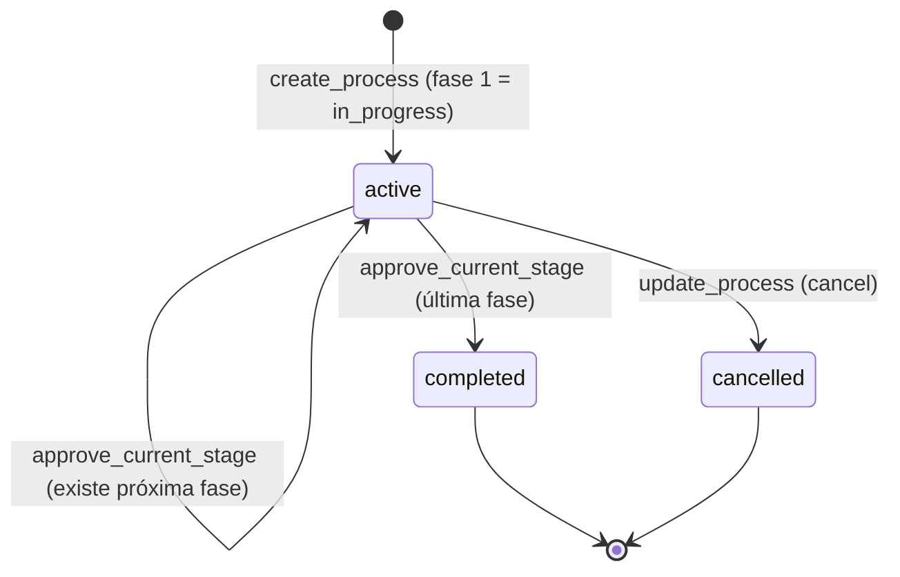
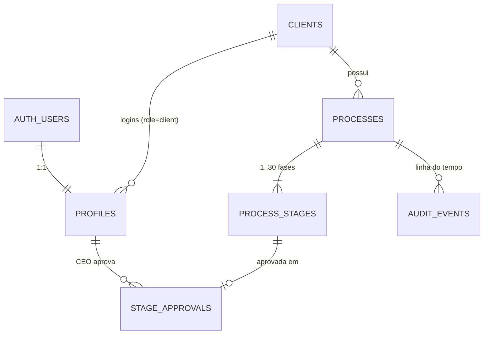

# Spec — Rastreador de entregas para clientes (backend + banco)

> **Status:** rascunho para revisão · **Versão:** 0.1 · **Data:** 2026-11-15
> **Escopo desta spec:** somente **backend e banco de dados**. Os painéis (frontend) terão spec própria.
>
> Artefatos ligados: contrato [`contracts/openapi.v1.yaml`](../../contracts/openapi.v1.yaml) ·
> threat model [`docs/security/threat-model.md`](../security/threat-model.md) ·
> plano [`docs/plan/implementation-waves.md`](../plan/implementation-waves.md) ·
> ADRs [`docs/adr/`](../adr/)

---

## 1. Visão geral

### 1.1 Objetivo

Quando um cliente fecha contrato, ele recebe um link (o domínio deste projeto) e um login criado
manualmente. Com ele, acompanha **somente** o andamento das próprias entregas, fase a fase. Os
**4 CEOs** têm um painel próprio: veem todos os clientes (uma aba por cliente) e todos os
processos, e **só eles** avançam um processo para a próxima fase, dando um "Ok".

Este backend entrega:

1. Autenticação com login e senha criados manualmente, sem cadastro público.
2. Isolamento rígido entre clientes (multi-tenant), validado em três camadas.
3. O fluxo de fases com aprovação por um único CEO, atômico e seguro sob concorrência.
4. Trilha de auditoria de toda mutação de negócio.

### 1.2 Atores

| Ator | `role` | Como a conta nasce | O que vê | O que faz |
|------|--------|--------------------|----------|-----------|
| Cliente | `client` | Um CEO provisiona pela API e recebe uma senha temporária | Só os processos do **próprio** cliente | Lê o andamento e troca a própria senha |
| CEO (4 pessoas) | `ceo` | Script operacional fora da API (`pnpm ceo:create`); **não existe endpoint que crie CEO** | Todos os clientes e processos | Cria clientes, logins de cliente e processos; aprova fases; cancela e arquiva |

### 1.3 Linguagem ubíqua

| Termo (pt-BR) | No código (en) | Definição |
|---------------|----------------|-----------|
| Cliente | `Client` | Empresa contratante. É o **tenant**. |
| Login de cliente | `ClientUser` | Credencial (e-mail e senha) vinculada a exatamente um cliente. |
| Processo | `Process` | Acompanhamento de uma entrega contratada. Pertence a um cliente e tem fases ordenadas. |
| Fase | `Stage` | Etapa de um processo: `pending` → `in_progress` → `completed`. |
| "Ok" / Aprovação | `Approval` | Ato de **um** CEO que conclui a fase atual e inicia a próxima. |
| Template de fases | `StageTemplate` | Lista padrão de fases, copiada para o processo no momento da criação. |
| Principal | `Principal` | Identidade autenticada da requisição: `userId`, `role`, `clientId`, `aal` e pendências. |
| Pendência | `PendingAction` | Ação que o usuário precisa concluir antes de usar o sistema: `CHANGE_PASSWORD`, `ENROLL_MFA` ou `VERIFY_MFA`. |
| Evento de auditoria | `AuditEvent` | Registro append-only de uma mutação de negócio. |

### 1.4 Escopo

**Dentro (v1):** login, logout e sessão; troca de senha obrigatória no primeiro acesso; MFA TOTP
obrigatório para CEOs; gestão de clientes e de logins de cliente (provisionar, listar, desativar
e resetar senha); processos com fases (template padrão ou fases informadas); aprovação de fase;
cancelamento; linha do tempo; leitura pelo cliente; auditoria; rate limiting; observabilidade;
migrations com RLS e testes.

**Fora (v1):** frontend; "esqueci minha senha" por e-mail (o reset é feito por um CEO);
notificações por e-mail ou WhatsApp; anexos e upload; desfazer aprovação ou reabrir fase; editar
fases depois de criadas; mensagens por fase visíveis ao cliente; criação de CEO pela API;
internacionalização. Os itens com chance de entrar depois estão em §8.

---

## 2. Requisitos

### 2.1 Funcionais

| ID | Requisito | Endpoint(s) | Aceite |
|----|-----------|-------------|--------|
| RF-01 | Usuário faz login com e-mail e senha. Não existe cadastro público. | `POST /auth/login` | AC-01, AC-02, AC-03 |
| RF-02 | Usuário encerra a sessão, que é revogada no servidor. | `POST /auth/logout` | AC-04 |
| RF-03 | Usuário consulta a própria sessão: papel, cliente e pendências. | `GET /auth/session` | AC-05, AC-07 |
| RF-04 | Usuário troca a própria senha. A troca é obrigatória após senha temporária. | `POST /auth/password` | AC-05, AC-06 |
| RF-05 | CEO cadastra e verifica MFA TOTP. É obrigatório para usar o painel de CEO. | `POST /auth/mfa/totp/enroll`, `POST /auth/mfa/totp/verify` | AC-07, AC-08 |
| RF-06 | CEO lista, cria, consulta, renomeia, arquiva e desarquiva clientes. | `GET/POST /admin/clients`, `GET/PATCH /admin/clients/{clientId}` | AC-11 |
| RF-07 | CEO provisiona logins de um cliente com senha temporária exibida **uma única vez**; lista, desativa, reativa e reseta a senha. | `/admin/clients/{clientId}/users/**` | AC-12, AC-13, AC-14 |
| RF-08 | CEO cria um processo para um cliente com as fases informadas ou com o template padrão. A fase 1 inicia `in_progress`. | `POST /admin/clients/{clientId}/processes`, `GET /admin/stage-templates/default` | AC-15 |
| RF-09 | CEO lista os processos de qualquer cliente e vê o detalhe completo (base das abas por cliente). | `GET /admin/clients/{clientId}/processes`, `GET /admin/processes/{processId}` | AC-15, AC-16 |
| RF-10 | CEO dá "Ok" na fase atual: ela vira `completed` e a próxima `in_progress`. Basta **um** CEO. A última aprovação conclui o processo. | `POST /admin/processes/{processId}/approvals` | AC-16, AC-17, AC-18 |
| RF-11 | CEO renomeia ou cancela um processo ativo. | `PATCH /admin/processes/{processId}` | AC-19 |
| RF-12 | CEO vê a linha do tempo do processo, com quem fez o quê e quando. | `GET /admin/processes/{processId}/events` | AC-28 |
| RF-13 | Cliente lista e detalha **somente** os próprios processos, sem dados internos. | `GET /me/processes`, `GET /me/processes/{processId}` | AC-09, AC-20, AC-21 |
| RF-14 | Contas de CEO são criadas apenas por script operacional auditado, nunca pela API. A criação grava `account.provisioned` na trilha de auditoria, na mesma transação, sem ator. | `pnpm ceo:create` (fora do contrato) | AC-31 |
| RF-15 | Health check público e sem detalhes internos. | `GET /health` | AC-29 |

### 2.2 Não funcionais

| ID | Requisito |
|----|-----------|
| RNF-01 | **Segurança:** atender OWASP Top 10:2025 e OWASP API Security Top 10:2023. O mapeamento está em [`docs/security/threat-model.md`](../security/threat-model.md); os requisitos concretos são os SEC-* de §2.3. |
| RNF-02 | **Desempenho** (tempo de servidor, Vercel `gru1` ↔ Supabase `sa-east-1`): p95 < 300 ms em leituras e < 500 ms em escritas, com até 50 requisições/s. |
| RNF-03 | **Escala-alvo:** até 500 clientes, 2.000 processos, 30 fases por processo, 10 logins por cliente e 4 CEOs. Não se otimiza além disso. |
| RNF-04 | **Observabilidade:** logs JSON estruturados, `X-Request-Id` ponta a ponta (HTTP → banco), auditoria de mutações e logs de eventos de autenticação. |
| RNF-05 | **LGPD:** dados no Brasil (`sa-east-1` e `gru1`), minimização, base legal e retenção definidas (§3.12). |
| RNF-06 | **Qualidade:** TypeScript strict (`strict`, `noUncheckedIndexedAccess`, `exactOptionalPropertyTypes`), cobertura ≥ 80% em `domain/` e `application/`, toda policy e função do banco coberta por pgTAP. |
| RNF-07 | **Compatibilidade:** API versionada em `/api/v1`. Mudança incompatível vira `/api/v2` com nota de compatibilidade; mudança aditiva é bump minor do contrato. |
| RNF-08 | **Disponibilidade:** herda os SLAs de Vercel e Supabase. Produção no plano Pro do Supabase, porque projetos Free pausam por inatividade e não têm proteção contra senhas vazadas. |

### 2.3 Requisitos de segurança

| ID | Requisito |
|----|-----------|
| SEC-01 | **Deny by default.** Toda rota declara uma política de acesso explícita. As únicas rotas públicas são `GET /health` e `POST /auth/login`, marcadas no contrato com `security: []`. |
| SEC-02 | **Ordem fixa no pipeline:** request id → checagens de transporte (Origin, Content-Type, tamanho) → rate limit → autenticação → autorização (papel e pendências) → validação de input → caso de uso. |
| SEC-03 | **Tenant vem da sessão, nunca do cliente.** Endpoints de cliente (`/me/*`) não recebem `clientId` em path, query ou body. O tenant é derivado de `auth.uid()` no banco. |
| SEC-04 | **RLS em todas as tabelas de `public`.** Policies existem somente para `SELECT`. `anon` não tem nenhum privilégio. `authenticated` não tem `INSERT/UPDATE/DELETE` em nenhuma tabela: escritas só por funções `SECURITY DEFINER` com `SET search_path = ''`, nomes totalmente qualificados e checagem de papel e tenant dentro da função. |
| SEC-05 | **Acesso cross-tenant retorna 404** (nunca o dado e nunca 403, que revelaria a existência do recurso). Testes cross-tenant são obrigatórios em pgTAP e na API. |
| SEC-06 | **SQL injection:** nenhuma SQL montada por concatenação no app; acesso só pelo client Supabase (PostgREST parametrizado) e por RPC com parâmetros tipados; nenhuma SQL dinâmica em funções (se inevitável, `format()` com `%I`/`%L` e `EXECUTE ... USING`); input do usuário nunca interpolado em filtros PostgREST (`.or()`, `.filter()`, `.textSearch()`). Todos os objetos Zod usam `.strict()` (rejeitam campos desconhecidos, o que evita mass assignment). Ver §3.8. |
| SEC-07 | **Sessão:** cookie `__Host-rt-session` com `HttpOnly`, `Secure`, `SameSite=Lax` e `Path=/`. O access token expira em 15 min; refresh token com rotação e detecção de reuso. A sessão dura no máximo 12 h e é encerrada após 4 h de inatividade (`[auth.sessions] timebox` e `inactivity_timeout`); o cookie tem o mesmo teto de 12 h (ADR 0009). O servidor valida o JWT com `getClaims()`/`getUser()` e nunca confia em `getSession()`. A sessão é checada no banco a cada requisição (`auth.sessions`), o que torna logout e desativação efetivos imediatamente. |
| SEC-08 | **CSRF:** métodos não seguros exigem `Origin` igual a uma origem permitida (`APP_ORIGIN`; em preview, as URLs da própria deployment). O corpo precisa ser `application/json`. SameSite=Lax completa a defesa. |
| SEC-09 | **Rate limiting** por IP, por conta e por usuário (§3.9), com resposta 429 e `Retry-After`. O limitador fica **na frente** do Supabase Auth. |
| SEC-10 | **Senhas:** de 12 a 72 bytes UTF-8 (o bcrypt trunca acima de 72 bytes); a nova precisa ser diferente da atual; senha temporária com 20 caracteres gerados por CSPRNG, exibida uma única vez, com troca obrigatória; troca exige a senha atual e revoga as demais sessões; proteção contra senhas vazadas (HIBP) do Supabase ativada em produção. |
| SEC-11 | **MFA TOTP obrigatório para CEO.** Todo endpoint `/admin/*` e toda função de CEO no banco exigem `aal2`. |
| SEC-12 | **Sem enumeração de usuários:** o login responde `401 INVALID_CREDENTIALS` com corpo idêntico para e-mail inexistente, senha errada e conta desativada. |
| SEC-13 | **Erros sem internals:** `application/problem+json` (RFC 9457) com `code` estável e `requestId`, sem stack, SQL ou mensagem do Supabase. Qualquer exceção numa checagem de segurança resulta em negação (**fail closed**). |
| SEC-14 | **Headers em toda resposta:** HSTS (2 anos, `includeSubDomains; preload`), `Content-Security-Policy: default-src 'none'; frame-ancestors 'none'` na API, `X-Content-Type-Options: nosniff`, `X-Frame-Options: DENY`, `Referrer-Policy: no-referrer`, `Permissions-Policy` mínima, `Cache-Control: no-store` e `X-Request-Id`. Sem CORS (mesma origem), sem `X-Powered-By`. |
| SEC-15 | **Segredos:** chaves só no servidor. Nenhuma variável do Supabase usa prefixo `NEXT_PUBLIC_`. A secret key é lida apenas em `src/shared/db/admin-client.ts` (com `import 'server-only'`) e em `scripts/`. |
| SEC-16 | **Auditoria append-only:** toda mutação de negócio grava `audit_events` **na mesma transação**. A tabela não aceita `UPDATE` nem `DELETE`. Eventos de autenticação vão para logs estruturados. Logs sem PII (redação de e-mail, senha, cookie, `authorization` e tokens). |
| SEC-17 | **Limites de input:** corpo ≤ 16 KiB; todas as strings com tamanho máximo; até 30 fases por processo; paginação com `limit` ≤ 100; cursor opaco validado. |
| SEC-18 | **Supply chain:** lockfile commitado, GitHub Actions pinadas por SHA com `permissions: contents: read`, Dependabot, gitleaks, `pnpm audit`, SAST (CodeQL ou Semgrep). O MCP do Supabase fica restrito ao projeto de **dev**, em modo read-only. |
| SEC-19 | **Chamadas de saída** só para o Supabase (URL vinda de env), com timeout de 5 s. Nenhum fetch de URL controlada pelo usuário: SSRF fica fora da superfície por design. |
| SEC-20 | **Superfície mínima no Supabase:** cadastro público desativado, extensão `pg_graphql` removida, Storage e Realtime sem uso, chaves de assinatura JWT assimétricas. |

---

## 3. Design técnico

### 3.1 Stack e decisões

| Camada | Escolha | ADR |
|--------|---------|-----|
| Runtime e API | Next.js 16+ (App Router, Route Handlers, runtime Node.js), TypeScript strict | [0001](../adr/0001-stack-nextjs-supabase-vercel.md) |
| Hospedagem | Vercel, funções na região `gru1` (São Paulo) | 0001 |
| Banco e Auth | Supabase (Postgres + Auth), região `sa-east-1` (São Paulo) | 0001 |
| Sessão | Next.js como **BFF**: o browser fala só com `/api/v1`, nunca direto com o Supabase. Cookie HttpOnly via `@supabase/ssr` | [0002](../adr/0002-bff-sessao-cookie-httponly.md) |
| Autorização | Três camadas: pipeline HTTP, funções `SECURITY DEFINER` (único caminho de escrita) e RLS (leitura) | [0003](../adr/0003-autorizacao-em-camadas-rls-e-funcoes.md) |
| Rate limiting | Contadores em Postgres (`private`), atrás de uma interface `RateLimiter` | [0004](../adr/0004-rate-limiting-no-postgres.md) |
| Arquitetura | Monolito modular com vertical slices e camadas DDD por módulo | [0005](../adr/0005-monolito-modular-vertical-slices.md) |
| Validação | Zod (`.strict()`) em toda fronteira, inclusive nas respostas do Supabase | — |
| Logs | pino (JSON) com redação | — |
| Testes | Vitest (unit, integração e API), pgTAP (`supabase test db`), validação de contrato com Ajv sobre o OpenAPI | — |
| Contrato | OpenAPI 3.1, lint com Redocly | — |

### 3.2 Arquitetura

Monolito modular com dois bounded contexts e um kernel compartilhado:

```
src/
├── app/api/v1/**/route.ts        # adaptadores finos: só reexportam o handler do módulo
├── modules/
│   ├── identity/                 # autenticação, sessão, senha, MFA, contas (logins)
│   │   ├── domain/               # Role, Principal, PendingAction, política de senha
│   │   ├── application/          # um arquivo por caso de uso (login.ts, change-password.ts …)
│   │   ├── infrastructure/       # gateways Supabase Auth, repositórios, admin gateway
│   │   ├── presentation/         # schemas Zod, mappers de DTO, handlers HTTP
│   │   └── index.ts              # API pública do módulo
│   └── tracking/                 # clientes, processos, fases, aprovações, linha do tempo
│       └── (mesma estrutura)
└── shared/
    ├── http/                     # withRoute: pipeline seguro, problem+json, políticas
    ├── db/                       # fábricas de client Supabase (server-only) + tipos gerados
    ├── observability/            # logger, request id
    ├── config/                   # env validado por Zod (falha no boot)
    └── kernel/                   # Result, erros base, Clock, tipos de id
```

**Regras de fronteira** (aplicadas pelo ESLint a partir da Onda 0):

- `domain/` não importa nada de fora do próprio `domain/` e do `shared/kernel`.
- `application/` depende de interfaces (ports) declaradas em `domain/`; `infrastructure/` as implementa.
- Um módulo só importa outro pelo `index.ts`. `identity` conhece `clientId` apenas como id opaco
  e consulta a existência de um cliente via `tracking` (`index.ts` → `getClientStatus`).
  `tracking` **não** importa `identity`: a dependência é de mão única, sem ciclo.
- Não há container de DI compartilhado: cada handler monta as próprias dependências. Assim,
  slices paralelos não disputam o mesmo arquivo de composição.
- `src/app/**/route.ts` não importa `@supabase/*` nem `@/shared/db`.
- Leituras do cliente usam um **query service** separado do repositório do agregado (CQRS leve),
  para que os slices de leitura e de escrita evoluam sem conflito.

### 3.3 Pipeline de requisição (`withRoute`)

Toda rota é criada com `withRoute(policy, handler)`. O tipo `policy` **não tem default**:
`{ access: 'public' }` precisa ser escrito explicitamente.

```
 1. Gera X-Request-Id (UUID v4), SEMPRE no servidor. Um X-Request-Id enviado pelo cliente nunca vira
    o id da requisição: se casar com ^[A-Za-z0-9-]{8,64}$, é registrado à parte nos logs como
    `clientRequestId`; senão é ignorado. Resposta, `problem+json`, logs e auditoria só carregam o id do servidor.
 2. Métodos não seguros: Origin ∈ origens permitidas            → senão 403 ORIGIN_NOT_ALLOWED
 3. Corpo: Content-Type application/json e tamanho ≤ 16 KiB      → 415 / 413
 4. Rate limit do grupo da rota (IP, conta ou usuário)          → 429 + Retry-After
 5. Autenticação: getClaims() + RPC current_principal()         → 401 UNAUTHENTICATED
 6. Autorização: papel ∈ policy.roles                           → 403 FORBIDDEN
                 pendências ⊆ policy.allowPending               → 403 <pendência>_REQUIRED
 7. Validação Zod (.strict()) de params, query e body           → 400 VALIDATION_ERROR
 8. Caso de uso (Result<T, DomainError>)
 9. Mapeia o resultado para DTO e status; erro de domínio → problem+json
10. Headers de segurança e X-Request-Id em TODAS as respostas, inclusive erros
```

`withRoute` lê cookies de `NextRequest` e escreve em `NextResponse` (sem `next/headers`), de modo
que um handler pode ser testado por invocação direta. O client Supabase de cada requisição envia
o header `x-request-id`, que as funções do banco gravam na auditoria
(`current_setting('request.headers', true)::json->>'x-request-id'`).

### 3.4 Autenticação e sessão

- **Login** (`POST /auth/login`): normaliza o e-mail (trim + lowercase, NFC) → rate limit por IP
  e por conta (HMAC do e-mail) → `signInWithPassword` num client que grava cookies → carrega
  `current_principal()` → se não houver principal ativo, faz `signOut` e responde 401 genérico.
  Antes de chamar o Auth, o login gasta o orçamento global de logins (§3.9). Só as respostas do Auth
  que dizem "estas credenciais não abrem sessão" (`invalid_credentials`, `user_banned`,
  `email_not_confirmed`) viram o 401 genérico; falha de transporte, timeout, 5xx, 429 e qualquer
  outro código do Auth viram 503, nunca 401. Toda recusa (401) responde só depois de um piso de
  400 ms mais até 100 ms de jitter, medido do início do handler, para que senha errada, e-mail
  inexistente e conta desativada levem o mesmo tempo.
  A resposta traz `user`, `client` (para quem tem papel `client`), `aal` e `pendingActions`, e
  **nunca** tokens.
- **Cookies:** `@supabase/ssr` com `cookieOptions.name = '__Host-rt-session'`; ao gravar, força
  `httpOnly: true, secure: true, sameSite: 'lax', path: '/'`. Pode ser dividido em `.0`, `.1`.
  `localhost` é contexto seguro nos navegadores modernos, então funciona em dev.
- **Renovação:** o access token (15 min) é renovado com o refresh token dentro do pipeline; os
  cookies novos vão na resposta. O reuso de refresh token revoga a família (Supabase).
- **Revogação efetiva:** `current_principal()` só retorna o principal se a `session_id` do JWT
  existir em `auth.sessions` e o perfil não estiver desativado. Logout, desativação e reset de
  senha apagam sessões, e a próxima requisição recebe 401 mesmo com um JWT ainda válido.
- **Contas de CEO:** `pnpm -s ceo:create --target <host> --email … --name …` (o `-s` é parte do
  comando: sem ele o pnpm escreve o próprio cabeçalho no stdout) roda localmente, por uma pessoa, num
  terminal, com a secret key do ambiente alvo. Gera uma senha temporária e cria o usuário com
  `app_metadata.role = 'ceo'`, já com a senha (ADR 0007), de modo que nasce com `CHANGE_PASSWORD` e
  `ENROLL_MFA` pendentes. O trigger de perfil grava `account.provisioned` na auditoria na mesma
  transação (RF-14), com `actor_id` e `request_id` nulos e `{"role":"ceo","channel":"auth_admin"}` nos
  metadados; uma falha da auditoria derruba a criação (fail closed). O script valida os argumentos
  como a API (e-mail normalizado, nome de 1 a 120 caracteres visíveis) e exige só `SUPABASE_URL` e
  `SUPABASE_SECRET_KEY`, lidas do shell e do arquivo de ambiente (`--env-file`, padrão `.env.local`;
  o que já está no shell vence o arquivo, e o stderr diz qual arquivo foi lido ou que nenhum foi).
  As proteções valem antes de qualquer chamada: `--target` precisa ser o host de `SUPABASE_URL`,
  `http:` só vale para loopback, URL e chave precisam vir do mesmo lugar (as duas do shell ou as duas
  do arquivo, para uma chave nunca encontrar a URL de outro projeto), o script recusa rodar com `CI`
  definido e recusa um stdout que não seja um terminal, a não ser com `--allow-non-tty` (a senha não
  pode ir parar num log por acidente). O stdout leva **só** a senha temporária, **uma única vez**, em
  uma linha; todo o resto (rótulos, o host alvo, o id do usuário) vai para o stderr. Um e-mail que já
  tem conta (de qualquer papel) é recusado sem alterar nada (código de saída 3); recusas antes da
  chamada saem com 2; as demais falhas saem com 1 e sem repetir o que o Auth respondeu.
- **Troca de senha** (`POST /auth/password`, ADR 0010): valida a política da nova senha (12
  caracteres a 72 bytes, E-12) e que difere da atual (E-13) antes de chamar o Auth; prova a senha
  atual por um sign-in descartável, que gasta o orçamento global de logins e cuja sessão é revogada
  na hora (nada dela vai para a resposta); grava a nova senha com a sessão do usuário (o Auth
  derruba as outras sessões) e chama `mark_password_changed()`, que prova a troca, limpa
  `CHANGE_PASSWORD` e revoga as outras sessões de novo, mantendo a da requisição (AC-06). Senha
  atual errada: 422 `INVALID_CURRENT_PASSWORD`. Um CEO sem TOTP verificado ainda fica com
  `ENROLL_MFA` depois da troca; um CEO com TOTP verificado precisa de `aal2` (com `aal1` o pipeline
  responde 403 `MFA_VERIFICATION_REQUIRED`, e a função recusa com 42501 por baixo). Duas falhas sem
  resposta deixam o estado incerto e viram 503 com a orientação "repita; se a senha atual for
  recusada, use a nova senha como atual": o `updateUser` que não responde (o Auth pode ter gravado a
  senha) e o `mark_password_changed()` que falha duas vezes depois do `updateUser`. Se a primeira
  chamada do `mark_password_changed()` gravou e só a resposta se perdeu, o `PASSWORD_UNCHANGED` da
  segunda é sucesso: depois de um `updateUser` bem-sucedido, a linha de base só iguala o hash se uma
  chamada anterior gravou.
- **Contas de cliente:** `auth.admin.createUser` com `email_confirm: true` e
  `app_metadata = { role: 'client', client_id }`. O trigger `private.handle_new_auth_user` cria o
  `profile` **na mesma transação** a partir de `raw_app_meta_data`, que só a secret key consegue
  escrever. O GoTrue faz o `INSERT` em `auth.users` só com `provider`/`providers` e grava o
  `app_metadata` recebido num `UPDATE` logo depois, na mesma transação; por isso o trigger é um
  `CONSTRAINT TRIGGER` **adiado** (roda no `COMMIT` e relê a linha). Se faltar papel ou cliente, o
  trigger lança erro, o `COMMIT` falha e o usuário não é criado (fail closed).
  `raw_user_meta_data`, que o próprio usuário edita, **nunca** é lido. O nome de exibição vem de
  `app_metadata.display_name` (CEO e cliente), e o trigger também recusa cliente arquivado ou com
  10 logins (defesa em profundidade; o caso de uso checa antes para responder 422).
- **Senha temporária na criação:** o usuário é criado **já com a senha temporária** na mesma
  chamada `auth.admin.createUser` (provisionamento e `ceo:create`); no reset, a senha nova é
  gravada no Auth **antes** de chamar `require_password_change`. Só assim a linha de base de
  `mark_password_changed()` prova que o usuário trocou a senha (criar sem senha e definir depois
  deixaria a "troca" comprovada sem ação do usuário).

### 3.5 Autorização

**Camada 1, aplicação (`withRoute` + caso de uso):** papel, pendências e posse do recurso. Quando
um CEO age sobre um login, o caso de uso confere que `userId` pertence ao `clientId` do path; se
não pertencer, responde 404.

**Camada 2, funções do banco (escrita):** toda função de escrita chama `private.is_ceo()`
(papel `ceo`, `aal2`, sessão viva, perfil ativo) e valida o alvo. Exemplo: as funções de conta
recusam alvo que não seja `role = 'client'`.

**Camada 3, RLS (leitura):** clientes leem apenas linhas do próprio tenant; CEOs `aal2` leem tudo.
As tabelas visíveis ao cliente contêm **só colunas seguras para o cliente**; dados internos
(quem aprovou, auditoria, perfis de outros usuários) ficam em tabelas exclusivas de CEO. Isso
protege propriedades (OWASP API3) mesmo se alguém chamar o PostgREST direto com o próprio JWT.

**Pendências** (calculadas em `current_principal()`):

| Pendência | Condição | Código do 403 |
|-----------|----------|---------------|
| `CHANGE_PASSWORD` | `profiles.must_change_password = true` | `PASSWORD_CHANGE_REQUIRED` |
| `ENROLL_MFA` | papel `ceo` sem fator TOTP verificado | `MFA_ENROLLMENT_REQUIRED` |
| `VERIFY_MFA` | papel `ceo` com fator verificado e sessão `aal1` | `MFA_VERIFICATION_REQUIRED` |

Uma rota é liberada somente se **todas** as pendências do principal estiverem no `allowPending`
dela:

| Rota | `roles` | `allowPending` |
|------|---------|----------------|
| `POST /auth/logout`, `GET /auth/session` | client, ceo | CHANGE_PASSWORD, ENROLL_MFA, VERIFY_MFA |
| `POST /auth/password` | client, ceo | CHANGE_PASSWORD, ENROLL_MFA |
| `POST /auth/mfa/totp/enroll` | ceo | ENROLL_MFA |
| `POST /auth/mfa/totp/verify` | ceo | ENROLL_MFA, VERIFY_MFA |
| `/me/*` | client | — |
| `/admin/*` | ceo | — |

Fluxo do primeiro acesso de um CEO: login (`aal1`, CHANGE_PASSWORD e ENROLL_MFA) → troca de
senha → enroll → verify (`aal2`) → painel liberado. Com pendência em ordem, o `code` do 403
segue a prioridade CHANGE_PASSWORD > ENROLL_MFA > VERIFY_MFA.

### 3.6 Máquina de estados do processo



**Invariantes** (no agregado `Process` em TypeScript **e** nas constraints e funções do banco):

- I1. Um processo tem de 1 a 30 fases com `position` contígua de 1 a n.
- I2. Processo `active`: exatamente uma fase `in_progress`; as anteriores estão `completed` e as
  posteriores `pending`.
- I3. Processo `completed`: todas as fases `completed` e `completed_at` preenchido.
- I4. Processo `cancelled`: as fases ficam congeladas e nenhuma transição é aceita.
- I5. Toda fase `completed` tem exatamente uma `stage_approvals` com o CEO e o instante.
- I6. Aprovar exige papel `ceo` com `aal2`, processo `active` e `expectedStageId` igual à fase
  atual (controle de concorrência otimista, com semântica de `If-Match`).

### 3.7 Escrita por funções do banco (RPC)

Toda função de escrita é `SECURITY DEFINER`, `SET search_path = ''`, tem `EXECUTE` revogado de
`PUBLIC`/`anon` e concedido só ao papel necessário, valida os inputs (espelhando o Zod), grava
`audit_events` na mesma transação e trava as linhas afetadas (`SELECT … FOR UPDATE`).

| Função | Executada por | Efeito |
|--------|---------------|--------|
| `current_principal()` | authenticated | Retorna o principal (ou nenhuma linha): sessão viva, perfil ativo, papel, cliente, nome de exibição, `aal`, `has_verified_totp`, `must_change_password` |
| `create_client(p_name)` | authenticated + `is_ceo()` | Cria o cliente. Evento `client.created` |
| `update_client(p_client_id, p_name, p_archived)` | idem | Renomeia, arquiva ou desarquiva. Eventos `client.updated` / `client.archived` / `client.unarchived` |
| `list_client_users(p_client_id)` | authenticated + `is_ceo()` | Logins do cliente com e-mail e último acesso (junta `profiles` com `auth.users`, que não é exposto) |
| `record_account_provisioned(p_user_id)` | idem | Evento `account.provisioned` (após `auth.admin.createUser`) |
| `set_account_disabled(p_user_id, p_disabled)` | idem; alvo precisa ser `client` | Marca o perfil, apaga as sessões. `account.disabled` / `account.enabled` (só quando o estado muda) |
| `set_account_display_name(p_user_id, p_display_name)` | idem; alvo precisa ser `client` | Renomeia o login (`PATCH …/users/{userId}` com `displayName`). `account.updated` |
| `require_password_change(p_user_id)` | idem; alvo precisa ser `client` | `must_change_password = true`, apaga as sessões. `account.password_reset` |
| `mark_password_changed()` | authenticated (o próprio usuário) | Exige prova da troca: o hash atual em `auth.users` difere da linha de base (`private.password_baselines`, gravada na criação e no reset), senão `PASSWORD_UNCHANGED`; CEO com TOTP verificado precisa de `aal2`. Então `must_change_password = false`, renova a linha de base e apaga as **demais** sessões do usuário (mantém a da requisição, AC-06). `account.password_changed` |
| `create_process(p_client_id, p_title, p_stages jsonb)` | authenticated + `is_ceo()` | Cria o processo e as fases (do template se `p_stages` for nulo); fase 1 `in_progress`. `process.created` |
| `update_process(p_process_id, p_title, p_cancel)` | idem | Renomeia ou cancela. `process.updated` / `process.cancelled` |
| `approve_current_stage(p_process_id, p_expected_stage_id)` | idem | Conclui a fase atual, grava a aprovação, inicia a próxima ou conclui o processo. `stage.approved` (+ `process.completed`) |
| `rate_limit_hit(p_bucket, p_window_seconds, p_max)` | **somente `service_role`** | Contador de janela fixa; retorna `allowed` e `retry_after_seconds` |

**Mapeamento de erros do banco** (feito em `infrastructure/`; o que não for mapeado vira 500):

| Banco | Erro de domínio | HTTP / `code` |
|-------|-----------------|---------------|
| SQLSTATE `42501` | `ForbiddenError` (também gera log `warn`: indica bypass da camada 1) | 403 `FORBIDDEN` |
| `P0001` + `NOT_FOUND` | `NotFoundError` | 404 `NOT_FOUND` |
| `P0001` + `STALE_STAGE` | `StaleStageError` | 409 `STALE_STAGE` |
| `P0001` + `PROCESS_NOT_ACTIVE` | `ProcessNotActiveError` | 422 `PROCESS_NOT_ACTIVE` |
| `P0001` + `CLIENT_ARCHIVED` | `ClientArchivedError` | 422 `CLIENT_ARCHIVED` |
| `P0001` + `PASSWORD_UNCHANGED` | `PasswordUnchangedError` | 422 `PASSWORD_UNCHANGED` |
| `P0001` + `USER_LIMIT_REACHED` | `UserLimitReachedError` | 422 `USER_LIMIT_REACHED` |
| `P0001` + `INVALID_INPUT`, `23514`, `22001` | `ValidationError` | 400 `VALIDATION_ERROR` |
| `23505` | `ConflictError` | 409 `CONFLICT` |

### 3.8 Prevenção de SQL injection (e de injeção em geral)

1. **Sem SQL no app.** O app usa apenas `supabase.from(...).select/eq/...` e `supabase.rpc(...)`.
   O PostgREST parametriza os valores. É proibido montar SQL ou filtros com template string.
2. **Filtros PostgREST:** `.or()`, `.filter()` e `.textSearch()` com valor interpolado são
   proibidos. A v1 não tem busca textual. Se um dia houver, usar `.ilike(col, value)` com valor
   escapado ou uma RPC.
3. **Funções PL/pgSQL:** sem `EXECUTE` dinâmico. Se for inevitável: `format('%I', ident)` e
   `EXECUTE … USING`. Todas com `SET search_path = ''` (impede hijack de search_path) e nomes
   qualificados (`public.processes`).
4. **Validação tipada antes de tudo:** UUIDs como `z.string().uuid()`, enums fechados e tamanhos
   máximos; `.strict()` em todos os objetos.
5. **Least privilege no banco:** o app nunca usa um papel que possa fazer DDL; `authenticated` não
   escreve em tabela nenhuma.
6. **Verificação automática:** hook de pós-edição (`.claude/hooks/post-edit-checks.mjs`), regra
   do ESLint (`no-restricted-syntax` para template literal em `.or/.filter`), Semgrep/CodeQL no
   CI e pgTAP verificando `proconfig` (search_path) de toda função `SECURITY DEFINER`.

XSS: a API só responde JSON com `Content-Type` correto, `nosniff` e CSP `default-src 'none'`.

### 3.9 Rate limiting

| Grupo | Escopo da chave | Limite |
|-------|-----------------|--------|
| login | IP (HMAC) | 20 / 15 min |
| login | conta (HMAC do e-mail normalizado) | 10 / 15 min |
| login | global (todos os logins juntos, uma única chave) | 300 / 5 min, sempre abaixo da cota `sign_in_sign_ups` do Auth |
| sessão que faria o servidor chamar o Auth (cookie vencido ou que não se verifica localmente) | IP (HMAC) | 60 / 15 min |
| verificação TOTP | usuário | 5 / 5 min |
| troca de senha | usuário | 5 / 15 min |
| provisionar ou resetar senha de login de cliente | CEO | 20 / hora |
| demais escritas autenticadas | usuário | 60 / min |
| leituras autenticadas | usuário | 300 / min |
| health | IP | 60 / min |

- O IP vem do helper da plataforma (`ipAddress()` de `@vercel/functions`), nunca de um header
  arbitrário. As chaves são HMAC-SHA256 com `RATE_LIMIT_KEY_SECRET`: o banco não guarda IP nem
  e-mail em claro.
- **Por que na frente do Supabase Auth:** como o servidor chama o Auth, o Supabase vê o IP da
  Vercel. Sem o nosso limitador, um atacante poderia esgotar o limite por IP do Supabase e
  bloquear **todos** os usuários.
- Se o limitador falhar, a requisição é negada (fail closed, 503).
- **Escopo `global`:** uma chave só para o app inteiro, usada apenas por orçamentos agregados
  que o código gasta explicitamente (o login). Nunca vale em política de rota. Os limites por IP e
  por conta não protegem a cota do Auth contra um atacante distribuído; o teto global responde
  429 antes que o Auth responda 503 a todos.
- **Sessão que chama o Auth:** antes de `getClaims()`, o servidor lê o cookie do mesmo jeito que o
  cliente do Auth (sem confiar nele). A invariante: toda chamada ao Auth feita ao resolver um
  principal é cobrada do orçamento do IP, e um IP sem orçamento não chega ao Auth. O servidor só
  não cobra quando prova que não haverá chamada (nenhum cookie de sessão, ou token não vencido e
  assimétrico de um `kid` recentemente verificado); todo o resto, inclusive cookie ilegível, gasta
  uma unidade. Acima do orçamento: 401, sem apagar os cookies e sem chamar o Auth. Um cookie que
  faria o cliente lançar uma exceção que não é erro de autenticação (algoritmo não suportado, token
  malformado) é recusado com 401 antes. As chamadas realmente feitas ao Auth são contadas no `fetch`
  do cliente e a diferença para o que foi cobrado é cobrada depois (`auth.session_budget_mispredicted`).
  Mesmo um token local é recusado se a memória do limitador já sabe que o IP está sem orçamento.
- Cada instância guarda em memória as negações que viu e responde 429 sem consultar o banco até o fim
  da janela (só deixa o limite mais estrito). `rate_limit_hit` apaga, em cerca de 1% das chamadas,
  até 500 janelas vencidas há mais de 48 h; a limpeza diária por `pg_cron` entra na Onda 11.

### 3.10 Observabilidade e auditoria

- **Logs** (pino, JSON, stdout → Vercel): `requestId`, `route`, `method`, `status`, `durationMs`,
  `userId` (id interno), `role`. Redação de `password`, `email`, `cookie`, `authorization`,
  `temporaryPassword`, `secret` e `token`. Proibido `console.*` em `src/`.
- **Eventos de auth em log:** `auth.login.succeeded` (userId, `sessionId`, `ipHash`),
  `auth.login.failed` (HMAC do e-mail, `ipHash` e uma categoria: `invalid_credentials`,
  `account_inactive`, `upstream_unavailable` ou `upstream_error`), `auth.logout` (userId,
  `sessionId`, `ipHash`), `auth.mfa.enrolled`, `auth.mfa.verified`,
  `auth.mfa.failed`, `auth.rate_limited` (escopo, grupo e `subjectHash`), `authz.denied` (com motivo),
  `auth.session_budget_mispredicted` (chamadas medidas, unidades cobradas e `ipHash`) e
  `auth.session_key_rejected` (token recusado na importação da chave; só o nome do erro).
  `ipHash`, `accountHash` e `subjectHash` são HMACs com chave derivada de `RATE_LIMIT_KEY_SECRET`,
  diferentes dos valores gravados no banco: o log não guarda IP nem e-mail e não se liga às linhas
  de `rate_limit_counters`.
- **Auditoria no banco** (`audit_events`): eventos de negócio de §3.7, gravados na mesma
  transação da mudança, com ator, papel, recurso, cliente, processo, `request_id` e `metadata`
  sem PII.
- **Alertas** (Onda 11): rajada de 401 e 429 no login, qualquer 500, 403 `FORBIDDEN` vindo do
  banco (indica bypass da camada 1) e falha de escrita de auditoria.

### 3.11 Configuração e segredos

Variáveis em [`.env.example`](../../.env.example), validadas por Zod no boot; o processo não sobe
se faltar alguma:

| Variável | Uso | Onde é lida |
|----------|-----|-------------|
| `APP_ORIGIN` | Origem permitida no check de CSRF | `shared/http` |
| `SUPABASE_URL` | URL do projeto | `shared/db` |
| `SUPABASE_PUBLISHABLE_KEY` | Client com escopo de usuário (RLS) | `shared/db/server-client.ts` |
| `SUPABASE_SECRET_KEY` | Auth Admin API e `rate_limit_hit` | **apenas** `shared/db/admin-client.ts` e `scripts/` |
| `RATE_LIMIT_KEY_SECRET` | Chave HMAC das chaves de rate limit | `shared/http/rate-limit` |
| `LOG_LEVEL` | Nível do pino | `shared/observability` |

Previews da Vercel apontam para um projeto Supabase de **staging**, nunca de produção, e ficam
com Deployment Protection ligado.

No Auth do Supabase (`supabase/config.toml`), `[auth] enable_signup = false` bloqueia o cadastro
público. `[auth.email] enable_signup` precisa ficar `true`: apesar do nome, no CLI ele liga o provider
de e-mail e senha, e com `false` o login responde 422 `email_provider_disabled`. O Admin API cria
usuários nos dois casos.

**Gate de go-live do Auth hospedado (F-40).** Nenhum ambiente hospedado com contas reais pode existir
antes de `security_update_password_require_current_password` estar ligado no projeto (Management
API; não é chave do `config.toml`, o Supabase local não a liga). Sem ela, quem tem o token de acesso
de uma sessão recente e a publishable key troca a senha direto em `PUT /auth/v1/user`, sem a senha
atual que o app exige em `POST /auth/password` (ADR 0010). Entram no mesmo gate, Onda 11: HIBP,
chaves JWT assimétricas, `timebox` e `inactivity_timeout` e o `sign_in_sign_ups` do Auth acima do
orçamento global de logins.

### 3.12 LGPD

| Item | Definição |
|------|-----------|
| Papéis | Controladora: a empresa dona do produto. Operadores: Supabase e Vercel (região Brasil). |
| Dados pessoais | Nome e e-mail dos logins de cliente e dos CEOs; IP (só em logs de plataforma; HMAC no rate limit); trilha de auditoria (ids internos). |
| Base legal | Execução de contrato (art. 7º, V) para contas e processos; legítimo interesse e segurança (art. 7º, IX) para logs e auditoria. |
| Minimização | Sem CPF, telefone ou endereço. O e-mail fica só em `auth.users`. |
| Retenção | Logs de aplicação: 90 dias. Auditoria e retenção de contas após o fim do contrato estão em Q-07. |
| Direitos do titular | v1: desativação pelo CEO. Exclusão e anonimização por runbook na Onda 11 (`docs/how-to/`). |

---

## 4. Modelo de dados



**Enums:** `app_role ('ceo','client')` · `process_status ('active','completed','cancelled')` ·
`stage_status ('pending','in_progress','completed')`.

### 4.1 Tabelas (`public`, todas com RLS)

**`clients`**: tenant. Visível ao próprio cliente.

| Coluna | Tipo | Regras |
|--------|------|--------|
| `id` | `uuid` PK | `default gen_random_uuid()` |
| `name` | `text` | 1–160 caracteres após trim |
| `archived_at` | `timestamptz` | nulo = ativo |
| `created_at`, `updated_at` | `timestamptz` | `default now()` |

**`profiles`**: 1:1 com `auth.users`. Cada usuário vê o próprio; CEOs veem todos.

| Coluna | Tipo | Regras |
|--------|------|--------|
| `id` | `uuid` PK | FK `auth.users(id) ON DELETE CASCADE` |
| `role` | `app_role` | obrigatório |
| `client_id` | `uuid` | FK `clients(id) ON DELETE RESTRICT`; check: `client` ⇒ not null, `ceo` ⇒ null |
| `display_name` | `text` | 1–120 |
| `must_change_password` | `boolean` | `default true` |
| `disabled_at` | `timestamptz` | nulo = ativo |
| `created_at`, `updated_at` | `timestamptz` | |

**`processes`**: visível ao próprio cliente.

| Coluna | Tipo | Regras |
|--------|------|--------|
| `id` | `uuid` PK | |
| `client_id` | `uuid` | FK `clients(id) ON DELETE RESTRICT` |
| `title` | `text` | 1–160 |
| `status` | `process_status` | `default 'active'` |
| `version` | `integer` | `default 1`, incrementa a cada mutação |
| `created_at`, `updated_at` | `timestamptz` | |
| `completed_at` | `timestamptz` | check: `status = 'completed'` ⇔ not null |
| `cancelled_at` | `timestamptz` | check: `status = 'cancelled'` ⇔ not null |

**`process_stages`**: visível ao próprio cliente, só com colunas seguras para ele.

| Coluna | Tipo | Regras |
|--------|------|--------|
| `id` | `uuid` PK | |
| `process_id` | `uuid` | FK `processes(id) ON DELETE CASCADE` |
| `position` | `smallint` | 1–30; `UNIQUE (process_id, position)` |
| `name` | `text` | 1–120 |
| `description` | `text` | ≤ 2000, opcional |
| `status` | `stage_status` | `default 'pending'` |
| `started_at`, `completed_at` | `timestamptz` | checks coerentes com `status` |

Índice parcial único: `(process_id) WHERE status = 'in_progress'` garante no máximo uma fase atual.

**`stage_approvals`**: **somente CEO**.

| Coluna | Tipo | Regras |
|--------|------|--------|
| `id` | `uuid` PK | |
| `process_stage_id` | `uuid` | FK `ON DELETE CASCADE`, `UNIQUE` |
| `process_id` | `uuid` | FK |
| `approved_by` | `uuid` | FK `profiles(id) ON DELETE RESTRICT` (CEO é desativado, nunca apagado) |
| `approved_at` | `timestamptz` | `default now()` |

**`audit_events`**: **somente CEO**, append-only.

| Coluna | Tipo | Regras |
|--------|------|--------|
| `id` | `bigint` | `GENERATED ALWAYS AS IDENTITY` |
| `occurred_at` | `timestamptz` | `default now()` |
| `actor_id` | `uuid` | sem FK (histórico sobrevive) |
| `actor_role` | `app_role` | |
| `action` | `text` | `^[a-z_]+(\.[a-z_]+)+$` |
| `resource_type` | `text` | `client` / `account` / `process` / `stage` |
| `resource_id` | `uuid` | |
| `client_id`, `process_id` | `uuid` | para filtros e linha do tempo |
| `request_id` | `text` | ≤ 64 caracteres, `[A-Za-z0-9-]` |
| `metadata` | `jsonb` | `default '{}'`, ≤ 4 KiB, sem PII |

Trigger `BEFORE UPDATE OR DELETE` lança erro, e há `REVOKE UPDATE, DELETE, TRUNCATE` de todos os
papéis da aplicação.

**`default_stage_template`**: **somente CEO**; alterada só por migration (Q-01).

| Coluna | Tipo | Regras |
|--------|------|--------|
| `position` | `smallint` PK | 1–30 |
| `name` | `text` | 1–120 |
| `description` | `text` | ≤ 2000 |

**`private.rate_limit_counters`** (schema não exposto): `bucket text`, `window_start timestamptz`,
`count integer`; PK `(bucket, window_start)`. Limpeza diária via `pg_cron` (Onda 11).

### 4.2 Matriz de acesso

| Tabela | `anon` | client (SELECT) | CEO `aal2` (SELECT) | Escrita |
|--------|--------|-----------------|---------------------|---------|
| `clients` | — | a própria linha | todas | RPC de CEO |
| `profiles` | — | a própria linha | todas | trigger de `auth.users` + RPCs |
| `processes` | — | `client_id` = o seu | todas | RPC de CEO |
| `process_stages` | — | fases de processos próprios | todas | RPC de CEO |
| `stage_approvals` | — | — | todas | RPC de CEO |
| `audit_events` | — | — | todas | dentro das RPCs (append-only) |
| `default_stage_template` | — | — | todas | migration |

**`service_role` (secret key):** não escreve em `profiles`, `audit_events` nem
`default_stage_template` (papel, trilha e template não são forjáveis nem com a secret key) e só
executa `rate_limit_hit`. Mantém DML em `clients`, `processes`, `process_stages` e
`stage_approvals` apenas para fixtures de teste no Supabase local e operação manual; o app nunca
escreve com ela (AGENTS.md; ESLint e hooks restringem o admin client).

**Texto visível** (nomes e títulos) recusa caracteres de controle **e** de formatação Unicode
(bidi override, zero-width, BOM), que permitiriam falsificar nomes no painel (E-30), no Zod e nos
CHECKs do banco.

**Helpers de RLS** (`private`, `SECURITY DEFINER STABLE`, sempre chamados como
`(select private.fn())` nas policies para cache por statement): `private.current_client_id()`
e `private.is_ceo()`. O helper `private.request_id()` lê o `x-request-id` do PostgREST
(saneado para `[A-Za-z0-9-]{1,64}`) para as funções gravarem na auditoria.

### 4.3 Índices

| Índice | Caso de uso |
|--------|-------------|
| `profiles (client_id) WHERE role = 'client'` | listar os logins de um cliente |
| `processes (client_id, created_at DESC)` | aba do cliente e `/me/processes` |
| `process_stages (process_id, position)` (unique) | detalhe do processo |
| `process_stages (process_id) WHERE status = 'in_progress'` (unique) | fase atual / invariante I2 |
| `stage_approvals (process_id)` | detalhe de CEO |
| `audit_events (process_id, occurred_at)` | linha do tempo |
| `audit_events (client_id, occurred_at)` | auditoria por cliente |
| `audit_events (occurred_at)` | retenção |
| `clients (created_at DESC, id)` | paginação por cursor |

---

## 5. Contratos de API

O contrato completo e normativo é o [`contracts/openapi.v1.yaml`](../../contracts/openapi.v1.yaml).
Código respeita o contrato; mudar o contrato exige bump de versão e nota de compatibilidade.

**Convenções**

- Base `/api/v1`. JSON em camelCase. IDs são UUID v4. Datas em ISO 8601 UTC.
- Autenticação por cookie de sessão (`sessionCookie`). Toda operação tem `x-auth-policy`
  (`roles` e `allowPending`) e, quando aplicável, `x-rate-limit`. O agent `contract-guardian`
  confere se os handlers declaram a mesma política.
- Erros em `application/problem+json`: `type`, `title`, `status`, `code`, `requestId`, além de
  `errors[]` em 400 e extensões específicas (`currentStageId` em 409 `STALE_STAGE`).
- Paginação por cursor opaco: `?limit=1..100&cursor=…` → `{ items, nextCursor }`.

| Método e path | operationId | Política |
|---------------|-------------|----------|
| `GET /health` | `getHealth` | pública |
| `POST /auth/login` | `login` | pública + rate limit |
| `POST /auth/logout` | `logout` | client, ceo (todas as pendências) |
| `GET /auth/session` | `getSession` | client, ceo (todas as pendências) |
| `POST /auth/password` | `changePassword` | client, ceo (CHANGE_PASSWORD, ENROLL_MFA) |
| `POST /auth/mfa/totp/enroll` | `enrollTotp` | ceo (ENROLL_MFA) |
| `POST /auth/mfa/totp/verify` | `verifyTotp` | ceo (ENROLL_MFA, VERIFY_MFA) |
| `GET /me/processes` | `listMyProcesses` | client |
| `GET /me/processes/{processId}` | `getMyProcess` | client |
| `GET /admin/clients` | `listClients` | ceo |
| `POST /admin/clients` | `createClient` | ceo |
| `GET /admin/clients/{clientId}` | `getClient` | ceo |
| `PATCH /admin/clients/{clientId}` | `updateClient` | ceo |
| `GET /admin/clients/{clientId}/users` | `listClientUsers` | ceo |
| `POST /admin/clients/{clientId}/users` | `provisionClientUser` | ceo |
| `PATCH /admin/clients/{clientId}/users/{userId}` | `updateClientUser` | ceo |
| `POST /admin/clients/{clientId}/users/{userId}/password-reset` | `resetClientUserPassword` | ceo |
| `GET /admin/clients/{clientId}/processes` | `listClientProcesses` | ceo |
| `POST /admin/clients/{clientId}/processes` | `createProcess` | ceo |
| `GET /admin/processes/{processId}` | `getProcess` | ceo |
| `PATCH /admin/processes/{processId}` | `updateProcess` | ceo |
| `POST /admin/processes/{processId}/approvals` | `approveCurrentStage` | ceo |
| `GET /admin/processes/{processId}/events` | `listProcessEvents` | ceo |
| `GET /admin/stage-templates/default` | `getDefaultStageTemplate` | ceo |

**Catálogo de `code`**

| HTTP | `code` |
|------|--------|
| 400 | `VALIDATION_ERROR` |
| 401 | `UNAUTHENTICATED`, `INVALID_CREDENTIALS` |
| 403 | `FORBIDDEN`, `ORIGIN_NOT_ALLOWED`, `PASSWORD_CHANGE_REQUIRED`, `MFA_ENROLLMENT_REQUIRED`, `MFA_VERIFICATION_REQUIRED` |
| 404 | `NOT_FOUND` |
| 409 | `STALE_STAGE`, `EMAIL_ALREADY_REGISTERED`, `MFA_ALREADY_ENROLLED`, `CONFLICT` |
| 413 | `PAYLOAD_TOO_LARGE` |
| 415 | `UNSUPPORTED_MEDIA_TYPE` |
| 422 | `PROCESS_NOT_ACTIVE`, `CLIENT_ARCHIVED`, `WEAK_PASSWORD`, `PASSWORD_UNCHANGED`, `INVALID_CURRENT_PASSWORD`, `INVALID_MFA_CODE`, `USER_LIMIT_REACHED` |
| 429 | `RATE_LIMITED` |
| 500 | `INTERNAL_ERROR` |
| 503 | `SERVICE_UNAVAILABLE` |

---

## 6. Edge cases e tratamento de erros

| # | Situação | Comportamento |
|---|----------|---------------|
| E-01 | Dois CEOs dão "Ok" ao mesmo tempo, com o mesmo `expectedStageId` | `FOR UPDATE` serializa: um recebe 200 e o outro 409 `STALE_STAGE` com `currentStageId` |
| E-02 | Retry de aprovação após timeout | 409 `STALE_STAGE`; o detalhe mostra que a fase foi concluída e por quem. Nunca avança duas fases |
| E-03 | Aprovar processo `completed` ou `cancelled` | 422 `PROCESS_NOT_ACTIVE` |
| E-04 | Processo com uma única fase | A primeira aprovação conclui o processo |
| E-05 | Cliente pede processo de outro cliente, ou UUID inexistente | 404 `NOT_FOUND` (resposta idêntica nos dois casos) |
| E-06 | `processId` malformado | 400 `VALIDATION_ERROR` |
| E-07 | Cliente chama `/admin/*`; CEO chama `/me/*` | 403 `FORBIDDEN` |
| E-08 | Conta desativada com JWT ainda válido | 401 na próxima requisição (sessões apagadas + checagem no banco) |
| E-09 | Logout em outro dispositivo | A sessão daquele dispositivo é revogada; as demais seguem (escopo `local`) |
| E-10 | Refresh token reutilizado (roubo) | O Supabase revoga a família; 401 |
| E-11 | E-mail com maiúsculas ou espaços no login e no provisionamento | Normalizado (trim, lowercase, NFC) |
| E-12 | Senha com mais de 72 bytes ou menos de 12 caracteres na troca ou no provisionamento | 422 `WEAK_PASSWORD`. No login, só limites de tamanho (400) |
| E-13 | Nova senha igual à atual | 422 `PASSWORD_UNCHANGED` |
| E-14 | `Content-Type` diferente de JSON / corpo > 16 KiB / campo desconhecido | 415 / 413 / 400 |
| E-15 | POST sem `Origin` ou com origem estranha | 403 `ORIGIN_NOT_ALLOWED` |
| E-16 | Criar processo ou login para cliente arquivado | 422 `CLIENT_ARCHIVED` |
| E-17 | Provisionar e-mail já cadastrado | 409 `EMAIL_ALREADY_REGISTERED` (visível só para CEO) |
| E-18 | Limite de 10 logins por cliente atingido | 422 `USER_LIMIT_REACHED` |
| E-19 | `userId` no path não pertence ao `clientId` (ou é um CEO) | 404 `NOT_FOUND` |
| E-20 | Lista de fases vazia, com mais de 30 itens ou com nome só de espaços | 400 `VALIDATION_ERROR` |
| E-21 | Supabase lento ou fora do ar | Timeout de 5 s → 503 `SERVICE_UNAVAILABLE`; escritas são atômicas, então o retry é seguro |
| E-22 | Rate limiter indisponível | 503 (fail closed) |
| E-23 | Falha ao gravar `account.provisioned` depois de `createUser` | Compensação: apaga o usuário criado, responde 503 e loga em `error` |
| E-24 | Falha no `ban` do Auth depois de desativar no banco | O acesso já está bloqueado pelo banco; loga em `error` e responde 200 (a desativação vale) |
| E-25 | CEO perde o dispositivo do TOTP | Fora da API: runbook com script operacional (Onda 11) |
| E-26 | Enroll com fator não verificado pendente | Remove o fator não verificado antigo e cria um novo |
| E-27 | Enroll com fator já verificado | 409 `MFA_ALREADY_ENROLLED` |
| E-28 | Código TOTP errado | 422 `INVALID_MFA_CODE`; conta no rate limit (5 / 5 min) |
| E-29 | Cursor de paginação adulterado | 400 `VALIDATION_ERROR` |
| E-30 | Texto com caracteres de controle ou Unicode não normalizado | Normaliza para NFC e rejeita caracteres de controle (400) |

---

## 7. Plano de testes

| Nível | Ferramenta | Cobre |
|-------|-----------|-------|
| Unit | Vitest | Agregado `Process` (todas as transições e invariantes), política de senha, cálculo de pendências, casos de uso com fakes in-memory, pipeline `withRoute` (ordem auth → authz → validação), mapeamento de erros, redator de logs |
| Banco | pgTAP (`pnpm db:test`) | RLS cross-tenant, `anon` sem acesso, `authenticated` sem escrita direta, funções de CEO exigindo `aal2`, append-only de `audit_events`, `search_path` e `EXECUTE` de toda função `SECURITY DEFINER`, trigger de criação de perfil, invariantes de fase |
| Integração | Vitest + Supabase local | Repositórios e gateways contra Postgres e Auth reais |
| API | Vitest invocando os handlers com `NextRequest` + Supabase local | Fluxos completos por endpoint, cross-tenant (404), headers, problem+json, **validação das respostas contra o OpenAPI** |
| Concorrência | Vitest (requisições paralelas) | AC-17 |
| Segurança | gitleaks, `pnpm audit`, CodeQL/Semgrep (CI); OWASP ZAP baseline (Onda 11) | Segredos, dependências, padrões inseguros |
| Carga | k6 (Onda 11) | RNF-02 |

**Os testes de aceite levam o ID no nome** (por exemplo, `it('AC-17: concurrent approvals …')`),
para o goal command de cada onda conseguir contá-los.

### 7.1 Critérios de aceite

| ID | Critério |
|----|----------|
| AC-01 | Login válido → 200; `Set-Cookie: __Host-rt-session…; HttpOnly; Secure; SameSite=Lax; Path=/`; corpo sem tokens |
| AC-02 | Senha errada, e-mail inexistente e conta desativada → 401 `INVALID_CREDENTIALS` com corpos byte a byte iguais (exceto `requestId`) |
| AC-03 | 11ª tentativa em 15 min para a mesma conta → 429 com `Retry-After`; 21ª do mesmo IP → 429 |
| AC-04 | Logout → 204; reusar o cookie antigo → 401 |
| AC-05 | Com `CHANGE_PASSWORD` pendente, só `session`, `logout` e `password` respondem; os demais → 403 `PASSWORD_CHANGE_REQUIRED` |
| AC-06 | A troca de senha exige a senha atual, aplica a política (12–72 bytes, diferente da atual), revoga as outras sessões e limpa a pendência |
| AC-07 | CEO sem fator → `/admin/*` dá 403 `MFA_ENROLLMENT_REQUIRED`; após enroll + verify (`aal2`) → 200 |
| AC-08 | No banco, funções e policies de CEO negam sessões `aal1` (pgTAP) |
| AC-09 | Cliente A não lê cliente, processos nem fases de B: 404 na API e conjunto vazio no pgTAP |
| AC-10 | `anon` não lê nenhuma tabela nem executa nenhuma função de `public` (pgTAP) |
| AC-11 | CEO cria, lista (paginado), consulta, renomeia e arquiva cliente; nome inválido → 400 |
| AC-12 | Provisionar login → 201 com `temporaryPassword` de 20 caracteres, retornada uma única vez; o usuário nasce com `CHANGE_PASSWORD`; e-mail duplicado → 409; cliente arquivado → 422 |
| AC-13 | Desativar login → a próxima requisição desse usuário dá 401 e o login falha; reativar → o login volta a funcionar |
| AC-14 | Resetar senha → nova senha temporária, `CHANGE_PASSWORD` pendente, sessões anteriores revogadas |
| AC-15 | Criar processo sem `stages` usa o template padrão; com `stages` (1–30) usa as fases informadas; a fase 1 fica `in_progress` |
| AC-16 | Aprovar avança: a fase atual fica `completed` (com aprovação e CEO), a próxima `in_progress`, e `stage.approved` é gravado na mesma transação |
| AC-17 | Duas aprovações simultâneas com o mesmo `expectedStageId` → exatamente um 200 e um 409 `STALE_STAGE` |
| AC-18 | Aprovar a última fase conclui o processo; nova aprovação → 422 `PROCESS_NOT_ACTIVE` |
| AC-19 | Cancelar processo ativo → `cancelled`; aprovar depois → 422 |
| AC-20 | O cliente lista e detalha só os próprios processos; o DTO não tem `approvedBy`, ids de CEO nem eventos |
| AC-21 | Cliente em `/admin/*` → 403; CEO em `/me/*` → 403 |
| AC-22 | Toda resposta, inclusive erro, traz os headers de SEC-14, `X-Request-Id` e `Cache-Control: no-store`; erros em problem+json sem stack nem SQL |
| AC-23 | POST sem Origin válido → 403 `ORIGIN_NOT_ALLOWED`; Content-Type errado → 415; corpo > 16 KiB → 413; campo desconhecido → 400 |
| AC-24 | `UPDATE` e `DELETE` em `audit_events` falham para todos os papéis da aplicação (pgTAP) |
| AC-25 | Toda função `SECURITY DEFINER` tem `search_path=''` e `EXECUTE` revogado de `PUBLIC`/`anon` (pgTAP via `pg_proc`) |
| AC-26 | Toda rota implementada existe no contrato, e as respostas dos testes de API validam contra o schema |
| AC-27 | Logs são JSON e o redator remove e-mail, senha, cookie, authorization e tokens (unit) |
| AC-28 | A linha do tempo lista os eventos do processo em ordem cronológica, com ator (id e nome) |
| AC-29 | `GET /health` → 200 `{ "status": "ok" }` sem autenticação e sem detalhes internos |
| AC-30 | CI verde: lint, typecheck, unit, pgTAP, API, contract lint, gitleaks, audit e SAST |
| AC-31 | `pnpm ceo:create` cria um CEO com `CHANGE_PASSWORD` e `ENROLL_MFA` pendentes; nenhum endpoint consegue criar ou promover CEO (teste negativo na API e no pgTAP) |

---

## 8. Questões em aberto

Todas têm um **default adotado**, para a implementação não travar. Os CEOs confirmam ou ajustam.

| ID | Questão | Default adotado |
|----|---------|-----------------|
| Q-01 | Quais são as fases padrão e os nomes delas? | Placeholder no seed: Contrato assinado · Briefing · Planejamento · Execução · Revisão · Entrega final |
| Q-02 | Um cliente pode ter mais de um processo (vários contratos)? | Sim, o modelo é 1:N. O painel do cliente lista todos |
| Q-03 | Um cliente pode ter mais de um login? | Sim, até 10 por cliente |
| Q-04 | A senha inicial é gerada pelo sistema ou digitada pelo CEO? | Gerada (20 caracteres, CSPRNG), exibida uma vez e trocada no primeiro acesso |
| Q-05 | É preciso desfazer um "Ok" dado por engano? | Fora da v1; candidato à v1.1 (`POST …/approvals/revert` com auditoria) |
| Q-06 | O cliente deve ver mensagens por fase ("aguardando aprovação do layout")? | Fora da v1; candidato à v1.1 (coluna `client_message`) |
| Q-07 | Por quanto tempo guardar auditoria e contas depois do fim do contrato? | Auditoria por 5 anos; contas desativadas ao arquivar e anonimizadas após 1 ano (validar com o jurídico) |
| Q-08 | Arquivar um cliente deve desativar os logins dele automaticamente? | Não na v1: arquivar só impede novos processos e novos logins |
| Q-09 | O cliente pode ver o nome do CEO que aprovou cada fase? | Não (dado interno) |
| Q-10 | Notificar o cliente quando a fase muda (e-mail ou WhatsApp)? | Fora da v1 |
| Q-11 | Limite rígido de 4 contas de CEO? | Não no banco; o script avisa quando passar de 4 |
| Q-12 | Qual é o domínio de produção? | A definir; vai em `APP_ORIGIN` |
